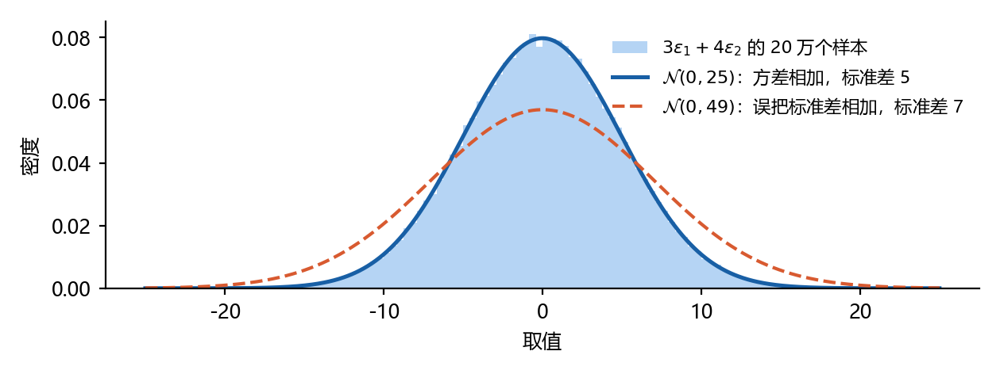
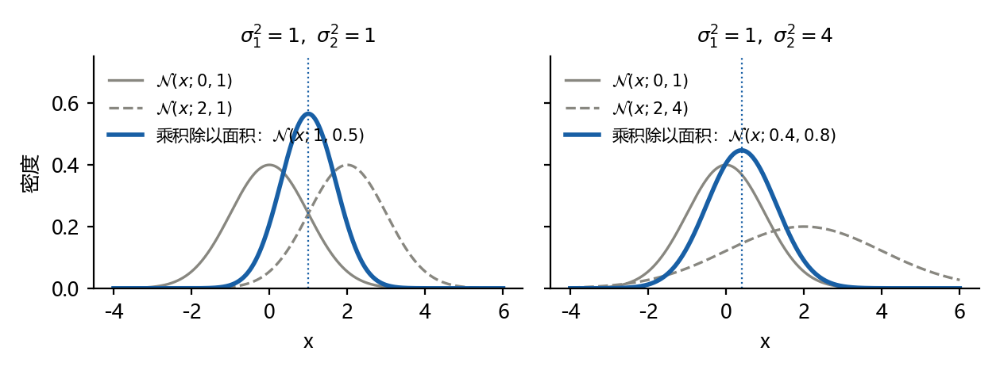
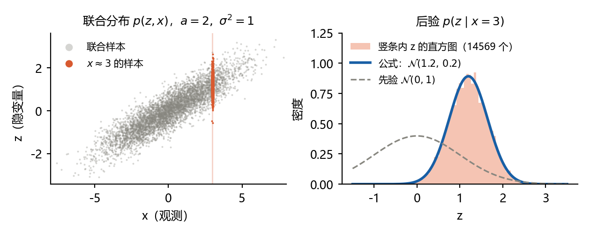
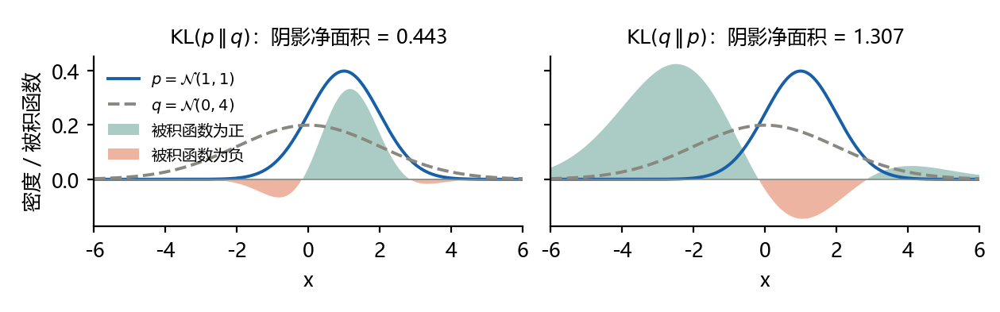

# 扩散模型推导笔记 D0–D1：高斯分布预备与 KL 散度

本文是扩散模型推导笔记的第一篇，把 D0（高斯分布预备）和 D1（两个高斯分布之间的 KL 散度）一步一步推出来。每一步都写清三件事：这一步做了什么，依据哪条规则，为什么要这样做。

读法：先读第 1 章“工具箱”，8 条规则各配一个数字例子；再按第 2 章给的顺序推 D0(c)、D0(b)、D0(a)、D1。每题最后有“重推骨架”，合上文档，只看骨架在白纸上重推一遍。第 7 章是两项配套练习：运行代码核对 D1，再用三句话总结三个基本问题。第 8 章是自测题，答案在第 9 章。

题号 D0–D14 是本系列推导题的统一编号：本篇只含 D0、D1，文中提到的 D2–D7 在后续篇目中给出。记号按 Ho et al. (2020)，log 一律指自然对数。文中的数字例子都用脚本核对过，四张图由 `code/make_figures.py` 生成。版本 1.0，2026-10-19。

## 1 工具箱：D0、D1 只用到这 8 条规则

推导卡住，多半不是想不到思路，而是某一步该用的规则一时想不起来。下面 8 条覆盖了 D0、D1 的全部步骤。正文每一步都注明用的是哪一条，例如“依据：T3”。

### T1 对数与指数的运算

**术语**：本文的 log 是以 e 为底的自然对数；$`\exp(u)`$ 就是 $`e^u`$。

**规则**

- $`\log(ab)=\log a+\log b`$，$`\log\dfrac ab=\log a-\log b`$。
- $`\log a^k=k\log a`$。所以 $`\log\sqrt a=\frac{1}{2}\log a`$，$`\log\dfrac1a=-\log a`$。
- $`\log e^u=u`$，$`e^u\cdot e^v=e^{u+v}`$。

**例子**：$`\log\dfrac{1}{\sqrt{2\pi\cdot4}}=-\frac{1}{2}\log(2\pi)-\frac{1}{2}\log4=-\frac{1}{2}\log(2\pi)-\log2`$。

**用在**：D0(b) 第 2 步，D1 第 1、2 步。

### T2 期望的线性

**术语**：期望（expectation）$`\mathbb{E}[X]`$ 是随机变量 X 的平均值。对连续型随机变量，$`\mathbb{E}[f(X)]=\int f(x)\,p(x)\,dx`$，也就是用密度 p 给每个取值加权后求和。写成 $`\mathbb{E}_p`$ 时，下标 p 表示“x 按 p 取值”。

**规则**

- 常数的期望是它自己：$`\mathbb{E}[c]=c`$。
- $`\mathbb{E}[aX+b]=a\,\mathbb{E}[X]+b`$。
- $`\mathbb{E}[X+Y]=\mathbb{E}[X]+\mathbb{E}[Y]`$。这一条不需要 X、Y 独立。

**例子**：若 $`\mathbb{E}[X]=3`$，则 $`\mathbb{E}[2X+5]=2\cdot3+5=11`$。

**用在**：D0(a)(c)，D1 第 3 步。

### T3 方差与协方差

**术语**：方差（variance）$`\operatorname{Var}(X)=\mathbb{E}\big[(X-\mathbb{E}X)^2\big]`$，衡量 X 偏离自己的平均值有多远；标准差是方差的平方根。协方差（covariance）$`\operatorname{Cov}(X,Y)=\mathbb{E}\big[(X-\mathbb{E}X)(Y-\mathbb{E}Y)\big]`$，衡量两个量是否同涨同落。

**规则**

- $`\operatorname{Var}(aX+b)=a^2\operatorname{Var}(X)`$：加常数不改变方差，乘 a 使方差乘 $`a^2`$。
- 一般情形：$`\operatorname{Var}(X+Y)=\operatorname{Var}(X)+\operatorname{Var}(Y)+2\operatorname{Cov}(X,Y)`$。
- X、Y 独立时 $`\operatorname{Cov}(X,Y)=0`$，于是 $`\operatorname{Var}(X+Y)=\operatorname{Var}(X)+\operatorname{Var}(Y)`$。

**为什么独立时交叉项为零**：记 $`u=X-\mathbb{E}X`$，$`v=Y-\mathbb{E}Y`$，则

```math
\operatorname{Var}(X+Y)=\mathbb{E}\big[(u+v)^2\big]=\mathbb{E}[u^2]+2\,\mathbb{E}[uv]+\mathbb{E}[v^2].
```

独立时 $`\mathbb{E}[uv]=\mathbb{E}[u]\,\mathbb{E}[v]=0\cdot0=0`$，只剩两个方差。

**例子**：X、Y 独立，方差都是 1，则 $`\operatorname{Var}(3X+4Y)=9+16=25`$，标准差是 5，不是 7。

**用在**：D0(a)(c)。

### T4 偏差-方差分解

**规则**：对任意常数 c，

```math
\mathbb{E}\big[(X-c)^2\big]=\operatorname{Var}(X)+(\mathbb{E}X-c)^2 .
```

**推法**：记 $`\mu=\mathbb{E}X`$，把 $`X-c`$ 拆成 $`(X-\mu)+(\mu-c)`$，平方后取期望：

```math
\mathbb{E}\big[(X-c)^2\big]=\mathbb{E}\big[(X-\mu)^2\big]+2(\mu-c)\,\mathbb{E}[X-\mu]+(\mu-c)^2 .
```

第一项按定义是方差；中间项里 $`\mathbb{E}[X-\mu]=\mu-\mu=0`$（T2）；最后一项是常数。

**怎么理解**：围绕任意一点 c 的平方偏离，等于围绕均值的方差，再加上“均值离 c 有多远”的平方。

**例子**：$`X\sim\mathcal{N}(1,1)`$，取 $`c=0`$：$`\mathbb{E}[X^2]=1+1^2=2`$。

**用在**：D1 第 3 步，这是 D1 唯一的技巧。

### T5 高斯分布的三条规则

**术语**：高斯分布（Gaussian distribution）记作 $`\mathcal{N}(\mu,\sigma^2)`$，第一个参数是均值，第二个参数是方差，不是标准差。它的密度是

```math
\mathcal{N}(x;\mu,\sigma^2)=\frac{1}{\sqrt{2\pi\sigma^2}}\exp\Big(-\frac{(x-\mu)^2}{2\sigma^2}\Big).
```

$`x\sim\mathcal{N}(\mu,\sigma^2)`$ 读作“x 服从这个高斯”；$`\mathcal{N}(x;\mu,\sigma^2)`$ 指这条钟形曲线在 x 处的高度。两种写法说的是同一个分布。

**规则**

- 规则 A，由均值和方差确定：两个高斯分布只要均值相同、方差也相同，就是同一个分布。所以要判断“是哪个高斯”，只需算均值和方差。
- 规则 B，独立高斯的线性组合仍是高斯：X、Y 是相互独立的高斯，则 $`aX+bY+c`$ 仍是高斯。没有独立这个条件，结论可能不成立。
- 规则 C，标准化：$`x\sim\mathcal{N}(\mu,\sigma^2)`$ 等价于 $`x=\mu+\sigma\varepsilon`$，其中 $`\varepsilon\sim\mathcal{N}(0,1)`$。

**例子**：$`\varepsilon\sim\mathcal{N}(0,1)`$，则 $`2+3\varepsilon\sim\mathcal{N}(2,9)`$：均值是 2，方差是 $`3^2\cdot1=9`$（T3）。

**用在**：D0(a)(c)。

### T6 配方法与高斯识别模板

**术语**：配方法（completing the square）把“二次项 + 一次项”凑成“一个完全平方 + 一个常数”。

**规则**：当 $`A\gt 0`$ 时，

```math
-\frac{1}{2}Ax^2+Bx=-\frac{1}{2}A\Big(x-\frac BA\Big)^2+\frac{B^2}{2A}.
```

**验证**：把右边的平方展开，

```math
-\frac{1}{2}A\Big(x^2-\frac{2B}{A}x+\frac{B^2}{A^2}\Big)+\frac{B^2}{2A}=-\frac{1}{2}Ax^2+Bx-\frac{B^2}{2A}+\frac{B^2}{2A}=-\frac{1}{2}Ax^2+Bx .
```

**高斯识别模板**：如果某个密度取对数后具有形式

```math
\log p(x)=-\frac{1}{2}Ax^2+Bx+\text{常数},\qquad A\gt 0,
```

那么 p 就是高斯，并且

```math
\sigma^2=\frac1A,\qquad \mu=\frac BA .
```

原因：配方后 $`\log p(x)=-\dfrac{(x-B/A)^2}{2\cdot(1/A)}+\text{常数}`$，与高斯的对数密度 $`-\dfrac{(x-\mu)^2}{2\sigma^2}+\text{常数}`$ 逐项对比即得。这里的 A 叫精度（precision），是方差的倒数。

**怎么记**：$`x^2`$ 前面的系数去掉 $`-\frac{1}{2}`$，就是精度；方差是精度的倒数；均值等于 x 的系数除以精度。

**例子**：$`\log p(x)=-x^2+4x+\text{常数}`$。对比得 $`-\frac{1}{2}A=-1`$，所以 $`A=2`$；$`B=4`$。于是 $`p=\mathcal{N}(2,\frac{1}{2})`$。

**用在**：D0(a)(b)，以后的 D5。

### T7 正比于与归一化常数

**术语**：$`f(x)\propto g(x)`$ 读作“f 正比于 g”，意思是 $`f(x)=C\cdot g(x)`$，C 是不含 x 的常数。归一化常数（normalizing constant）是让密度的积分等于 1 的那个常数。

**规则**：密度的积分必须等于 1，所以只要知道一个密度“随 x 怎么变”，前面的常数就被唯一确定了。推导时可以把所有不含变量的因子都丢进常数，最后用 T6 的模板认出是哪个分布。取对数以后，“乘一个常数”变成“加一个常数”，所以对数式子里写“+ 常数”。

**例子**：$`e^{-(x-1)^2}\propto\mathcal{N}(x;1,\frac{1}{2})`$。因为 $`\mathcal{N}(x;1,\frac{1}{2})=\dfrac{1}{\sqrt\pi}\,e^{-(x-1)^2}`$，两者只差常数 $`\dfrac{1}{\sqrt\pi}`$。

**用在**：D0(a)(b)。D1 不能这样做：KL 要的是一个具体数值，常数必须保留。

### T8 贝叶斯公式

**术语**：条件分布 $`p(z\mid x)`$ 是“已知 x 之后 z 的分布”。

**规则**

```math
p(z\mid x)=\frac{p(x\mid z)\,p(z)}{p(x)} .
```

把 x 当作已知数、z 当作变量时，分母 $`p(x)`$ 不含 z，是常数，所以

```math
p(z\mid x)\propto p(x\mid z)\,p(z).
```

**用在**：D0(a) 的后验，以后的 D5。

## 2 推导顺序与两个通用套路

| 题目 | 要做什么 | 用到的规则 | 建议顺序 |
|---|---|---|---|
| D0(c) 噪声合并 | 证明两个随机变量同分布 | T2、T3、T5 | 1 |
| D0(b) 两个高斯密度相乘 | 把乘积认成一个高斯 | T1、T6、T7 | 2 |
| D0(a) 线性高斯模型 | 求边缘分布和后验分布 | T2、T3、T5、T6、T7、T8 | 3 |
| D1 两个高斯的 KL 散度 | 把一个期望算成闭式 | T1、T2、T3、T4 | 4 |

D0 的三个小题按 (c)、(b)、(a) 的顺序最顺：(c) 只需算均值和方差；(b) 引入配方法；(a) 的边缘分布就是 (c) 的做法，后验就是 (b) 的做法。D1 不依赖 D0，但要用到 T4。

D0 的每一步都属于下面两个套路之一。以后推 D4、D5，用的还是这两个套路。

**套路一：算矩**。术语：矩（moment）指均值、方差这类由期望定义的量。这个套路用于说明某个随机变量是哪个高斯：

1. 说明它是高斯（T5 规则 B 或 C）。
2. 算均值（T2）。
3. 算方差（T3）。
4. 用 T5 规则 A 下结论。

**套路二：配方**。这个套路用于从几个密度的乘积里认出一个高斯：

1. 写成“正比于”的形式，只关心变量（T7、T8）。
2. 取对数，乘法变加法（T1）。
3. 展开平方，把不含变量的项丢进常数。
4. 收集二次项系数和一次项系数。
5. 套 T6 的模板，读出方差和均值。

## 3 D0(c) 噪声合并

**题目**：$`\varepsilon_1,\varepsilon_2\sim\mathcal{N}(0,1)`$ 相互独立，a、b 是常数。证明 $`a\varepsilon_1+b\varepsilon_2`$ 与 $`\sqrt{a^2+b^2}\,\varepsilon`$ 同分布，其中 $`\varepsilon\sim\mathcal{N}(0,1)`$。

**先看懂题目**：同分布（equal in distribution）指两个随机变量取各种值的概率规律完全一样，记作 $`\overset{d}{=}`$。两边不必是同一个数，只要分布一样。

**思路**：两边都会是高斯，所以用套路一：先说明是高斯，再比较均值和方差。

**第 1 步　说明左边是高斯**

$`a\varepsilon_1+b\varepsilon_2`$ 是两个相互独立的高斯的线性组合，所以是高斯。

依据：T5 规则 B。为什么先做这一步：规则 A 只对高斯成立；不先确认是高斯，算出均值和方差也不能下结论。

**第 2 步　算左边的均值**

```math
\mathbb{E}[a\varepsilon_1+b\varepsilon_2]=a\,\mathbb{E}[\varepsilon_1]+b\,\mathbb{E}[\varepsilon_2]=a\cdot0+b\cdot0=0 .
```

依据：T2。

**第 3 步　算左边的方差**

```math
\operatorname{Var}(a\varepsilon_1+b\varepsilon_2)=\operatorname{Var}(a\varepsilon_1)+\operatorname{Var}(b\varepsilon_2)=a^2\cdot1+b^2\cdot1=a^2+b^2 .
```

依据：第一个等号用 T3 的独立规则，$`\varepsilon_1,\varepsilon_2`$ 独立，协方差为 0；第二个等号用 T3 的 $`\operatorname{Var}(aX)=a^2\operatorname{Var}(X)`$，再代入 $`\operatorname{Var}(\varepsilon_1)=\operatorname{Var}(\varepsilon_2)=1`$。为什么是 $`a^2`$ 而不是 a：方差是“偏离的平方”的平均，一个量乘以 a，它的偏离的平方就乘以 $`a^2`$。

**第 4 步　算右边的均值和方差**

右边是常数 $`\sqrt{a^2+b^2}`$ 乘标准高斯 ε，仍是高斯（T5 规则 C）。均值是 $`\sqrt{a^2+b^2}\cdot0=0`$，方差是 $`\big(\sqrt{a^2+b^2}\big)^2\cdot1=a^2+b^2`$（T3）。

**第 5 步　下结论**

两边都是高斯，均值都是 0，方差都是 $`a^2+b^2`$。由 T5 规则 A，二者同分布：

```math
a\varepsilon_1+b\varepsilon_2\ \overset{d}{=}\ \sqrt{a^2+b^2}\,\varepsilon\ \sim\ \mathcal{N}\big(0,\ a^2+b^2\big).
```

**向量版本**：当 $`\varepsilon_1,\varepsilon_2\sim\mathcal{N}(0,I)`$ 是 d 维向量时，$`\mathcal{N}(0,I)`$ 的意思是每个坐标都是独立的 $`\mathcal{N}(0,1)`$。对每个坐标重复上面五步，每个坐标都是 $`\mathcal{N}(0,a^2+b^2)`$，且不同坐标仍相互独立，所以结果是 $`\mathcal{N}\big(0,(a^2+b^2)I\big)`$。

**数字检查**：取 $`a=3`$，$`b=4`$。$`3\varepsilon_1+4\varepsilon_2\sim\mathcal{N}(0,25)`$，标准差是 5，可以写成 $`5\varepsilon`$。图 1 是 20 万个样本的直方图：它和标准差 5 的曲线重合，和“把标准差相加”得到的 7 对不上。



**它在扩散模型里的用处**：D4 推前向过程的闭式时，要把 $`\sqrt{\alpha_t(1-\bar\alpha_{t-1})}\,\varepsilon'`$ 和 $`\sqrt{\beta_t}\,\varepsilon_t`$ 合成一个噪声。这时 $`a^2+b^2`$ 是

```math
\alpha_t(1-\bar\alpha_{t-1})+\beta_t=\alpha_t-\bar\alpha_t+1-\alpha_t=1-\bar\alpha_t ,
```

用到了 $`\alpha_t\bar\alpha_{t-1}=\bar\alpha_t`$ 和 $`\beta_t=1-\alpha_t`$。合成的噪声就是 $`\sqrt{1-\bar\alpha_t}\,\varepsilon`$，这正是 D4 的结论。

**常见卡点**

- 把标准差相加：$`3+4=7`$ 是错的，相加的是方差 $`9+16=25`$。
- 忘了独立条件：若 $`\varepsilon_1,\varepsilon_2`$ 相关，方差要多出 $`2ab\operatorname{Cov}(\varepsilon_1,\varepsilon_2)`$。
- 把 $`\mathcal{N}(0,25)`$ 里的 25 当成标准差：第二个参数是方差。

**重推骨架**

1. “同分布”要比较哪两个量？为什么只比较它们就够？
2. 左边为什么是高斯？
3. 左边的均值是多少？用了哪条规则？
4. 左边的方差是多少？哪一步用到了独立？
5. 右边的均值和方差各是多少？

## 4 D0(b) 两个高斯密度相乘

**题目**：证明 $`\mathcal{N}(x;\mu_1,\sigma_1^2)\,\mathcal{N}(x;\mu_2,\sigma_2^2)\propto\mathcal{N}(x;\mu,\sigma^2)`$，并求 $`\mu`$ 和 $`\sigma^2`$。

**先看懂题目**：这里相乘的是两条密度曲线在同一个 x 处的高度，结果仍是 x 的函数。它不是“两个高斯随机变量相乘”。两条曲线相乘后，曲线下面积一般不等于 1，所以题目用 $`\propto`$：乘积的形状是一个高斯，只差一个常数倍。

这一题会反复出现：贝叶斯公式里的“似然 × 先验”就是两个密度相乘。D0(a) 的后验和 D5 的前向后验都是这个结构。

**思路**：套路二，配方。取对数，只留含 x 的项，整理成 $`-\frac{1}{2}Ax^2+Bx`$，再套 T6 的模板。

**第 1 步　写出两个密度**

```math
\mathcal{N}(x;\mu_1,\sigma_1^2)=\frac{1}{\sqrt{2\pi\sigma_1^2}}\exp\Big(-\frac{(x-\mu_1)^2}{2\sigma_1^2}\Big),\qquad \mathcal{N}(x;\mu_2,\sigma_2^2)=\frac{1}{\sqrt{2\pi\sigma_2^2}}\exp\Big(-\frac{(x-\mu_2)^2}{2\sigma_2^2}\Big).
```

依据：T5 的密度公式。

**第 2 步　相乘，再取对数**

两个系数 $`\dfrac{1}{\sqrt{2\pi\sigma_1^2}}`$、$`\dfrac{1}{\sqrt{2\pi\sigma_2^2}}`$ 都不含 x，合成一个常数；两个 exp 相乘，指数相加（T1）。取对数后：

```math
\log\Big[\mathcal{N}(x;\mu_1,\sigma_1^2)\,\mathcal{N}(x;\mu_2,\sigma_2^2)\Big]=-\frac{(x-\mu_1)^2}{2\sigma_1^2}-\frac{(x-\mu_2)^2}{2\sigma_2^2}+\text{常数}.
```

为什么要取对数：乘积变成加法，exp 消失，剩下的是 x 的二次式，容易整理。

**第 3 步　展开平方，丢掉不含 x 的项**

$`(x-\mu_1)^2=x^2-2\mu_1x+\mu_1^2`$，所以

```math
-\frac{(x-\mu_1)^2}{2\sigma_1^2}=-\frac{1}{2\sigma_1^2}x^2+\frac{\mu_1}{\sigma_1^2}x-\frac{\mu_1^2}{2\sigma_1^2}.
```

最后一项不含 x，丢进常数（T7）。第二项同样处理。注意一次项的符号：$`-\dfrac{1}{2\sigma_1^2}\cdot(-2\mu_1x)=+\dfrac{\mu_1}{\sigma_1^2}x`$。

**第 4 步　按 x 的次数合并**

```math
\log[\cdots]=-\frac12\Big(\frac1{\sigma_1^2}+\frac1{\sigma_2^2}\Big)x^2+\Big(\frac{\mu_1}{\sigma_1^2}+\frac{\mu_2}{\sigma_2^2}\Big)x+\text{常数}.
```

这一步只是把两项的 $`x^2`$ 系数相加、x 的系数相加。

**第 5 步　套模板**

与 T6 的 $`-\frac{1}{2}Ax^2+Bx`$ 对比：

```math
A=\frac1{\sigma_1^2}+\frac1{\sigma_2^2},\qquad B=\frac{\mu_1}{\sigma_1^2}+\frac{\mu_2}{\sigma_2^2}.
```

$`A\gt 0`$，所以乘积正比于一个高斯，并且

```math
\frac1{\sigma^2}=\frac1{\sigma_1^2}+\frac1{\sigma_2^2},\qquad \mu=\sigma^2\Big(\frac{\mu_1}{\sigma_1^2}+\frac{\mu_2}{\sigma_2^2}\Big).
```

**第 6 步（可选）　化成不含倒数的形式**

第一式通分：$`\dfrac1{\sigma^2}=\dfrac{\sigma_1^2+\sigma_2^2}{\sigma_1^2\sigma_2^2}`$，所以 $`\sigma^2=\dfrac{\sigma_1^2\sigma_2^2}{\sigma_1^2+\sigma_2^2}`$。再把括号通分：$`\dfrac{\mu_1}{\sigma_1^2}+\dfrac{\mu_2}{\sigma_2^2}=\dfrac{\mu_1\sigma_2^2+\mu_2\sigma_1^2}{\sigma_1^2\sigma_2^2}`$。代入第二式：

```math
\mu=\frac{\sigma_1^2\sigma_2^2}{\sigma_1^2+\sigma_2^2}\cdot\frac{\mu_1\sigma_2^2+\mu_2\sigma_1^2}{\sigma_1^2\sigma_2^2}=\frac{\sigma_2^2\,\mu_1+\sigma_1^2\,\mu_2}{\sigma_1^2+\sigma_2^2}.
```

**怎么记**：精度相加，均值按精度加权平均。

- 精度相加：乘积的精度比两个因子的精度都大，所以 $`\sigma^2`$ 比 $`\sigma_1^2`$、$`\sigma_2^2`$ 都小，曲线更窄。
- 按精度加权：$`\mu=w_1\mu_1+w_2\mu_2`$，其中 $`w_1=\dfrac{1/\sigma_1^2}{A}`$，$`w_2=\dfrac{1/\sigma_2^2}{A}`$。两个权重都为正、和为 1，所以 μ 落在 $`\mu_1`$ 和 $`\mu_2`$ 之间，并且靠近方差小、更“确定”的那一个。

**数字检查**

- $`\mathcal{N}(x;0,1)\cdot\mathcal{N}(x;2,1)`$：$`A=2`$，$`B=2`$，乘积 $`\propto\mathcal{N}(x;1,0.5)`$，正好在中间，方差减半。
- $`\mathcal{N}(x;0,1)\cdot\mathcal{N}(x;2,4)`$：$`A=1+\frac{1}{4}=1.25`$，$`B=0+\frac{2}{4}=0.5`$，乘积 $`\propto\mathcal{N}(x;0.4,0.8)`$，偏向方差小的 $`\mathcal{N}(x;0,1)`$。

图 2 是这两个例子。蓝线是把乘积除以它自身的面积后得到的曲线，和公式给出的高斯重合。



**常见卡点**

- 把 $`\propto`$ 当成 $`=`$：乘积的面积不是 1，两边差一个常数。
- 展开平方漏掉 2：$`(x-\mu)^2`$ 的一次项是 $`-2\mu x`$。
- 提出 $`-\frac{1}{2}`$ 后符号出错：一次项系数 B 是正的 $`\mu_1/\sigma_1^2+\mu_2/\sigma_2^2`$。
- 混淆方差和精度：模板里的 A 是精度，方差是 $`1/A`$。

**重推骨架**

1. 为什么可以只写“+ 常数”？
2. 取对数后得到什么式子？
3. 展开平方后，哪些项丢进常数？
4. $`x^2`$ 的系数和 x 的系数分别是什么？
5. 模板给出的 $`\sigma^2`$ 和 $`\mu`$ 是什么？

## 5 D0(a) 线性高斯模型

**题目**：$`z\sim\mathcal{N}(0,I)`$，$`x\mid z\sim\mathcal{N}(Az,\sigma^2I)`$。求 x 的边缘分布，以及 z 的后验分布 $`p(z\mid x)`$。

本章先做一维版本：z、x 都是数，矩阵 A 换成数 a。把每一步弄懂以后，5.4 节再把同样的步骤换成向量和矩阵。

**先看懂题目**

- 线性高斯模型（linear Gaussian model）：先抽一个隐变量 z，乘以 a，再加上高斯噪声，得到观测 x。$`x\mid z\sim\mathcal{N}(az,\sigma^2)`$ 的意思是“知道 z 以后，x 是以 az 为中心、方差为 $`\sigma^2`$ 的高斯”。
- 用 T5 规则 C 把它改写成生成过程：$`x=az+\sigma\varepsilon`$，其中 $`z,\varepsilon\sim\mathcal{N}(0,1)`$ 相互独立。
- 边缘分布（marginal distribution）$`p(x)`$：不知道 z 时，x 本身的分布。
- 先验（prior）$`p(z)`$：看到 x 之前对 z 的判断。后验（posterior）$`p(z\mid x)`$：看到 x 之后对 z 的判断。
- 这个模型是 VAE 解码器最简单的形式，也和扩散模型“加一步噪声”的写法相同，所以值得吃透。

### 5.1 边缘分布：套路一

**第 1 步　写成生成过程**：$`x=az+\sigma\varepsilon`$（T5 规则 C）。

**第 2 步　x 是高斯**：它是两个独立高斯 z、ε 的线性组合（T5 规则 B）。

**第 3 步　均值**：$`\mathbb{E}[x]=a\,\mathbb{E}[z]+\sigma\,\mathbb{E}[\varepsilon]=0`$（T2）。

**第 4 步　方差**：$`\operatorname{Var}(x)=a^2\operatorname{Var}(z)+\sigma^2\operatorname{Var}(\varepsilon)=a^2+\sigma^2`$（T3，z 与 ε 独立）。

**结论**：

```math
x\sim\mathcal{N}\big(0,\ a^2+\sigma^2\big).
```

这和 D0(c) 是同一个套路：D0(c) 中 $`a\varepsilon_1+b\varepsilon_2`$ 的方差是 $`a^2+b^2`$，这里只是把 b 换成了 σ。

### 5.2 后验分布：套路二

**思路**：后验正比于“似然 × 先验”，是两个关于 z 的高斯相乘，做法和 D0(b) 一样。术语：似然（likelihood）指把 $`p(x\mid z)`$ 看成 z 的函数。

**第 1 步　贝叶斯公式**

```math
p(z\mid x)\propto p(x\mid z)\,p(z).
```

依据：T8，分母 $`p(x)`$ 不含 z。

**第 2 步　写出两个对数**

```math
\log p(x\mid z)=-\frac{(x-az)^2}{2\sigma^2}+\text{常数},\qquad \log p(z)=-\frac{z^2}{2}+\text{常数}.
```

依据：对 T5 的密度公式取对数（T1），系数部分进常数（T7）。

**第 3 步　相加**

```math
\log p(z\mid x)=-\frac{(x-az)^2}{2\sigma^2}-\frac{z^2}{2}+\text{常数}.
```

**第 4 步　展开，分清谁是变量**

$`(x-az)^2=x^2-2axz+a^2z^2`$。在后验里，x 是已经看到的数，z 才是变量，所以 $`x^2`$ 这一项不含 z，进常数：

```math
-\frac{(x-az)^2}{2\sigma^2}=-\frac{a^2}{2\sigma^2}z^2+\frac{ax}{\sigma^2}z+\text{常数}.
```

这是最容易卡住的地方：在后验里，x 的地位和 D0(b) 里的 $`\mu_1`$、$`\sigma_1`$ 一样，都是常数。

**第 5 步　合并 z 的二次项和一次项**

```math
\log p(z\mid x)=-\frac12\Big(1+\frac{a^2}{\sigma^2}\Big)z^2+\frac{ax}{\sigma^2}\,z+\text{常数}.
```

$`z^2`$ 的系数里，1 来自先验，$`a^2/\sigma^2`$ 来自似然。

**第 6 步　套 T6 的模板**

$`A=1+\dfrac{a^2}{\sigma^2}=\dfrac{\sigma^2+a^2}{\sigma^2}`$，$`B=\dfrac{ax}{\sigma^2}`$，所以

```math
\operatorname{Var}(z\mid x)=\frac1A=\frac{\sigma^2}{\sigma^2+a^2},\qquad \mathbb{E}[z\mid x]=\frac BA=\frac{ax}{\sigma^2}\cdot\frac{\sigma^2}{\sigma^2+a^2}=\frac{ax}{\sigma^2+a^2}.
```

即

```math
p(z\mid x)=\mathcal{N}\Big(z;\ \frac{ax}{\sigma^2+a^2},\ \frac{\sigma^2}{\sigma^2+a^2}\Big).
```

**第 7 步　用极端情况检查**

- 噪声很小，$`\sigma\to0`$：$`\mathbb{E}[z\mid x]\to x/a`$，方差趋于 0。没有噪声时，看到 x 就能精确反推 z。
- $`a=0`$：x 里没有 z 的任何信息，后验均值 0、方差 1，退回先验 $`\mathcal{N}(0,1)`$。
- 后验方差 $`\dfrac{\sigma^2}{\sigma^2+a^2}\lt 1`$：看到数据以后，对 z 的不确定性变小了。

### 5.3 另一种方法：联合高斯的条件公式

这一节用来核对 5.2，可以第二遍再读。

术语：联合高斯（jointly Gaussian）指 (z, x) 作为一个整体服从二维高斯。这里 z 和 x 都是独立高斯 z、ε 的线性组合，所以是联合高斯。对联合高斯，有一维条件公式（见 Bishop, 2006, 第 2.3.1 节）：

```math
\mathbb{E}[z\mid x]=\mathbb{E}[z]+\frac{\operatorname{Cov}(z,x)}{\operatorname{Var}(x)}\big(x-\mathbb{E}[x]\big),\qquad \operatorname{Var}(z\mid x)=\operatorname{Var}(z)-\frac{\operatorname{Cov}(z,x)^2}{\operatorname{Var}(x)}.
```

需要的量：$`\operatorname{Var}(x)=a^2+\sigma^2`$（5.1 节）；$`\operatorname{Cov}(z,x)=\mathbb{E}[z\,(az+\sigma\varepsilon)]=a\,\mathbb{E}[z^2]+\sigma\,\mathbb{E}[z\varepsilon]=a\cdot1+\sigma\cdot0=a`$。这里用了 z、x 的均值都是 0，所以协方差就是 $`\mathbb{E}[zx]`$；$`\mathbb{E}[z\varepsilon]=\mathbb{E}[z]\,\mathbb{E}[\varepsilon]=0`$ 来自独立。

代入：

```math
\mathbb{E}[z\mid x]=\frac{a}{a^2+\sigma^2}\,x,\qquad \operatorname{Var}(z\mid x)=1-\frac{a^2}{a^2+\sigma^2}=\frac{\sigma^2}{a^2+\sigma^2}.
```

与 5.2 的结果相同。两条独立的路得到同一个答案，说明推导没有错。

**数字检查**：取 $`a=2`$，$`\sigma^2=1`$，观测到 $`x=3`$。边缘分布是 $`\mathcal{N}(0,5)`$；后验均值 $`\dfrac{2\times3}{1+4}=1.2`$，后验方差 $`\dfrac15=0.2`$。图 3 左边是 (x, z) 的联合样本，竖条是 $`x\approx3`$ 的样本；右边是竖条里 z 的直方图，它和公式给出的 $`\mathcal{N}(1.2,0.2)`$ 重合。可以这样理解后验：在联合分布上，沿 $`x=3`$ 切一刀。



### 5.4 矩阵版本

这一节第二遍再看。设 $`z\in\mathbb{R}^n`$，$`x\in\mathbb{R}^m`$，A 是 $`m\times n`$ 矩阵。步骤和一维完全相同，只是把数的运算换成矩阵运算。需要三条矩阵规则：

- 转置：$`(AB)^\top=B^\top A^\top`$；向量长度的平方 $`\Vert v\Vert^2=v^\top v`$。
- 协方差的线性变换：$`\operatorname{Cov}(Az)=A\operatorname{Cov}(z)A^\top`$。这是 $`\operatorname{Var}(aX)=a^2\operatorname{Var}(X)`$ 的矩阵版本。
- 向量配方模板：Λ 对称且可逆时，若 $`\log p(z)=-\frac{1}{2}z^\top\Lambda z+b^\top z+\text{常数}`$，则 $`p=\mathcal{N}(\Lambda^{-1}b,\ \Lambda^{-1})`$。这是 T6 的矩阵版本，Λ 叫精度矩阵。

一维与矩阵逐项对照：

| 一维 | 矩阵 |
|---|---|
| $`x=az+\sigma\varepsilon`$ | $`x=Az+\sigma\varepsilon`$ |
| $`\operatorname{Var}(x)=a^2+\sigma^2`$ | $`\operatorname{Cov}(x)=AA^\top+\sigma^2I`$ |
| $`(x-az)^2`$ 展开 | $`\Vert x-Az\Vert^2=x^\top x-2x^\top Az+z^\top A^\top Az`$ |
| 精度 $`1+a^2/\sigma^2`$ | 精度矩阵 $`\Lambda=I+A^\top A/\sigma^2`$ |
| 一次项系数 $`ax/\sigma^2`$ | $`b=A^\top x/\sigma^2`$ |
| 后验均值 $`B/A`$ | $`\Lambda^{-1}A^\top x/\sigma^2`$ |
| 后验方差 $`1/A`$ | 后验协方差 $`\Lambda^{-1}`$ |

结论：

```math
x\sim\mathcal{N}\big(0,\ AA^\top+\sigma^2I\big),\qquad z\mid x\sim\mathcal{N}\Big(\Lambda^{-1}\frac{A^\top x}{\sigma^2},\ \Lambda^{-1}\Big),\qquad \Lambda=I+\frac{A^\top A}{\sigma^2}.
```

后验均值的另一种常见写法是 $`A^\top(AA^\top+\sigma^2I)^{-1}x`$。两种写法相等，证明只要一行：

```math
A^\top(AA^\top+\sigma^2I)=A^\top AA^\top+\sigma^2A^\top=(A^\top A+\sigma^2I)A^\top .
```

两边左乘 $`(A^\top A+\sigma^2I)^{-1}`$、右乘 $`(AA^\top+\sigma^2I)^{-1}`$，得到 $`(A^\top A+\sigma^2I)^{-1}A^\top=A^\top(AA^\top+\sigma^2I)^{-1}`$。而 $`\Lambda^{-1}/\sigma^2=(\sigma^2\Lambda)^{-1}=(\sigma^2I+A^\top A)^{-1}`$，所以 $`\Lambda^{-1}A^\top x/\sigma^2=A^\top(AA^\top+\sigma^2I)^{-1}x`$。两种协方差写法也相等，依据是 Woodbury 恒等式，这里不展开，已用随机矩阵数值核对。

**常见卡点**

- 后验里把 x 当变量：x 已经观测到，是常数，$`x^2`$ 那一项进常数。
- 边缘分布忘了 z 本身的方差：$`\operatorname{Var}(az)=a^2\operatorname{Var}(z)=a^2`$。
- 矩阵版本的乘法顺序：$`A^\top A`$ 是 $`n\times n`$，$`AA^\top`$ 是 $`m\times m`$，不能互换。

**重推骨架**

1. 把 $`x\mid z\sim\mathcal{N}(az,\sigma^2)`$ 改写成生成过程。
2. 边缘分布：为什么是高斯？均值和方差各是多少？
3. 后验：写出贝叶斯公式的“正比于”形式。
4. 两个对数相加后展开，哪一项进常数？为什么？
5. $`z^2`$ 的系数和 z 的系数是什么？套模板。
6. 用 $`\sigma\to0`$ 和 $`a=0`$ 检查结果。

## 6 D1 两个对角高斯之间的 KL 散度

**术语**：KL 散度（Kullback–Leibler divergence）衡量分布 q 与分布 p 的差别：

```math
\mathrm{KL}(p\,\Vert\,q)=\mathbb{E}_{x\sim p}\big[\log p(x)-\log q(x)\big]=\int p(x)\log\frac{p(x)}{q(x)}\,dx .
```

它有三条性质：$`\mathrm{KL}\ge0`$；p 与 q 完全相同时等于 0；一般 $`\mathrm{KL}(p\Vert q)\ne\mathrm{KL}(q\Vert p)`$，即不对称。期望是按 p 取的，也就是“x 从 p 里抽”。

为什么要会它：VAE 损失里的 KL 项（D3），以及 DDPM 损失的每一项 $`L_{t-1}`$（D7），都是两个高斯之间的 KL。

**题目**

- (a) 一维：$`p=\mathcal{N}(\mu_1,\sigma_1^2)`$，$`q=\mathcal{N}(\mu_2,\sigma_2^2)`$，证明 $`\mathrm{KL}(p\Vert q)=\log\dfrac{\sigma_2}{\sigma_1}+\dfrac{\sigma_1^2+(\mu_1-\mu_2)^2}{2\sigma_2^2}-\dfrac12`$。
- (b) d 维对角高斯：KL 等于各维的 (a) 相加。
- (c) 两个特例：方差相同；q 是标准高斯。

**思路**：KL 是“两个对数密度之差”的期望。高斯的对数密度是 x 的二次式，二次式在高斯下的期望可以用 T3、T4 直接算出，于是得到闭式。

### 6.1 一维情形 (a)

**第 1 步　写出两个对数密度**

```math
\log p(x)=-\frac12\log(2\pi\sigma_1^2)-\frac{(x-\mu_1)^2}{2\sigma_1^2},\qquad \log q(x)=-\frac12\log(2\pi\sigma_2^2)-\frac{(x-\mu_2)^2}{2\sigma_2^2}.
```

依据：对 T5 的密度公式取对数。系数 $`\dfrac{1}{\sqrt{2\pi\sigma^2}}`$ 的对数是 $`-\frac{1}{2}\log(2\pi\sigma^2)`$，exp 的对数是指数本身（T1）。注意：这里不能把常数丢掉，因为 KL 要的是具体数值，不是“正比于”。

**第 2 步　相减，化简常数**

```math
\log p(x)-\log q(x)=\frac12\log\frac{2\pi\sigma_2^2}{2\pi\sigma_1^2}-\frac{(x-\mu_1)^2}{2\sigma_1^2}+\frac{(x-\mu_2)^2}{2\sigma_2^2}.
```

2π 约掉；再用 T1 的 $`\frac{1}{2}\log a^2=\log a`$，得 $`\frac{1}{2}\log\dfrac{\sigma_2^2}{\sigma_1^2}=\log\dfrac{\sigma_2}{\sigma_1}`$。于是

```math
\log p(x)-\log q(x)=\log\frac{\sigma_2}{\sigma_1}-\frac{(x-\mu_1)^2}{2\sigma_1^2}+\frac{(x-\mu_2)^2}{2\sigma_2^2}.
```

注意第三项前面是加号：它来自“减去 $`\log q`$”，而 $`\log q`$ 里这一项本来带负号。

**第 3 步　逐项取期望，x 服从 p**

由 T2，期望可以逐项算。

- 常数项：$`\mathbb{E}_p\Big[\log\dfrac{\sigma_2}{\sigma_1}\Big]=\log\dfrac{\sigma_2}{\sigma_1}`$。
- 第二项：在 p 下，x 的均值正是 $`\mu_1`$，所以 $`\mathbb{E}_p\big[(x-\mu_1)^2\big]`$ 就是 p 的方差 $`\sigma_1^2`$（T3 的定义）。这一项的期望是 $`-\dfrac{\sigma_1^2}{2\sigma_1^2}=-\dfrac12`$。
- 第三项：平方的中心是 $`\mu_2`$，不是 p 的均值，所以要用 T4，取 $`c=\mu_2`$：$`\mathbb{E}_p\big[(x-\mu_2)^2\big]=\sigma_1^2+(\mu_1-\mu_2)^2`$。这一项的期望是 $`\dfrac{\sigma_1^2+(\mu_1-\mu_2)^2}{2\sigma_2^2}`$。

**第 4 步　合起来**

```math
\mathrm{KL}(p\Vert q)=\log\frac{\sigma_2}{\sigma_1}+\frac{\sigma_1^2+(\mu_1-\mu_2)^2}{2\sigma_2^2}-\frac12 .
```

**第 5 步　检查**

- p 与 q 相同：$`\log1+\dfrac{\sigma^2}{2\sigma^2}-\dfrac12=0`$。
- 数字：$`p=\mathcal{N}(1,1)`$，$`q=\mathcal{N}(0,4)`$，即 $`\sigma_2=2`$。$`\mathrm{KL}(p\Vert q)=\log2+\dfrac{1+1}{8}-\dfrac12=0.6931+0.25-0.5=0.4431`$。反过来 $`\mathrm{KL}(q\Vert p)=\log\dfrac12+\dfrac{4+1}{2}-\dfrac12=1.3069`$。两者不相等，这就是不对称。
- 图 4 把 KL 画成面积：$`\mathrm{KL}(p\Vert q)`$ 是曲线 $`p(x)\log\dfrac{p(x)}{q(x)}`$ 下的净面积。被积函数有负的部分，但净面积总是大于等于 0。



### 6.2 d 维对角高斯 (b)

**术语**：对角高斯指协方差矩阵是对角阵，等价于各个坐标相互独立。记 p 的第 j 维为 $`\mathcal{N}(\mu_{1j},\sigma_{1j}^2)`$，q 的第 j 维为 $`\mathcal{N}(\mu_{2j},\sigma_{2j}^2)`$。

**第 1 步　密度拆成乘积**：坐标独立，所以 $`p(x)=\prod_{j=1}^d\mathcal{N}(x_j;\mu_{1j},\sigma_{1j}^2)`$，q 同理。

**第 2 步　对数变求和**（T1）：

```math
\log p(x)-\log q(x)=\sum_{j=1}^d\Big[\log p_j(x_j)-\log q_j(x_j)\Big].
```

**第 3 步　逐项取期望**（T2）：第 j 项只含 $`x_j`$，而在 p 下 $`x_j\sim\mathcal{N}(\mu_{1j},\sigma_{1j}^2)`$，所以第 j 项的期望正是一维 KL。

**结论**：

```math
\mathrm{KL}(p\Vert q)=\sum_{j=1}^d\Big[\log\frac{\sigma_{2j}}{\sigma_{1j}}+\frac{\sigma_{1j}^2+(\mu_{1j}-\mu_{2j})^2}{2\sigma_{2j}^2}-\frac12\Big].
```

### 6.3 两个特例 (c)

**特例一：方差相同**。每一维都有 $`\sigma_{1j}=\sigma_{2j}=\sigma`$。代入一维公式：$`\log\dfrac\sigma\sigma=0`$，$`\dfrac{\sigma^2+(\mu_{1j}-\mu_{2j})^2}{2\sigma^2}-\dfrac12=\dfrac{(\mu_{1j}-\mu_{2j})^2}{2\sigma^2}`$。各维相加：

```math
\mathrm{KL}(p\Vert q)=\frac{\Vert\mu_1-\mu_2\Vert^2}{2\sigma^2}.
```

方差相同时，KL 只剩“均值差的平方”。DDPM 的 $`L_{t-1}`$ 就是这个形式（D7），这正是扩散模型训练目标是均方误差的来源。

**特例二：q 是标准高斯**。$`\mu_{2j}=0`$，$`\sigma_{2j}=1`$，把 p 的参数简记为 $`\mu_j,\sigma_j`$。代入一维公式：$`\log\dfrac1{\sigma_j}+\dfrac{\sigma_j^2+\mu_j^2}{2}-\dfrac12`$。由 T1，$`\log\dfrac1{\sigma_j}=-\log\sigma_j=-\frac{1}{2}\log\sigma_j^2`$，提出 $`\frac{1}{2}`$ 后：

```math
\mathrm{KL}\big(p\,\Vert\,\mathcal{N}(0,I)\big)=\frac12\sum_{j=1}^d\Big(\mu_j^2+\sigma_j^2-1-\log\sigma_j^2\Big).
```

这是 VAE 损失里的 KL 项（D3）。代码通常让网络输出 $`\log\sigma^2`$，正好对应这个写法。

**数字检查**：特例二取 $`\mu=0.5`$，$`\sigma=0.8`$，得 $`\frac{1}{2}\big(0.25+0.64-1-\log0.64\big)=0.1681`$。特例一取 $`\mu_1=(1,2)`$，$`\mu_2=(0,0)`$，$`\sigma=1`$，得 $`\dfrac{1^2+2^2}{2}=2.5`$。配套代码 `01_gaussian_kl_check.py` 的 (a) 项把闭式公式与 torch 的计算结果、蒙特卡洛估计逐一对比，运行结果和逐项解读见第 7 章。

**常见卡点**

- 第三项漏掉 $`(\mu_1-\mu_2)^2`$：$`x-\mu_2`$ 的中心不是 p 的均值，必须用 T4。
- 对数里 σ 和 σ² 混淆：$`\frac{1}{2}\log\sigma^2=\log\sigma`$。
- 以为 2π 会留下：两个对数密度各有一个 $`-\frac{1}{2}\log2\pi`$，相减时抵消。
- 期望按谁取：$`\mathrm{KL}(p\Vert q)`$ 按 p 取期望；换成 $`\mathrm{KL}(q\Vert p)`$，结果不同。

**重推骨架**

1. KL 的定义式是什么？期望按哪个分布取？
2. 两个对数密度分别是什么？
3. 相减后常数项化成什么？
4. 三项的期望各是多少？第三项用了哪条规则？
5. 特例一、特例二分别代入了什么？

## 7 配套练习：代码核对与三句话小结

本章有两项配套练习：运行代码，确认闭式 KL 与 torch.distributions 一致；用三句话总结三个基本问题。下面逐项完成，并和第 6 章的公式对上。

### 7.1 运行 01_gaussian_kl_check.py 的 (a) 项

**运行命令**：在仓库根目录下执行

```
python code/01_gaussian_kl_check.py
```

**(a) 项的输出**：2026-10-19 实测，整份脚本最后一行是“全部通过”。下面只删了对齐用的空格。

```
(a) D1 两个对角高斯的 KL 散度
  闭式 vs torch.distributions  公式值 2.48875057  数值值 2.48875057  误差 0.00e+00  通过
  闭式 vs 蒙特卡洛(1e6 样本)     公式值 2.48875057  数值值 2.48848595  误差 2.65e-04  通过
  与 N(0,I) 的 KL 特例         公式值 3.26064412  数值值 3.26064412  误差 0.00e+00  通过
```

**这一项在算什么**：脚本第 48、49 行取了两个三维对角高斯 $`p=\mathcal{N}\big(\mu_1,\operatorname{diag}(\sigma_1^2)\big)`$ 和 $`q=\mathcal{N}\big(\mu_2,\operatorname{diag}(\sigma_2^2)\big)`$，其中 $`\mu_1=(0.5,\,-1,\,2)`$，$`\sigma_1=(1.2,\,0.7,\,0.4)`$，$`\mu_2=(0,\,0.5,\,1)`$，$`\sigma_2=(1,\,1,\,0.8)`$。然后用三种方法算同一个 $`\mathrm{KL}(p\Vert q)`$：

1. 闭式：第 42 到 44 行的函数 `kl_diag_gaussians`，公式写在第 44 行，就是 6.2 的公式。
2. torch.distributions：第 53 行调用 PyTorch 自带的 `kl_divergence`。
3. 蒙特卡洛：第 54、55 行从 p 抽 $`10^6`$ 个样本，求 $`\log p(x)-\log q(x)`$ 的平均值。这是 KL 定义式 $`\mathbb{E}_{x\sim p}[\log p(x)-\log q(x)]`$ 的直接近似。

第 59、60 行再核对 6.3 的特例二：$`\frac{1}{2}\sum_j(\mu_j^2+\sigma_j^2-1-\log\sigma_j^2)`$ 与一般公式代入 $`\mu_2=0`$、$`\sigma_2=1`$ 的结果比较。两者都是 3.26064412，说明特例二的化简正确。

**代码与公式逐项对照**：第 44 行这一行代码，和 6.2 的公式一项对一项。

| 代码 | 公式 |
|---|---|
| `torch.log(s2 / s1)` | $`\log\dfrac{\sigma_{2j}}{\sigma_{1j}}`$ |
| `(s1 ** 2 + (mu1 - mu2) ** 2) / (2 * s2 ** 2)` | $`\dfrac{\sigma_{1j}^2+(\mu_{1j}-\mu_{2j})^2}{2\sigma_{2j}^2}`$ |
| `- 0.5` | $`-\dfrac{1}{2}`$ |
| `.sum()` | $`\sum_{j=1}^{d}`$，各维相加 |

**结论一：闭式与 torch.distributions 一致**。误差是 0.00e+00，两个结果在 64 位浮点下完全相同。原因是 PyTorch 内部用的是同一个公式的另一种写法。它的源码在 `torch/distributions/kl.py` 的 `_kl_normal_normal` 中，每一维算的是

```math
\frac{1}{2}\Big(\frac{\sigma_1^2}{\sigma_2^2}+\frac{(\mu_1-\mu_2)^2}{\sigma_2^2}-1-\log\frac{\sigma_1^2}{\sigma_2^2}\Big),
```

对多维的 Independent 分布再把各维相加。用 T1，$`-\frac{1}{2}\log\dfrac{\sigma_1^2}{\sigma_2^2}=\log\dfrac{\sigma_2}{\sigma_1}`$；再把前两项合并成 $`\dfrac{\sigma_1^2+(\mu_1-\mu_2)^2}{2\sigma_2^2}`$，就得到 6.1 第 4 步的公式。两种写法代数上相同，所以数值也相同。

**结论二：闭式与蒙特卡洛的差在随机误差之内**。蒙特卡洛的结果比闭式小 2.65e-4。蒙特卡洛是“抽样求平均”，本身带随机误差，误差的量级是“单个样本的标准差 ÷ $`\sqrt N`$”。这里单个样本 $`\log p-\log q`$ 的标准差约 1.54，$`N=10^6`$，所以标准误差约 $`1.54/1000\approx1.5\times10^{-3}`$。实测差 2.65e-4 只有约 0.2 个标准误差，完全在预期之内。样本越多，这个差越小；闭式没有这种误差。

**手算核对**：用 6.1 的一维公式逐维计算，再按 6.2 相加，不用电脑也能得到 2.48875。

| 维 | p 的 $`(\mu_1,\sigma_1)`$ | q 的 $`(\mu_2,\sigma_2)`$ | $`\log\dfrac{\sigma_2}{\sigma_1}`$ | $`\dfrac{\sigma_1^2+(\mu_1-\mu_2)^2}{2\sigma_2^2}`$ | 该维 KL |
|---|---|---|---|---|---|
| 1 | (0.5, 1.2) | (0, 1) | −0.1823 | 0.8450 | 0.1627 |
| 2 | (−1, 0.7) | (0.5, 1) | 0.3567 | 1.3700 | 1.2267 |
| 3 | (2, 0.4) | (1, 0.8) | 0.6931 | 0.9063 | 1.0994 |
| 合计 |  |  |  |  | 2.4888 |

每一维的 KL 等于第 4 列加第 5 列再减 0.5。以第 3 维为例：$`\log\frac{0.8}{0.4}=\log2=0.6931`$，$`\frac{0.16+1}{2\times0.64}=0.90625`$，$`0.6931+0.90625-0.5=1.0994`$。KL 主要来自第 2 维和第 3 维：第 2 维的均值差最大，第 3 维的方差相差 4 倍。

### 7.2 三句话说清三个基本问题

1. **生成模型学什么**：生成模型学的是数据的概率分布 $`p(x)`$；学会以后，既能从中采样出新的、和真实数据相似的样本，也能判断一个样本落在密度高的地方还是低的地方。
2. **隐变量为什么有用**：隐变量 z 让复杂的 $`p(x)`$ 可以写成“先从简单分布 $`p(z)`$ 抽一个 z，再按 $`p(x\mid z)`$ 生成 x”，即 $`p(x)=\int p(x\mid z)\,p(z)\,dz`$，于是“简单分布 + 神经网络”就能表达复杂分布，采样也很容易；代价是这个积分一般算不出来。
3. **KL 在做什么**：KL 散度 $`\mathrm{KL}(p\Vert q)=\mathbb{E}_{x\sim p}[\log p(x)-\log q(x)]`$ 衡量用 q 代替 p 差了多少，它总是大于等于 0、只有两个分布相同时才等于 0，而且不对称；VAE 用它把编码器给出的分布拉向先验，DDPM 损失中的 $`L_{t-1}`$ 项都是两个高斯之间的 KL。

**每句话和本文的对应**

- 第一句里的“密度高低”不是概率：概率是密度曲线下的面积，见 T5、T7。
- 第二句最简单的例子就是 D0(a)：$`z\sim\mathcal{N}(0,1)`$，$`x=az+\sigma\varepsilon`$。线性情形下积分能算出来，边缘分布是 $`\mathcal{N}(0,a^2+\sigma^2)`$，见 5.1 节。把 az 换成神经网络 $`f(z)`$ 之后积分就算不出来，这正是 VAE 要引入证据下界（evidence lower bound，ELBO）的原因，本系列的 D2 会推导它。
- 第三句的闭式就是第 6 章的 D1，不对称见图 4。方差相同时 KL 只剩均值差的平方（6.3 特例一），这是扩散模型训练目标是均方误差的来源。

**自己检验**：合上文档，把三句话写在纸上，再对照检查有没有漏掉“采样”“积分算不出来”“不对称”这三个关键词。

## 8 自测题

做完再翻到第 9 章看答案。

1. $`\varepsilon_1,\varepsilon_2`$ 相互独立，都服从 $`\mathcal{N}(0,1)`$。$`2\varepsilon_1-\varepsilon_2`$ 服从什么分布？能写成某个数乘以标准高斯吗？
2. $`\mathcal{N}(x;1,1)\cdot\mathcal{N}(x;3,3)`$ 正比于哪个高斯？
3. D0(a) 的一维版本中取 $`a=1`$，$`\sigma^2=3`$，观测到 $`x=2`$。求 x 的边缘分布、z 的后验均值和后验方差。
4. 求 $`\mathrm{KL}\big(\mathcal{N}(0,1)\,\Vert\,\mathcal{N}(1,1)\big)`$。
5. 为什么 D1 第三项的期望是 $`\sigma_1^2+(\mu_1-\mu_2)^2`$，而不是 $`\sigma_1^2`$？

## 9 自测答案

1. 均值 0，方差 $`2^2+(-1)^2=5`$（T3，独立）。所以 $`2\varepsilon_1-\varepsilon_2\sim\mathcal{N}(0,5)`$，可以写成 $`\sqrt5\,\varepsilon`$。减号不会让方差变小，因为系数要平方。
2. $`A=1+\frac{1}{3}=\frac{4}{3}`$，$`B=\frac{1}{1}+\frac{3}{3}=2`$，所以 $`\sigma^2=\frac{3}{4}`$，$`\mu=B/A=\frac{3}{2}`$，即 $`\mathcal{N}(x;1.5,0.75)`$。
3. 边缘分布 $`\mathcal{N}(0,\,1+3)=\mathcal{N}(0,4)`$；后验均值 $`\dfrac{ax}{\sigma^2+a^2}=\dfrac24=0.5`$；后验方差 $`\dfrac{\sigma^2}{\sigma^2+a^2}=\dfrac34`$。
4. $`\log1+\dfrac{1+(0-1)^2}{2}-\dfrac12=0.5`$。
5. 平方 $`(x-\mu_2)^2`$ 的中心 $`\mu_2`$ 不是 p 的均值 $`\mu_1`$。T4 说：围绕任意一点的平方偏离的期望，等于方差加上“均值到这个点的距离”的平方。

## 参考文献

1. Ho, J., Jain, A., & Abbeel, P. (2020). Denoising diffusion probabilistic models. *Advances in Neural Information Processing Systems 33*. arXiv:2006.11239.
2. Kingma, D. P., & Welling, M. (2014). Auto-encoding variational Bayes. *International Conference on Learning Representations*. arXiv:1312.6114.
3. Bishop, C. M. (2006). *Pattern Recognition and Machine Learning*. Springer. 第 2.3 节。
4. Kullback, S., & Leibler, R. A. (1951). On information and sufficient statistics. *The Annals of Mathematical Statistics*, 22(1), 79–86.
5. PyTorch 文档，`torch.distributions.kl.kl_divergence`：<https://pytorch.org/docs/stable/distributions.html>
