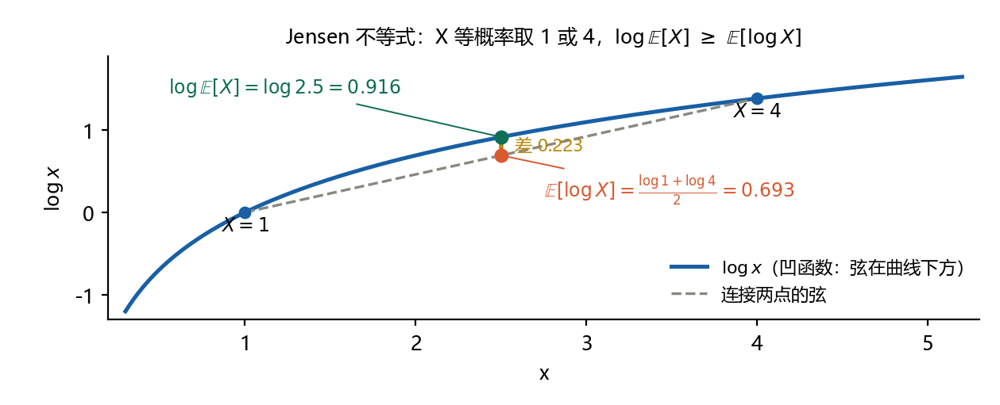
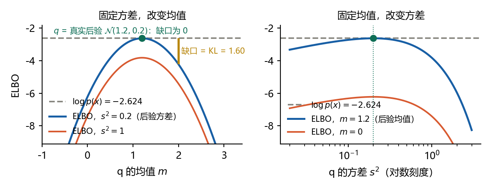
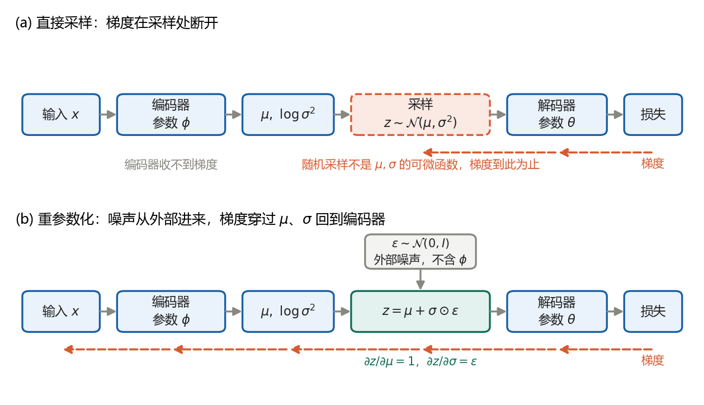
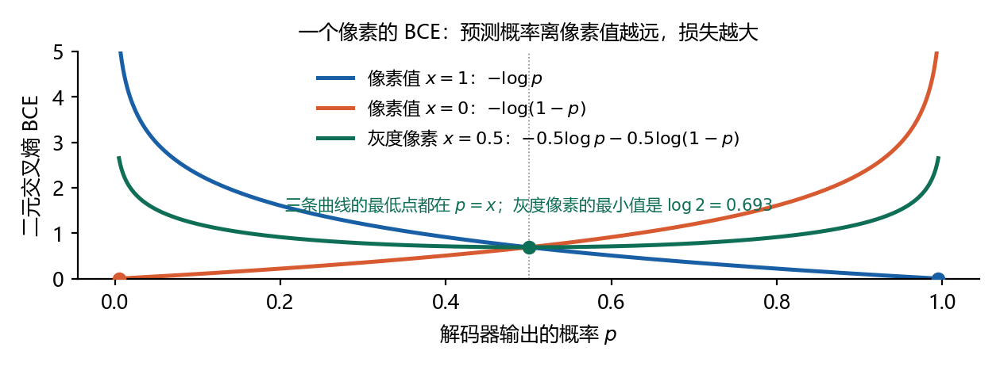
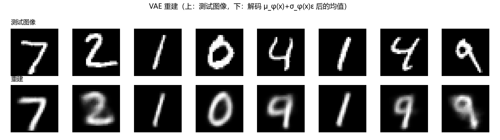
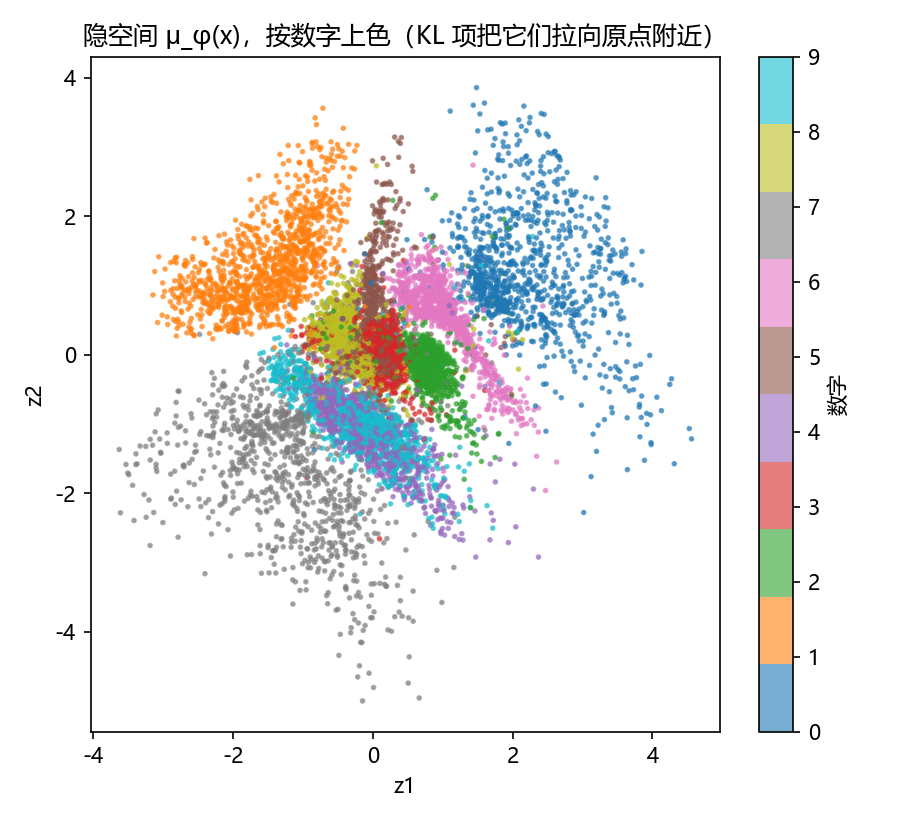
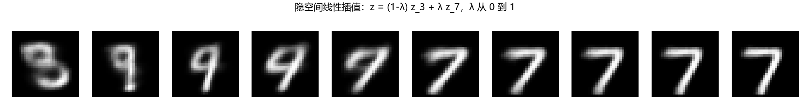
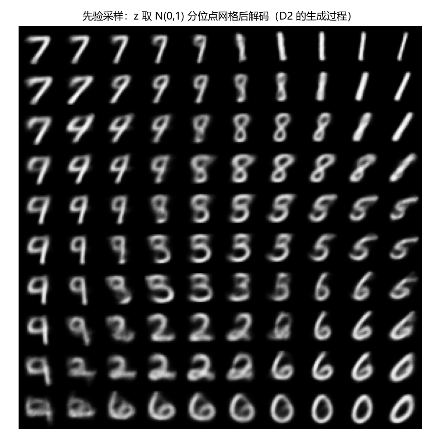

# 扩散模型推导笔记 D2–D3：证据下界与 VAE 的损失

本文是扩散模型推导笔记的第二篇，接着 [D0–D1](D0-D1-gaussian-and-kl.md) 把 D2（证据下界 ELBO 的两种推法与两项形式）和 D3（重参数化与 VAE 的损失）一步一步推出来。写法与 D0–D1 相同：每一步都写清三件事，这一步做了什么，依据哪条规则，为什么要这样做。

读法：第 1 章先用一张表回顾 D0–D1 用过的 5 条规则，再讲 9 条新规则 T9 到 T17，编号接着 D0–D1 往下排；第 2 章给推导顺序和一个新套路“凑出 KL”；第 3 章说清楚为什么需要 ELBO；第 4、5、6 章推 D2 的 (a)(b)(c)，第 7 章推 D3 的 (a) 到 (d)；第 8 章是配套练习：运行 `code/02_vae_mnist.py` 在 MNIST 上训练一个 VAE，看四张结果图，并在代码里找出重参数化、KL、重建各在哪一行；第 9 章把所有“重推骨架”汇总成一页，闭卷时只看这一页；第 10 章是自测题，答案在第 11 章。

与听课笔记的关系：[L2](L2-vae-lectures.md) 第 3 章按课程的顺序讲了同一个下界，本文把其中每一步展开推导。两篇用的是同一个玩具例子，相同的量数值相同。

记号按 Kingma & Welling (2014)：解码器 $`p_\theta(x|z)`$，编码器 $`q_\phi(z|x)`$，先验 $`p(z)=\mathcal{N}(0,I)`$。$`\mathcal{N}(\mu,\sigma^2)`$ 的第二个参数是方差，log 一律指自然对数。文中的数字都由 `code/d2_d3_check.py` 核对，图 1 至图 4 由 `code/make_figures_d2_d3.py` 生成，图 5 至图 8 由 `code/02_vae_mnist.py` 训练后生成。版本 1.0，2026-10-24。

## 1 工具箱：D2、D3 用到的规则

推导卡住，多半是某一步该用的规则一时想不起来。D2、D3 会用到 D0–D1 的 5 条规则和 9 条新规则。正文每一步都注明用的是哪一条，例如“依据：T11”。

### 1.1 沿用的旧规则

下面 5 条在 [D0–D1 第 1 章](D0-D1-gaussian-and-kl.md#1-工具箱d0d1-只用到这-8-条规则)讲过，这里只列结论。

| 编号 | 内容 | 本文用在 |
|---|---|---|
| [T1](D0-D1-gaussian-and-kl.md#t1-对数与指数的运算) 对数运算 | $`\log(ab)=\log a+\log b`$，$`\log\dfrac ab=\log a-\log b`$ | D2 每一步拆 log |
| [T2](D0-D1-gaussian-and-kl.md#t2-期望的线性) 期望的线性 | $`\mathbb{E}[X+Y]=\mathbb{E}[X]+\mathbb{E}[Y]`$，常数的期望是它自己 | D2(b)(c)，D3(b) |
| [T4](D0-D1-gaussian-and-kl.md#t4-偏差-方差分解) 偏差-方差分解 | $`\mathbb{E}[(X-c)^2]=\mathrm{Var}(X)+(\mathbb{E}X-c)^2`$ | 第 5 章玩具例子的 ELBO 闭式 |
| [T5](D0-D1-gaussian-and-kl.md#t5-高斯分布的三条规则) 规则 A、C | 规则 A：均值相同、方差也相同的两个高斯是同一个分布；规则 C：$`x\sim\mathcal{N}(\mu,\sigma^2)`$ 等价于 $`x=\mu+\sigma\varepsilon`$，$`\varepsilon\sim\mathcal{N}(0,1)`$ | D3(b) 重参数化 |
| [T8](D0-D1-gaussian-and-kl.md#t8-贝叶斯公式) 贝叶斯公式 | $`p(z\mid x)=\dfrac{p(x\mid z)\,p(z)}{p(x)}`$ | T9 的第二种拆法 |

### 1.2 T9 联合分布的两种拆法与边缘化

**术语**：联合分布（joint distribution）$`p(x,z)`$ 是 x 和 z 一起出现的概率密度。边缘分布（marginal distribution）$`p(x)`$ 是只看 x、不管 z 时的密度；从联合分布得到它的操作叫边缘化（marginalization），就是把 z 积掉。

**规则**

- 拆法一，按生成顺序：$`p(x,z)=p(z)\,p(x|z)`$。先抽 z，再在给定 z 的条件下抽 x。
- 拆法二，按推断顺序：$`p(x,z)=p(x)\,p(z|x)`$。先有 x，再问 z 在哪。
- 两种拆法相等，所以 $`p(x)=\dfrac{p(x,z)}{p(z|x)}`$；把它移项就是 T8 的贝叶斯公式。
- 边缘化：$`p(x)=\int p(x,z)\,dz=\int p(x|z)\,p(z)\,dz`$。

**例子**：D0(a) 的一维版本，$`z\sim\mathcal{N}(0,1)`$，$`x\mid z\sim\mathcal{N}(az,\sigma^2)`$。按拆法一，$`p(x,z)=\mathcal{N}(z;0,1)\,\mathcal{N}(x;az,\sigma^2)`$；边缘化后 $`p(x)=\mathcal{N}(x;0,a^2+\sigma^2)`$，这是 [D0–D1 第 5.1 节](D0-D1-gaussian-and-kl.md#51-边缘分布套路一)算过的。取 $`a=2`$，$`\sigma^2=1`$，观测到 $`x=3`$，则 $`p(3)=\mathcal{N}(3;0,5)`$，$`\log p(3)=-2.6237`$。这个数第 4、5 章还会用。

**用在**：D2(a) 第 1 步，D2(b) 第 2 步，D2(c) 第 1 步。

### 1.3 T10 乘一个、除一个：把积分写成期望

**规则**：对任何在 z 的取值范围内处处大于 0 的密度 $`q(z)`$，

```math
\int f(z)\,dz=\int q(z)\,\frac{f(z)}{q(z)}\,dz=\mathbb{E}_{z\sim q}\Big[\frac{f(z)}{q(z)}\Big].
```

**为什么**：第一个等号是乘以 $`q(z)/q(z)=1`$，被积函数没变。第二个等号是 T2 里期望的定义：$`\int q(z)\,g(z)\,dz=\mathbb{E}_q[g(z)]`$，这里 $`g=f/q`$。

**注意**：q 必须处处大于 0，否则会出现除以 0。高斯密度处处大于 0，所以 VAE 里没有这个问题。

**例子**：$`\int_0^1 z^2\,dz=\dfrac13`$。取 $`q`$ 为 (0,1) 上的均匀分布，密度是 1，右边就是 $`\mathbb{E}[z^2]=\frac13`$。换一个 $`q(z)=2z`$（也是 (0,1) 上的密度），右边是 $`\mathbb{E}_q\Big[\dfrac{z^2}{2z}\Big]=\dfrac12\mathbb{E}_q[z]=\dfrac12\cdot\dfrac23=\dfrac13`$。q 随便选，结果都一样。

**用在**：D2(a) 第 2 步。这一招是重要性采样（importance sampling）的基本形式，以后 D6 还会见到。

### 1.4 T11 Jensen 不等式：log 是凹函数

**术语**：凹函数（concave function）的图像向上拱，曲线上任意两点之间的弦（连接两点的线段）都在曲线下方。$`\log x`$ 是凹函数。

**规则**：X 是取正值的随机变量，则

```math
\log\mathbb{E}[X]\ \ge\ \mathbb{E}[\log X],
```

等号成立当且仅当 X 几乎处处是常数（只取一个值）。

**为什么**：先看 X 等概率取 $`x_1`$、$`x_2`$ 两个值的情形。$`\mathbb{E}[\log X]=\frac{\log x_1+\log x_2}{2}`$ 是弦在中点处的高度；$`\log\mathbb{E}[X]=\log\frac{x_1+x_2}{2}`$ 是曲线在同一横坐标处的高度。弦在曲线下方，所以曲线那一点高。X 取更多值、或各值概率不等时，$`\mathbb{E}[\log X]`$ 是曲线上几个点高度的加权平均，仍然落在曲线下方，结论一样。

**例子**：X 等概率取 1 或 4。$`\log\mathbb{E}[X]=\log2.5=0.916`$，$`\mathbb{E}[\log X]=\frac{0+1.386}{2}=0.693`$，前者大 0.223。图 1 画出了这两个数。再如 X 以概率 0.5、0.25、0.25 取 1、2、9：$`\log\mathbb{E}[X]=\log3.25=1.179`$，$`\mathbb{E}[\log X]=0.723`$。



**怎么记**：“log 在外面的那个大”，或者“平均的对数 ≥ 对数的平均”。

**用在**：D2(a) 第 3 步，T12 的证明。

### 1.5 T12 KL 散度非负

**术语**：KL 散度在 [D0–D1 第 6 章](D0-D1-gaussian-and-kl.md#6-d1-两个对角高斯之间的-kl-散度)定义过：$`\mathrm{KL}(q\,\Vert\,p)=\mathbb{E}_{z\sim q}[\log q(z)-\log p(z)]`$。这条性质也叫吉布斯不等式（Gibbs' inequality），[P0 第 3.4 节](P0-probability-and-information.md#34-kl-散度的性质)从信息论的角度讲过它。

**规则**：$`\mathrm{KL}(q\,\Vert\,p)\ge0`$，等号成立当且仅当 q 与 p 是同一个分布。

**推法**（三行）：

```math
-\mathrm{KL}(q\,\Vert\,p)=\mathbb{E}_q\Big[\log\frac{p(z)}{q(z)}\Big]\ \le\ \log\mathbb{E}_q\Big[\frac{p(z)}{q(z)}\Big]=\log\int q(z)\frac{p(z)}{q(z)}\,dz=\log\int p(z)\,dz=\log1=0 .
```

第一个等号是 T1 把 $`\log q-\log p`$ 写成 $`-\log\frac pq`$；不等号是 T11，取 $`X=p/q`$；后面是约掉 q，密度积分等于 1。左边 $`\le0`$，所以 KL $`\ge0`$。取等条件：T11 要求 $`p/q`$ 为常数 c，即 $`p=cq`$，两边积分得 $`1=c`$，所以 $`p=q`$。Jensen 不等式和这条性质的一般证明见 Cover & Thomas (2006) 第 2.6 节。

**例子**：[D0–D1 第 6.1 节](D0-D1-gaussian-and-kl.md#61-一维情形-a)算过 $`\mathrm{KL}\big(\mathcal{N}(1,1)\,\Vert\,\mathcal{N}(0,4)\big)=0.4431\gt 0`$。

**用在**：D2(b) 第 6 步，D2(c) 的解读。

### 1.6 T13 期望里的常数，以及期望按谁取

**规则**：一个量如果不含被平均的那个变量，它的期望就是它自己：$`\mathbb{E}_{z\sim q}[c]=c`$。特别地，$`\log p(x)`$ 里没有 z，所以

```math
\mathbb{E}_{q(z|x)}\big[\log p(x)\big]=\log p(x).
```

**下标提醒**：$`\mathbb{E}_{q_\phi(z|x)}[\cdot]`$ 读作“x 固定，z 按 $`q_\phi(z|x)`$ 抽，然后取平均”。本文所有期望都按 q 取，不按 p 取。

**例子**：$`\mathbb{E}_{z\sim q}[\log p(x)+z]=\log p(x)+\mathbb{E}_q[z]`$。

**用在**：D2(b) 第 1 步。这一步看起来“什么都没做”，却是分解推法的起点。

### 1.7 T14 求导与积分可以交换

**规则**：被积函数光滑、积分收敛时（本文的高斯情形都满足），

```math
\nabla_\phi\int h(z,\phi)\,dz=\int\nabla_\phi h(z,\phi)\,dz .
```

**推论**：被积函数是乘积时用乘积法则。若 f 不含 φ，则 $`\nabla_\phi\big[q_\phi(z)\,f(z)\big]=f(z)\,\nabla_\phi q_\phi(z)`$。

**含义**：求导号可以穿进积分号，但穿进去以后打在谁身上，要看谁含 φ。D3(a) 的全部问题就在这里。

**用在**：D3(a) 第 1 步，D3(b) 第 3 步。

### 1.8 T15 换元：期望可以换到外部噪声上

**术语**：这条规则叫无意识统计学家法则（law of the unconscious statistician）。它说的是：要算 $`f(z)`$ 的期望，不必知道 z 的密度，只要知道 z 是怎么从另一个变量 ε 生成的。

**规则**：若 $`z=g(\varepsilon)`$，$`\varepsilon\sim p(\varepsilon)`$，则

```math
\mathbb{E}_{z}\big[f(z)\big]=\mathbb{E}_{\varepsilon}\big[f(g(\varepsilon))\big].
```

**高斯情形**：$`z\sim\mathcal{N}(\mu,\sigma^2)`$ 等价于 $`z=\mu+\sigma\varepsilon`$，$`\varepsilon\sim\mathcal{N}(0,1)`$（T5 规则 C），所以 $`\mathbb{E}_{z\sim\mathcal{N}(\mu,\sigma^2)}[f(z)]=\mathbb{E}_{\varepsilon\sim\mathcal{N}(0,1)}[f(\mu+\sigma\varepsilon)]`$。

**例子**：$`f(z)=z^2`$，$`z\sim\mathcal{N}(\mu,1)`$。直接算：$`\mathbb{E}[z^2]=\mu^2+1`$（T4 取 $`c=0`$）。换元算：$`\mathbb{E}_\varepsilon[(\mu+\varepsilon)^2]=\mu^2+2\mu\,\mathbb{E}[\varepsilon]+\mathbb{E}[\varepsilon^2]=\mu^2+0+1`$。一致。

**用在**：D3(b) 第 2 步。

### 1.9 T16 蒙特卡洛与单样本估计

**术语**：蒙特卡洛估计（Monte Carlo estimate）是用样本的平均代替期望。

**规则**：$`\mathbb{E}_q[f]\approx\dfrac1N\sum_{i=1}^N f(z_i)`$，$`z_i\sim q`$。这个估计是无偏的（unbiased）：它自己的期望正好等于 $`\mathbb{E}_q[f]`$。N 取 1 也无偏，只是单次的随机误差大；随机梯度下降把很多步平均起来，所以每步只抽一个样本也能收敛。

**例子**：[D0–D1 第 7.1 节](D0-D1-gaussian-and-kl.md#71-运行-01_gaussian_kl_checkpy-的-a-项)用 $`10^6`$ 个样本估计 KL，与闭式只差 $`2.65\times10^{-4}`$。

**用在**：D3(b) 第 4 步。Kingma & Welling (2014) 第 2.3 节也写道，只要一批数据足够多（例如 100 个），每个数据点抽 1 个样本就够了；DDPM 训练时每步只抽一个 t 和一个 ε，依据也是这一条。

### 1.10 T17 伯努利分布、sigmoid 与二元交叉熵

**术语**：伯努利分布（Bernoulli distribution）是只取 0 或 1 的分布：取 1 的概率为 p，取 0 的概率为 $`1-p`$。两种情况可以写成一个式子 $`\mathrm{Bern}(x;p)=p^x(1-p)^{1-x}`$，x 取 1 时它等于 p，取 0 时等于 $`1-p`$。

**对数**（T1）：$`\log\mathrm{Bern}(x;p)=x\log p+(1-x)\log(1-p)`$。

**二元交叉熵**（binary cross-entropy，BCE）：$`\mathrm{BCE}(x,p)=-\big[x\log p+(1-x)\log(1-p)\big]`$，就是负的对数概率。x=1 时它是 $`-\log p`$，p 越接近 1 越小；x=0 时它是 $`-\log(1-p)`$。

**sigmoid 与 logit**：网络输出的是任意实数 l，叫 logit；经过 sigmoid 函数 $`p=\mathrm{sigmoid}(l)=\dfrac{1}{1+e^{-l}}`$ 变成 (0,1) 之间的概率。直接用 logit 算 BCE 有一个数值稳定的写法：

```math
\mathrm{BCE}=\mathrm{softplus}(l)-x\,l,\qquad \mathrm{softplus}(l)=\log(1+e^{l}).
```

推法：$`\log\mathrm{sigmoid}(l)=-\mathrm{softplus}(-l)`$，$`\log(1-\mathrm{sigmoid}(l))=-\mathrm{softplus}(l)`$，代入 BCE 的定义得 $`x\,\mathrm{softplus}(-l)+(1-x)\,\mathrm{softplus}(l)`$，再用 $`\mathrm{softplus}(-l)=\mathrm{softplus}(l)-l`$ 合并。第 8 章代码第 142 行调用的 `binary_cross_entropy_with_logits` 直接接收 logit，PyTorch 按与此等价的稳定形式计算，文档说明它借助 log-sum-exp 技巧保证数值稳定。

**灰度也能用**：x 取 0 到 1 之间的小数时公式照用，最小值在 $`p=x`$ 处取到，最小值不是 0 而是 $`-x\log x-(1-x)\log(1-x)`$，x=0.5 时是 $`\log2=0.693`$。

**例子**：x=1，p=0.9：BCE $`=0.1054`$；x=0，p=0.9：$`2.3026`$；x=0.5，p=0.5：$`0.6931`$；x=0.5，p=0.9：$`1.2040`$。logit 版核对：$`l=2.1972`$ 时 $`\mathrm{sigmoid}(l)=0.9`$，$`\mathrm{softplus}(l)-l=0.1054`$，与第一个数一致。

**用在**：D3(d)，代码第 142 行。图 4 在 7.4 节。

### 1.11 可选：T18 对数导数技巧

第二遍再看。因为 $`\nabla\log q=\dfrac{\nabla q}{q}`$，所以 $`\nabla_\phi q_\phi(z)=q_\phi(z)\,\nabla_\phi\log q_\phi(z)`$。它把“对密度求导”换成“密度乘以对数密度的导数”，后者可以写成期望。只在 D3(a) 的替代方案里用到。

## 2 推导顺序与一个新套路

| 题目 | 要做什么 | 用到的规则 | 顺序 |
|---|---|---|---|
| D2(a) Jensen 推法 | 证明 $`\log p(x)\ge\mathrm{ELBO}`$ | T9、T10、T11、T1 | 1 |
| D2(b) 分解推法 | 证明 $`\log p(x)=\mathrm{ELBO}+\mathrm{KL}`$ | T13、T9、T1、T2、T12 | 2 |
| D2(c) 两项形式 | 把 ELBO 拆成重建项减 KL | T9、T1、T2 | 3 |
| D3(a) 梯度为什么不能直接进期望 | 说明原因 | T14（T18） | 4 |
| D3(b) 重参数化 | 把期望换到 ε 上，给单样本估计 | T5 规则 C、T15、T14、T16 | 5 |
| D3(c) KL 闭式 | 引用 D1(c) | D1 | 6 |
| D3(d) 伯努利解码器 | 证明重建项就是负 BCE | T17 | 7 |

顺序按题号的 (a)(b)(c) 排：(a) 短，先建立“ELBO 是下界”的感觉；(b) 说清缺口是什么；(c) 把 ELBO 整理成代码里的两项。D3 的四小题各自独立，(b) 最重要。

[D0–D1 第 2 章](D0-D1-gaussian-and-kl.md#2-推导顺序与两个通用套路)总结了两个套路：算矩和配方。D2 用到第三个。

**套路三：凑出 KL**。看到 $`\mathbb{E}_q[\log\text{某个比值}]`$，就把比值的分子分母拆成几项（T1），再把含 $`\log q`$ 的那一项和另一个密度的 log 配成 $`\mathbb{E}_q[\log q-\log p(\cdot)]`$ 的形状，按 D1 的定义认出 KL。工具是“加一项减一项”：

```math
\log A-\log B=(\log A-\log C)+(\log C-\log B).
```

D2(b) 加减的是 $`\log q_\phi(z|x)`$，D2(c) 用的是拆法一自带的 $`\log p(z)`$。以后 D6 把 DDPM 的 ELBO 拆成一串 KL，用的还是它。

## 3 先看懂题目：隐变量模型与 ELBO 要解决的问题

### 3.1 记号

- 隐变量模型（latent variable model）：$`p_\theta(x,z)=p(z)\,p_\theta(x|z)`$。先验（prior）$`p(z)=\mathcal{N}(0,I)`$ 是固定的，不学；解码器（decoder）$`p_\theta(x|z)`$ 是一个神经网络，参数 θ 是它的权重。生成一张图的过程是：先抽 z，再按 $`p_\theta(x|z)`$ 生成 x。
- 证据（evidence）：$`p_\theta(x)=\int p_\theta(x|z)\,p(z)\,dz`$，也叫边缘似然（marginal likelihood）。$`\log p_\theta(x)`$ 可以理解为模型给这张图打的分：越大，模型越认为它像真实数据。训练的目标是让训练数据的 $`\log p_\theta(x)`$ 尽量大，这叫最大似然（maximum likelihood）。
- 真实后验（true posterior）$`p_\theta(z|x)=\dfrac{p_\theta(x|z)\,p(z)}{p_\theta(x)}`$（T8）：看到 x 之后，z 应该在哪。
- 变分分布（variational distribution）$`q_\phi(z|x)=\mathcal{N}\big(\mu_\phi(x),\mathrm{diag}\,\sigma_\phi^2(x)\big)`$：我们自己设计的一个分布，能算密度、能采样，用来代替算不出来的 $`p_\theta(z|x)`$。在 VAE 里它叫编码器（encoder），参数 φ 是编码器网络的权重，网络输入 x，输出均值向量 $`\mu_\phi(x)`$ 和方差向量 $`\sigma_\phi^2(x)`$。“diag”表示各个坐标相互独立，即对角高斯。
- θ 和 φ 是两套参数。θ 管“从 z 生成 x”，φ 管“从 x 推断 z”。

### 3.2 卡在哪里

[D0(a)](D0-D1-gaussian-and-kl.md#5-d0a-线性高斯模型) 里解码器是线性的，$`x=az+\sigma\varepsilon`$，积分能算出来，$`p(x)=\mathcal{N}(0,a^2+\sigma^2)`$。把 az 换成神经网络 $`f_\theta(z)`$ 以后，$`\int p_\theta(x|z)\,p(z)\,dz`$ 就算不出来了：z 是 d 维向量，这是一个 d 重积分，网格法在 d=2 时还勉强，d=100 时网格点数是天文数字；用蒙特卡洛估计积分，再取 log，又会有偏（T11 告诉我们 $`\log\mathbb{E}\ne\mathbb{E}\log`$）。所以不能直接最大化 $`\log p_\theta(x)`$。

出路：找一个算得出来、并且永远不超过 $`\log p_\theta(x)`$ 的量，叫下界（lower bound）。抬高下界，$`\log p_\theta(x)`$ 至少不会比它低。这个量就是证据下界（evidence lower bound，ELBO）。D2 要证明两件事：它确实是下界（(a)、(b)），它确实算得出来（(c)：只含 q 下的期望和一个闭式 KL）。想读英文的完整讲解，可以看两位原作者写的入门综述 Kingma & Welling (2019)。

## 4 D2(a) Jensen 推法

**题目**：证明

```math
\log p_\theta(x)\ \ge\ \mathbb{E}_{q_\phi(z|x)}\big[\log p_\theta(x,z)-\log q_\phi(z|x)\big]=:\mathrm{ELBO}.
```

**先看懂题目**：右边的期望按 $`q_\phi(z|x)`$ 取（T13 的下标）：x 固定，z 从编码器给的分布里抽。要证的是“左边大于等于右边”，是不等式，不是等式。记号 $`:=`$ 读作“定义为”：右边这个量从此叫 ELBO。

**思路**：左边是 x 的函数，右边是 z 的期望，所以先把 z 请进来（T9 写成积分），再把积分变成 q 下的期望（T10），最后把 log 放进期望（T11，这一步出现不等号）。

**第 1 步　边缘化**

```math
\log p_\theta(x)=\log\int p_\theta(x,z)\,dz .
```

依据：T9。为什么：ELBO 是对 z 的期望，必须先让 z 出现。

**第 2 步　乘一个、除一个**

```math
\log\int p_\theta(x,z)\,dz=\log\int q_\phi(z|x)\,\frac{p_\theta(x,z)}{q_\phi(z|x)}\,dz=\log\mathbb{E}_{q_\phi(z|x)}\Big[\frac{p_\theta(x,z)}{q_\phi(z|x)}\Big].
```

依据：T10，$`q_\phi`$ 是高斯密度，处处大于 0。为什么要换成 q 下的期望：只有期望才能用 Jensen；只有对 q 的期望才能靠从 q 采样来估计。

**第 3 步　Jensen 不等式**

记 $`Y=\dfrac{p_\theta(x,z)}{q_\phi(z|x)}`$，它取正值。由 T11，$`\log\mathbb{E}_q[Y]\ge\mathbb{E}_q[\log Y]`$，所以

```math
\log p_\theta(x)\ \ge\ \mathbb{E}_{q_\phi(z|x)}\Big[\log\frac{p_\theta(x,z)}{q_\phi(z|x)}\Big].
```

依据：T11。为什么方向是这样：log 是凹函数，“log 在外面的那个大”，左边的 log 在期望外面。

**第 4 步　拆开 log**

```math
\log\frac{p_\theta(x,z)}{q_\phi(z|x)}=\log p_\theta(x,z)-\log q_\phi(z|x).
```

依据：T1。代回第 3 步，右边正是题目里 ELBO 的定义式。证毕。

**第 5 步　什么时候取等**

T11 的等号条件：Y 对 z 是常数，即 $`\dfrac{p_\theta(x,z)}{q_\phi(z|x)}=c`$，c 不随 z 变。于是 $`q_\phi(z|x)=\dfrac{p_\theta(x,z)}{c}`$。两边对 z 积分：左边是密度，积分为 1；右边是 $`\dfrac{p_\theta(x)}{c}`$（T9 边缘化）。所以 $`c=p_\theta(x)`$，从而

```math
q_\phi(z|x)=\frac{p_\theta(x,z)}{p_\theta(x)}=p_\theta(z|x).
```

最后一个等号是 T9 的拆法二。结论：编码器恰好等于真实后验时，ELBO 取到 $`\log p_\theta(x)`$；否则严格小于。

**数字检查**：用第 5 章的玩具例子（D0(a) 一维版，$`a=2`$，$`\sigma^2=1`$，$`x=3`$），$`\log p(x)=-2.6237`$。把先验当编码器，$`q=\mathcal{N}(0,1)`$：ELBO $`=-7.4189`$，确实小于 $`-2.6237`$。把真实后验当编码器，$`q=\mathcal{N}(1.2,0.2)`$：ELBO $`=-2.6237`$，与 $`\log p(x)`$ 相等。用 $`10^6`$ 个样本的蒙特卡洛估计 $`q=\mathcal{N}(0,1)`$ 时的 ELBO，得 $`-7.4156`$，与闭式 $`-7.4189`$ 的差在随机误差之内。

**常见卡点**

- 忘了 q 必须处处大于 0：第 2 步在除以它。
- Jensen 的方向记反：用图 1 定向，曲线上的点高于弦。
- 把 $`\mathbb{E}_q`$ 里的 x 当变量：x 是固定的那张图，期望只对 z 取。
- ELBO 的“大小”：本文两个例子里 ELBO 都是负数。“抬高 ELBO”指让它变大，也就是更接近 $`\log p_\theta(x)`$；它永远不会超过 $`\log p_\theta(x)`$。

**重推骨架**

1. 把 $`p(x)`$ 写成什么积分？
2. 乘什么、除什么？为什么可以？
3. 哪一步出现不等号？依据什么？方向怎么定？
4. 不等号右边拆开是什么？
5. 什么时候取等号？

## 5 D2(b) 分解推法

**题目**：证明恒等式

```math
\log p_\theta(x)=\mathrm{ELBO}+\mathrm{KL}\big(q_\phi(z|x)\,\Vert\,p_\theta(z|x)\big).
```

**先看懂题目**：这次是等式。它比 (a) 多说了一件事：下界和真值之间差的那一块，叫缺口（gap），正好等于编码器 $`q_\phi(z|x)`$ 和真实后验 $`p_\theta(z|x)`$ 之间的 KL 散度。

**思路**：从 $`\log p_\theta(x)`$ 出发。先用 T13 把它写成 q 下的期望，这是最不自然、也最关键的一步；再用 T9 把 $`p(x)`$ 换成 $`\dfrac{p(x,z)}{p(z|x)}`$；然后“加一项减一项”凑出 KL（套路三）。

**第 1 步　写成 q 下的期望**

```math
\log p_\theta(x)=\mathbb{E}_{q_\phi(z|x)}\big[\log p_\theta(x)\big].
```

依据：T13，$`\log p_\theta(x)`$ 不含 z。为什么要做这种看起来没用的事：等式右边的 ELBO 和 KL 都是 q 下的期望，左边也变成 q 下的期望，才能在同一个期望号里面做加减。

**第 2 步　换掉 $`p_\theta(x)`$**

由 T9 的拆法二，$`p_\theta(x)=\dfrac{p_\theta(x,z)}{p_\theta(z|x)}`$。代入并用 T1 拆开：

```math
\log p_\theta(x)=\mathbb{E}_q\big[\log p_\theta(x,z)-\log p_\theta(z|x)\big].
```

这一步的要点：$`p_\theta(x)`$ 不含 z，但把它写成两个含 z 的量之比以后，z 就进来了，而且对每个 z 这个比值都等于 $`p_\theta(x)`$。

**第 3 步　加一项、减一项**

在期望里加上 $`\log q_\phi(z|x)`$，再减去它，总量不变：

```math
\log p_\theta(x)=\mathbb{E}_q\big[\log p_\theta(x,z)-\log q_\phi(z|x)+\log q_\phi(z|x)-\log p_\theta(z|x)\big].
```

依据：套路三。为什么加减的是 $`\log q`$：目标是凑出两块，一块是 ELBO（里面有 $`-\log q`$），一块是 KL（里面有 $`+\log q`$）。

**第 4 步　拆成两个期望**

```math
\log p_\theta(x)=\mathbb{E}_q\big[\log p_\theta(x,z)-\log q_\phi(z|x)\big]+\mathbb{E}_q\big[\log q_\phi(z|x)-\log p_\theta(z|x)\big].
```

依据：T2。

**第 5 步　认出两块**

第一块是第 4 章第 4 步里 ELBO 的定义式。第二块按 D1 的定义是 $`\mathbb{E}_q[\log q-\log p]`$ 的形状，期望按 q 取，q 在前，所以它是 $`\mathrm{KL}\big(q_\phi(z|x)\,\Vert\,p_\theta(z|x)\big)`$。

**第 6 步　下结论**

```math
\log p_\theta(x)=\mathrm{ELBO}+\mathrm{KL}\big(q_\phi(z|x)\,\Vert\,p_\theta(z|x)\big).
```

由 T12，KL $`\ge0`$，所以 $`\mathrm{ELBO}\le\log p_\theta(x)`$，这又把 (a) 证了一遍；而且差的正好是这个 KL。KL $`=0`$ 当且仅当 $`q_\phi(z|x)=p_\theta(z|x)`$，与 (a) 第 5 步的取等条件一致。

**两种推法的区别**：(a) 只说“≥”，(b) 给出了缺口的名字。这件事很有用：$`\log p_\theta(x)`$ 不含 φ，所以对 φ 来说，最大化 ELBO 就等于最小化 $`\mathrm{KL}(q_\phi\,\Vert\,p_\theta(z|x))`$，也就是让编码器尽量接近真实后验。用优化去逼近一个算不出的后验，这就是变分推断（variational inference），Bishop (2006) 第 10.1 节正是从这个分解讲起的。对 θ 来说，ELBO 变大可能来自 $`\log p_\theta(x)`$ 变大，也可能只来自缺口变小；所以 θ 和 φ 要一起优化，让缺口一直保持很小，这时抬高 ELBO 才能把 $`\log p_\theta(x)`$ 一起推高。[L2 第 3.5 节](L2-vae-lectures.md#35-为什么要引入-qzx)讲的就是这一点。

**数字检查**：玩具例子 $`a=2`$，$`\sigma^2=1`$，$`x=3`$，真实后验是 $`\mathcal{N}(1.2,0.2)`$（[D0–D1 第 5.2 节](D0-D1-gaussian-and-kl.md#52-后验分布套路二)），$`\log p(x)=-2.6237`$。对 $`q=\mathcal{N}(m,s^2)`$，ELBO 可以用闭式算（5.1 节），$`\mathrm{KL}(q\,\Vert\,\text{后验})`$ 用 D1 的公式算。按 (b)，每一行的“缺口”列都应该等于“KL”列。

| q | ELBO | 缺口 $`\log p(x)-\mathrm{ELBO}`$ | D1 算出的 KL（q 对后验） |
|---|---|---|---|
| $`\mathcal{N}(1.2,0.2)`$，等于真实后验 | −2.6237 | 0 | 0 |
| $`\mathcal{N}(0,1)`$，等于先验 | −7.4189 | 4.7953 | 4.7953 |
| $`\mathcal{N}(1.2,1)`$，均值对、方差太大 | −3.8189 | 1.1953 | 1.1953 |
| $`\mathcal{N}(2,0.2)`$，方差对、均值偏 | −4.2237 | 1.6000 | 1.6000 |
| $`\mathcal{N}(1.2,0.05)`$，均值对、方差太小 | −2.9418 | 0.3181 | 0.3181 |

前两行也出现在 L2 第 3.5 节的表里。图 2 把这件事画成曲线：固定方差改变均值、固定均值改变方差，ELBO 曲线都在 $`\log p(x)`$ 这条水平线下方，只在真实后验处碰到它。



### 5.1 玩具例子的 ELBO 闭式（可选，第二遍再看）

这一节说明表里的数是怎么算的，只用 T1、T4。$`q=\mathcal{N}(m,s^2)`$，先用 T9 拆法一把 $`\log p(x,z)`$ 拆成 $`\log p(x|z)+\log p(z)`$，于是

```math
\mathrm{ELBO}=\mathbb{E}_q[\log p(x|z)]+\mathbb{E}_q[\log p(z)]-\mathbb{E}_q[\log q(z)].
```

- 第一项：$`\log p(x|z)=-\frac{1}{2}\log(2\pi\sigma^2)-\dfrac{(x-az)^2}{2\sigma^2}`$。在 q 下 az 的均值是 am、方差是 $`a^2s^2`$，用 T4：$`\mathbb{E}_q[(x-az)^2]=(x-am)^2+a^2s^2`$。
- 第二项：$`\log p(z)=-\frac{1}{2}\log(2\pi)-\dfrac{z^2}{2}`$，而 $`\mathbb{E}_q[z^2]=m^2+s^2`$（T4 取 $`c=0`$）。
- 第三项：$`-\log q(z)=\frac{1}{2}\log(2\pi s^2)+\dfrac{(z-m)^2}{2s^2}`$，在 q 下第二块的期望是 $`\dfrac{s^2}{2s^2}=\dfrac12`$。所以 $`-\mathbb{E}_q[\log q]=\frac{1}{2}\log(2\pi s^2)+\frac{1}{2}`$，这是高斯的熵。

代入 $`m=1.2`$，$`s^2=0.2`$：第一项 $`-0.9189-\dfrac{0.36+0.8}{2}=-1.4989`$；第二项 $`-0.9189-\dfrac{1.44+0.2}{2}=-1.7389`$；第三项 $`\frac{1}{2}\log(2\pi\cdot0.2)+\frac{1}{2}=0.1142+0.5=0.6142`$。合计 $`-2.6236`$，与 $`\log p(x)=-2.6237`$ 只差四舍五入。

**常见卡点**

- 第 1 步觉得多此一举，跳过它就没法往下推。
- 第 3 步加减的是 $`\log q_\phi(z|x)`$，得到的是 $`\mathrm{KL}(q\,\Vert\,p_\theta(z|x))`$；D2(c) 会得到另一个 $`\mathrm{KL}(q\,\Vert\,p(z))`$。两个 KL 不是一回事：前者是缺口，算不出；后者是损失里的正则项，有闭式。
- KL 的方向：$`\mathbb{E}_q[\log q-\log p]`$，q 在前。
- 把 $`p_\theta(z|x)`$（真实后验，算不出）和 $`q_\phi(z|x)`$（编码器，算得出）混为一谈。

**重推骨架**

1. 为什么可以把 $`\log p(x)`$ 写成 $`\mathbb{E}_q[\log p(x)]`$？
2. $`p(x)`$ 换成了什么？依据哪条拆法？
3. 加一项减一项，加减的是什么？
4. 拆成了哪两块？
5. 第二块为什么是 KL？方向怎么看？
6. 由此得到 ELBO $`\le\log p(x)`$ 的依据是什么？缺口是什么？

## 6 D2(c) ELBO 的两项形式

**题目**：证明

```math
\mathrm{ELBO}=\mathbb{E}_{q_\phi(z|x)}\big[\log p_\theta(x|z)\big]-\mathrm{KL}\big(q_\phi(z|x)\,\Vert\,p(z)\big).
```

**先看懂题目**：这是把 ELBO 整理成“一个需要采样的期望，减一个有闭式的 KL”。代码里的损失就是这个形式取负号。

**思路**：把 $`p_\theta(x,z)`$ 按拆法一（生成顺序）拆开，再用套路三认出 KL。

**第 1 步　代入拆法一**

$`p_\theta(x,z)=p(z)\,p_\theta(x|z)`$（T9），取对数拆开（T1）：

```math
\mathrm{ELBO}=\mathbb{E}_q\big[\log p(z)+\log p_\theta(x|z)-\log q_\phi(z|x)\big].
```

**第 2 步　分成两个期望**

```math
\mathrm{ELBO}=\mathbb{E}_q\big[\log p_\theta(x|z)\big]+\mathbb{E}_q\big[\log p(z)-\log q_\phi(z|x)\big].
```

依据：T2。为什么这样分：第一块只含解码器，第二块只含编码器和先验。

**第 3 步　认出 KL**

第二块里 log 的顺序是“先验减 q”，与 KL 定义里的“q 减另一个”差一个负号：

```math
\mathbb{E}_q\big[\log p(z)-\log q_\phi(z|x)\big]=-\mathbb{E}_q\big[\log q_\phi(z|x)-\log p(z)\big]=-\mathrm{KL}\big(q_\phi(z|x)\,\Vert\,p(z)\big).
```

依据：D1 的定义。代回第 2 步即得题目的式子。证毕。

**两项各在拉什么**

- 重建项（reconstruction term）$`\mathbb{E}_q[\log p_\theta(x|z)]`$：从编码器抽一个 z，解码器从这个 z 还原出 x 的对数概率。它越大，说明 z 带着足够的信息让解码器认出 x。它把 q 往“窄、信息多”的方向拉：q 越集中在最能还原 x 的那个 z 附近，重建越好。
- 正则项（regularization term）$`\mathrm{KL}(q_\phi(z|x)\,\Vert\,p(z))`$：编码器给出的分布离先验 $`\mathcal{N}(0,I)`$ 有多远。它前面是减号，所以要它小：q 的均值靠近 0、方差靠近 1。它把 q 往“宽、靠近原点”的方向拉。
- 拉锯：只有重建项时，q 会把方差缩到 0，退回普通自编码器，隐空间有空洞、不能从先验采样；只有正则项时，q 全变成 $`\mathcal{N}(0,I)`$，z 不含 x 的任何信息。用完整的损失训练，如果最后 q 也退化成先验，这叫后验坍缩（posterior collapse）。KL 闭式（D3(c)）里的 $`-\log\sigma^2`$ 在 σ 趋于 0 时趋于无穷，这就是阻止方差缩到 0 的机制。
- 为什么 (c) 比 (a) 的形式好用：$`\mathrm{KL}(q\,\Vert\,p(z))`$ 是两个对角高斯之间的 KL，有闭式（D1(c)），不用采样；只有重建项需要采样，而且每张图抽一个 z 就够（T16）。
- 预告：代码里重建项在第 142 行（BCE），正则项在第 137 行（KL 闭式）。

**数字检查**：玩具例子里取 $`q=\mathcal{N}(1.2,0.2)`$。重建项 $`\mathbb{E}_q[\log p(x|z)]=-1.4989`$（5.1 节第一项）；正则项用 D1(c)：$`\mathrm{KL}\big(\mathcal{N}(1.2,0.2)\,\Vert\,\mathcal{N}(0,1)\big)=\frac{1}{2}\big(1.44+0.2-1-\log0.2\big)=\frac{1}{2}(0.64+1.6094)=1.1247`$。ELBO $`=-1.4989-1.1247=-2.6236`$，与第 5 章的结果一致；并且 5.1 节的第二项加第三项 $`-1.7389+0.6142=-1.1247`$ 正是 $`-\mathrm{KL}`$，两条路对上了。[L2 第 3.6 节](L2-vae-lectures.md#36-下界拆成两项与网络对上)的表里有同样的两个数。

**常见卡点**

- 第 3 步的符号：$`\mathbb{E}_q[\log p-\log q]=-\mathrm{KL}(q\,\Vert\,p)`$，不是 $`+\mathrm{KL}`$。
- 把 (c) 的 $`\mathrm{KL}(q\,\Vert\,p(z))`$ 和 (b) 的 $`\mathrm{KL}(q\,\Vert\,p_\theta(z|x))`$ 混淆：前者可算，后者算不出。
- 以为重建项是“误差”：它是对数概率，越大越好；损失是它的负数。

**重推骨架**

1. $`p(x,z)`$ 用哪种拆法？
2. 拆成的两块各是什么？
3. 第二块怎么变成 $`-\mathrm{KL}`$？
4. 两项各在拉什么？

## 7 D3 重参数化与 VAE 的损失

**题目回顾**：$`q_\phi(z|x)=\mathcal{N}(\mu_\phi(x),\mathrm{diag}\,\sigma_\phi^2(x))`$，$`p(z)=\mathcal{N}(0,I)`$，解码器 $`p_\theta(x|z)`$。

- (a) 说明为什么 $`\nabla_\phi\mathbb{E}_{q_\phi(z|x)}[f(z)]`$ 不能直接把梯度放进期望。
- (b) 用 $`z=\mu_\phi+\sigma_\phi\odot\varepsilon`$ 把 ELBO 写成 $`\mathbb{E}_\varepsilon[\cdot]`$，并给出单样本估计。
- (c) $`\mathrm{KL}\big(q_\phi(z|x)\,\Vert\,\mathcal{N}(0,I)\big)=\frac{1}{2}\sum_j\big(\mu_j^2+\sigma_j^2-1-\log\sigma_j^2\big)`$。
- (d) 解码器为逐像素伯努利时，$`\mathbb{E}_q[\log p_\theta(x|z)]`$ 的单样本估计等于负的二元交叉熵。

### 7.1 D3(a) 为什么梯度不能直接放进期望

**先看懂题目**：训练时要对 φ 求 ELBO 的梯度。ELBO 的第一项是 $`\mathbb{E}_{q_\phi(z|x)}[f(z)]`$，$`f(z)=\log p_\theta(x|z)`$。φ 出现在期望的下标里（决定 z 的分布），不出现在 f 里。问题是：先从 $`q_\phi`$ 抽一个 z，再对 $`f(z)`$ 求 φ 的梯度，这样行不行？

**第 1 步　写成积分再求导**

```math
\nabla_\phi\,\mathbb{E}_{q_\phi(z|x)}[f(z)]=\nabla_\phi\int q_\phi(z|x)\,f(z)\,dz=\int f(z)\,\nabla_\phi q_\phi(z|x)\,dz .
```

依据：T14，f 不含 φ，梯度打在 $`q_\phi`$ 上。

**第 2 步　看它是不是期望**

右边不是“$`q_\phi`$ 下某个量的期望”的形状：里面没有 $`q_\phi(z|x)`$ 作为权重，只有它的梯度。所以不能用“从 q 抽样、取平均”来估计它。

**第 3 步　天真做法得到什么**

抽出 z 以后，$`f(z)`$ 里没有 φ，所以 $`\nabla_\phi f(z)=0`$：“抽样再求导”得到的梯度恒为 0，编码器学不到任何东西。图 3(a) 画的就是这个情形：从采样这一步起，梯度断开。根本原因是“采样”这个操作不是 μ、σ 的可微函数，自动微分不知道随机数是怎么依赖 μ、σ 的。

**可选　T18 的补救**：把 $`\nabla_\phi q_\phi=q_\phi\nabla_\phi\log q_\phi`$ 代入第 1 步，右边变成 $`\mathbb{E}_q\big[f(z)\,\nabla_\phi\log q_\phi(z|x)\big]`$，这又是 q 下的期望，可以抽样估计。它叫 score-function 估计，也叫 REINFORCE（Williams, 1992）。它无偏，但随机误差大，Kingma & Welling (2014) 第 2.2 节末尾也指出了这一点。

**数字检查**：取 $`f(z)=z^2`$，$`q=\mathcal{N}(\mu,1)`$，$`\mu=1`$。真梯度 $`\dfrac{d}{d\mu}\mathbb{E}[z^2]=\dfrac{d}{d\mu}(\mu^2+1)=2\mu=2`$。`code/d2_d3_check.py` 用三种办法估计它，每种办法重复 2000 次、每次平均 1000 个样本：

| 估计方法 | 单个样本的标准差 | 1000 个样本平均后的标准差：理论 / 模拟 | 模拟的平均值 |
|---|---|---|---|
| 天真做法：抽样后只对 f 求导 | 0 | 0 / 0 | 0（错） |
| score-function（T18） | $`\sqrt{30}\approx5.48`$ | 0.173 / 0.174 | 2.00 |
| 重参数化（7.2 节） | 2 | 0.063 / 0.064 | 2.00 |

两种无偏估计的平均值都是 2.00，但 score-function 的随机误差是重参数化的 $`\sqrt{30}/2\approx2.7`$ 倍。这还是最简单的 f。两类梯度估计的系统比较见 Mohamed et al. (2020)；在 VAE 这类问题上，重参数化的方差通常小得多，这正是 Kingma & Welling (2014) 采用它的原因。

**理论值怎么来**（可选）：重参数化的单样本估计是 $`\frac{d}{d\mu}(\mu+\varepsilon)^2=2(\mu+\varepsilon)`$，方差 $`4\,\mathrm{Var}(\varepsilon)=4`$。score-function 的单样本估计是 $`f(z)\,\frac{\partial}{\partial\mu}\log q(z)=z^2(z-\mu)`$，代入 $`\mu=1`$、$`z=1+\varepsilon`$ 得 $`(1+\varepsilon)^2\varepsilon`$。它的均值是 2，二阶矩是 $`\mathbb{E}[(1+\varepsilon)^4\varepsilon^2]=1+6\cdot3+15=34`$，用到 $`\mathbb{E}[\varepsilon^2]=1`$、$`\mathbb{E}[\varepsilon^4]=3`$、$`\mathbb{E}[\varepsilon^6]=15`$，奇数次矩为 0。所以方差是 $`34-2^2=30`$（[T3](D0-D1-gaussian-and-kl.md#t3-方差与协方差)：方差等于二阶矩减均值的平方）。平均 N 个样本，标准差除以 $`\sqrt N`$。

### 7.2 D3(b) 重参数化

**术语**：重参数化（reparameterization）指把“从 $`q_\phi`$ 采样”改写成“确定的函数作用在一个外部噪声上”。

**第 1 步　把采样写成函数加噪声**

```math
z=\mu_\phi(x)+\sigma_\phi(x)\odot\varepsilon,\qquad \varepsilon\sim\mathcal{N}(0,I).
```

依据：T5 规则 C 逐维使用；$`\odot`$ 是逐元素相乘，$`\sigma_\phi(x)`$ 是各维标准差组成的向量。这样得到的 z 均值是 $`\mu_\phi`$、各维方差是 $`\sigma_\phi^2`$，并且是高斯，所以它的分布正是 $`q_\phi(z|x)`$（T5 规则 A）。分布没变，变的只是随机性从哪里进来。

**第 2 步　换元**

```math
\mathbb{E}_{q_\phi(z|x)}[f(z)]=\mathbb{E}_{\varepsilon\sim\mathcal{N}(0,I)}\big[f(\mu_\phi(x)+\sigma_\phi(x)\odot\varepsilon)\big].
```

依据：T15。现在期望按 $`\mathcal{N}(0,I)`$ 取，它不含 φ；φ 进了 f 的括号里。

**第 3 步　梯度进期望**

```math
\nabla_\phi\,\mathbb{E}_\varepsilon\big[f(\mu_\phi+\sigma_\phi\odot\varepsilon)\big]=\mathbb{E}_\varepsilon\big[\nabla_\phi f(\mu_\phi+\sigma_\phi\odot\varepsilon)\big].
```

依据：T14，现在 φ 只在被积函数里，而 ε 的密度不含 φ。右边是“ε 下某个量的期望”，可以抽样。链式法则给出 $`\dfrac{\partial z}{\partial\mu}=1`$，$`\dfrac{\partial z}{\partial\sigma}=\varepsilon`$，梯度就沿着这两条路从 z 回到 μ、σ，再回到编码器的权重。图 3(b)。



**第 4 步　ELBO 写成 ε 的期望，并单样本估计**

把第 2 步用到 D2(c) 的重建项上：

```math
\mathrm{ELBO}=\mathbb{E}_{\varepsilon}\big[\log p_\theta(x\mid\mu_\phi+\sigma_\phi\odot\varepsilon)\big]-\mathrm{KL}\big(q_\phi(z|x)\,\Vert\,p(z)\big).
```

抽一个 $`\varepsilon^{(1)}`$，令 $`z^{(1)}=\mu_\phi+\sigma_\phi\odot\varepsilon^{(1)}`$，单样本估计是

```math
\widehat{\mathrm{ELBO}}=\log p_\theta(x\mid z^{(1)})-\mathrm{KL}\big(q_\phi(z|x)\,\Vert\,p(z)\big).
```

依据：T16。KL 项用闭式（7.3 节），不抽样；只有重建项是估计出来的。

**第 5 步　训练损失**

```math
\mathcal{L}=-\widehat{\mathrm{ELBO}}=-\log p_\theta(x\mid z^{(1)})+\mathrm{KL}\big(q_\phi(z|x)\,\Vert\,p(z)\big).
```

最小化负 ELBO 就是最大化 ELBO；对一个批次里的所有 x 取平均，然后对 θ、φ 一起做梯度下降。

**常见卡点**

- 以为重参数化改变了分布：没有，z 的分布仍是 $`q_\phi(z|x)`$，改变的只是随机性的来源。
- 忘了 KL 项不需要抽样。
- $`\odot`$ 是逐元素相乘，$`\sigma_\phi`$ 是向量，不是矩阵。
- 代码里网络输出的是 $`\log\sigma^2`$，所以 $`\sigma=\exp\big(\frac{1}{2}\log\sigma^2\big)`$。

**重推骨架**

1. z 怎么写成 μ、σ、ε 的函数？为什么分布不变？
2. 期望换到谁身上？依据什么？
3. 为什么现在梯度可以进期望？
4. 单样本估计是什么？哪一项不用抽样？

### 7.3 D3(c) KL 的闭式

$`q_\phi(z|x)`$ 和 $`p(z)=\mathcal{N}(0,I)`$ 都是对角高斯，由 D1(c) 的特例二（[D0–D1 第 6.3 节](D0-D1-gaussian-and-kl.md#63-两个特例-c)推过）：

```math
\mathrm{KL}\big(q_\phi(z|x)\,\Vert\,\mathcal{N}(0,I)\big)=\frac{1}{2}\sum_{j=1}^{d}\Big(\mu_j^2+\sigma_j^2-1-\log\sigma_j^2\Big).
```

原论文附录 B 给出的是同一个式子，写成 $`-\mathrm{KL}`$ 的形式。

**各项在做什么**：$`\mu_j^2`$ 把均值拉向 0。$`\sigma_j^2-1-\log\sigma_j^2`$ 是函数 $`u-1-\log u`$ 在 $`u=\sigma_j^2`$ 处的值，它大于等于 0，只在 $`u=1`$ 处为 0，所以把方差拉向 1；σ 趋于 0 时 $`-\log\sigma^2`$ 趋于无穷，这就是第 6 章说的阻止方差缩到 0 的机制。

**数字检查**：$`\mu=0.5`$，$`\sigma=0.8`$：$`0.1681`$（D0–D1 第 6.3 节核对过）。$`\mu=0`$，$`\sigma=1`$：0。$`\mu=0`$，$`\sigma^2=0.01`$：$`1.8076`$；$`\sigma^2=10^{-4}`$：$`4.1052`$，方差越小惩罚越大。

**代码**：第 135 到 137 行。网络输出的是 $`\log\sigma^2`$（变量名 `logvar`），所以 $`\sigma_j^2`$ 就是 `logvar.exp()`，$`\log\sigma_j^2`$ 就是 `logvar` 本身。让网络输出 $`\log\sigma^2`$ 而不是 $`\sigma^2`$ 的原因：取 exp 后自动大于 0，不用额外约束；而且公式里本来就要用 $`\log\sigma_j^2`$。原论文附录 C.2 的高斯网络也是输出 $`\log\sigma^2`$。

### 7.4 D3(d) 伯努利解码器与 BCE

**第 1 步　解码器的形式**

```math
p_\theta(x|z)=\prod_{i=1}^{784}\mathrm{Bern}\big(x_i;\,p_i(z)\big),\qquad p_i(z)=\mathrm{sigmoid}\big(l_i(z)\big),
```

$`l(z)`$ 是解码器网络输出的 784 个 logit。连乘的意思是：给定 z，784 个像素相互独立。原论文附录 C.1 的伯努利解码器就是这个形式。

**第 2 步　取对数**

```math
\log p_\theta(x|z)=\sum_{i=1}^{784}\Big[x_i\log p_i(z)+(1-x_i)\log\big(1-p_i(z)\big)\Big]=-\sum_{i=1}^{784}\mathrm{BCE}\big(x_i,p_i(z)\big).
```

依据：T1 把连乘变求和，T17 给每一项。

**第 3 步　单样本估计**

把 $`z^{(1)}`$ 代入：$`\mathbb{E}_q[\log p_\theta(x|z)]`$ 的单样本估计是 $`-\sum_i\mathrm{BCE}(x_i,p_i(z^{(1)}))`$。于是 7.2 节第 5 步的损失是

```math
\mathcal{L}=\sum_{i=1}^{784}\mathrm{BCE}\big(x_i,p_i(z^{(1)})\big)+\mathrm{KL}\big(q_\phi(z|x)\,\Vert\,p(z)\big).
```

**灰度说明**：MNIST 的像素是 0 到 1 之间的灰度，不是严格的 0 或 1。BCE 对灰度仍然可用，最小值在 $`p_i=x_i`$ 处取到（T17，图 4），这是常见做法。严格地说，x 不是 0 或 1 时，这个“伯努利似然”不再是一个归一化的概率分布，Loaiza-Ganem & Cunningham (2019) 专门讨论过这一点；作为损失，它仍然常用。另一种选择是高斯解码器，重建项变成均方误差，见 [L2 第 3.6 节](L2-vae-lectures.md#36-下界拆成两项与网络对上)。



**代码**：第 142 行调用 `binary_cross_entropy_with_logits`，用的是 T17 的 logit 版稳定公式；`reduction="none"` 保留每个像素的值，`.sum(dim=1)` 对 784 个像素求和（就是上式的 $`\sum_i`$），得到每张图的 $`-\log p_\theta(x|z)`$。

### 7.5 合起来：VAE 每一步在算什么

对一张图 x：

1. 编码器算出 $`\mu_\phi(x)`$ 和 $`\log\sigma_\phi^2(x)`$（第 115 到 117 行）。
2. 抽 ε，算 $`z=\mu+\sigma\odot\varepsilon`$（第 120 到 124 行，D3(b)）。
3. 解码器从 z 算出 784 个 logit（第 126 到 127 行）。
4. 重建项：784 个像素的 BCE 求和（第 142 行，D3(d)）。
5. 正则项：KL 闭式（第 137 行，D3(c)）。
6. 损失是两者之和，即负 ELBO（第 174 行）；对一个批次取平均后反向传播，Adam 更新 θ 和 φ（第 175 行）。

## 8 配套练习：训练一个 VAE，对照公式找代码

### 8.1 运行命令与输出

在仓库根目录下执行：

```
python code/02_vae_mnist.py
```

第一次运行会把 MNIST（LeCun et al., 1998）的原始文件（约 11 MB）下载到 `data/mnist/`，以后直接读缓存。默认参数是 10 个 epoch、批大小 128、隐变量 2 维、学习率 $`10^{-3}`$、随机种子 0（第 149 到 152 行、第 164 行）。下面是在一块 CUDA GPU 上（PyTorch 2.11）运行的输出原文：

```
数据：train (60000, 784) test (10000, 784)，设备 cuda
epoch  1  重建项  177.326  KL 项   4.094  负ELBO  181.420  | KL闭式 vs torch 最大差 9.54e-07
epoch  2  重建项  153.987  KL 项   5.388  负ELBO  159.375  | KL闭式 vs torch 最大差 9.54e-07
epoch  3  重建项  148.283  KL 项   5.713  负ELBO  153.997  | KL闭式 vs torch 最大差 4.77e-07
epoch  4  重建项  144.821  KL 项   5.952  负ELBO  150.772  | KL闭式 vs torch 最大差 4.77e-07
epoch  5  重建项  142.310  KL 项   6.130  负ELBO  148.439  | KL闭式 vs torch 最大差 9.54e-07
epoch  6  重建项  140.485  KL 项   6.228  负ELBO  146.712  | KL闭式 vs torch 最大差 4.77e-07
epoch  7  重建项  139.148  KL 项   6.315  负ELBO  145.463  | KL闭式 vs torch 最大差 4.77e-07
epoch  8  重建项  138.141  KL 项   6.351  负ELBO  144.491  | KL闭式 vs torch 最大差 4.77e-07
epoch  9  重建项  137.247  KL 项   6.405  负ELBO  143.651  | KL闭式 vs torch 最大差 0.00e+00
epoch 10  重建项  136.607  KL 项   6.440  负ELBO  143.048  | KL闭式 vs torch 最大差 0.00e+00
训练用时 13.1 s；图已保存到 docs/figures
```

**怎么读这些数**

- 三列分别是：重建项，即每张图 784 个像素的 BCE 之和，再对整个 epoch 的图取平均（第 142 行）；KL 项（第 137 行）；负 ELBO，即两者之和（第 174 行）。单位是 nat，因为用的是自然对数。
- 10 个 epoch 后负 ELBO 是 143.05，等于 136.61 加 6.44。重建项从 177 降到 137；KL 项从 4.1 升到 6.4。KL 变大不是坏事：它说明编码器的分布从先验“分化”出去，z 开始携带 x 的信息，正是第 6 章说的拉锯。重建项占了总损失的 95%。
- “KL闭式 vs torch 最大差”每个 epoch 都在 $`10^{-6}`$ 以下：第 137 行手写的闭式和 `torch.distributions` 的 `kl_divergence` 算的是同一个数。它不是 0 而是 $`10^{-7}`$ 量级，原因是这里用 32 位浮点数，而且 torch 内部的公式写法不同（D0–D1 第 7.1 节），舍入的位置不一样。输出里的 $`4.77\times10^{-7}`$ 和 $`9.54\times10^{-7}`$ 正好是 $`2^{-21}`$ 和 $`2^{-20}`$，即 32 位浮点数在 4 到 8、8 到 16 之间相邻两个数的间距，所以两种算法只差最后一位。D0–D1 的核对脚本用 64 位浮点数，那里的差是 0。
- 换一台机器，数字会不同。同样的代码和种子，在测试机的 CPU 上 10 个 epoch 后负 ELBO 是 143.373（重建 136.916 加 KL 6.457），用时 19.6 s。浮点运算的顺序一变，小数点后几位就变，训练过程随之分岔：CPU 版隐空间里各数字团的位置与下面图 6 不同，但 8.2 节说的现象（同一个数字聚成一团、4 与 9 重叠、两个 4 都被重建成 9）都还在。图 5 至图 8 是上面这次 GPU 运行的结果。

### 8.2 四张图

**重建图（图 5）**：上排是测试集的前 8 张图像，数字依次是 7、2、1、0、4、1、4、9；下排是把每张图编码、抽样、再解码后的均值。1、7、0 还原得好；两个 4 都被还原成了 9 的样子，2 变糊了。原因有两条。第一，隐变量只有 2 维，784 个数被压成 2 个数，4 和 9 在隐空间里挤在一起（图 6），解码器只能输出两者的“平均”。第二，解码器是逐像素独立的伯努利，再加上对 z 的随机性取平均，结果就是像素层面的平均，边缘发糊。8.4 节的第 3 个问题会再用到这一点。



**隐空间散点（图 6）**：测试集 10000 张图的 $`\mu_\phi(x)`$，按数字上色。能看到：同一个数字聚成一团；1（橙）在左上，0（蓝）在右上，7（灰）在左下，三者离得远；4（紫）和 9（青）重叠在中下方，3（红）、5（棕）、8（黄绿）挤在中间。绝大多数点落在原点周围正负 4 的范围内，中心密、四周稀，像一团被各数字分割开的高斯。这是正则项（第 137 行）的作用：没有它，各团可以跑到任意远、彼此之间留下空洞，从先验 $`\mathcal{N}(0,I)`$ 抽的 z 就会落在没有训练过的地方。



**插值（图 7）**：取测试集里第一张 3 和第一张 7 的编码均值 $`z_3`$、$`z_7`$，在两者之间走直线 $`z=(1-\lambda)z_3+\lambda z_7`$，λ 从 0 到 1 取 10 个点，逐个解码。中间先像 9、再像 4，最后变成 7，与图 6 里 3、9、4、7 的相对位置一致。每一步都是一个说得过去的数字，没有乱码，说明隐空间是连续的：相邻的 z 解码出相似的 x。这是正则项让 q 有一定宽度、解码器被迫对“附近的 z”也能工作的结果，[L2 第 2.3 节](L2-vae-lectures.md#23-为什么要加噪声码空间的连续性)从课程的角度讲了同一件事。



**先验采样（图 8）**：把 $`\mathcal{N}(0,1)`$ 从 5% 到 95% 的 10 个分位点（约 −1.64 到 1.64）做成 10×10 的网格当作 z，逐个解码后拼成一张图。这就是 D2 里的生成过程：先 $`z\sim p(z)`$，再 $`x\sim p_\theta(x|z)`$，不需要任何输入图。网格第 i 行第 j 列对应 $`z_1`$ 取第 i 个分位点、$`z_2`$ 取第 j 个分位点；对照图 6 时把行当 $`z_1`$、列当 $`z_2`$：网格左上角 $`(-1.64,-1.64)`$ 是图 6 左下角的 7，右上角 $`(-1.64,1.64)`$ 是图 6 左上角的 1，右下角 $`(1.64,1.64)`$ 是图 6 右上角的 0。相邻格子之间逐渐变形，没有突变。



### 8.3 对照表：重参数化、KL、重建各在哪一行

行号以本仓库的 `code/02_vae_mnist.py` 为准，`code/d2_d3_check.py` 的最后一项会核对这些行号。

| 公式 | 行号 | 代码 | 对应 |
|---|---|---|---|
| 重参数化，D3(b) | 120 到 124 | `std = torch.exp(0.5 * logvar)`；`eps = torch.randn_like(std)`；`return mu + std * eps` | $`\sigma=\exp(\frac{1}{2}\log\sigma^2)`$；$`\varepsilon\sim\mathcal{N}(0,I)`$；$`z=\mu+\sigma\odot\varepsilon`$ |
| KL 闭式，D3(c) 即 D1(c) | 135 到 137 | `0.5 * (mu ** 2 + logvar.exp() - 1.0 - logvar).sum(dim=1)` | $`\frac{1}{2}\sum_j(\mu_j^2+\sigma_j^2-1-\log\sigma_j^2)`$ |
| 重建项，D3(d) | 142 | `binary_cross_entropy_with_logits(logits, x, reduction="none")` 再 `.sum(dim=1)` | $`\sum_i\mathrm{BCE}=-\log p_\theta(x\mid z)`$ |
| 负 ELBO | 174 | `loss = rec + kl` | $`\mathcal{L}=-\widehat{\mathrm{ELBO}}`$ |
| D1(c) 的核对 | 178 到 182 | `td.kl_divergence(q, p)` 与 `kl_to_std_normal` 相减 | 两种算法的最大差在 $`10^{-6}`$ 以下 |

前向过程在第 129 到 132 行：`encode`，`reparameterize`，`decode` 依次调用。第 127 行解码器输出的是 logit，画图时第 192 行再过 sigmoid 变成像素概率。

**KL 那一行逐项对照**

| 代码 | 公式 |
|---|---|
| `mu ** 2` | $`\mu_j^2`$ |
| `logvar.exp()` | $`\sigma_j^2`$，因为 `logvar` 存的是 $`\log\sigma^2`$ |
| `- 1.0` | $`-1`$ |
| `- logvar` | $`-\log\sigma_j^2`$ |
| `0.5 *` | $`\frac{1}{2}`$ |
| `.sum(dim=1)` | $`\sum_j`$，dim=1 是隐变量的维度，dim=0 是批次 |

**重参数化那三行逐项对照**：`0.5 * logvar` 是 $`\log\sigma`$（T1：$`\frac{1}{2}\log\sigma^2=\log\sigma`$），`torch.exp` 之后是 σ；`randn_like(std)` 生成与 σ 同形状的标准高斯噪声 ε；`mu + std * eps` 是 $`\mu+\sigma\odot\varepsilon`$，`*` 对张量就是逐元素相乘。

### 8.4 四个概念问题

1. **ELBO 和 $`\log p(x)`$ 之间差的是什么？什么时候取等？** 差 $`\mathrm{KL}(q_\phi(z|x)\,\Vert\,p_\theta(z|x))`$，即编码器与真实后验的 KL（D2(b)）；编码器恰好等于真实后验时取等（图 2 的顶点）。
2. **重参数化解决了什么问题？不用它能不能训练？** 解决的是梯度无法穿过随机采样、编码器收不到梯度的问题（D3(a)）：把噪声放到外面，梯度沿 μ、σ 回传（D3(b)）。不用它也能训练，用 score-function 估计（T18，REINFORCE），它无偏但随机误差大，7.1 节的例子里标准差是重参数化的 2.7 倍，所以 VAE 通常不用它。
3. **为什么 VAE 生成的图糊？把 KL 权重调大会发生什么？** 糊的原因是逐像素独立的解码分布加上对 z 的随机性取平均，等于像素层面的平均；隐变量维度小时不同数字还会共用同一片 z（图 5 的 4 变成 9）。把损失改成重建项加 β 倍 KL（β-VAE，Higgins et al., 2017），β 大于 1 时 q 被更强地拉向先验：从先验采样更可靠、z 的各维更“解耦”，但重建更糊，KL 更接近 0，极端时后验坍缩；β 小于 1 则相反。
4. **把 z 换成“和 x 同维度的加噪版本”会得到什么？** 令 $`x_1=\sqrt{\alpha}\,x+\sqrt{1-\alpha}\,\varepsilon`$，它和 x 同维。这时编码器不用学，是固定的加噪，只需要学解码器 $`p_\theta(x|x_1)`$；再把加噪重复 T 次，就是扩散模型的前向过程（本系列的 D4）。VAE 的 ELBO 在那里会按套路三拆成一串 KL（D6），[L1 第 2.6 节](L1-ddpm-lectures.md#26-ddpm-的证据下界)是课程里的版本。

## 9 重推骨架汇总

闭卷时只看这一页。每个问题都应该能用一两行回答。

**D2(a) Jensen 推法**

1. 把 $`p(x)`$ 写成什么积分？
2. 乘什么、除什么？为什么可以？
3. 哪一步出现不等号？依据什么？方向怎么定？
4. 不等号右边拆开是什么？
5. 什么时候取等号？

**D2(b) 分解推法**

1. 为什么可以把 $`\log p(x)`$ 写成 $`\mathbb{E}_q[\log p(x)]`$？
2. $`p(x)`$ 换成了什么？依据哪条拆法？
3. 加一项减一项，加减的是什么？
4. 拆成了哪两块？
5. 第二块为什么是 KL？方向怎么看？
6. 由此得到 ELBO $`\le\log p(x)`$ 的依据是什么？缺口是什么？

**D2(c) 两项形式**

1. $`p(x,z)`$ 用哪种拆法？
2. 拆成的两块各是什么？
3. 第二块怎么变成 $`-\mathrm{KL}`$？
4. 两项各在拉什么？

**D3(a) 梯度为什么不能直接进期望**

1. 把 $`\nabla_\phi\mathbb{E}_{q_\phi}[f]`$ 写成积分后，梯度打在谁身上？
2. 为什么“抽样再求导”得到 0？
3. 哪一步操作不可微？

**D3(b) 重参数化**

1. z 怎么写成 μ、σ、ε 的函数？为什么分布不变？
2. 期望换到谁身上？依据什么？
3. 为什么现在梯度可以进期望？
4. 单样本估计是什么？哪一项不用抽样？

## 10 自测题

做完再翻到第 11 章看答案。

1. X 等概率取 2 或 8。$`\log\mathbb{E}[X]`$ 和 $`\mathbb{E}[\log X]`$ 各是多少？哪个大？
2. 有人这样推：“$`\log p(x)=\mathbb{E}_q\big[\log p(x,z)-\log q(z|x)\big]`$，所以 ELBO 就等于 $`\log p(x)`$，根本不是什么下界。”错在哪一步？
3. 编码器给出 $`\mu=(0.3,\,-0.4)`$，$`\sigma^2=(0.5,\,2)`$。求 $`\mathrm{KL}\big(q\,\Vert\,\mathcal{N}(0,I)\big)`$。
4. 代码第 174 行是 `loss = rec + kl`。按 D2(c)，ELBO 是“重建项减 KL”，为什么损失里是加号？
5. 若把第 123 行的 `eps` 换成全零（即 $`z=\mu`$，不加噪声），模型会变成什么？隐空间的连续性还有保证吗？

## 11 自测答案

1. $`\mathbb{E}[X]=5`$，$`\log\mathbb{E}[X]=\log5=1.609`$；$`\mathbb{E}[\log X]=\frac{\log2+\log8}{2}=\frac{0.693+2.079}{2}=1.386`$。前者大，符合 T11。
2. 错在把 log 放进期望时丢了不等号。正确的是 $`\log p(x)=\log\mathbb{E}_q\Big[\dfrac{p(x,z)}{q(z|x)}\Big]`$，log 在期望外面；要把它放进去必须用 Jensen（T11），得到的是“≥”而不是“=”。两边的差是 $`\mathrm{KL}(q\,\Vert\,p(z|x))`$（D2(b)），只有 q 等于真实后验时才是 0。
3. 逐维用 $`\frac{1}{2}(\mu_j^2+\sigma_j^2-1-\log\sigma_j^2)`$：第 1 维 $`\frac{1}{2}(0.09+0.5-1-\log0.5)=\frac{1}{2}(-0.41+0.6931)=0.1416`$；第 2 维 $`\frac{1}{2}(0.16+2-1-\log2)=\frac{1}{2}(1.16-0.6931)=0.2334`$。合计 $`0.3750`$。
4. 损失是负 ELBO：$`\mathcal{L}=-\mathrm{ELBO}=-\mathbb{E}_q[\log p_\theta(x|z)]+\mathrm{KL}`$。第一项的负号把“对数概率”变成 BCE（D3(d)），所以是 `rec + kl`；最小化它就是最大化 ELBO。
5. z 不再随机，编码器变成普通自编码器的确定映射 $`x\mapsto\mu_\phi(x)`$，外加一个 KL 惩罚。σ 不再影响重建，只受 KL 项支配，会被推到 1；μ 仍受重建项和 KL 的拉锯。但“解码器必须对 μ 附近的所有 z 都能重建”这个机制没有了，隐空间不再保证连续，插值和先验采样的质量会变差。这正是 D3(b) 里噪声存在的意义。

## 参考文献

1. Kingma, D. P., & Welling, M. (2014). Auto-encoding variational Bayes. *International Conference on Learning Representations*. arXiv:1312.6114. 第 2.2 节（变分下界）、第 2.3 节（单样本估计）、第 2.4 节（重参数化）、附录 B（KL 闭式）、附录 C（伯努利与高斯网络）。
2. Kingma, D. P., & Welling, M. (2019). An introduction to variational autoencoders. *Foundations and Trends in Machine Learning*, 12(4), 307–392. arXiv:1906.02691.
3. Bishop, C. M. (2006). *Pattern Recognition and Machine Learning*. Springer. 第 10.1 节（对数似然分解为下界加 KL）。
4. Cover, T. M., & Thomas, J. A. (2006). *Elements of Information Theory* (2nd ed.). Wiley. 第 2.6 节（Jensen 不等式与 KL 非负）。
5. Williams, R. J. (1992). Simple statistical gradient-following algorithms for connectionist reinforcement learning. *Machine Learning*, 8(3–4), 229–256.
6. Mohamed, S., Rosca, M., Figurnov, M., & Mnih, A. (2020). Monte Carlo gradient estimation in machine learning. *Journal of Machine Learning Research*, 21(132), 1–62. arXiv:1906.10652.
7. Higgins, I., Matthey, L., Pal, A., Burgess, C., Glorot, X., Botvinick, M., Mohamed, S., & Lerchner, A. (2017). β-VAE: Learning basic visual concepts with a constrained variational framework. *International Conference on Learning Representations*.
8. Loaiza-Ganem, G., & Cunningham, J. P. (2019). The continuous Bernoulli: Fixing a pervasive error in variational autoencoders. *Advances in Neural Information Processing Systems 32*. arXiv:1907.06845.
9. LeCun, Y., Bottou, L., Bengio, Y., & Haffner, P. (1998). Gradient-based learning applied to document recognition. *Proceedings of the IEEE*, 86(11), 2278–2324.
10. PyTorch 文档，`torch.nn.BCEWithLogitsLoss`：<https://docs.pytorch.org/docs/stable/generated/torch.nn.BCEWithLogitsLoss.html>
