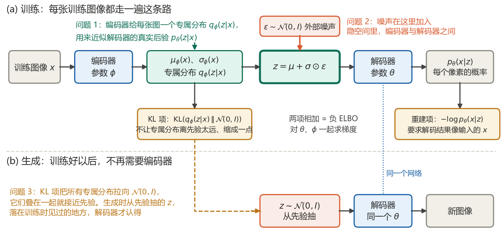
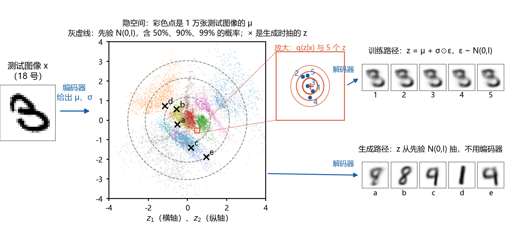
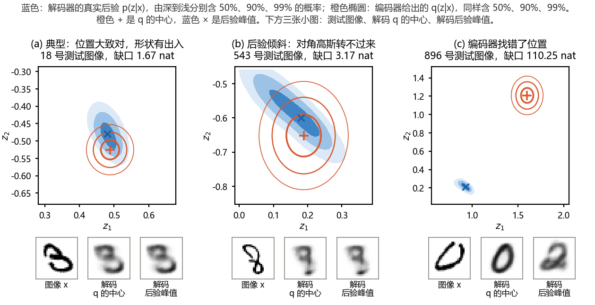
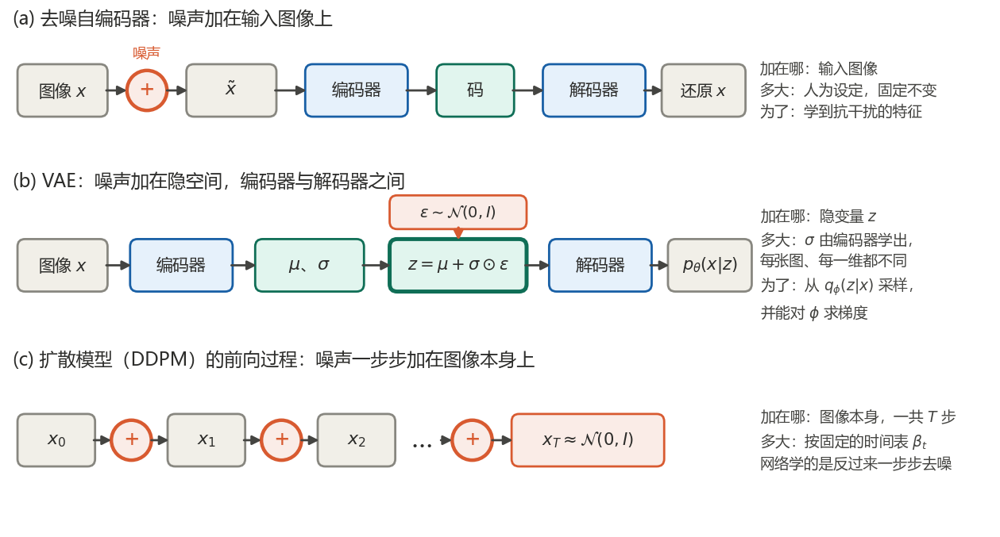
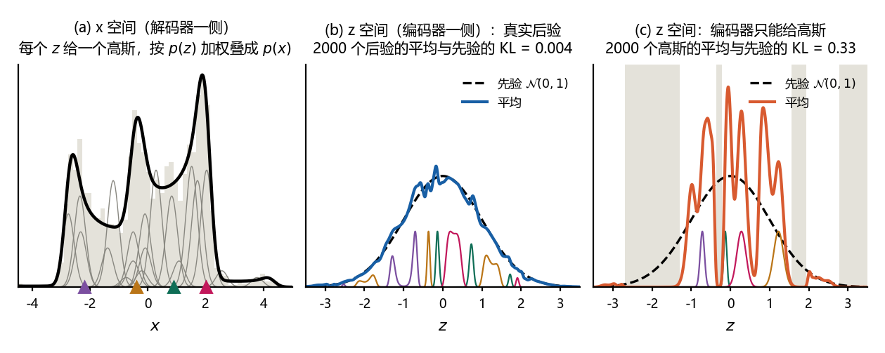
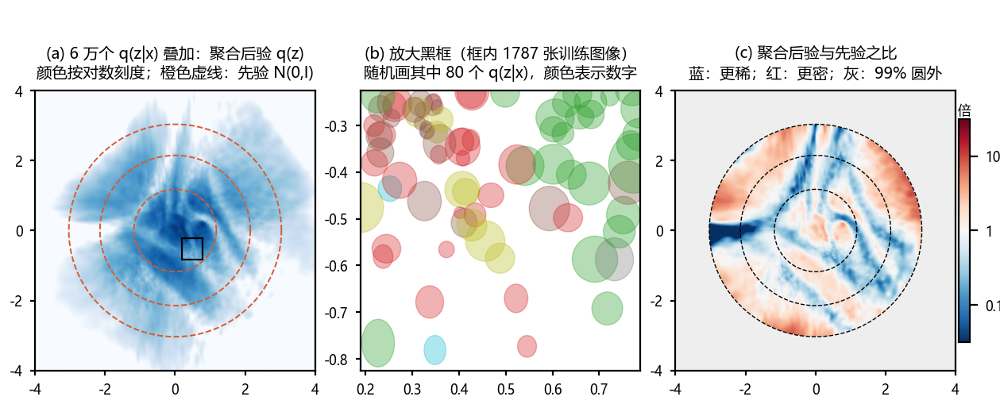

# 扩散模型推导笔记 I0：VAE 的直观路线

本文是本系列的直观篇，不做逐步推导，只把变分自编码器（VAE）的来龙去脉连成一条路线，并回答学 VAE 时最容易卡住的三个问题：编码器学的是什么，重参数化把噪声加在哪里，讲 VAE 时说的“混合高斯”指的是哪一个。素材主要来自苏剑林的《变分自编码器》系列博客（一）（二）（三）和李宏毅老师的课程，课程内容已整理在 [L2](L2-vae-lectures.md)；每一步背后的推导在 [D2–D3](D2-D3-elbo-and-vae-loss.md)。

每个说法都用两个例子核对。一个是一维的玩具例子，与 [L2 图 5(b)](L2-vae-lectures.md#33-vae无穷多个高斯的混合) 是同一个模型，所有的量都能精确计算。另一个是 [D2–D3 第 8 章](D2-D3-elbo-and-vae-loss.md#8-配套练习训练一个-vae对照公式找代码)在 MNIST 上训练的 VAE，它的隐变量只有 2 维，所以解码器的真实后验可以在网格上直接算出来，与编码器给出的分布逐一比较。

读法：第 0 章是一页速览；第 1、2 章是路线的前半段，说明自编码器为什么不能直接生成，以及解码器为什么就是生成模型本身；第 3、4、5 章分别回答三个问题；第 6 章把训练和生成串起来；第 7 章列出常见误解；第 8、9 章是自测题和答案。

记号按 Kingma & Welling (2014)：先验 $`p(z)=\mathcal{N}(0,I)`$，解码器 $`p_\theta(x|z)`$，编码器 $`q_\phi(z|x)`$。$`\mathcal{N}(\mu,\sigma^2)`$ 的第二个参数是方差，log 一律指自然对数，nat 是按自然对数计的信息量单位。MNIST 测试图像按从 0 开始的下标编号，“18 号”就是代码里的 `test_x[18]`。玩具例子的数字由 `code/i0_check.py` 核对，MNIST 上的数字由 `code/03_vae_latent_mnist.py` 算出并打印；图 1、图 4、图 5 由 `code/make_figures_i0.py` 生成，图 2、图 3、图 6 由 `code/03_vae_latent_mnist.py` 生成。版本 1.0，2026-10-24。

引用说明：博客与课程的内容是笔记作者自己的概括，没有照录原文，链接见参考资料。

## 0 一页速览

### 0.1 三个问题的简短回答

| 问题 | 简短回答 | 本文 |
|---|---|---|
| 编码器学的是什么？是 $`p(z\mid x)`$ 吗？ | 是它的近似。编码器给每张图一个专属的对角高斯 $`q_\phi(z\mid x)`$，训练使它靠近解码器的真实后验 $`p_\theta(z\mid x)`$。它只能是轴对齐的椭圆，而且一个网络要管所有的图，所以只是近似 | 第 3 章 |
| 重参数化把噪声加在哪里？ | 加在隐空间里，编码器与解码器之间：$`z=\mu_\phi(x)+\sigma_\phi(x)\odot\varepsilon`$。噪声 $`\varepsilon`$ 先乘以编码器给的 $`\sigma`$，再加到编码器给的 $`\mu`$ 上，不加在输入图像上，也不加在输出上 | 第 4 章 |
| “混合高斯”是训练数据的编码器输出叠起来的吗？ | 有两个混合，在两个空间。李宏毅讲的“无穷多个高斯的混合”在 $`x`$ 空间，是解码器按先验加权叠成的 $`p_\theta(x)`$；训练数据的编码器输出叠起来是另一个混合，在 $`z`$ 空间，叫聚合后验 $`q_\phi(z)`$。KL 项让后者接近先验，生成才可行 | 第 5 章 |

### 0.2 路线

1. **自编码器**能把图压成一个码再还原，但码散落各处，随便取一个码去解码，结果没有保证，所以不能直接生成（第 1 章）。
2. **规定码从哪里来**：先验 $`p(z)=\mathcal{N}(0,I)`$。解码器把每个 $`z`$ 变成一个关于 $`x`$ 的分布，所有 $`z`$ 按先验加权叠起来，就是模型给出的数据分布 $`p_\theta(x)`$。解码器就是生成模型本身（第 2 章）。
3. **训练解码器，要知道每张图对应哪些 $`z`$**，这就是后验 $`p_\theta(z|x)`$。它写不出来，于是训练一个编码器 $`q_\phi(z|x)`$ 去近似它，每张图得到一个专属的高斯（第 3 章）。
4. **训练时 $`z`$ 从专属的高斯里抽**：$`z=\mu+\sigma\odot\varepsilon`$。噪声加在隐空间，迫使解码器对 $`\mu`$ 附近的一片 $`z`$ 都能还原（第 4 章）。
5. **KL 项把每个专属的高斯拉向 $`\mathcal{N}(0,I)`$**：不让 $`\sigma`$ 缩成 0，也让所有训练图像的专属高斯叠起来接近先验（第 5 章）。
6. **生成时不用编码器**：从 $`\mathcal{N}(0,I)`$ 抽 $`z`$，直接解码。训练的损失是重建项加 KL 项，即负的证据下界（ELBO）（第 6 章）。



## 1 起点：自编码器能压缩，不能生成

**术语**：自编码器（auto-encoder）由编码器和解码器组成：编码器把输入 $`x`$ 压成一个低维的码，解码器把码还原成 $`x`$，训练目标是还原得尽量像。码也叫隐变量（latent variable），码所在的空间叫隐空间（latent space）。

**要点**：

1. 想用自编码器生成新图，就得自己挑一个码送进解码器。可是解码器只在训练图像的码上训练过，这些码可以落在隐空间的任何地方，彼此之间留着大片空白；随手挑的码多半落在空白处，解码结果没有保证。李宏毅在课上讲到这里时打了一个问号（[L2 第 2.1 节](L2-vae-lectures.md#21-从自编码器到-vae)）。
2. 要能生成，必须做到两件事：第一，规定码从一个固定的分布里抽，生成时才知道去哪里取码；第二，保证解码器在这个分布覆盖的范围内都训练过。VAE 用先验 $`p(z)=\mathcal{N}(0,I)`$ 做到第一件（第 2 章），用编码器的噪声和 KL 项做到第二件（第 4、5 章）。
3. 苏剑林在《变分自编码器（一）》的“经典回顾”一节指出，常见教程的画法是从 $`\mathcal{N}(0,I)`$ 抽 $`z`$、解码、再要求结果像训练图像，这说不通：抽出来的 $`z`$ 该和哪一张训练图像比较，根本不知道。VAE 的实际做法是先由训练图像决定 $`z`$ 从哪里抽，第 3 章细说。

**联系**：[L2 第 2.3 节](L2-vae-lectures.md#23-为什么要加噪声码空间的连续性)用满月与弦月的例子说明码之间的空白。

## 2 解码器：生成模型本身

**术语**：先验（prior）$`p(z)`$ 是隐变量在看到任何数据之前的分布，VAE 取 $`\mathcal{N}(0,I)`$，并且固定不学。解码器（decoder）$`p_\theta(x|z)`$ 是由神经网络给出的关于 $`x`$ 的分布，$`\theta`$ 是网络的参数。证据（evidence）也叫边缘似然，是模型给一张图的概率 $`p_\theta(x)`$。

**要点**：

1. 生成一张图分两步：先抽 $`z\sim\mathcal{N}(0,I)`$，再从 $`p_\theta(x|z)`$ 抽 $`x`$。在 MNIST 的例子里，解码器输出 784 个像素各自为黑的概率。
2. 每个 $`z`$ 在 $`x`$ 空间里给出一个分布，解码器是高斯时就是一个高斯。按先验 $`p(z)`$ 加权、对所有 $`z`$ 积分，得到模型的数据分布（下式）。这就是李宏毅课上说的“无穷多个高斯的混合”：$`z`$ 只是一个简单的标准正态，把它变成高斯参数的却是神经网络，所以 $`p_\theta(x)`$ 可以很复杂（图 5(a)）。这是本文要区分的第一个混合，它在 $`x`$ 空间，属于解码器一侧。
3. 训练的目标是让训练图像的 $`\log p_\theta(x)`$ 尽量大，即最大似然。难处在积分：对一张具体的图，只有隐空间里很小的一片 $`z`$ 能解码出像它的东西。在 MNIST 的例子里，这一片的标准差中位数约 0.05，而先验的标准差是 1，从先验随便抽 $`z`$ 几乎抽不中；隐变量的维数越高越是如此。
4. 能产生这张图的那一片 $`z`$，正是后验（posterior）$`p_\theta(z|x)`$。知道了它，就知道该拿哪些 $`z`$ 去训练解码器；可是它的分母正是写不出来的 $`p_\theta(x)`$，所以后验同样写不出来。下一章的编码器就是为此而设。

**公式**：

```math
p_\theta(x)=\int p(z)\,p_\theta(x|z)\,dz,\qquad p_\theta(z|x)=\frac{p(z)\,p_\theta(x|z)}{p_\theta(x)}.
```

**联系**：无穷多个高斯的混合见 [L2 第 3.3 节](L2-vae-lectures.md#33-vae无穷多个高斯的混合)，积分为什么算不出来见 [D2–D3 第 3.2 节](D2-D3-elbo-and-vae-loss.md#32-卡在哪里)。

## 3 编码器在学什么（问题 1）

### 3.1 回答

**术语**：编码器（encoder）是另一个神经网络，参数为 $`\phi`$。它读入 $`x`$，输出均值 $`\mu_\phi(x)`$ 和方差 $`\sigma_\phi^2(x)`$（代码里输出的是 $`\log\sigma^2`$），给出一个对角高斯 $`q_\phi(z|x)=\mathcal{N}(\mu_\phi(x),\mathrm{diag}\,\sigma_\phi^2(x))`$。它也叫近似后验或识别模型。

**回答**：是 $`p(z|x)`$ 的近似。确切地说，编码器给每张训练图像一个专属的高斯分布，训练使它靠近解码器的真实后验 $`p_\theta(z|x)`$。依据是下面这个恒等式：左边与 $`\phi`$ 无关，所以对 $`\phi`$ 抬高 ELBO，就是在压小右边的 KL 散度，也就是让 $`q_\phi(z|x)`$ 靠近真实后验。推导见 [D2–D3 第 5 章](D2-D3-elbo-and-vae-loss.md#5-d2b-分解推法)。

```math
\log p_\theta(x)=\mathrm{ELBO}(\theta,\phi;x)+\mathrm{KL}\big(q_\phi(z|x)\,\Vert\,p_\theta(z|x)\big)
```

苏剑林在《变分自编码器（一）》的“VAE 初现”一节特别强调了“专属”二字：VAE 假设的是每个样本的后验是正态分布，均值和方差由网络按样本算出，而不是所有样本共用一个正态分布。

有三点要说清楚：

1. **它近似的是解码器的后验**。数据里并没有“真正的 $`z`$”，$`p_\theta(z|x)`$ 由先验和解码器按贝叶斯公式定义，解码器一变，后验跟着变。编码器和解码器一起训练、互相适应：解码器学着解码编码器给的码，编码器学着把每张图放到解码器能还原它的地方。
2. **它只能是对角高斯**。在二维隐空间里，就是一个与坐标轴对齐的椭圆，不能倾斜，不能弯曲，也不能有两个峰。
3. **一个网络管所有的图**。这叫摊销推断（amortized inference）：新图来了直接算，不用为每张图单独优化；代价是对少见的图，椭圆可能放错地方。

### 3.2 一张真实的图：编码器给出一个很小的椭圆

图 2 是 D2–D3 第 8 章那个 VAE 上的实际情况。18 号测试图像是一个 3，经编码器得到 $`\mu=(0.488,-0.525)`$、$`\sigma=(0.0225,0.0238)`$。在隐空间里，这是一个大小约为先验四十分之一的小椭圆。按 $`z=\mu+\sigma\odot\varepsilon`$ 抽 5 个 $`z`$，都落在这个小椭圆里，解码出来几乎是同一个 3。作为对照，从先验 $`\mathcal{N}(0,I)`$ 抽 5 个 $`z`$，解码出来是各种数字，这就是生成。



整个训练集上，编码器给出的标准差中位数是 0.038（第一维）和 0.047（第二维），95% 分位是 0.10 和 0.11。每张图的专属分布都很窄，6 万个窄椭圆铺开，才盖住先验的范围（第 5 章）。

### 3.3 和真实后验比一比

隐变量只有 2 维时，真实后验可以硬算：在 $`[-7,7]^2`$ 上取步长 0.01 的网格，共 196 万个点，每个点算出 $`p(z)\,p_\theta(x|z)`$，归一化就得到 $`p_\theta(z|x)`$，同时得到 $`\log p_\theta(x)`$。对前 1000 张测试图像这样算，再在同一个网格上求出每张图的 ELBO，结果如下：

| 量 | 数值 |
|---|---|
| 平均负 ELBO | 142.96 nat |
| 平均 $`-\log p_\theta(x)`$ | 138.32 nat |
| 缺口 $`\log p_\theta(x)-\mathrm{ELBO}`$ 的中位数 | 1.67 nat |
| 缺口的平均 | 4.64 nat |
| 缺口小于 1 nat 的图 | 32% |
| 缺口大于 10 nat 的图 | 9% |
| 真实后验落在 $`q`$ 的 90% 椭圆内的概率，中位数 | 0.49；若 $`q`$ 与真实后验相同，应为 0.90 |
| 真实后验两个坐标的相关系数，绝对值的中位数 | 0.40 |

缺口就是上一节恒等式里的 $`\mathrm{KL}(q_\phi(z|x)\Vert p_\theta(z|x))`$。作为核对，ELBO 也按训练时的算法算了一遍：KL 用闭式，重建项用 1000 个重参数化样本的平均。1000 张图中有 997 张，两种算法的差在蒙特卡洛标准误的 3 倍以内。

图 3 挑了三张图：

- **典型**：缺口为中位数的那张，18 号（一个 3），缺口 1.67 nat。$`q`$ 的位置基本对，但真实后验的中心偏上一些，形状略微倾斜。
- **后验倾斜**：后验大部分仍在 $`q`$ 附近、倾斜得最厉害的一张，543 号（一个 8），相关系数 $`-0.875`$，缺口 3.17 nat。对角高斯只能与坐标轴对齐，转不过来。
- **找错位置**：缺口最大的一张，896 号（一个笔画张开的 0），缺口 110 nat。编码器把它放在 0 聚集的地方 $`(1.60,1.21)`$，真实后验的峰却在 $`(0.93,0.21)`$。解码 $`q`$ 的中心，得到一个工整的 0；解码后验峰值，得到一团模糊的笔画。后者与这张不规则的 0 逐像素更接近，所以解码器的似然更偏爱它。真实后验是按解码器逐像素的似然定义的，与人眼认为它是几不一定一致，[L2 第 4.2 节](L2-vae-lectures.md#42-vae-的问题逐像素地像不等于真的像)讲过逐像素比较的这个特点。



**补充**：

1. Cremer et al. (2018) 把这个缺口分成两部分：一部分来自分布族太简单（对角高斯），另一部分来自一个网络管所有的图（摊销），并发现后者往往更大。图 3 的第三张属于后一种情况。
2. MNIST 的像素是灰度，伯努利似然对它并不严格归一化（[D2–D3 第 7.4 节](D2-D3-elbo-and-vae-loss.md#74-d3d-伯努利解码器与-bce)），但上面的恒等式只涉及对 $`z`$ 的积分，照样成立。
3. 本文 MNIST 上的数字来自测试机 GPU 上的一次运行。在 CPU 上运行，训练出的模型略有不同：缺口的中位数是 1.57 nat，聚合后验与先验的 KL 是 0.40 nat，按同样规则选出的三张图也不同，但上面的结论都不变。

**联系**：[L2 第 3.5 节](L2-vae-lectures.md#35-为什么要引入-qzx)从“为什么要引入 $`q(z|x)`$”讲同一件事。[D0–D1 第 5.2 节](D0-D1-gaussian-and-kl.md#52-后验分布套路二)在一维线性高斯模型里用配方法求出了精确的后验，那里后验本身就是高斯，编码器可以做到缺口为 0。

## 4 噪声加在哪里（问题 2）

### 4.1 回答

**术语**：重参数化（reparameterization）把“从 $`q_\phi(z|x)`$ 抽一个 $`z`$”改写成“确定的计算加上一份与参数无关的噪声”。

**回答**：噪声加在隐空间里，编码器与解码器之间。编码器先算出 $`\mu`$ 和 $`\sigma`$，再取一份标准正态噪声 $`\varepsilon`$，乘以 $`\sigma`$、加上 $`\mu`$，得到 $`z`$ 送进解码器（下式，$`\odot`$ 是逐元素相乘）。噪声不加在输入图像上，不加在解码器的输出上，也不加在网络的参数上。代码是 `code/02_vae_mnist.py` 的第 120 到 124 行：先由 $`\log\sigma^2`$ 算出 $`\sigma`$，再生成同样形状的噪声，最后返回 $`\mu+\sigma\varepsilon`$。

```math
z=\mu_\phi(x)+\sigma_\phi(x)\odot\varepsilon,\qquad\varepsilon\sim\mathcal{N}(0,I)
```

### 4.2 重参数化没有多加一份噪声

ELBO 本来就是对 $`q_\phi(z|x)`$ 的期望，训练时本来就要从 $`q_\phi(z|x)`$ 抽 $`z`$。问题出在梯度：“抽样”这个操作不是 $`\mu`$、$`\sigma`$ 的可微函数，梯度传到这里就断了。改写成 $`\mu+\sigma\odot\varepsilon`$ 以后，$`z`$ 的分布一点没变，随机性改由外部的 $`\varepsilon`$ 带进来；$`\partial z/\partial\mu=1`$，$`\partial z/\partial\sigma=\varepsilon`$，梯度就能穿过 $`z`$ 回到编码器。苏剑林在《变分自编码器（一）》的“重参数技巧”一节这样概括：抽样这个动作不再参与梯度下降，参与的是抽样的结果。推导见 [D2–D3 第 7.1 节](D2-D3-elbo-and-vae-loss.md#71-d3a-为什么梯度不能直接放进期望)和[第 7.2 节](D2-D3-elbo-and-vae-loss.md#72-d3b-重参数化)。

### 4.3 与另外两种“加噪声”比较

图 4 和下表把 VAE 与去噪自编码器、扩散模型放在一起：

| 模型 | 噪声加在哪里 | 噪声多大 | 为什么加 |
|---|---|---|---|
| 去噪自编码器（Vincent et al., 2008） | 输入图像 | 人为设定，固定不变 | 让网络学到抗干扰的特征 |
| VAE | 隐变量 $`z`$，编码器与解码器之间 | $`\sigma`$ 由编码器学出，每张图、每一维都不同 | 从 $`q_\phi(z\mid x)`$ 抽样，并且能对 $`\phi`$ 求梯度 |
| 扩散模型（DDPM）的前向过程 | 图像本身，分 $`T`$ 步一步步加 | 按固定的时间表 $`\beta_t`$ | 网络学着反过来一步步去噪 |



### 4.4 这份噪声起什么作用

1. **让隐空间连续**：同一张图每次训练抽到的 $`z`$ 都不一样，解码器必须对 $`\mu`$ 附近的一片 $`z`$ 都还原出这张图；相邻图像的码一旦重叠，重叠处就得解码成介于两者之间的样子。隐空间因此被填满，变得连续（李宏毅的满月与弦月，[L2 第 2.3 节](L2-vae-lectures.md#23-为什么要加噪声码空间的连续性)）。
2. **噪声的大小是学出来的**：如果损失只有重建项，噪声只会妨碍还原，编码器会把 $`\sigma`$ 压到 0，VAE 退化成普通的自编码器（[L2 第 2.4 节](L2-vae-lectures.md#24-只最小化重建误差会怎样)）。KL 项里有 $`-\log\sigma^2`$，$`\sigma\to0`$ 时它趋于无穷，所以噪声训不没。苏剑林在《变分自编码器（一）》的“本质是什么”一节把这看成 VAE 内部的对抗：重建项希望没有噪声，KL 项希望有噪声；与 GAN 不同，这里双方混在同一个损失里一起进化。在 MNIST 的例子里，$`\sigma`$ 最后停在 0.04 左右：很小，但不是 0。
3. **每张图只抽一个 $`z`$ 就够**：训练时每张图每一步只抽一个 $`z`$，即原论文中的 $`L=1`$。苏剑林在《变分自编码器（三）》中的解释是：训练好的后验很窄，多抽几次，结果也差不多。本文的 MNIST 模型正是这样，图 2 中抽到的 5 个 $`z`$ 解码出来几乎一样。
4. **生成时不需要重参数化**：生成时直接从 $`\mathcal{N}(0,I)`$ 抽 $`z`$，编码器不出场。

**联系**：DDPM 的前向过程没有可学的参数，相当于一个固定的编码器（[L1 第 2.6 节](L1-ddpm-lectures.md#26-ddpm-的证据下界)）；VAE 的编码器则要和解码器一起学。

## 5 “混合高斯”指的是哪一个（问题 3）

### 5.1 回答：两个混合，在两个空间

**术语**：聚合后验（aggregate posterior）是编码器在所有训练图像上的输出取平均得到的分布 $`q_\phi(z)`$。

| | 解码器一侧 | 编码器一侧 |
|---|---|---|
| 所在空间 | $`x`$ 空间（图像） | $`z`$ 空间（隐空间） |
| 式子 | $`p_\theta(x)=\int p(z)\,p_\theta(x\mid z)\,dz`$ | $`q_\phi(z)=\frac{1}{N}\sum_{n=1}^{N}q_\phi(z\mid x_n)`$ |
| 分量 | 每个 $`z`$ 一个，无穷多个 | 每张训练图像一个，共 $`N`$ 个 |
| 权重 | 先验 $`p(z)`$ | 每张图 $`1/N`$ |
| 名称 | 模型的边缘分布，李宏毅课上的“无穷多个高斯的混合” | 聚合后验，苏剑林写作 $`p(Z)=\sum_X p(Z\mid X)p(X)`$ |

所以，李宏毅讲的是第一个混合；“训练数据的编码器输出的高斯分布组合起来”是第二个混合。两个都存在，并且通过先验联系在一起：生成时 $`z`$ 从先验抽，训练时解码器见到的 $`z`$ 却来自聚合后验，只有两者接近，生成时抽到的 $`z`$ 才落在解码器训练过的地方。苏剑林在《变分自编码器（一）》的“分布标准化”一节正是这样解释 KL 项的：让每个 $`p(Z|X)`$ 都向标准正态看齐，叠起来的 $`p(Z)`$ 也就向标准正态看齐。

### 5.2 理想情况：聚合后验正好是先验

如果编码器就是真实后验，并且模型完全拟合了数据，即 $`p_\theta(x)=p_{\mathrm{data}}(x)`$，那么聚合后验正好等于先验。下式第一步用 $`p_{\mathrm{data}}=p_\theta`$，第二步是乘法公式，第三步把 $`x`$ 积掉：

```math
\int p_{\mathrm{data}}(x)\,p_\theta(z|x)\,dx=\int p_\theta(x)\,p_\theta(z|x)\,dx=\int p_\theta(x,z)\,dx=p(z)
```

图 5 在玩具例子里画出了这件事。数据直接从模型抽，所以 $`p_\theta=p_{\mathrm{data}}`$ 精确成立：

- **(a) $`x`$ 空间**：19 个 $`z`$ 各自的高斯（细线）按先验加权，叠成有三个峰的 $`p(x)`$（粗线），与 2000 个数据的直方图一致。
- **(b) $`z`$ 空间，用真实后验**：2000 个数据点各自的后验 $`p(z|x_n)`$ 取平均，与先验的 KL 只有 0.004 nat，最大差 0.05，这是只抽 2000 个点带来的抽样误差；对 $`x`$ 做精确积分时，与先验的差在 $`10^{-6}`$ 以下。
- **(c) $`z`$ 空间，换成编码器能给的高斯**：对每个数据点，找使 ELBO 最大的高斯。这些高斯的平均起伏很大，与先验的 KL 是 0.33 nat；先验有 18% 的概率落在灰色区间里，那里聚合后验不到先验的十分之一。

换成高斯为什么差这么多？这个玩具的真实后验大多有好几个峰：2000 个后验中，94.5% 有两个以上的峰（次峰至少有主峰一成高），主峰左右 0.25 以内的概率，中位数只有 0.50。一个高斯只能盖住一个峰，许多数据点的高斯挤在同几个位置，其余地方就空了。



### 5.3 KL 项的两份工作

把 KL 项在训练集上的平均拆开，得到下面的恒等式（Hoffman & Johnson, 2016）。这里 $`x`$ 在训练集上均匀地取，$`q_\phi(z)`$ 是聚合后验，$`I_q(x;z)`$ 是互信息：在“先取一张训练图像，再从它的专属分布抽 $`z`$”这个过程中，$`z`$ 带有多少关于 $`x`$ 的信息。

```math
\mathbb{E}_x\big[\mathrm{KL}\big(q_\phi(z|x)\,\Vert\,p(z)\big)\big]=I_q(x;z)+\mathrm{KL}\big(q_\phi(z)\,\Vert\,p(z)\big)
```

证明只需在对数里减一项、加一项 $`\log q_\phi(z)`$：

```math
\mathbb{E}_x\mathbb{E}_{q_\phi(z|x)}\Big[\log\frac{q_\phi(z|x)}{p(z)}\Big]=\mathbb{E}_x\mathbb{E}_{q_\phi(z|x)}\Big[\log\frac{q_\phi(z|x)}{q_\phi(z)}\Big]+\mathbb{E}_{q_\phi(z)}\Big[\log\frac{q_\phi(z)}{p(z)}\Big]
```

右边第一项是互信息的定义；第二项先对 $`x`$ 平均，$`q_\phi(z|x)`$ 平均起来就是 $`q_\phi(z)`$。

所以 KL 项同时做两份工作：为 $`z`$ 携带的信息收费，码越能区分不同的图，这一份越大；把聚合后验拉向先验。重建项需要信息，KL 项为信息收费，两者的折中就是第 4.4 节说的对抗。互信息不会超过 $`\log N`$，因为 $`z`$ 最多只能分辨出是哪一张训练图像。两个例子的数字：

| 例子 | KL 项的平均 | 互信息 | 聚合后验与先验的 KL |
|---|---|---|---|
| MNIST，训练集 6 万张 | 6.56 nat | 6.20 nat，上限 $`\log 60000=11.0`$ | 0.36 nat |
| 玩具例子，编码器只能给高斯 | 2.46 nat | 2.12 nat | 0.33 nat |

MNIST 上，KL 项的绝大部分是在为信息付费，聚合后验与先验的差距只占 0.36 nat。聚合后验与先验的 KL 用 2 万个样本的蒙特卡洛估计，标准误 0.006；在 $`[-4,4]^2`$ 的网格上直接求和得到 0.34，网格外还有 0.3% 的概率没有算进去。

### 5.4 MNIST 上的聚合后验

图 6 把 6 万张训练图像的 $`q_\phi(z|x_n)`$ 叠了起来：

- **(a)** 聚合后验不是一个光滑的高斯：各个数字聚成团，团与团之间密度低。它的均值是 $`(0.075,0.020)`$，两个方向的方差是 1.33 和 1.30，相关系数 0.14，大体上与 $`\mathcal{N}(0,I)`$ 相当。
- **(b)** 放大来看，它由一个个很窄的椭圆组成。
- **(c)** 与先验相比，蓝色区域比先验稀。从先验抽 $`z`$ 时，有 35% 落在聚合后验不到先验一半的地方，有 2% 落在不到十分之一的地方。这些地方，解码器在训练时很少见到 $`z`$。

聚合后验的“铺开”靠的是什么，可以用全方差公式看出来：

```math
\mathrm{Cov}_{q_\phi(z)}[z]=\mathrm{Cov}_n\big[\mu_\phi(x_n)\big]+\mathbb{E}_n\big[\mathrm{diag}\,\sigma_\phi^2(x_n)\big]
```

在第一维上，这是 1.323 加 0.0028：铺开几乎全靠各张图的均值彼此分开，而不是靠每个椭圆变宽。



**补充**：

1. 对固定的编码器，使平均 ELBO 最大的先验恰好是聚合后验本身（Tomczak & Welling, 2018，式 (8)）。他们提出的 VampPrior 用少量可以学习的“伪输入”的编码器输出取平均，来近似这个最优先验。另一条路是直接训练聚合后验去匹配先验，例如对抗自编码器（Makhzani et al., 2015）。
2. 第 7 章第 3 条误解与这里有关：KL 项并不要求每张图的 $`q_\phi(z|x)`$ 都等于先验，接近先验的是它们叠起来的整体。

### 5.5 两个混合放在一起看：两个联合分布

苏剑林在《变分自编码器（二）》中换了一个角度：编码器一侧和解码器一侧各给出一个 $`(x,z)`$ 的联合分布，训练就是让两者一致。前者是“先取一张训练图像，再从它的专属分布抽 $`z`$”，后者是“先从先验抽 $`z`$，再解码”：

```math
q_\phi(x,z)=p_{\mathrm{data}}(x)\,q_\phi(z|x),\qquad p_\theta(x,z)=p(z)\,p_\theta(x|z)
```

把数据分布看成有密度的分布，两者之间的 KL 散度展开以后，就是负 ELBO 的平均，只差一个与参数无关的常数，即数据分布的熵 $`H(p_{\mathrm{data}})`$：

```math
\mathrm{KL}\big(q_\phi(x,z)\,\Vert\,p_\theta(x,z)\big)=-\mathbb{E}_x\big[\mathrm{ELBO}(\theta,\phi;x)\big]-H(p_{\mathrm{data}})
```

本章的两个混合，恰好是这两个联合分布的边缘：$`p_\theta(x,z)`$ 把 $`z`$ 积掉，得到第一个混合 $`p_\theta(x)`$；$`q_\phi(x,z)`$ 把 $`x`$ 积掉，得到第二个混合，即聚合后验 $`q_\phi(z)`$。KL 散度的链式法则给出两种拆法，其中 $`q_\phi(x|z)=q_\phi(x,z)/q_\phi(z)`$：

```math
\mathrm{KL}\big(q_\phi(x,z)\,\Vert\,p_\theta(x,z)\big)=\mathrm{KL}\big(p_{\mathrm{data}}(x)\,\Vert\,p_\theta(x)\big)+\mathbb{E}_x\big[\mathrm{KL}\big(q_\phi(z|x)\,\Vert\,p_\theta(z|x)\big)\big]
```

```math
\mathrm{KL}\big(q_\phi(x,z)\,\Vert\,p_\theta(x,z)\big)=\mathrm{KL}\big(q_\phi(z)\,\Vert\,p(z)\big)+\mathbb{E}_{q_\phi(z)}\big[\mathrm{KL}\big(q_\phi(x|z)\,\Vert\,p_\theta(x|z)\big)\big]
```

两种拆法里的每一项都不小于 0，所以压小这一个 KL，就同时压着两对边缘分布：在 $`x`$ 一侧，模型的 $`p_\theta(x)`$ 要接近数据；在 $`z`$ 一侧，聚合后验要接近先验。第一种拆法就是第 3 章的恒等式对数据取平均：模型拟合数据，加上编码器贴近真实后验。玩具例子里数据直接从模型抽，第一种拆法的第一项为 0，于是聚合后验与先验的 KL 不会超过平均缺口；两者都用 2000 个数据点估计，分别是 0.33 nat 和 0.55 nat。

**联系**：第一个混合见 [L2 第 3.3 节](L2-vae-lectures.md#33-vae无穷多个高斯的混合)；KL 项来自 ELBO 的两项形式，见 [D2–D3 第 6 章](D2-D3-elbo-and-vae-loss.md#6-d2c-elbo-的两项形式)；同一个模型的隐空间散点和先验采样，见 [D2–D3 第 8.2 节](D2-D3-elbo-and-vae-loss.md#82-四张图)。

## 6 把路线串起来：训练与生成

| | 训练 | 生成 |
|---|---|---|
| 输入 | 一批训练图像 $`x`$ | 无 |
| 编码器 | 用：给出 $`\mu_\phi(x)`$、$`\sigma_\phi(x)`$ | 不用 |
| $`z`$ 从哪里来 | $`z=\mu+\sigma\odot\varepsilon`$，即从 $`q_\phi(z\mid x)`$ 抽 | 从先验 $`\mathcal{N}(0,I)`$ 抽 |
| 解码器 | 给出 $`p_\theta(x\mid z)`$，与 $`x`$ 比较 | 同一个解码器，输出新图像 |
| 算什么 | 损失 = 重建项 + KL 项 = 负 ELBO，对 $`\theta`$、$`\phi`$ 一起求梯度 | 只做前向计算 |
| `02_vae_mnist.py` | 编码器的两个输出头在第 111、112 行，重参数化在第 120 到 124 行，KL 在第 137 行，重建在第 142 行，损失在第 174 行 | D2–D3 图 8 的先验采样 |

一句话总结这条路线：解码器是生成模型本身；编码器是训练时的助手，给每张图一个专属分布，去近似解码器的后验；噪声在隐空间里按编码器给的 $`\sigma`$ 加入，让隐空间连续，同时让梯度能传回编码器；KL 项既不让专属分布缩成一点，也让所有的专属分布叠起来接近先验，生成时从先验抽的 $`z`$ 才落在解码器熟悉的地方。损失的两项与证据下界的关系，见 [D2–D3 第 6 章](D2-D3-elbo-and-vae-loss.md#6-d2c-elbo-的两项形式)。

## 7 常见误解

1. **“编码器输出 $`z`$”**。编码器输出的是分布的参数 $`\mu`$ 和 $`\log\sigma^2`$，$`z`$ 是按 $`z=\mu+\sigma\odot\varepsilon`$ 抽出来的。
2. **“VAE 学的是先验 $`p(z)`$”**。先验固定为 $`\mathcal{N}(0,I)`$，学的是编码器和解码器。
3. **“KL 项让每张图的 $`q_\phi(z|x)`$ 都等于 $`\mathcal{N}(0,I)`$”**。真那样的话，$`z`$ 不带任何信息，这叫后验坍缩（posterior collapse）。实际训练出来，每个 $`q_\phi(z|x)`$ 都很窄，MNIST 上 $`\sigma`$ 约为 0.04；接近先验的是它们叠起来的聚合后验。
4. **“重参数化是为了多加一点噪声”**。它不改变 $`z`$ 的分布，只改变随机性进入计算的位置，目的是让梯度能传回编码器。
5. **“真实后验是数据里本来就有的”**。它由先验和解码器定义，随着解码器的训练而变。
6. **“讲 VAE 时的混合高斯，就是编码器输出叠起来”**。李宏毅讲的混合在 $`x`$ 空间，由解码器按先验加权叠成；编码器输出叠起来的是 $`z`$ 空间里的聚合后验。
7. **“ELBO 越接近 0 越好”**。ELBO 是 $`\log p_\theta(x)`$ 的下界，抬高它是让它接近 $`\log p_\theta(x)`$。本文 MNIST 的例子里，每张图的 ELBO 约为 $`-143`$ nat，$`\log p_\theta(x)`$ 约为 $`-138`$ nat。

## 8 自测题

1. 编码器输出什么？它在近似什么？为什么说它近似的是“解码器的”后验？
2. 一张训练图像的 $`z`$ 是怎样得到的？噪声 $`\varepsilon`$ 乘了谁、加到了哪里？生成新图时还需要这一步吗？
3. 写出本文区分的两个“混合”的式子，指出它们各自在哪个空间，分量和权重是什么。
4. 用 $`\mathbb{E}_x[\mathrm{KL}(q_\phi(z|x)\Vert p(z))]=I_q(x;z)+\mathrm{KL}(q_\phi(z)\Vert p(z))`$ 解释：如果给 KL 项乘一个很大的权重，编码器会怎样？如果完全去掉 KL 项呢？
5. 图 3(c) 中，编码器把那张 0 放在了 0 聚集的地方，为什么说它“找错了位置”？这说明真实后验是按什么标准定义的？

## 9 自测答案

1. 输出均值 $`\mu_\phi(x)`$ 与 $`\log\sigma_\phi^2(x)`$，即对角高斯 $`q_\phi(z|x)`$ 的参数。它近似 $`p_\theta(z|x)=p(z)p_\theta(x|z)/p_\theta(x)`$。这个后验由先验和解码器定义，解码器的参数 $`\theta`$ 一变它就跟着变，所以是“解码器的”后验。训练时对 $`\phi`$ 抬高 ELBO，等于压小 $`\mathrm{KL}(q_\phi(z|x)\Vert p_\theta(z|x))`$。
2. 编码器先给出 $`\mu`$、$`\sigma`$，再抽 $`\varepsilon\sim\mathcal{N}(0,I)`$，令 $`z=\mu+\sigma\odot\varepsilon`$。噪声乘以编码器给的 $`\sigma`$，加到 $`\mu`$ 上，位置在隐空间，编码器与解码器之间。生成时不需要这一步：直接从 $`\mathcal{N}(0,I)`$ 抽 $`z`$ 送进解码器。
3. $`x`$ 空间：$`p_\theta(x)=\int p(z)p_\theta(x|z)dz`$，每个 $`z`$ 一个分量，权重是先验，有无穷多个。$`z`$ 空间：$`q_\phi(z)=\frac{1}{N}\sum_n q_\phi(z|x_n)`$，每张训练图像一个分量，权重是 $`1/N`$，共 $`N`$ 个。
4. 权重很大时，压小 KL 项最省事的办法是让 $`z`$ 不带信息，互信息趋于 0，每个 $`q_\phi(z|x)`$ 都趋于先验，这就是后验坍缩，重建随之变差。完全去掉 KL 项，信息不再收费，$`\sigma`$ 缩向 0，聚合后验也可以离先验很远；从先验抽的 $`z`$ 解码器没有见过，VAE 退化成普通的自编码器。
5. “找错”是以解码器的似然为准说的。真实后验 $`p_\theta(z|x)\propto p(z)p_\theta(x|z)`$ 在 $`(0.93,0.21)`$ 附近最大，那里解码出的模糊笔画与这张不规则的 0 逐像素更接近；编码器给的位置解码出一个工整的 0，逐像素差得多，ELBO 比 $`\log p_\theta(x)`$ 低 110 nat。可见真实后验按解码器逐像素的似然定义，而不是按人眼判断的类别。

## 参考资料

1. 苏剑林 (2018). 变分自编码器（一）：原来是这么一回事. 科学空间. <https://kexue.fm/archives/5253> 。本文引用其中“经典回顾”“VAE 初现”“分布标准化”“重参数技巧”“本质是什么”各节。
2. 苏剑林 (2018). 变分自编码器（二）：从贝叶斯观点出发. 科学空间. <https://kexue.fm/archives/5343> 。从联合分布的 KL 散度出发，一步得到 VAE 的损失。
3. 苏剑林 (2018). 变分自编码器（三）：这样做为什么能成？ 科学空间. <https://kexue.fm/archives/5383> 。讨论每个样本为什么只抽一个 $`z`$ 就够。
4. 李宏毅. 机器学习 2016 秋（课程页）. <https://speech.ee.ntu.edu.tw/~tlkagk/courses_ML16.html> 。2016/12/02 条目下的 VAE 一讲，听课笔记见 [L2](L2-vae-lectures.md)。
5. 李宏毅. 生成式AI导论 2024（课程页）. <https://speech.ee.ntu.edu.tw/~hylee/genai/2024-spring.php> 。第 18 讲的前半段。
6. Kingma, D. P., & Welling, M. (2014). Auto-encoding variational Bayes. *International Conference on Learning Representations*. arXiv:1312.6114.
7. Kingma, D. P., & Welling, M. (2019). An introduction to variational autoencoders. *Foundations and Trends in Machine Learning*, 12(4), 307–392. arXiv:1906.02691.
8. Hoffman, M. D., & Johnson, M. J. (2016). ELBO surgery: Yet another way to carve up the variational evidence lower bound. *NIPS 2016 Workshop on Advances in Approximate Bayesian Inference*.
9. Tomczak, J. M., & Welling, M. (2018). VAE with a VampPrior. *Proceedings of the 21st International Conference on Artificial Intelligence and Statistics (AISTATS)*. arXiv:1705.07120. 第 3 节式 (8)：最优先验是聚合后验。
10. Makhzani, A., Shlens, J., Jaitly, N., Goodfellow, I., & Frey, B. (2015). Adversarial autoencoders. arXiv:1511.05644.
11. Cremer, C., Li, X., & Duvenaud, D. (2018). Inference suboptimality in variational autoencoders. *Proceedings of the 35th International Conference on Machine Learning (ICML)*. arXiv:1801.03558.
12. Vincent, P., Larochelle, H., Bengio, Y., & Manzagol, P.-A. (2008). Extracting and composing robust features with denoising autoencoders. *Proceedings of the 25th International Conference on Machine Learning (ICML)*, 1096–1103.
13. Ho, J., Jain, A., & Abbeel, P. (2020). Denoising diffusion probabilistic models. *Advances in Neural Information Processing Systems 33*. arXiv:2006.11239.
14. LeCun, Y., Bottou, L., Bengio, Y., & Haffner, P. (1998). Gradient-based learning applied to document recognition. *Proceedings of the IEEE*, 86(11), 2278–2324. 图 2、图 3、图 6 使用的 MNIST 数据集。
