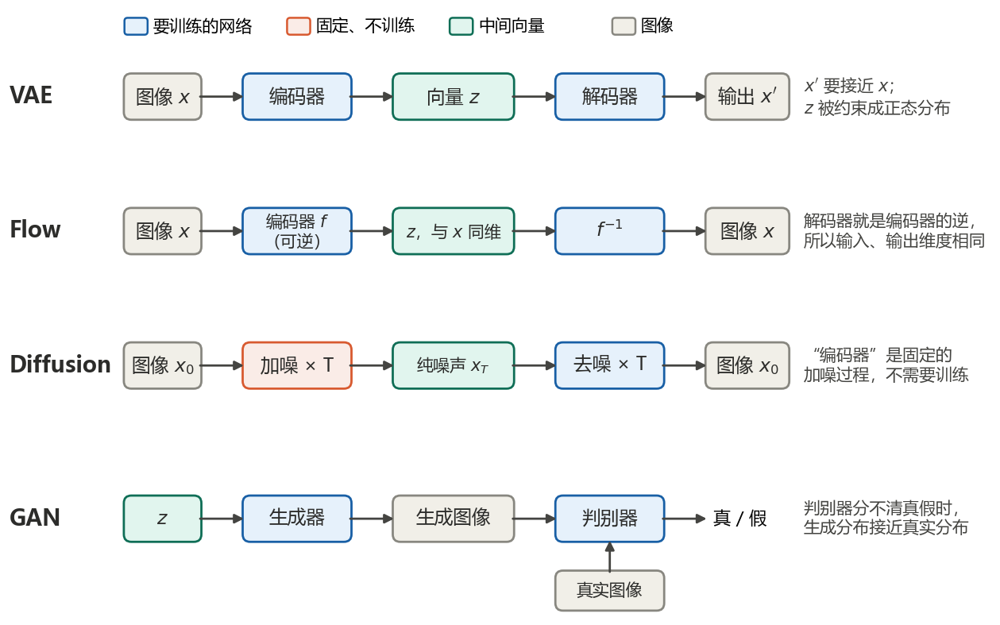
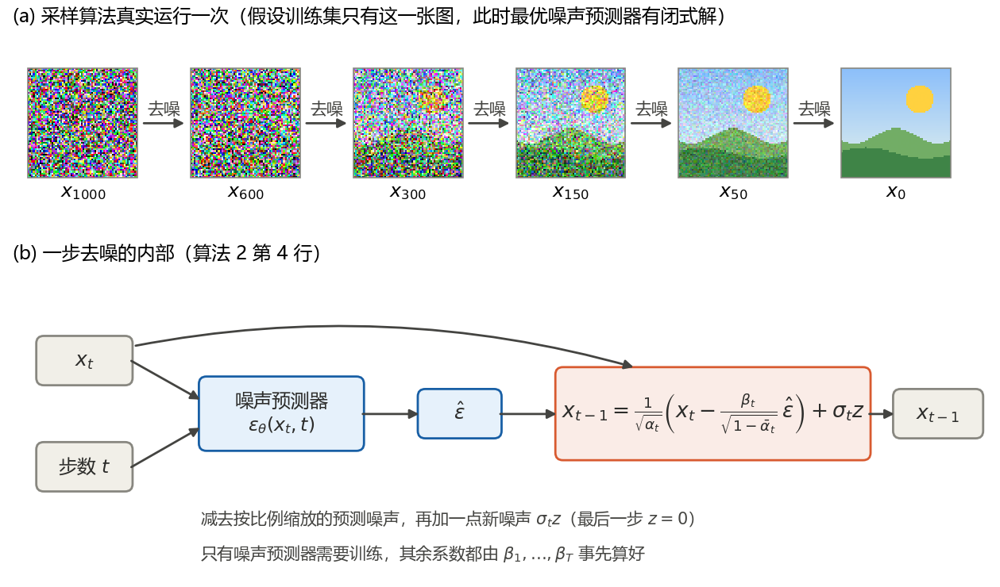
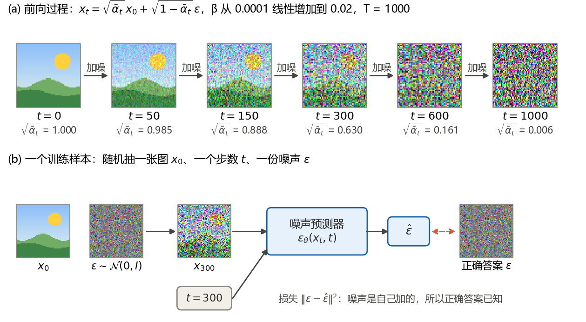
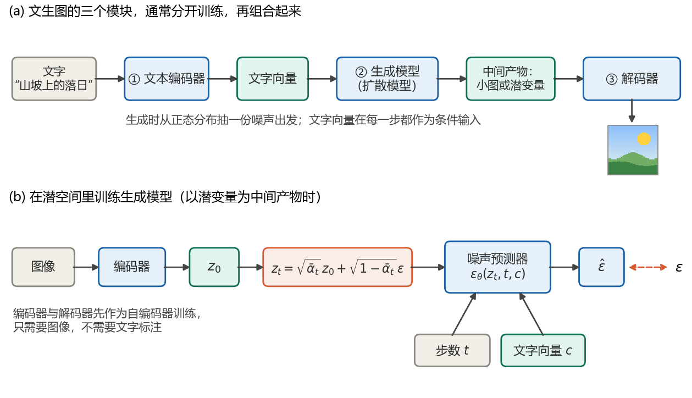
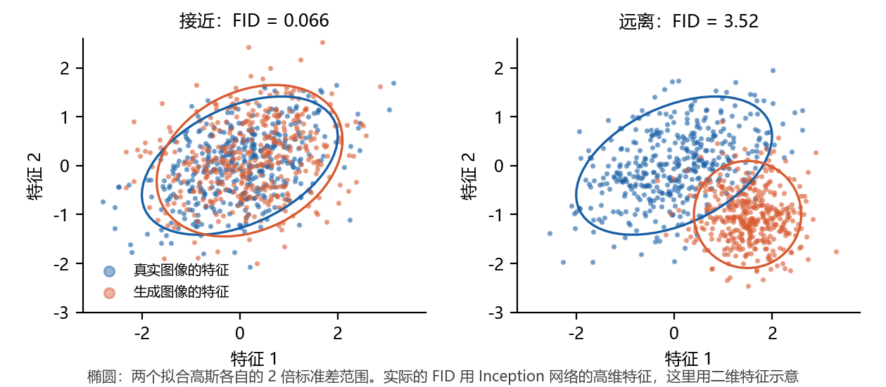

# 扩散模型推导笔记 L0：图像生成模型与扩散模型入门（李宏毅课程听课笔记）

本文是本系列的听课笔记，整理李宏毅《机器学习 2023 春》课程 3 月 24 日“机器如何生成图像”所附的三段视频：《【生成式AI】速覽圖像生成常見模型》《【生成式AI】淺談圖像生成模型 Diffusion Model 原理》《【生成式AI】Stable Diffusion、DALL-E、Imagen 背後共同的套路》。这三讲几乎不涉及推导，目标是先建立全貌：图像生成要解决什么问题，扩散模型怎样生成、怎样训练，文生图系统由哪几部分组成。4 月 7 日的四讲《Diffusion Model 原理剖析》讲数学原理，整理在 [L1](L1-ddpm-lectures.md)。

读法：每节内容按同一顺序排列。**术语**先给出专有名词，再用平白的话解释；**要点**用自己的话概括课上的内容；**公式**写出相关公式；**补充**给出课上没有展开、已对照原论文核实的细节；**联系**指向本系列其他笔记的对应位置。第 0 章是一页速览，第 4 章是小结，第 5、6 章是自测题和答案。

记号按 Ho et al. (2020)：$`x_0`$ 是干净图像，$`x_t`$ 是加噪 $`t`$ 步后的图像，$`\epsilon`$ 是标准高斯噪声；$`\beta_t`$ 是第 $`t`$ 步的加噪强度，$`\alpha_t=1-\beta_t`$，$`\bar\alpha_t=\alpha_1\alpha_2\cdots\alpha_t`$；$`\mathcal{N}(\mu,\sigma^2)`$ 的第二个参数是方差。

引用说明：课程视频与讲义的版权属于原作者，链接见参考资料。本文不包含讲义截图，也没有照录讲义文字；文字是笔记作者自己的概括，课上的比喻都已改写。五幅插图由 `code/make_figures_l0_l1.py` 用代码绘制，示例图像是程序生成的合成风景，不取自任何数据集。文中的数字由 `code/l0_l1_check.py` 核对，引用的论文都对照过 arXiv 或出版方页面。版本 1.0，2026-10-20。

## 0 一页速览

| 讲次 | 课上回答的问题 | 一句话结论 | 本文 |
|---|---|---|---|
| 第 1 讲：速览图像生成常见模型 | 图像生成与文字生成有什么不同？ | 正确答案不止一个，而是一个分布。先从正态分布抽一个向量，再由网络把它变成图像；VAE、Flow、扩散模型、GAN 是训练这种网络的四种办法 | 第 1 章 |
| 第 2 讲：浅谈扩散模型原理 | 扩散模型怎样生成、怎样训练？ | 从纯噪声出发，把同一个去噪模块用 $`T`$ 次；去噪模块的核心是噪声预测器，它的训练数据由前向加噪过程自己造出来 | 第 2 章 |
| 第 3 讲：文生图的共同套路 | Stable Diffusion、DALL·E、Imagen 有什么共同点？ | 都由文本编码器、生成模型、解码器三部分组成；生成模型只生成压缩后的图，解码器的训练不需要文字 | 第 3 章 |

三个最常用的式子：

| 用途 | 公式 | 出处 |
|---|---|---|
| 一步加噪 | $`x_t=\sqrt{\bar\alpha_t}\,x_0+\sqrt{1-\bar\alpha_t}\,\epsilon`$ | DDPM 式 (4)，推导见 L1 第 3.1 节 |
| 训练损失 | $`\Vert\epsilon-\epsilon_\theta(x_t,t)\Vert^2`$ | DDPM 算法 1、式 (14) |
| 一步去噪 | $`x_{t-1}=\frac{1}{\sqrt{\alpha_t}}\Big(x_t-\frac{\beta_t}{\sqrt{1-\bar\alpha_t}}\epsilon_\theta(x_t,t)\Big)+\sigma_t z`$ | DDPM 算法 2，推导见 L1 第 3.5 节 |

## 1 四类图像生成模型（第 1 讲）

### 1.1 图像生成要学的是一个分布

**术语**：文生图（text-to-image）指输入一段文字 $`y`$、输出一张图像 $`x`$。条件分布 $`P(x\mid y)`$ 是给定文字时各种图像出现的概率。自回归生成（autoregressive generation）指一次只生成一个元素，每一步以已经生成的部分为条件，课上称为“各个击破”；与之相对，一次生成全部元素称为“一次到位”。

**要点**：

1. 一张图包含的信息比描述它的文字多得多。“一只在奔跑的狗”没有交代品种、毛色和背景，这些都要模型自己补全。所以同一段文字对应许多张都算正确的图，要学的不是一个答案，而是分布 $`P(x\mid y)`$。
2. 文字生成通常是自回归的：每一步输出下一个字的概率分布，再从中抽一个。图像也可以照做：把像素按从左到右、从上到下的顺序排成序列，每一步输出下一个像素颜色的概率分布。OpenAI 的 Image GPT 就是这样做的。缺点是慢：256×256 的图有 65536 个像素，就要生成 65536 步。
3. 如果改为一次生成所有像素，并让每个像素各自独立地从自己的分布里抽，就会出问题：有的像素“选”了黑狗，有的像素“选”了白狗，拼起来不成一张图。像素之间必须协调。
4. 解决办法：先从一个简单、容易抽样的分布（通常是标准正态分布）中抽一个高维向量 $`z`$，再把 $`z`$ 和文字一起送进生成网络，由网络输出整张图。不同的 $`z`$ 对应不同的图，随机性全部来自 $`z`$，像素之间的协调由网络负责。网络要做的，是把简单的分布变成复杂的 $`P(x\mid y)`$。

**补充**：Image GPT 的论文（Chen et al., 2020）为了缩短序列，用 k-means 把 RGB 颜色聚成 512 类，即 9 位调色板：每个像素只需在 512 类中选一类，而不是在 $`256^3`$ 种颜色中选，序列长度也缩短为原来的三分之一。

**联系**：生成网络的训练目标，即让输出分布接近真实分布，在 L1 第 2.1、2.2 节讨论。

### 1.2 VAE

**术语**：变分自编码器（Variational Auto-Encoder, VAE）由编码器（encoder）和解码器（decoder）组成：编码器把图像压缩成一个向量，解码器把向量还原成图像。

**要点**：训练时同时要求两件事：解码器的输出尽量接近输入的图像；编码器输出的向量尽量接近标准正态分布。训练好以后丢掉编码器，从标准正态分布抽 $`z`$ 送进解码器，就能得到新的图像。

**联系**：VAE 的训练目标来自对数似然的下界，见 L1 第 2.3、2.4 节。

### 1.3 Flow 模型

**术语**：流模型（flow-based model）的编码器 $`f`$ 是一个可逆函数，解码器直接取它的逆 $`f^{-1}`$，不需要另外训练。

**要点**：因为要可逆，输入与输出的维度必须相同：一张 256×256 的彩色图对应一个同样大小的向量，而不是一个短向量。训练时要求 $`f`$ 把图像映射成服从标准正态分布的向量；生成时从标准正态分布抽 $`z`$，计算 $`f^{-1}(z)`$。

**补充**：可逆的好处是图像的概率可以用变量替换公式精确算出，于是能直接做最大似然训练；代价是每一层都必须可逆，而且雅可比行列式要容易计算，网络结构因此受限。课程页另附有李宏毅较早的 VAE、Flow、GAN 专题视频，链接见参考资料。

### 1.4 扩散模型

**要点**：扩散模型（diffusion model）可以看成把 VAE 的两半都换掉：编码器换成固定的“加噪”，对图像反复加 $`N`$ 次噪声，直到它变成纯噪声；解码器换成“去噪”，从纯噪声出发反复去噪 $`N`$ 次。加噪的方式事先规定好，不需要训练，只有去噪需要训练。第 2 章展开这一节。

### 1.5 GAN

**术语**：生成对抗网络（Generative Adversarial Network, GAN）由生成器（generator，讲义上画作 decoder）和判别器（discriminator）组成。

**要点**：生成器把 $`z`$ 变成图像，生成图像的分布记作 $`P'(x)`$，真实图像的分布记作 $`P(x)`$。判别器判断一张图是真实的还是生成的。两者交替训练：判别器努力分辨真假，生成器努力让判别器分不出。判别器怎么都分不清时，说明 $`P'(x)`$ 与 $`P(x)`$ 已经很接近。

**补充**：GAN 常与其他方法结合使用。讲义列出了三种组合：VAE 加 GAN（Larsen et al., 2015）、Flow 加 GAN（Flow-GAN，Grover et al., 2018）、扩散模型加 GAN（Diffusion-GAN，Wang et al., 2023）。

### 1.6 四类模型对照



| 方法 | 图像 → 向量 | 向量 → 图像 | 训练时比较什么 |
|---|---|---|---|
| VAE | 编码器，要训练 | 解码器，要训练 | 输出与输入的差距，以及向量与正态分布的差距 |
| Flow | 可逆编码器 $`f`$，要训练 | $`f^{-1}`$，不另外训练 | 用变量替换公式算出的似然 |
| 扩散模型 | 加噪 $`N`$ 次，固定 | 去噪 $`N`$ 次，要训练 | 预测的噪声与实际加入的噪声 |
| GAN | 无 | 生成器，要训练 | 判别器的判断 |

**联系**：四类方法的共同目标在 L1 第 2.1 节用最大似然的语言统一表述。

## 2 扩散模型怎样生成、怎样训练（第 2 讲）

### 2.1 反向过程：从纯噪声出发反复去噪

**术语**：反向过程（reverse process）指从纯噪声 $`x_T`$ 出发、一步步去噪直到得到图像 $`x_0`$ 的过程。DDPM 取步数 $`T=1000`$。

**要点**：

1. 从标准正态分布抽一张全是噪声的“图” $`x_T`$，它的大小与要生成的图像相同。
2. 把 $`x_T`$ 送进去噪模块，得到噪声少一些的 $`x_{T-1}`$；再送进去，得到 $`x_{T-2}`$；如此重复，直到 $`x_0`$。
3. 课上用了一个比喻：一句常被认为出自米开朗基罗的话说，雕像本来就在石块里，雕刻只是凿掉多余的部分。去噪就是一步步凿掉多余的噪声。

图 2(a) 是 DDPM 采样算法实际运行一次的结果。为了写出最优的噪声预测器，这里假设训练集只有这一张合成图，此时预测器有闭式解；跑完 1000 步，输出与这张图的最大差小于 $`10^{-9}`$。真实的训练集有许多张图，网络只能学到近似的预测器，生成的是新的图像。



### 2.2 同一个去噪模块，多输入一个步数

**要点**：1000 步用的是同一个去噪网络，参数共享。但第 1000 步面对的几乎是纯噪声，第 1 步面对的几乎是干净图像，任务差别很大，所以除了带噪图像，还要把当前步数 $`t`$ 也作为输入，告诉网络现在的噪声有多重。

**补充**：DDPM 的去噪网络是一个类似 PixelCNN++ 的 U-Net，各层使用组归一化，步数 $`t`$ 用 Transformer 的正弦位置编码送入网络（DDPM 第 4 节）。

### 2.3 去噪模块的内部：噪声预测器

**术语**：噪声预测器（noise predictor）$`\epsilon_\theta(x_t,t)`$ 输入带噪图像 $`x_t`$ 和步数 $`t`$，输出它认为 $`x_t`$ 中含有的噪声，$`\theta`$ 是网络参数。

**要点**：去噪模块并不直接输出去噪后的图，而是先预测图中的噪声，再从输入中减去。整个模块中只有噪声预测器需要训练，其余都是固定的运算，见图 2(b)。

**公式**（DDPM 算法 2 第 4 行）：

```math
x_{t-1}=\frac{1}{\sqrt{\alpha_t}}\Big(x_t-\frac{\beta_t}{\sqrt{1-\bar\alpha_t}}\,\epsilon_\theta(x_t,t)\Big)+\sigma_t z,\qquad z\sim\mathcal{N}(0,I)
```

最后一步取 $`z=0`$。讲义上把系数写作 $`\frac{1-\alpha_t}{\sqrt{1-\bar\alpha_t}}`$，因为 $`1-\alpha_t=\beta_t`$，两种写法相同。这些系数从哪里来、为什么去噪之后还要再加一份噪声 $`\sigma_t z`$，是 L1 的主题。

**补充**：为什么预测噪声，而不是直接预测去噪后的图？DDPM 论文的表 2 比较过这两种做法：直接预测后验均值，只有用完整的变分下界训练时才好；预测噪声并用简化的损失训练，效果最好，CIFAR-10 上的 FID 为 3.17。

### 2.4 训练数据从哪里来：前向过程

**术语**：前向过程（forward process），也叫扩散过程（diffusion process），指对干净图像一步步加噪的过程。

**要点**：

1. 噪声预测器要训练，就需要“正确答案”：图中到底含有什么噪声。
2. 这个答案可以自己造：从数据集中取一张图，从标准正态分布抽一份噪声加上去，得到带噪图；加进去的噪声就是正确答案。输入（带噪图和步数）与标签（噪声）都有了，训练噪声预测器就成了普通的监督学习。
3. 课上先把前向过程讲成逐步加噪：第 1 步加一点，第 2 步再加一点，到第 1000 步只剩噪声。第 2 步的带噪图配上第 2 步加入的噪声，就是一个训练样本。L1 第 1.2 节会说明，实际实现时不必真的逐步加，任意一步的结果都可以一步算出。

**公式**（一步加噪，推导见 L1 第 3.1 节）：

```math
x_t=\sqrt{\bar\alpha_t}\,x_0+\sqrt{1-\bar\alpha_t}\,\epsilon,\qquad \epsilon\sim\mathcal{N}(0,I)
```

**补充**：DDPM 把像素值线性缩放到 $`[-1,1]`$，取 $`T=1000`$，$`\beta_t`$ 从 $`10^{-4}`$ 线性增加到 $`0.02`$（DDPM 第 3.3、4 节）。这时 $`\sqrt{\bar\alpha_t}`$ 在 $`t=50`$、150、300、600、1000 时分别约为 0.985、0.888、0.630、0.161、0.006（图 3a）：到第 1000 步，干净图像的系数不到 1%，$`x_T`$ 几乎就是纯噪声。



### 2.5 加入文字条件

**要点**：做文生图时，把文字也作为噪声预测器的输入，写作 $`\epsilon_\theta(x_t,t,y)`$。训练数据换成图像与文字成对的数据，加噪和预测噪声的做法不变；生成时每一步都输入同一段文字。

**补充**：成对数据的规模差别很大。课上比较了课程作业用的约 7 万张图、ImageNet 的约 100 万张图，以及 LAION-5B 的 58.5 亿对图文。LAION-5B（Schuhmann et al., 2022）是用 CLIP 过滤过的公开图文数据集，其中英文约 23.2 亿对。

### 2.6 DDPM 的两个算法

**术语**：DDPM 即去噪扩散概率模型（Denoising Diffusion Probabilistic Models，Ho et al., 2020）。

**要点**：论文用两个算法概括训练与生成。

- 训练（算法 1）：反复执行以下步骤直到收敛：抽一张图 $`x_0`$；从 1 到 $`T`$ 均匀地抽一个步数 $`t`$；抽一份噪声 $`\epsilon\sim\mathcal{N}(0,I)`$；对下面的损失做一步梯度下降。
- 采样（算法 2）：抽 $`x_T\sim\mathcal{N}(0,I)`$；$`t`$ 从 $`T`$ 到 1，每步按 2.3 节的公式算出 $`x_{t-1}`$；输出 $`x_0`$。

**公式**（算法 1 中的损失）：

```math
\Big\Vert\epsilon-\epsilon_\theta\Big(\sqrt{\bar\alpha_t}\,x_0+\sqrt{1-\bar\alpha_t}\,\epsilon,\ t\Big)\Big\Vert^2
```

**补充**：讲义说这两个算法“暗藏玄机”。第 2 讲的直观图景解释不了三个细节：训练时为什么只加一次噪声；为什么网络只需预测噪声；采样时为什么去噪之后还要再加一份噪声。L1 第 1 章把它们列出来，第 3、4 章逐一解释。

## 3 文生图的共同框架（第 3 讲）

### 3.1 三个模块

**术语**：

- 文本编码器（text encoder）：把文字变成一串向量。
- 生成模型（generation model）：以文字向量为条件，从噪声生成“中间产物”，通常就是扩散模型。
- 解码器（decoder）：把中间产物还原成图像。
- 中间产物：图像的压缩版本，可以是人看得懂的小图，也可以是人看不懂的潜在表示（latent representation）。

**要点**：Stable Diffusion、DALL·E 系列、Imagen 都由这三个模块组成。三个模块通常分开训练，再组合起来。生成模型只负责生成压缩后的图，计算量比直接生成大图小得多；把它还原成大图的工作交给解码器。



### 3.2 Stable Diffusion

**要点**：Stable Diffusion 基于潜在扩散模型（Latent Diffusion Models, LDM，Rombach et al., 2022）。三个模块分别是：

1. 文本编码器：v1 版本用一个冻结的 CLIP ViT-L/14 文本编码器；
2. 生成模型：在潜空间中做扩散的 U-Net，文字通过交叉注意力（cross-attention）送进 U-Net 的各层；
3. 解码器：一个自编码器的解码器，把潜变量还原成图像。

**补充**：

- v1 版本的自编码器下采样因子 $`f=8`$，把 $`H\times W\times 3`$ 的图像映射成 $`H/8\times W/8\times 4`$ 的潜变量，512×512 的图像对应 64×64×4 的潜变量。LDM 论文比较了 $`f`$ 取 1、2、4、8、16、32 的情形，认为 $`f`$ 取 4 到 16 时效率与质量最平衡。
- U-Net 是噪声预测器 $`\epsilon_\theta`$ 的网络结构，不是扩散模型本身：扩散模型指整个加噪、去噪的框架，U-Net 只是其中被训练的那个网络。DDPM 原文用的也是 U-Net。

### 3.3 DALL·E 系列

**要点**：DALL·E 2（Ramesh et al., 2022）分两段：先验模型（prior）把文字变成一个 CLIP 图像向量，解码器再从这个图像向量生成图像。对应到三个模块：文本编码器是 CLIP 的文本编码器，生成模型是先验模型，中间产物是 CLIP 图像向量（人看不懂），解码器是一个扩散模型。论文对先验试过自回归和扩散两种模型，扩散先验计算更省、效果更好。

**补充**：讲义同时列出了第一代 DALL·E（Ramesh et al., 2021），它把文字和图像都变成 token，用一个 Transformer 把两者当作一条序列自回归地生成。

### 3.4 Imagen 与文本编码器的作用

**要点**：Imagen（Saharia et al., 2022）的三个模块是：冻结的 T5-XXL 文本编码器（约 46 亿参数）；一个文生图扩散模型，生成 64×64 的小图；两个超分辨率扩散模型，把小图放大到 256×256，再放大到 1024×1024。这里的中间产物是小图，人看得懂。

**补充**：Imagen 论文第 4.4 节和图 4 比较了放大不同模块的效果：把 T5 文本编码器从 Small 逐级放大到 XXL，FID 和 CLIP score 都明显改善；把 U-Net 从 3 亿参数放大到 20 亿参数，改善小得多。结论是放大文本编码器比放大扩散模型更有效，文本编码器对结果影响很大。各系统用的文本编码器并不相同：Stable Diffusion v1 用 CLIP 的文本编码器，Imagen 用纯文本预训练的 T5。

### 3.5 评价指标一：FID

**术语**：FID（Fréchet Inception Distance，Heusel et al., 2017）衡量生成图像整体上与真实图像有多接近，越小越好。

**要点**：

1. 用一个预训练好的图像分类网络（Inception）提取特征，真实图像和生成图像各得到一批特征向量。
2. 假设两批特征各自服从高斯分布，用样本估计各自的均值和协方差。
3. 计算这两个高斯分布之间的 Fréchet 距离，就是 FID。

**公式**（arXiv 版式 (6)）：

```math
\mathrm{FID}=\Vert m-m_w\Vert^2+\mathrm{Tr}\big(C+C_w-2(CC_w)^{1/2}\big)
```

其中 $`m`$、$`C`$ 是真实图像特征的均值和协方差，$`m_w`$、$`C_w`$ 是生成图像特征的均值和协方差。

**补充**：均值和协方差是从样本估计的，样本少时 FID 系统性偏大。图 5 用二维“特征”示意：两组分布接近时闭式 FID 为 0.066，远离时为 3.52。对接近的一组，每边只用 25 个样本时，50 次估计的平均是 0.27；用 250 个样本时是 0.083；用 2500 个样本时是 0.067。两批样本来自同一分布时真值是 0，三种样本量下的平均依次是 0.20、0.022、0.0020。所以讲义强调，算 FID 需要大量生成图像。



### 3.6 评价指标二：CLIP score

**术语**：CLIP（Contrastive Language-Image Pre-Training，Radford et al., 2021）是用 4 亿对图文数据训练的一对编码器：一个图像编码器、一个文本编码器。训练目标是让成对的图文向量互相接近，不成对的互相远离。

**要点**：CLIP score 把生成的图像和输入的文字分别送进 CLIP 的两个编码器，比较两个向量的相似程度，越大说明图像越符合文字。FID 只看生成的图像像不像真的，不看它是否符合文字；CLIP score 补上了这一点。

**补充**：Imagen 图 4 中的 CLIP score 大约在 0.22 到 0.29 之间。Hessel et al. (2021) 提出的 CLIPScore 也是由 CLIP 向量计算的图文匹配指标，用于评价图像描述。

### 3.7 解码器的训练不需要文字

**要点**：解码器只负责把中间产物还原成图像，训练它不需要文字标注：

- 中间产物是小图时，把大图缩小就得到成对的训练数据（小图，大图）；
- 中间产物是潜变量时，训练一个自编码器：编码器把图像压成潜变量，解码器把它还原，要求输出尽量接近输入。训练好后取出解码器使用。

因此解码器可以用大量没有文字的图像来训练。

### 3.8 在潜空间里训练和生成

**要点**：以潜变量为中间产物时（Stable Diffusion 的做法），扩散模型在潜空间中工作。第 2 章的做法几乎原样照搬，只是把“图像”换成“潜变量”：

1. 训练：图像经编码器得到潜变量 $`z_0`$；按 2.4 节的方式加噪得到 $`z_t`$；噪声预测器的输入是 $`z_t`$、步数 $`t`$ 和文字向量 $`c`$，正确答案是加进去的噪声（图 4b）。
2. 生成：从标准正态分布抽一份与潜变量同样大小的噪声，以文字为条件反复去噪，得到潜变量，再交给解码器还原成图像。

**联系**：潜空间中的扩散与像素空间的数学完全相同，L1 的推导都适用。

## 4 小结

| 概念 | 一句话 | 本文 | 数学部分 |
|---|---|---|---|
| 条件分布 $`P(x\mid y)`$ | 同一段文字对应许多正确的图，要学的是分布 | 1.1 | L1 第 2.1 节 |
| 先抽向量再生成 | 随机性集中在向量 $`z`$ 上，网络负责协调全部像素 | 1.1 | — |
| VAE、Flow、GAN | 训练生成网络的另外三种办法 | 1.2、1.3、1.5 | L1 第 2.3、2.4 节（VAE） |
| 反向过程 | 从纯噪声出发，同一个去噪模块用 $`T`$ 次 | 2.1、2.2 | L1 第 1.3 节 |
| 噪声预测器 | 去噪模块中唯一要训练的部分 | 2.3 | L1 第 3.5 节 |
| 前向过程 | 自己加噪，自己造训练数据 | 2.4 | L1 第 3.1 节 |
| 文字条件 | 文字作为噪声预测器的额外输入 | 2.5、3.8 | — |
| 三个模块 | 文本编码器、生成模型、解码器，分开训练 | 3.1–3.4 | — |
| FID | 两批特征拟合成高斯后的距离，越小越好，需要大量样本 | 3.5 | — |
| CLIP score | 图文向量的相似程度，越大越好 | 3.6 | — |

## 5 自测题

做完再看第 6 章的答案。

1. 为什么不能让每个像素独立地从各自的分布中抽样？
2. Flow 模型为什么要求输入和输出的维度相同？
3. 1000 步用的是同一个去噪模块，为什么还要输入步数 $`t`$？
4. 噪声预测器的训练数据，即输入和正确答案，是怎么得到的？
5. 线性调度下 $`\sqrt{\bar\alpha_{1000}}`$ 约是多少？它说明 $`x_{1000}`$ 是什么样子？
6. 文生图的三个模块中，为什么解码器的训练不需要文字？
7. 用图 5 的数字说明，为什么计算 FID 需要大量生成图像。
8. 根据 Imagen 的实验，放大文本编码器和放大 U-Net，哪一个收益更大？

## 6 自测答案

1. 像素之间需要协调。各自独立抽样时，有的像素可能按“黑狗”抽，有的按“白狗”抽，拼起来不是一张合理的图。先抽一个向量、再由网络统一生成，随机性只来自这个向量，所有像素由同一个网络协调。
2. 解码器是编码器的逆函数 $`f^{-1}`$，只有输入、输出维度相同，函数才可能可逆。
3. 不同步数的噪声强度差别很大：第 1000 步几乎是纯噪声，第 1 步几乎是干净图像。输入 $`t`$ 是告诉网络现在的噪声有多重。
4. 从数据集取一张干净图，抽一个步数和一份噪声，按一步加噪公式合成带噪图。输入是带噪图和步数，正确答案就是加进去的那份噪声。
5. 约 0.006（$`\bar\alpha_{1000}\approx4.0\times10^{-5}`$）。干净图像的系数不到 1%，$`x_{1000}`$ 几乎是纯噪声。
6. 解码器只负责“中间产物 → 图像”。中间产物是小图时，把大图缩小即得训练对；是潜变量时，用自编码器训练，只需要图像。
7. 两批样本来自同一分布时，FID 的真值是 0，但每边只用 25 个样本时平均估计为 0.20，250 个时为 0.022，2500 个时为 0.0020。样本少时估计系统性偏大，样本足够多时 FID 才可信。
8. 放大文本编码器。从 T5-Small 放大到 T5-XXL，FID 和 CLIP score 改善明显；U-Net 从 3 亿参数放大到 20 亿参数，改善小得多。

## 参考资料

课程与视频：

1. 李宏毅. 机器学习 2023 春（课程页）. <https://speech.ee.ntu.edu.tw/~hylee/ml/2023-spring.php> 。3/24 条目“機器如何生成圖像”下有本文的三段视频和讲义 PDF。
2. 【生成式AI】速覽圖像生成常見模型. <https://youtu.be/z83Edfvgd9g>
3. 【生成式AI】淺談圖像生成模型 Diffusion Model 原理. <https://youtu.be/azBugJzmz-o>
4. 【生成式AI】Stable Diffusion、DALL-E、Imagen 背後共同的套路. <https://youtu.be/JbfcAaBT66U>
5. 同一课程页列出的专题视频：VAE <https://youtu.be/8zomhgKrsmQ> ；Flow-based Generative Model <https://youtu.be/uXY18nzdSsM> ；GAN <https://youtu.be/DQNNMiAP5lw>

论文与数据集：

6. Ho, J., Jain, A., & Abbeel, P. (2020). Denoising diffusion probabilistic models. *Advances in Neural Information Processing Systems 33*. arXiv:2006.11239.
7. Rombach, R., Blattmann, A., Lorenz, D., Esser, P., & Ommer, B. (2022). High-resolution image synthesis with latent diffusion models. *CVPR 2022*. arXiv:2112.10752.
8. Ramesh, A., et al. (2022). Hierarchical text-conditional image generation with CLIP latents. arXiv:2204.06125.
9. Ramesh, A., et al. (2021). Zero-shot text-to-image generation. arXiv:2102.12092.
10. Saharia, C., et al. (2022). Photorealistic text-to-image diffusion models with deep language understanding. *NeurIPS 2022*. arXiv:2205.11487.
11. Heusel, M., et al. (2017). GANs trained by a two time-scale update rule converge to a local Nash equilibrium. *NIPS 2017*. arXiv:1706.08500.
12. Radford, A., et al. (2021). Learning transferable visual models from natural language supervision. arXiv:2103.00020.
13. Hessel, J., et al. (2021). CLIPScore: A reference-free evaluation metric for image captioning. *EMNLP 2021*. arXiv:2104.08718.
14. Schuhmann, C., et al. (2022). LAION-5B: An open large-scale dataset for training next generation image-text models. *NeurIPS 2022 Datasets and Benchmarks Track*. arXiv:2210.08402.
15. Chen, M., et al. (2020). Generative pretraining from pixels. *ICML 2020*, PMLR 119:1691–1703.
16. Kingma, D. P., & Welling, M. (2014). Auto-encoding variational Bayes. *ICLR 2014*. arXiv:1312.6114.
17. Larsen, A. B. L., et al. (2015). Autoencoding beyond pixels using a learned similarity metric. arXiv:1512.09300.
18. Grover, A., et al. (2018). Flow-GAN: Combining maximum likelihood and adversarial learning in generative models. *AAAI 2018*. arXiv:1705.08868.
19. Wang, Z., et al. (2023). Diffusion-GAN: Training GANs with diffusion. *ICLR 2023*. arXiv:2206.02262.
