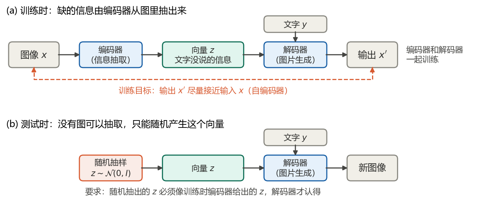
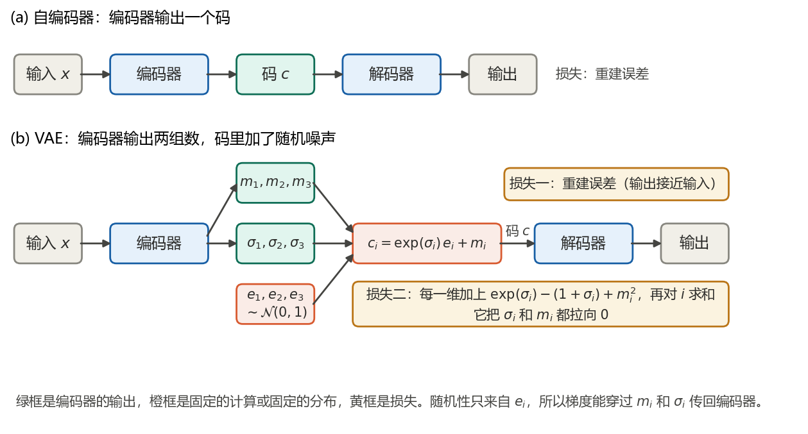
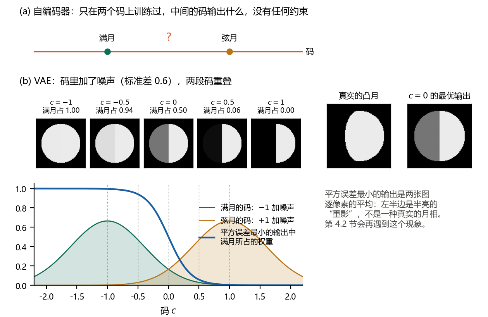
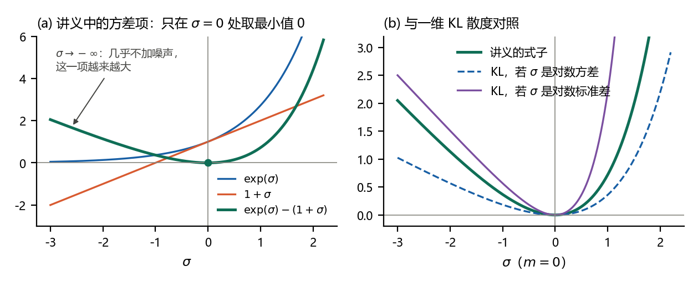
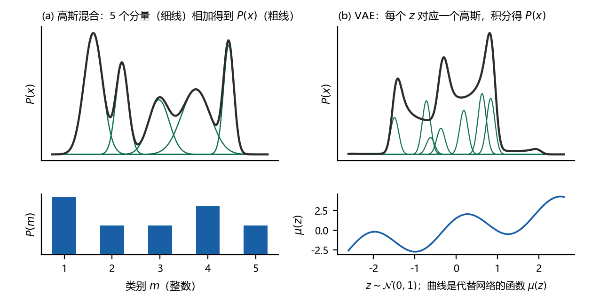
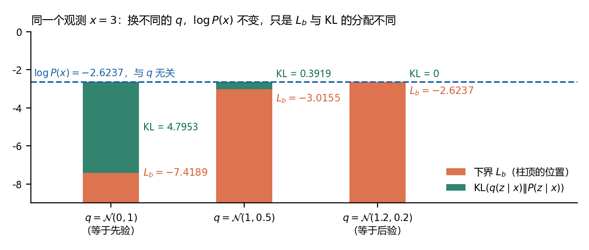
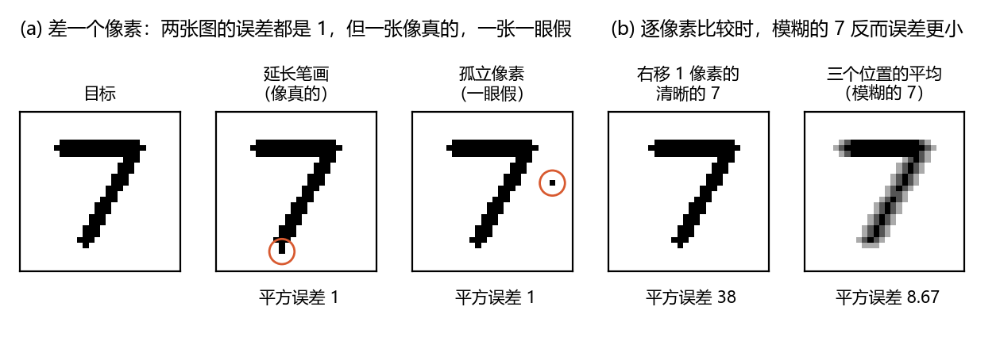

# 扩散模型推导笔记 L2：变分自编码器 VAE（李宏毅课程听课笔记）

本文是本系列的听课笔记，整理李宏毅老师两门课中讲变分自编码器（VAE）的内容。第一部分是《生成式AI导论 2024》第 18 讲《有關影像的生成式AI (下) — 快速導讀經典影像生成方法 (VAE, Flow, Diffusion, GAN) 以及與生成的影片互動》的前半段，用文字生图的例子说明 VAE 与 Flow 中间那个向量从何而来；第二部分是这一讲的课程页列为延伸视频的 2016 年《机器学习》VAE 一讲，从结构、直观一直讲到最大似然与下界。[L0](L0-image-generation-models.md) 第 1.2 节只用两句话介绍了 VAE，[L1](L1-ddpm-lectures.md) 第 2.3、2.4 节借 VAE 引出 DDPM 的下界；本文把 VAE 本身讲完整。

读法同 L0、L1：每节按 **术语**、**要点**、**公式**、**补充**、**联系** 排列。第 0 章是一页速览，第 1 章对应 2024 年的一讲，第 2 至 4 章对应 2016 年的一讲，第 5 章是小结，第 6、7 章是自测题和答案。

记号：沿用 2016 年讲义的写法。$`P(z)`$ 是隐变量 $`z`$ 的先验，$`P(x\mid z)`$ 是解码器给出的分布，$`q(z\mid x)`$ 是编码器给出的分布，$`L_b`$ 是对数似然的下界，即证据下界（ELBO）。解码器的输出记作 $`\mu(z)`$、$`\sigma(z)`$，编码器的输出记作 $`\mu'(x)`$、$`\sigma'(x)`$；第 2.1 节的结构图中，编码器的两组输出写作 $`m_i`$ 与 $`\sigma_i`$。讲义的 $`N(\mu,\sigma)`$ 中第二个参数泛指方差（多维时是协方差矩阵），本文自己的式子仍按本系列的约定：$`\mathcal{N}(\mu,\sigma^2)`$ 的第二个参数是方差。KL 散度写作 $`\mathrm{KL}(q\Vert P)`$。

引用说明：课程视频与讲义的版权属于原作者，链接见参考资料。本文不包含讲义截图，也没有照录讲义文字；文字是笔记作者自己的概括。七幅插图由 `code/make_figures_l2.py` 用代码绘制，图中的月亮和数字都是程序生成的简单图形；文中的数字由 `code/l2_check.py` 核对，引用的论文都对照过 arXiv 或出版方页面。版本 1.0，2026-10-22。

## 0 一页速览

| 讲次 | 课上回答的问题 | 一句话结论 | 本文 |
|---|---|---|---|
| 2024 第 18 讲（前半） | 文字没有描述的信息从哪里来？ | 训练时由编码器从图中抽取，测试时随机产生；这个向量就是生成模型里所说的 noise。VAE 用编码器加解码器，Flow 让解码器可逆，编码器就是它的逆 | 第 1 章 |
| 2016 VAE：结构与直观 | VAE 与自编码器差在哪里？为什么要加噪声？ | 编码器输出均值和方差两组数，码里加入随机噪声再送进解码器；损失另加一项，防止噪声的方差缩成 0 | 第 2 章 |
| 2016 VAE：数学原理 | VAE 到底在优化什么？ | 最大化似然。似然中的积分算不出来，引入 $`q(z\mid x)`$ 得到下界 $`L_b`$；$`L_b`$ 拆成 $`-\mathrm{KL}(q(z\mid x)\Vert P(z))`$ 与重建项，正好对应网络的两项损失 | 第 3 章 |
| 2016 VAE：推广与局限 | 怎样控制生成的内容？VAE 有什么问题？ | 条件 VAE 把类别也作为输入；逐像素比较分不出“像真的”和“一眼假”，平方误差还偏爱模糊的输出 | 第 4 章 |

三个最常用的式子：

```math
P(x)=\int_z P(z)\,P(x\mid z)\,dz
```

```math
\log P(x)=L_b+\mathrm{KL}\big(q(z\mid x)\Vert P(z\mid x)\big)\ \ge\ L_b
```

```math
L_b=-\mathrm{KL}\big(q(z\mid x)\Vert P(z)\big)+\mathbb{E}_{q(z\mid x)}\big[\log P(x\mid z)\big]
```

## 1 文字没说的信息从哪里来（2024 第 18 讲）

### 1.1 同一句话，许多张正确的图

**要点**：

1. 这一讲先回到前面介绍过的生成方式：Transformer 读入一段文字，一次输出图像的全部 patch，每个位置各自选一个编号（token）。
2. 训练资料中，“一只在奔跑的狗”可能配着一张草原上的哈士奇，也可能配着一张城市里的柴犬，两张图的 token 序列完全不同。同一句话要对上两个答案，模型不知道该照哪一个生成；各位置独立地选，还可能拼出一半哈士奇、一半柴犬的图。
3. 根源在于文字不能完整描述一张图：品种、背景、姿态这些信息，文字里没有，要模型自己补上，课上称之为“脑补”。

**联系**：L0 第 1.1 节黑狗、白狗的例子讲的是同一个问题。

### 1.2 用编码器把缺的信息抽出来

**术语**：自编码器（auto-encoder）由编码器（encoder）和解码器（decoder）组成：编码器把输入压缩成一个向量，解码器把这个向量还原成输入，训练目标是输出与输入尽量接近。

**要点**：

1. 训练时另加一个“信息抽取”模型：它看着训练图像和文字，把文字没说的部分抽出来，比如“哈士奇、草原”或“柴犬、都市”。“图片生成”模型同时读入文字和这份信息，生成图像。
2. 两个模型一起训练，目标是生成的图与输入的训练图像越接近越好。信息抽取模型就是编码器，图片生成模型就是解码器，两者合起来是一个以文字为条件的自编码器。
3. 实际抽出来的不是文字，而是一个向量，例如二维的 $`(0.5,1.0)`$ 与 $`(0.7,0.3)`$。人看不懂这些数，解码器看得懂。

### 1.3 测试时随机产生这份信息

**要点**：测试时只有文字，没有图可以抽取。办法是随机产生这个向量（讲义上画了一对骰子），让解码器根据文字和这个随机向量生成图像。所以文字没有描述的那部分信息，在生成时由随机抽样决定（图 1）。



**补充**：这里有一个课上没有展开的要求。随机产生的向量，必须和训练时编码器给出的向量“长得像”，即服从同一个分布，否则解码器从没见过这样的输入。普通的自编码器不管这件事，编码器的输出可能散落在任何地方；VAE 损失中的 KL 项正是为此而设：它把编码器给出的分布拉向标准正态分布，测试时就从标准正态分布抽样（第 2.4、3.6 节）。

### 1.4 VAE 与 Flow：中间的向量就是 noise

**术语**：流模型（flow-based model）只训练一个可逆的解码器 $`f`$，编码器直接取它的逆 $`f^{-1}`$；可逆要求维度不变，所以中间的向量与图像同样大小。

**要点**：

1. 去掉文字条件，第 1.2 节的结构就是 VAE：编码器把图压成一个向量，解码器把向量还原成图。Flow 的编码器与解码器互为逆函数。
2. 两种模型中间的向量，生成时都要随机产生，讲义把它标作 noise。这个名字容易让人以为它是没用的干扰，其实它装的正是文字没有描述、需要随机补上的信息。下一页讲义的标题就是“有信息的噪声”。

**联系**：L0 第 1.2、1.3 节简要介绍过 VAE 与 Flow，第 1.6 节有四类模型的对照图。

### 1.5 有信息的噪声：在潜空间里做加减

**要点**：

1. 把许多张“臭脸”的人脸图像分别送进编码器，取平均，得到一个“臭脸向量”；同样得到一个“笑脸向量”。
2. 把一张新的人脸图像编码，减去臭脸向量，加上笑脸向量，再送进解码器，得到的就是同一个人笑起来的样子。讲义注明，示范图由 OpenAI 的 Glow 生成。
3. 这说明中间向量带有可以解释的语义：表情这样的属性，对应于向量空间中的一个方向。

**补充**：Glow（Kingma & Dhariwal, 2018）是一种流模型。论文在 CelebA 人脸数据上，用数据集自带的二值属性标签（如微笑、金发、年轻）求出“有该属性的图像”与“没有该属性的图像”潜向量的平均差，作为这个属性的方向；把一张图的潜向量沿这个方向移动，再解码，就能改变这个属性。

### 1.6 四种经典方法在这一讲中的位置

**要点**：这一讲接着把扩散模型也看成“编码器加解码器”：编码器换成固定的加噪过程，解码器是反复去噪，这部分见 L0 第 1.4 节和第 2 章。GAN 只有解码器（生成器），另用一个判别器给生成的图打分。讲义最后指出 GAN 常作为“外挂”接在其他方法上，例如 VAE 加 GAN（Larsen et al., 2016），并列出四种方法各自的详细课程，其中 VAE 指向下面整理的 2016 年一讲。

## 2 VAE 的结构与直观（2016 VAE 一讲）

### 2.1 从自编码器到 VAE

**术语**：码（code）是编码器的输出、解码器的输入，也就是隐变量。重参数化（reparameterization）指把随机抽样写成“确定的计算加上一份与参数无关的噪声”，第 3.6 节再说明它的作用。VAE 由 Kingma & Welling (2014) 提出，Rezende et al. (2014) 几乎同时独立提出了同样的方法。

**要点**：

1. 自编码器：输入经编码器得到码，码经解码器得到输出，训练时让输出与输入尽量接近。想用它生成新图，就随机产生一个码送进解码器；可是解码器只见过编码器给出的码，随机的码能不能解码出像样的图，并没有保证，讲义在这里打了一个问号。
2. VAE 的编码器输出两个向量，讲义里都是三维：$`m=(m_1,m_2,m_3)`$ 与 $`\sigma=(\sigma_1,\sigma_2,\sigma_3)`$。再从正态分布抽一个同样维数的 $`e`$，按下面第一个式子算出码 $`c`$，送进解码器。
3. 损失有两项：一项是重建误差，另一项是下面第二个式子（图 2）。

**公式**：

```math
c_i=\exp(\sigma_i)\times e_i+m_i,\qquad e_i\sim\mathcal{N}(0,1)
```

```math
\sum_{i=1}^{3}\Big(\exp(\sigma_i)-(1+\sigma_i)+m_i^2\Big)
```



**补充（订正）**：讲义的两个式子用了不同的 $`\sigma_i`$ 约定。

1. 按第一个式子，噪声的标准差是 $`\exp(\sigma_i)`$，即 $`\sigma_i`$ 是对数标准差。这时码服从 $`\mathcal{N}(m_i,\exp(2\sigma_i))`$，它与标准正态分布之间的 KL 散度是 $`\frac{1}{2}\big(\exp(2\sigma_i)-(1+2\sigma_i)+m_i^2\big)`$。
2. 讲义的第二个式子，恰好是 $`\sigma_i`$ 为对数方差时这个 KL 的 2 倍：方差为 $`\exp(\sigma_i)`$ 时，KL 等于 $`\frac{1}{2}\big(\exp(\sigma_i)-(1+\sigma_i)+m_i^2\big)`$。按这个约定，第一个式子应写成 $`c_i=\exp(\sigma_i/2)\,e_i+m_i`$。
3. 两种约定的最小点相同，都在 $`\sigma_i=0`$、$`m_i=0`$，所以课上的结论（第 2.4 节）不受影响，但数值不同。例如 $`\sigma_i=1`$、$`m_i=0`$ 时，讲义的式子给出 $`\exp(1)-2=0.7183`$；若 $`\sigma_i`$ 是对数方差，KL 为 0.3591，正好一半；若 $`\sigma_i`$ 是对数标准差，KL 为 $`\frac{1}{2}\big(\exp(2)-3\big)=2.1945`$。
4. 常见的实现让编码器输出对数方差，再取 $`\exp(\sigma_i/2)`$ 作为标准差。原论文附录 B 的写法是 $`-\mathrm{KL}=\frac{1}{2}\sum_j\big(1+\log\sigma_j^2-\mu_j^2-\sigma_j^2\big)`$，其中 $`\sigma_j`$ 是标准差。

**联系**：对角高斯之间的 KL 散度见 [D0–D1 第 6 章](D0-D1-gaussian-and-kl.md#6-d1-两个对角高斯之间的-kl-散度)，与标准正态分布之间的特例见其中的 [6.3 节](D0-D1-gaussian-and-kl.md#63-两个特例-c)。

### 2.2 讲义中的几个例子

**要点**：讲义在这里展示了 VAE 能做的几件事。

1. CIFAR-10 上的生成样本，取自 Kingma et al. (2016) 关于逆自回归流（IAF）的论文。
2. 生成宝可梦：码取 10 维，训练好以后，固定其中 8 维，只在另外 2 维上取一个网格，逐点解码，看这两维分别控制了什么。
3. 写诗：Bowman et al. (2016) 用 VAE 编码句子，在两句话的码之间连一条线，沿线取点再解码，得到一串从一句逐渐过渡到另一句的句子。

### 2.3 为什么要加噪声：码空间的连续性

**要点**：讲义用月亮作直观解释（图 3）。

1. 自编码器把满月编码成一个点，把弦月编码成另一个点。两点中间的码在训练时从没出现过，解码出来是什么，没有任何保证。
2. VAE 给码加了噪声：满月对应的不再是一个点，而是一段范围，弦月也一样。两段范围重叠时，重叠处的码有时来自满月，有时来自弦月，解码器必须让输出同时尽量接近两者。课上说，这样中间的码也许就会解码成介于满月和弦月之间的月相。
3. 每个码周围的一片都要能解码出合理的图，码空间因此被填满，随机抽一个码，解码的结果也有意义。

**补充（数值例子）**：设满月的码在 $`-1`$，弦月的码在 $`+1`$，噪声的标准差为 0.6，两种图各占一半。以平方误差为准，码为 $`c`$ 时最好的输出是两张图的加权平均，满月的权重是 $`1/\big(1+\exp(2c/0.36)\big)`$：$`c=-0.5`$ 时为 0.94，$`c=0`$ 时为 0.5，$`c=0.3`$ 时为 0.16，$`c=1`$ 时只剩 0.004。也就是说，重叠处得到的是两张图逐像素的平均，未必是一种真实的月相：$`c=0`$ 时，左半边是半亮的“重影”。第 4.2 节会再遇到这个现象。



### 2.4 只最小化重建误差会怎样

**要点**：

1. 噪声的方差由编码器的输出 $`\sigma_i`$ 决定，是学出来的，讲义特别标出了这一点。
2. 如果损失只有重建误差，网络会让方差尽量小：没有噪声，重建最容易。这样 VAE 就退化成普通的自编码器，第 2.3 节的好处也随之消失。
3. 损失的第二项防止这件事。$`\exp(\sigma_i)`$ 与 $`1+\sigma_i`$ 之差在 $`\sigma_i=0`$ 处为 0，其余处处为正（图 4(a)）：$`\sigma_i`$ 往负方向走、方差变小时，这一项越来越大。所以它把 $`\sigma_i`$ 拉向 0，即方差拉向 1；$`m_i^2`$ 一项相当于对均值的 L2 正则化。

**公式**：

```math
\exp(\sigma)\ \ge\ 1+\sigma
```

等号只在 $`\sigma=0`$ 时成立：$`1+\sigma`$ 是 $`\exp(\sigma)`$ 在 $`\sigma=0`$ 处的切线，而指数函数是凸函数，图像总在切线上方。例如 $`\sigma_i=-5`$ 时，按讲义第一个式子，噪声的标准差只有 $`\exp(-5)\approx0.0067`$，几乎不加噪声，而这一项约为 4.0067。

**补充**：讲义说的是“希望 $`\sigma_i`$ 接近 0，即方差接近 1”。为什么偏偏是这个式子，第 3 章从最大似然推导以后就清楚了：它就是 KL 散度（第 3.6 节）。图 4(b) 把它与两种约定下的 KL 画在一起。



## 3 VAE 的数学原理（2016 VAE 一讲）

### 3.1 回到目标：估计 P(x)

**要点**：讲义此处回到生成模型要做的事：把每只宝可梦看成高维空间中的一个点 $`x`$，估计它的概率分布 $`P(x)`$。像宝可梦的图概率高，不像的概率低；有了 $`P(x)`$，按它抽样就能生成新的宝可梦。

### 3.2 高斯混合模型

**术语**：高斯混合模型（Gaussian Mixture Model, GMM）：$`P(x)`$ 是若干个高斯分布的加权和，权重 $`P(m)`$ 是第 $`m`$ 类出现的概率。讲义注明 $`m`$ 服从多项分布（multinomial），取值是整数。

**要点**：

1. 再复杂的分布，都可以用足够多的高斯叠加出来（图 5(a)）。
2. 抽样分两步：先按 $`P(m)`$ 抽一个整数 $`m`$，再从第 $`m`$ 个高斯 $`\mathcal{N}(\mu^m,\Sigma^m)`$ 中抽 $`x`$。所以每个 $`x`$ 都来自某一个分量，相当于属于某一类。
3. 讲义的评论：只说一个样本属于第几类，描述太粗；更好的是分布式表示（distributed representation），即用一个向量描述样本，每一维是一种属性。VAE 就是这样做的。

**公式**：

```math
P(x)=\sum_m P(m)\,P(x\mid m),\qquad m\sim P(m),\qquad x\mid m\sim\mathcal{N}(\mu^m,\Sigma^m)
```

**补充（数值）**：图 5(a) 的例子有 5 个分量，权重依次为 0.30、0.15、0.15、0.25、0.15，混合密度有 5 个峰；按两步法抽 50 万个样本，直方图与混合密度一致。

### 3.3 VAE：无穷多个高斯的混合

**要点**：

1. 把整数 $`m`$ 换成一个连续的向量 $`z`$，从标准正态分布中抽；$`z`$ 的每一维代表一种属性。
2. 每个 $`z`$ 经一个神经网络得到 $`\mu(z)`$ 与 $`\sigma(z)`$，决定一个高斯分布 $`x\mid z\sim\mathcal{N}(\mu(z),\sigma(z))`$。$`z`$ 有无穷多种取值，$`P(x)`$ 就是无穷多个高斯的混合，求和变成了积分。
3. 讲义强调：$`z`$ 虽然来自简单的 $`\mathcal{N}(0,I)`$，$`P(x)`$ 却可以非常复杂，因为把 $`z`$ 变成高斯参数的是神经网络。
4. $`\mu(z)`$、$`\sigma(z)`$ 由网络的参数决定，接下来要估计的就是这些参数。

**公式**：

```math
z\sim\mathcal{N}(0,I),\qquad x\mid z\sim\mathcal{N}\big(\mu(z),\sigma(z)\big),\qquad P(x)=\int_z P(z)\,P(x\mid z)\,dz
```

**补充（数值例子）**：图 5(b) 用一个固定的函数 $`\mu(z)=z+1.8\sin(2.8z+1)`$ 代替网络，并取 $`\sigma(z)=0.2`$。$`z`$ 只是一维标准正态，$`P(x)`$ 却有三个峰，分别在 $`x\approx-2.6`$、$`-0.35`$、$`1.9`$ 附近，最高峰约是最矮峰的 1.6 倍；数值积分与 50 万次抽样的直方图一致。

**补充**：$`z`$ 为什么取高斯？$`z`$ 是建模时自己引入的隐变量，它的分布由我们选定，原则上也可以取别的分布。选标准正态分布，一是容易抽样；二是编码器也取高斯时，第 3.6 节的 KL 项有闭式解；三是如上所说，网络能把它变成复杂的 $`P(x)`$。



**联系**：L1 第 2.3 节从同一个式子出发，讲 VAE 怎样定义似然。

### 3.4 最大似然与下界

**术语**：似然（likelihood）$`L=\sum_x\log P(x)`$ 是模型给每个观测样本 $`x`$ 的对数概率之和。下界 $`L_b`$（lower bound）即证据下界（Evidence Lower BOund, ELBO）。

**要点**：

1. 训练的目标是调整解码器网络的参数，使 $`L`$ 最大。
2. 难点在于 $`P(x)`$ 里有对 $`z`$ 的积分，算不出来。为此另找一个分布 $`q(z\mid x)`$：输入 $`x`$，由另一个网络输出 $`\mu'(x)`$ 与 $`\sigma'(x)`$，$`z\mid x\sim\mathcal{N}(\mu'(x),\sigma'(x))`$。这个网络就是 VAE 的编码器。
3. 推导：$`q(z\mid x)`$ 可以是任何分布。先利用它的积分为 1，把 $`\log P(x)`$ 写成对它的积分；再用 $`P(x)=P(z,x)/P(z\mid x)`$，在对数里同乘、同除 $`q(z\mid x)`$，拆成两项。第二项是 KL 散度，不小于 0，去掉它就得到下界。

**公式**：

```math
\log P(x)=\int_z q(z\mid x)\log P(x)\,dz=\int_z q(z\mid x)\log\frac{P(z,x)}{P(z\mid x)}\,dz
```

```math
=\int_z q(z\mid x)\log\frac{P(z,x)}{q(z\mid x)}\,dz+\int_z q(z\mid x)\log\frac{q(z\mid x)}{P(z\mid x)}\,dz=L_b+\mathrm{KL}\big(q(z\mid x)\Vert P(z\mid x)\big)
```

```math
L_b=\int_z q(z\mid x)\log\frac{P(x\mid z)\,P(z)}{q(z\mid x)}\,dz\ \le\ \log P(x)
```

**联系**：KL 散度的非负性见 [P0 第 3.4 节](P0-probability-and-information.md#34-kl-散度的性质)。L1 第 2.4 节是同一个推导，第 2.6 节是它的 DDPM 版本；完整的逐步推导是推导题 D2（后续）。

### 3.5 为什么要引入 q(z|x)

**要点**：

1. $`\log P(x)`$ 只由 $`P(z)`$ 与 $`P(x\mid z)`$ 决定，而 $`P(z)`$ 是固定的标准正态分布，所以它与 $`q`$ 无关。固定 $`P(x\mid z)`$、只调 $`q`$ 时，$`\log P(x)`$ 不变：$`L_b`$ 上升多少，KL 就下降多少。
2. 只调 $`P(x\mid z)`$ 去增大 $`L_b`$，并不保证似然上升：$`L_b`$ 的增加也可能来自 KL 的减少，$`\log P(x)`$ 甚至可能下降。同时调 $`q`$，就能把 KL 压小，使 $`L_b`$ 贴近 $`\log P(x)`$；这时再增大 $`L_b`$，因为 $`\log P(x)`$ 始终不小于 $`L_b`$，它也被一起推高。讲义的结论是：同时寻找 $`P(x\mid z)`$ 与 $`q(z\mid x)`$，使 $`L_b`$ 最大。
3. 附带的结果：KL 越小，$`q(z\mid x)`$ 越接近真正的后验 $`P(z\mid x)`$，训练结束时 $`q`$ 就是后验的近似。

**补充（数值例子）**：取一个能算出闭式解的模型：$`P(z)=\mathcal{N}(0,1)`$，$`P(x\mid z)=\mathcal{N}(2z,1)`$，观测到 $`x=3`$。这时 $`x`$ 的边缘分布是 $`\mathcal{N}(0,5)`$，$`\log P(x)=-2.6237`$，后验 $`P(z\mid x)=\mathcal{N}(1.2,0.2)`$。换三个 $`q`$（图 6）：

| $`q(z\mid x)`$ | $`L_b`$ | $`\mathrm{KL}(q\Vert P(z\mid x))`$ | 两者之和 |
|---|---|---|---|
| $`\mathcal{N}(0,1)`$，即先验 | $`-7.4189`$ | 4.7953 | $`-2.6237`$ |
| $`\mathcal{N}(1,0.5)`$ | $`-3.0155`$ | 0.3919 | $`-2.6237`$ |
| $`\mathcal{N}(1.2,0.2)`$，即后验 | $`-2.6237`$ | 0 | $`-2.6237`$ |

和始终等于 $`\log P(x)`$。$`q`$ 越接近后验，$`L_b`$ 越高；$`q`$ 等于后验时，下界与 $`\log P(x)`$ 重合。每个 $`q`$ 下 $`L_b`$ 的蒙特卡洛估计也与闭式值一致。



**联系**：这个模型就是 D0(a) 的线性高斯模型取 $`a=2`$、$`\sigma^2=1`$，后验的配方法求法见 [D0–D1 第 5.2 节](D0-D1-gaussian-and-kl.md#52-后验分布套路二)。

### 3.6 下界拆成两项，与网络对上

**要点**：

1. 把 $`L_b`$ 中的 $`P(x\mid z)P(z)`$ 拆开，下界分成两项：第一项是 $`-\mathrm{KL}(q(z\mid x)\Vert P(z))`$，第二项是 $`\log P(x\mid z)`$ 在 $`q(z\mid x)`$ 下的期望。
2. 第一项只涉及编码器。最大化它，就是让编码器给出的 $`q(z\mid x)`$ 接近先验 $`P(z)`$；两边都是高斯，KL 有闭式解，就是第 2.1 节损失的第二项，讲义注明推导见原论文附录 B。
3. 第二项把两个网络串起来：$`x`$ 经编码器得到 $`\mu'(x)`$ 与 $`\sigma'(x)`$，按它们抽一个 $`z`$，再经解码器得到 $`\mu`$ 与 $`\sigma`$，要求 $`x`$ 在这个高斯下的概率尽量大。实作中常不考虑解码器的方差，只要求解码器输出的均值与 $`x`$ 越接近越好，这正是自编码器的重建误差。

**公式**：

```math
L_b=\int_z q(z\mid x)\log\frac{P(z)}{q(z\mid x)}\,dz+\int_z q(z\mid x)\log P(x\mid z)\,dz=-\mathrm{KL}\big(q(z\mid x)\Vert P(z)\big)+\mathbb{E}_{q(z\mid x)}\big[\log P(x\mid z)\big]
```

解码器的方差固定为 $`\sigma^2`$ 时，对 $`D`$ 维的 $`x`$ 有

```math
\log P(x\mid z)=-\frac{\Vert x-\mu(z)\Vert^2}{2\sigma^2}-\frac{D}{2}\log(2\pi\sigma^2)
```

后一项是常数，所以最大化对数似然就是最小化平方误差。

**补充（数值例子）**：把第 3.5 节的三个 $`q`$ 拆开来看：

| $`q(z\mid x)`$ | $`-\mathrm{KL}(q\Vert P(z))`$ | $`\mathbb{E}_q[\log P(x\mid z)]`$ | $`L_b`$ |
|---|---|---|---|
| $`\mathcal{N}(0,1)`$ | 0 | $`-7.4189`$ | $`-7.4189`$ |
| $`\mathcal{N}(1,0.5)`$ | $`-0.5966`$ | $`-2.4189`$ | $`-3.0155`$ |
| $`\mathcal{N}(1.2,0.2)`$ | $`-1.1247`$ | $`-1.4989`$ | $`-2.6237`$ |

$`q`$ 等于先验时，第一项最好（为 0），重建却很差；$`q`$ 等于后验时，第一项付出 1.1247，重建项好得多，总和最高。两项之间的拉锯，就是 VAE 训练中“编码接近先验”与“重建得好”之间的权衡。

**补充（订正与说明）**：

1. 讲义第 30 页编码器的输出，在录像中写成了 $`\mu'(z)`$；官方 PDF 已改为 $`\mu'(x)`$。编码器的输入是 $`x`$，应以 PDF 为准。
2. 第 31 页把解码器的输出写成 $`\mu(x)`$、$`\sigma(x)`$，意在强调它们要与 $`x`$ 比较；它们其实是 $`z`$ 的函数，与第 26、27 页的 $`\mu(z)`$、$`\sigma(z)`$ 是同一个东西。
3. 重参数化：第二项要对编码器的参数求梯度，可 $`z`$ 是抽样得到的。第 2.1 节的 $`c_i=\exp(\sigma_i)e_i+m_i`$ 把随机性全部放在与参数无关的 $`e_i`$ 上，$`c`$ 就可以对 $`m_i`$、$`\sigma_i`$ 求导，梯度能穿过抽样传回编码器。这就是 Kingma & Welling (2014) 第 2.4 节的重参数化技巧，课上没有点出这个名字。例如取 $`f(c)=c^2`$、$`m=0.8`$、$`\sigma=-0.4`$，则 $`\mathbb{E}[c^2]=m^2+\exp(2\sigma)`$，对 $`m`$、$`\sigma`$ 的梯度分别是 $`2m=1.6`$ 与 $`2\exp(2\sigma)=0.8987`$；抽 200 万个 $`e`$ 按重参数化估计，两者的误差都小于 0.003。

**联系**：L1 第 2.6 节说明，DDPM 的 $`q`$ 是固定的前向过程，不像这里需要训练编码器；重参数化与梯度估计是推导题 D3 的内容（后续）。

## 4 条件 VAE 与 VAE 的问题（2016 VAE 一讲）

### 4.1 条件 VAE

**术语**：条件 VAE（conditional VAE, CVAE）的编码器和解码器都多读入一个条件 $`y`$，例如数字的类别。

**要点**：讲义展示了 Kingma et al. (2014) 的结果：在 MNIST 和 SVHN 上，每一行最左边是测试集中的一张图，把它编码得到 $`z`$；固定 $`z`$，只改变类别标签，解码出 0 到 9 的各个数字。同一行的数字风格一致，说明 $`z`$ 记住的是笔迹、颜色这样的风格，类别则交给了条件。

**公式**：把第 3.4 节的推导全部加上条件 $`y`$，下界变为

```math
\log P(x\mid y)\ \ge\ \mathbb{E}_{q(z\mid x,y)}\big[\log P(x\mid z,y)\big]-\mathrm{KL}\big(q(z\mid x,y)\Vert P(z\mid y)\big)
```

**补充**：Sohn et al. (2015) 用这一形式做结构化输出的预测，先验也可以依赖条件；Kingma et al. (2014) 的模型中，先验 $`P(z)`$ 与类别无关。讲义列出的延伸阅读还有 Yan et al. (2016) 的 Attribute2Image，以视觉属性为条件生成图像。第 1 章的文字生图，实际上就是以文字为条件的 VAE。

### 4.2 VAE 的问题：逐像素地像，不等于真的像

**要点**：

1. VAE 训练解码器时，要求输出与目标图尽量接近，比较的是一个个像素的差。它并没有真的去模仿“一张真实的图长什么样”。
2. 讲义的例子：两张输出都与目标差一个像素。一张是笔画末端多了一点，看起来很自然；另一张是空白处多了一个孤立的黑点，一眼就是假的。对逐像素的误差来说，两者一样（图 7(a)）。
3. 讲义的结论：VAE 可能只是记住了已有的图，而不是生成新的图。

**补充（数值例子）**：用 28×28 的合成数字 7（89 个黑像素）验证：延长笔画与孤立黑点的平方误差都是 1。再看位置的不确定：一张整体右移一个像素的清晰的 7，平方误差是 38；而左移、不动、右移三个位置的平均，即一张模糊的 7，平方误差只有 8.67（图 7(b)）。若目标本身等可能地出现在这三个位置，清晰的 7 的期望平方误差是 25.33，模糊的 7 是 16.67。以平方误差为准，模糊的平均反而是最好的输出；第 2.3 节重叠处的“重影”也是同一个原因。这是后来把 VAE 与 GAN 结合的动机之一：Larsen et al. (2016) 用判别器学到的特征代替逐像素的误差。



**联系**：GAN 见 L0 第 1.5 节；2024 年一讲也把 GAN 称为可以接在其他方法上的“外挂”（第 1.6 节）。

## 5 小结

| 概念 | 一句话 | 本文 | 推导在哪里 |
|---|---|---|---|
| 文字没说的信息 | 训练时由编码器抽取，测试时随机产生 | 1.2、1.3 | — |
| noise | 生成时随机产生的输入向量，带有信息 | 1.4、1.5 | — |
| VAE 的结构 | 编码器输出均值与方差，码里加噪声 | 2.1 | 推导题 D3（后续） |
| 加噪声的作用 | 码空间被填满，中间的码也能解码 | 2.3 | — |
| 方差项 | 防止噪声方差缩成 0，最小点在 $`\sigma_i=0`$、$`m_i=0`$ | 2.4 | [D0–D1 第 6.3 节](D0-D1-gaussian-and-kl.md#63-两个特例-c) |
| 无穷高斯混合 | $`z`$ 简单，$`P(x)`$ 可以很复杂 | 3.2、3.3 | — |
| 下界 | $`\log P(x)=L_b+\mathrm{KL}\ge L_b`$ | 3.4 | 推导题 D2（后续） |
| 引入 $`q`$ | $`\log P(x)`$ 与 $`q`$ 无关，调 $`q`$ 就是压小 KL | 3.5 | — |
| 两项损失 | $`L_b=-\mathrm{KL}(q\Vert P(z))`$ 加重建项 | 3.6 | [D0–D1 第 6 章](D0-D1-gaussian-and-kl.md#6-d1-两个对角高斯之间的-kl-散度)；推导题 D3（后续） |
| 条件 VAE | 条件同时送进编码器和解码器 | 4.1 | — |
| 逐像素误差 | 分不出真假，偏爱模糊的输出 | 4.2 | — |

## 6 自测题

做完再看第 7 章的答案。

1. 文字生图时，为什么需要一个随机产生的向量？训练时这个向量从哪里来？
2. VAE 的编码器为什么要输出两组数？如果只最小化重建误差，会发生什么？
3. 讲义的 $`\exp(\sigma_i)-(1+\sigma_i)+m_i^2`$ 在哪里取最小值？它与 KL 散度是什么关系？
4. 为什么说 VAE 的 $`P(x)`$ 是“无穷多个高斯的混合”？$`z`$ 服从标准正态分布，$`P(x)`$ 为什么还能很复杂？
5. 写出 $`\log P(x)`$ 与 $`L_b`$ 的关系。为什么只调整 $`q(z\mid x)`$ 时，$`\log P(x)`$ 不变？
6. 在第 3.5 节的例子中，$`q=\mathcal{N}(1,0.5)`$ 时 $`L_b`$ 与 KL 各是多少？两者之和是多少？
7. $`L_b`$ 的两项分别对应网络的哪一部分？为什么“不考虑解码器的方差”时，第二项就是重建误差？
8. 为什么逐像素的平方误差会偏爱模糊的输出？

## 7 自测答案

1. 文字不能完整描述一张图，品种、背景这些信息要另外补上。训练时由编码器从训练图像中抽取；测试时没有图，只能随机产生。所以需要一个容易抽样的分布，并让编码器给出的向量也服从它。
2. 一组是码的均值 $`m_i`$，一组决定噪声的大小，码等于均值加上缩放后的随机噪声。只最小化重建误差时，网络会把噪声的方差压到 0，VAE 就退化成普通的自编码器。
3. 在 $`\sigma_i=0`$、$`m_i=0`$ 处取最小值 0。若把 $`\sigma_i`$ 理解为对数方差，它恰好是 $`\mathcal{N}(m_i,\exp(\sigma_i))`$ 与 $`\mathcal{N}(0,1)`$ 之间 KL 散度的 2 倍；讲义的重参数化式子却把 $`\exp(\sigma_i)`$ 当作标准差，两个式子的约定不一致，但最小点相同。
4. 每个 $`z`$ 经网络决定一个高斯 $`\mathcal{N}(\mu(z),\sigma(z))`$；$`z`$ 连续取值，就有无穷多个高斯，按 $`P(z)`$ 加权积分得到 $`P(x)`$。把 $`z`$ 映射成高斯参数的是神经网络，可以是很复杂的函数。第 3.3 节的例子中，一维标准正态的 $`z`$ 就给出了有三个峰的 $`P(x)`$。
5. $`\log P(x)=L_b+\mathrm{KL}(q(z\mid x)\Vert P(z\mid x))`$。$`\log P(x)=\log\int_z P(z)P(x\mid z)\,dz`$ 只由 $`P(z)`$ 和 $`P(x\mid z)`$ 决定，式子里没有 $`q`$。
6. $`L_b=-3.0155`$，$`\mathrm{KL}=0.3919`$，两者之和是 $`\log P(x)=-2.6237`$。
7. $`-\mathrm{KL}(q(z\mid x)\Vert P(z))`$ 只涉及编码器的输出，要求它接近先验，即第 2.1 节损失的第二项；$`\mathbb{E}_q[\log P(x\mid z)]`$ 涉及编码器抽出的 $`z`$ 和解码器的输出。解码器的方差固定时，$`\log P(x\mid z)`$ 等于平方误差除以 $`-2\sigma^2`$ 再加一个常数，最大化它就是最小化重建误差。
8. 目标不确定时，例如位置可能偏一点，使期望平方误差最小的输出是各种可能目标的平均，平均起来就是一张模糊的图。第 4.2 节的例子中，模糊的 7 的期望平方误差是 16.67，清晰的 7 是 25.33。

## 参考资料

课程与视频：

1. 李宏毅. 生成式AI导论 2024（课程页）. <https://speech.ee.ntu.edu.tw/~hylee/genai/2024-spring.php> 。5/31 条目下有第 17、18 讲的视频与讲义 PDF，并列出 VAE、Flow、GAN、扩散模型的延伸视频。
2. 【生成式AI導論 2024】第18講：有關影像的生成式AI (下) — 快速導讀經典影像生成方法 (VAE, Flow, Diffusion, GAN) 以及與生成的影片互動. <https://youtu.be/OYN_GvAqv-A>
3. 李宏毅. 机器学习 2016 秋（课程页）. <https://speech.ee.ntu.edu.tw/~tlkagk/courses_ML16.html> 。2016/12/02 条目“Unsupervised Learning: Deep Generative Model”下有讲义 VAE (v5) 和两段视频。
4. ML Lecture 18: Unsupervised Learning - Deep Generative Model (Part II). <https://youtu.be/8zomhgKrsmQ> 。课程页 1 把它列为 VAE 的延伸视频。

论文：

5. Kingma, D. P., & Welling, M. (2014). Auto-encoding variational Bayes. *ICLR 2014*. arXiv:1312.6114.
6. Rezende, D. J., Mohamed, S., & Wierstra, D. (2014). Stochastic backpropagation and approximate inference in deep generative models. *ICML 2014*. arXiv:1401.4082.
7. Kingma, D. P., Rezende, D. J., Mohamed, S., & Welling, M. (2014). Semi-supervised learning with deep generative models. *NIPS 2014*. arXiv:1406.5298.
8. Sohn, K., Lee, H., & Yan, X. (2015). Learning structured output representation using deep conditional generative models. *NIPS 2015*.
9. Yan, X., Yang, J., Sohn, K., & Lee, H. (2016). Attribute2Image: Conditional image generation from visual attributes. *ECCV 2016*. arXiv:1512.00570.
10. Kingma, D. P., Salimans, T., Jozefowicz, R., Chen, X., Sutskever, I., & Welling, M. (2016). Improved variational inference with inverse autoregressive flow. *NIPS 2016*. arXiv:1606.04934.
11. Bowman, S. R., Vilnis, L., Vinyals, O., Dai, A. M., Jozefowicz, R., & Bengio, S. (2016). Generating sentences from a continuous space. *CoNLL 2016*. arXiv:1511.06349.
12. Kingma, D. P., & Dhariwal, P. (2018). Glow: Generative flow with invertible 1×1 convolutions. *NeurIPS 2018*. arXiv:1807.03039.
13. Larsen, A. B. L., Sønderby, S. K., Larochelle, H., & Winther, O. (2016). Autoencoding beyond pixels using a learned similarity metric. *ICML 2016*. arXiv:1512.09300.

入门读物：

14. Doersch, C. (2016). Tutorial on variational autoencoders. arXiv:1606.05908.
15. Kingma, D. P., & Welling, M. (2019). An introduction to variational autoencoders. *Foundations and Trends in Machine Learning*. arXiv:1906.02691.
16. 苏剑林. 变分自编码器（一）：原来是这么一回事. 科学空间. <https://kexue.fm/archives/5253>
