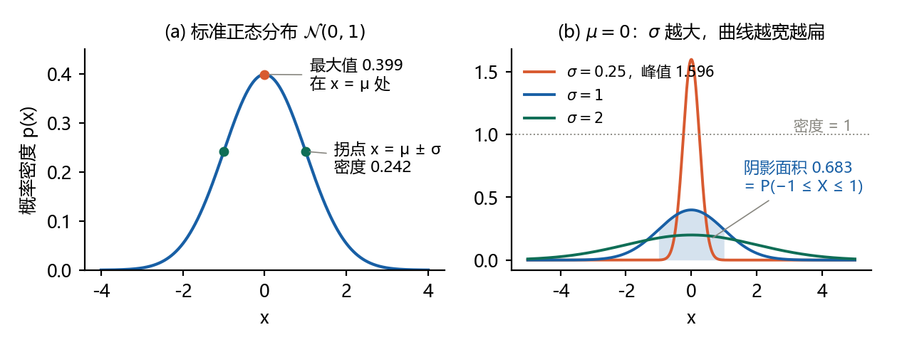
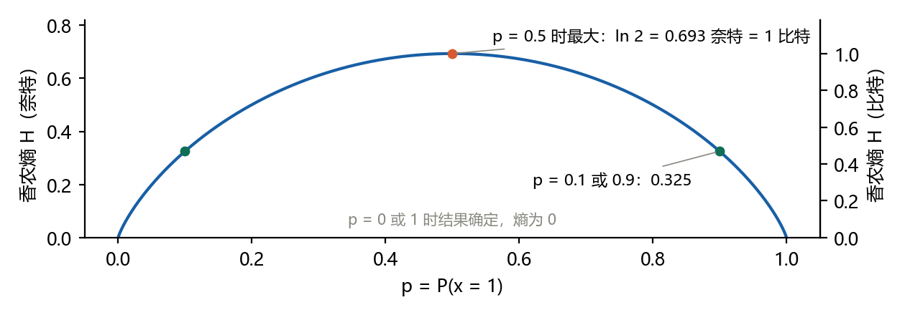
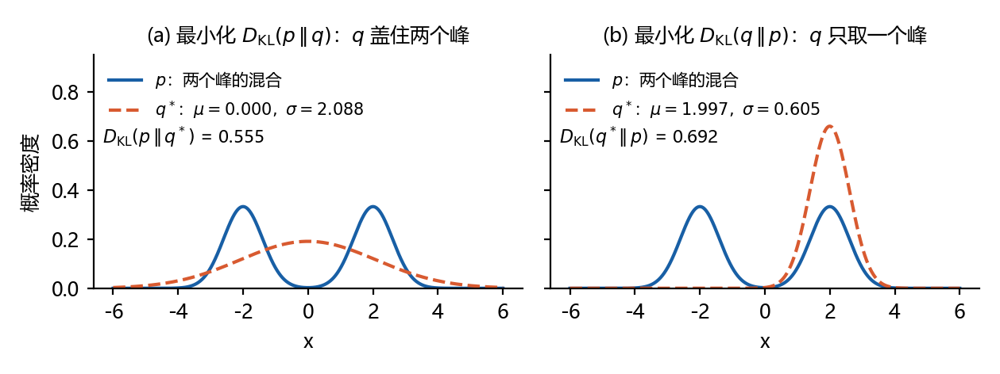

# 扩散模型推导笔记 P0：概率与信息论（花书第 3 章读书笔记）

本文是本系列的前置篇，整理《深度学习》（Goodfellow、Bengio、Courville 著，中文读者常称“花书”）第 3 章“概率与信息论”中与扩散模型关系最密切的三部分：3.9.3 节高斯分布、3.11 节贝叶斯规则、3.13 节信息论（自信息、熵、KL 散度、交叉熵）。D0–D1 要用的高斯密度、贝叶斯公式和 KL 散度，在这几节里第一次出现。

读法：每节内容按同一顺序排列。**要点**用自己的话概括原书；**公式**照录原书公式，并注明原书式号，方便对照；**读书批注**是阅读时写在书页边上的话；**补充**给出原书省略的推导和数值例子；**联系**说明这一节在扩散模型里用在哪里，并指向 D0–D1 的对应位置。第 0 章是一页速览，第 4 章是小结表，第 5、6 章是自测题和答案。

记号与原书一致：$`\mathcal{N}(x;\mu,\sigma^2)`$ 的第二个参数是方差；log 一律指自然对数，信息量的单位是奈特。原书用正体 $`\mathrm{x}`$ 表示随机变量、斜体 $`x`$ 表示它的取值，本文在不引起混淆时不作区分。

引用说明：公式和式号引自原书中译本；文字是笔记作者自己的概括，没有照录原书段落；三幅插图按公式用代码重新绘制，不是原书插图。文中的数字都由 `code/00_probability_check.py` 核对，插图由 `code/make_figures_p0.py` 生成。版本 1.0，2026-10-19。

## 0 一页速览

| 概念 | 公式 | 一句话 | 原书 |
|---|---|---|---|
| 一维高斯 | $`\mathcal{N}(x;\mu,\sigma^2)=\frac{1}{\sqrt{2\pi\sigma^2}}e^{-(x-\mu)^2/(2\sigma^2)}`$ | μ 定位置，σ 定宽度，曲线下总面积为 1 | 式 (3.21) |
| 精度 | $`\beta=1/\sigma^2`$ | 方差的倒数；反复求值时省去平方和取倒数 | 式 (3.22) |
| 多维高斯 | $`\mathcal{N}(\boldsymbol{x};\boldsymbol{\mu},\boldsymbol{\Sigma})`$ | $`\boldsymbol\Sigma=\sigma^2\boldsymbol I`$ 时各维独立、方差相同 | 式 (3.23)(3.24) |
| 贝叶斯规则 | $`P(x\mid y)=\frac{P(x)P(y\mid x)}{P(y)}`$ | 由 $`P(y\mid x)`$ 和 $`P(x)`$ 反推 $`P(x\mid y)`$ | 式 (3.42) |
| 自信息 | $`I(x)=-\log P(x)`$ | 越不可能的事件，发生时带来的信息越多 | 式 (3.48) |
| 香农熵 | $`H(x)=-\mathbb{E}_{x\sim P}[\log P(x)]`$ | 自信息的平均值，衡量不确定性 | 式 (3.49) |
| KL 散度 | $`D_{\mathrm{KL}}(P\Vert Q)=\mathbb{E}_{x\sim P}\big[\log\frac{P(x)}{Q(x)}\big]`$ | 两个分布的差异，非负，不对称 | 式 (3.50) |
| 交叉熵 | $`H(P,Q)=-\mathbb{E}_{x\sim P}\log Q(x)`$ | 等于 $`H(P)+D_{\mathrm{KL}}(P\Vert Q)`$ | 式 (3.51) |

## 1 高斯分布（3.9.3 节）

### 1.1 一维高斯密度

**术语**：正态分布（normal distribution）和高斯分布（Gaussian distribution）是同一个分布的两个名字。

**要点**：它由两个参数决定。均值 $`\mu\in\mathbb{R}`$ 是钟形曲线峰顶的横坐标，也就是 $`\mathbb{E}[x]=\mu`$；标准差 $`\sigma\in(0,\infty)`$ 控制曲线的宽窄，方差是 $`\sigma^2`$。

**公式**（原书式 (3.21)）：

```math
\mathcal{N}(x;\mu,\sigma^2)=\sqrt{\frac{1}{2\pi\sigma^2}}\exp\Big(-\frac{1}{2\sigma^2}(x-\mu)^2\Big)
```

**读书批注**：“一维高斯密度函数”。多维的写法见 1.5 节。

**补充：归一化常数从哪里来**。指数部分 $`\exp\big(-\frac{(x-\mu)^2}{2\sigma^2}\big)`$ 决定曲线的形状，但它下面的面积不是 1；前面的系数负责把面积调成 1。分两步：

1. 高斯积分：$`\int_{-\infty}^{\infty}e^{-u^2/2}\,du=\sqrt{2\pi}`$。证明要把它平方后改用极坐标计算，这里不展开。
2. 换元 $`u=(x-\mu)/\sigma`$，于是 $`dx=\sigma\,du`$：

```math
\int_{-\infty}^{\infty}\exp\Big(-\frac{(x-\mu)^2}{2\sigma^2}\Big)dx=\sigma\int_{-\infty}^{\infty}e^{-u^2/2}\,du=\sigma\sqrt{2\pi}
```

所以要除以 $`\sigma\sqrt{2\pi}=\sqrt{2\pi\sigma^2}`$，这正是式 (3.21) 前面的 $`\sqrt{1/(2\pi\sigma^2)}`$。代码核对：$`\int e^{-x^2/2}dx`$ 的数值积分为 2.506628，与 $`\sqrt{2\pi}`$ 一致；三组不同的 μ、σ 下，曲线下的总面积都是 1。

**联系**：D0–D1 的 [T5](D0-D1-gaussian-and-kl.md#t5-高斯分布的三条规则) 用的就是这个密度，同样约定第二个参数是方差。

### 1.2 精度

**术语**：精度（precision）是方差的倒数，$`\beta=1/\sigma^2`$。

**要点**：用 σ 写密度，每次求值都要先把 σ 平方再取倒数。如果要在很多组参数下反复求值，直接用 β 作参数更省事。

**公式**（原书式 (3.22)）：

```math
\mathcal{N}(x;\mu,\beta^{-1})=\sqrt{\frac{\beta}{2\pi}}\exp\Big(-\frac{1}{2}\beta(x-\mu)^2\Big)
```

**补充**：β 越大，方差越小，分布越集中，“精度”这个名字由此而来。代码核对：σ = 0.25（β = 16）时，式 (3.22) 与式 (3.21) 在整条曲线上的最大差约为 $`2\times10^{-16}`$，只是浮点舍入误差。

**联系**：D0–D1 的配方模板里，$`x^2`$ 的系数 A 就是精度（[T6](D0-D1-gaussian-and-kl.md#t6-配方法与高斯识别模板)）；两个高斯密度相乘时，结果的精度是两个精度之和（[第 4 章](D0-D1-gaussian-and-kl.md#4-d0b-两个高斯密度相乘)）。用精度写，这些结论都更简洁。

### 1.3 原书图 3.1：密度不是概率

**要点**：原书图 3.1 画的是标准正态分布（standard normal distribution），即 μ = 0、σ = 1 的正态分布。图上标出两处：最大值在 x = μ 处，拐点在 x = μ ± σ 处。

**读书批注**（四条）：

- $`\sqrt{1/(2\pi\sigma^2)}`$：让曲线下的总面积等于 1。
- 密度本身不是概率，曲线下某一段的面积才是概率。
- σ 越大，曲线越宽。
- x 离 μ 越远，$`(x-\mu)^2`$ 越大，$`e^{-\frac{1}{2\sigma^2}(x-\mu)^2}`$ 越小。

**补充**：

- 区间概率：$`P(a\le x\le b)=\int_a^b\mathcal{N}(x;\mu,\sigma^2)\,dx`$。单独一点的概率为 0，只有区间才有非零概率。
- 密度可以大于 1。σ = 0.25 时峰值是 $`1/(0.25\sqrt{2\pi})=1.596`$，曲线下总面积仍是 1；σ = 1、2 时峰值分别为 0.399、0.199。总面积固定为 1，所以曲线变宽时峰必然变低。
- 不论 σ 取多少，x 落在 μ ± σ 内的概率都是 0.683，即图 1(b) 中阴影的面积。代码在 σ = 0.25、1、2 下分别核对过。
- 拐点为什么在 μ ± σ：对密度 p(x) 求两次导数，得 $`p''(x)=p(x)\Big[\frac{(x-\mu)^2}{\sigma^4}-\frac{1}{\sigma^2}\Big]`$。方括号在 $`(x-\mu)^2=\sigma^2`$ 处变号，曲线的弯曲方向在这里改变：μ ± σ 之间向下弯，之外向上弯。标准正态分布在拐点处的密度为 0.242。



**联系**：扩散模型前向过程中，条件分布 $`q(\boldsymbol x_t\mid\boldsymbol x_0)`$ 的方差 $`1-\bar\alpha_t`$ 随 t 增大，对应的曲线也随之变宽、变低。

### 1.4 为什么常用正态分布

**要点**：原书给了两个理由，下面是自己的概括。

1. 中心极限定理（central limit theorem）：许多独立随机变量的和近似服从正态分布。由大量小因素叠加形成的噪声，用正态分布建模往往很准确。
2. 在方差相同的所有实数分布中，正态分布的不确定性最大。选用正态分布，相当于除了均值和方差，不再对模型附加其他先验知识。原书把证明放在 19.4.2 节。

**补充**：第 2 条说的不确定性，就是 3.2 节的微分熵。方差为 $`\sigma^2`$ 的正态分布，微分熵是 $`\frac{1}{2}\log(2\pi e\sigma^2)`$，数值例子见 3.2 节。

**联系**：扩散模型的前向过程每一步都加正态噪声。除了上面两点，还有一个推导上的好处：独立高斯的线性组合仍是高斯（D0–D1 的 T5 规则 B），所以很多量都能写出闭式解。

### 1.5 多维正态分布与各向同性

**术语**：

- 多维正态分布（multivariate normal distribution）：正态分布在 $`\mathbb{R}^n`$ 上的推广，参数是均值向量 $`\boldsymbol\mu`$ 和协方差矩阵 $`\boldsymbol\Sigma`$，Σ 是正定对称矩阵。
- 精度矩阵（precision matrix）：$`\boldsymbol\beta=\boldsymbol\Sigma^{-1}`$。D0–D1 的 5.4 节把它记作 Λ。
- 各向同性（isotropic）：协方差矩阵是一个数乘以单位阵，即 $`\boldsymbol\Sigma=\sigma^2\boldsymbol I`$。

**公式**（原书式 (3.23)、(3.24)）：

```math
\mathcal{N}(\boldsymbol x;\boldsymbol\mu,\boldsymbol\Sigma)=\sqrt{\frac{1}{(2\pi)^n\det(\boldsymbol\Sigma)}}\exp\Big(-\frac{1}{2}(\boldsymbol x-\boldsymbol\mu)^\top\boldsymbol\Sigma^{-1}(\boldsymbol x-\boldsymbol\mu)\Big)
```

```math
\mathcal{N}(\boldsymbol x;\boldsymbol\mu,\boldsymbol\beta^{-1})=\sqrt{\frac{\det(\boldsymbol\beta)}{(2\pi)^n}}\exp\Big(-\frac{1}{2}(\boldsymbol x-\boldsymbol\mu)^\top\boldsymbol\beta(\boldsymbol x-\boldsymbol\mu)\Big)
```

**要点**：

- μ 仍是均值，只是变成了向量；Σ 的对角线是各维的方差，非对角线是两两之间的协方差。
- 用 Σ 写密度，每次求值都要对 Σ 求逆；反复求值时改用精度矩阵更高效，理由与一维时用 β 相同。
- 实际中常把协方差矩阵限定为对角阵；更简单的是各向同性，即各维方差相同、互不相关。

**补充：各向同性时，密度是一维密度的乘积**。代入 $`\boldsymbol\Sigma=\sigma^2\boldsymbol I`$，有 $`\det(\boldsymbol\Sigma)=\sigma^{2n}`$，$`(\boldsymbol x-\boldsymbol\mu)^\top\boldsymbol\Sigma^{-1}(\boldsymbol x-\boldsymbol\mu)=\frac{1}{\sigma^2}\sum_{i=1}^n(x_i-\mu_i)^2`$，于是

```math
\mathcal{N}(\boldsymbol x;\boldsymbol\mu,\sigma^2\boldsymbol I)=\prod_{i=1}^n\frac{1}{\sqrt{2\pi\sigma^2}}\exp\Big(-\frac{(x_i-\mu_i)^2}{2\sigma^2}\Big)=\prod_{i=1}^n\mathcal{N}(x_i;\mu_i,\sigma^2)
```

指数里的求和变成了指数的乘积，系数 $`\sigma^{2n}`$ 开方后平均分给 n 个因子。联合密度能写成各维密度的乘积，说明各维相互独立。Σ 有非零的非对角元时，就不能这样拆。代码在三维情形下核对了这两点：各向同性时，两边之差小于 $`10^{-16}`$；换成一个各维相关的 Σ，联合密度与各维密度之积相差约 $`4\times10^{-4}`$。

**联系**：DDPM 的噪声 $`\boldsymbol\epsilon\sim\mathcal{N}(\boldsymbol 0,\boldsymbol I)`$ 是各向同性的标准正态分布，图像的每个像素各加一份独立的标准正态噪声。前向过程 $`q(\boldsymbol x_t\mid\boldsymbol x_{t-1})=\mathcal{N}(\sqrt{1-\beta_t}\,\boldsymbol x_{t-1},\,\beta_t\boldsymbol I)`$ 的协方差也是各向同性的，所以 D0–D1 可以先在一维里推导，再逐维推广（[5.4 节](D0-D1-gaussian-and-kl.md#54-矩阵版本)、[6.2 节](D0-D1-gaussian-and-kl.md#62-d-维对角高斯-b)）。注意，这里的 $`\beta_t`$ 是 DDPM 第 t 步加噪的方差，与原书表示精度的 β 不是同一个量。

## 2 贝叶斯规则（3.11 节）

**术语**：贝叶斯规则（Bayes' rule）用于在已知 $`P(y\mid x)`$ 和 $`P(x)`$ 时求 $`P(x\mid y)`$。

**公式**（原书式 (3.42)）：

```math
P(x\mid y)=\frac{P(x)\,P(y\mid x)}{P(y)}
```

分母可以用 $`P(y)=\sum_x P(y\mid x)P(x)`$ 计算，所以事先不必知道 $`P(y)`$。

**读书批注**：从条件概率的定义推出式 (3.42)。

```math
P(x\mid y)=\frac{P(x,y)}{P(y)},\qquad P(y\mid x)=\frac{P(x,y)}{P(x)}
```

两式都含联合概率 $`P(x,y)`$，消去它得 $`P(x\mid y)P(y)=P(y\mid x)P(x)`$，两边同除以 $`P(y)`$ 就是式 (3.42)。批注里把 $`P(x,y)`$ 简写成了 $`P(xy)`$。

**补充：四个名称**。

- 先验（prior）$`P(x)`$：观测到 y 之前对 x 的估计。
- 似然（likelihood）$`P(y\mid x)`$：x 取某个值时，观测到 y 的可能性。
- 证据（evidence）$`P(y)`$：也叫边缘似然，由 $`\sum_x P(y\mid x)P(x)`$ 得到。
- 后验（posterior）$`P(x\mid y)`$：观测到 y 之后对 x 的估计。

**补充：数值例子**。某种病的患病率为 1%；检测的灵敏度为 95%，即患者被检出阳性的概率是 0.95；误报率为 5%，即健康人被检出阳性的概率是 0.05。问：检测结果为阳性的人，真正患病的概率是多少？

1. 证据：$`P(\text{阳性})=0.95\times0.01+0.05\times0.99=0.0095+0.0495=0.059`$。
2. 后验：$`P(\text{患病}\mid\text{阳性})=\dfrac{0.01\times0.95}{0.059}=0.161`$。

换成人数更直观：每 1 万人中有 100 名患者，其中 95 人检出阳性；9900 名健康人中有 495 人被误报为阳性。阳性共 590 人，真正患病的只有 95 人，95/590 ≈ 16.1%。检测本身的准确率有 95%，但患病率很低，所以阳性结果多数是误报。代码模拟了 100 万人，阳性者中患病的比例为 0.161，与公式一致。

**联系**：扩散模型的反向过程要用到后验 $`q(\boldsymbol x_{t-1}\mid\boldsymbol x_t,\boldsymbol x_0)`$，它就是由式 (3.42) 算出来的：

```math
q(\boldsymbol x_{t-1}\mid\boldsymbol x_t,\boldsymbol x_0)=\frac{q(\boldsymbol x_t\mid\boldsymbol x_{t-1})\,q(\boldsymbol x_{t-1}\mid\boldsymbol x_0)}{q(\boldsymbol x_t\mid\boldsymbol x_0)}
```

这里用到了前向过程的马尔可夫性：已知 $`\boldsymbol x_{t-1}`$ 时，$`\boldsymbol x_t`$ 与 $`\boldsymbol x_0`$ 无关。右边三项都是已知的高斯分布，所以后验也是高斯分布。推导见 D0–D1 的 [T8](D0-D1-gaussian-and-kl.md#t8-贝叶斯公式) 和 [5.2 节](D0-D1-gaussian-and-kl.md#52-后验分布套路二)。

## 3 信息论（3.13 节）

**术语**：信息论（information theory）研究怎样度量一个信号含有多少信息。原书主要借用它的两类量：描述一个分布的不确定性（熵），以及度量两个分布之间的差异（KL 散度、交叉熵）。

### 3.1 自信息

**要点**：度量信息时，原书提出三条要求，下面是自己的概括。

1. 必然发生的事件不含信息；很可能发生的事件，信息很少。
2. 越不可能发生的事件，发生时带来的信息越多。
3. 独立事件的信息量相加。例如硬币两次正面朝上的信息量，是一次正面朝上的两倍。

满足这三条的定义叫自信息（self-information）。

**公式**（原书式 (3.48)）：

```math
I(x)=-\log P(x)
```

**单位**：

- 奈特（nat）：log 以 e 为底时的单位。1 奈特是观测到一个概率为 1/e 的事件时得到的信息量。
- 比特（bit）：以 2 为底时的单位，也叫香农（shannon）。
- 两者只差一个常数倍：1 奈特 = 1/ln 2 ≈ 1.443 比特。

**补充**：

- 为什么用对数：独立事件同时发生的概率是两个概率相乘，$`P(x,y)=P(x)P(y)`$。取对数后，乘法变成加法：$`I(x,y)=-\log P(x)-\log P(y)=I(x)+I(y)`$，第 3 条要求自然满足。
- 为什么加负号：加上负号后，概率越小，信息量越大（第 2 条）；P = 1 时 I = 0（第 1 条）。
- 例子：抛一枚均匀的硬币，正面朝上的信息量是 $`-\log0.5=\ln2\approx0.693`$ 奈特，即 1 比特；两次都正面朝上的概率为 0.25，信息量是 $`2\ln2`$，正好是一次的两倍。

**联系**：负的对数概率 $`-\log p`$，就是训练中常说的负对数似然（negative log-likelihood）。DDPM 的训练目标是负对数似然 $`-\log p_\theta(\boldsymbol x_0)`$ 的一个上界。

### 3.2 香农熵

**术语**：香农熵（Shannon entropy）是自信息在整个分布上的期望，记作 H(x) 或 H(P)。

**公式**（原书式 (3.49)）：

```math
H(x)=\mathbb{E}_{x\sim P}[I(x)]=-\mathbb{E}_{x\sim P}[\log P(x)]
```

**读书批注**：在式 (3.49) 旁写了 $`I(x)=-\log P(x)`$，在原书图 3.5 旁写了 $`\mathbb{E}_{x\sim p}[I(x)]=-\mathbb{E}_{x\sim p}[\log p(x)]`$。两条都在提醒：熵就是把 3.1 节的自信息按分布求平均。

**要点**：

- 编码的含义：按分布 P 生成符号，再给它们编码。以 2 为底时，熵是平均每个符号所需比特数的下界。
- 接近确定（结果几乎可以预知）的分布熵低，接近均匀的分布熵高。
- x 是连续变量时，香农熵称为微分熵（differential entropy）。

**补充：二值随机变量的熵**。这是原书图 3.5 画的情形。设 $`P(x=1)=p`$，则

```math
H(p)=-p\log p-(1-p)\log(1-p)
```

- p = 0 或 1 时，结果是确定的。按约定 $`0\log0=0`$，熵为 0。
- p = 0.5 时熵最大：$`H=\ln2\approx0.693`$ 奈特，即 1 比特。
- p = 0.1 或 0.9 时，熵为 0.325。
- 对 p 求导，$`H'(p)=\log\frac{1-p}{p}`$，只在 p = 0.5 处为 0，与上面一致。
- 更一般地，k 个结果的分布，熵不超过 $`\ln k`$，取均匀分布时达到。代码用 10 万个随机分布检验了 k = 4 的情形。



**补充：从离散到连续，丢掉了什么**。原书指出，推广到连续变量后，离散情形的一些性质不再成立。具体有两点：

- 离散时，$`I(x)=0`$ 意味着 $`P(x)=1`$，事件必然发生。连续时，密度为 1 的点信息量也是 0，可是任何单独一点的概率都是 0，谈不上“必然发生”。例如均匀分布 U(0, 1) 的密度处处为 1。
- 密度可以大于 1（1.3 节），所以 $`-\log p(x)`$ 可以为负，微分熵也可以为负。例如 U(0, 0.5) 的密度为 2，微分熵为 $`\ln0.5=-0.693`$。正态分布的微分熵为 $`\frac{1}{2}\log(2\pi e\sigma^2)`$：σ = 1 时为 1.419，σ = 0.1 时为 −0.884。

**联系**：扩散模型前向过程不断加噪，样本的分布逐渐接近标准正态分布。在方差为 1 的所有分布中，标准正态分布的微分熵最大（1.4 节第 2 条）。

### 3.3 KL 散度

**术语**：KL 散度（Kullback-Leibler divergence）度量同一个随机变量 x 上两个分布 P(x) 与 Q(x) 的差异。

**公式**（原书式 (3.50)）：

```math
D_{\mathrm{KL}}(P\Vert Q)=\mathbb{E}_{x\sim P}\Big[\log\frac{P(x)}{Q(x)}\Big]=\mathbb{E}_{x\sim P}[\log P(x)-\log Q(x)]
```

**要点：编码的含义**（批注圈出了“编码”二字）。在离散情形下，假设按 Q 设计了一套使消息最短的编码，却用它发送由 P 产生的符号。以 2 为底时，$`D_{\mathrm{KL}}(P\Vert Q)`$ 就是平均每个符号多花的比特数。机器学习中通常用奈特和自然对数。

**补充：数值例子**。$`P=(0.5,\,0.5)`$，$`Q=(0.9,\,0.1)`$：

```math
D_{\mathrm{KL}}(P\Vert Q)=0.5\ln\frac{0.5}{0.9}+0.5\ln\frac{0.5}{0.1}=0.511,\qquad D_{\mathrm{KL}}(Q\Vert P)=0.9\ln\frac{0.9}{0.5}+0.1\ln\frac{0.1}{0.5}=0.368
```

用编码来理解第一个数：

1. 按 Q 设计的理想码长是 $`-\log_2Q`$，两个结果分别为 0.152 比特和 3.322 比特。
2. 用这套码发送 P 产生的符号，平均码长为 $`0.5\times0.152+0.5\times3.322=1.737`$ 比特。
3. 按 P 设计的码，平均只需 1 比特。
4. 多花的 0.737 比特，正是 $`D_{\mathrm{KL}}(P\Vert Q)=0.511`$ 奈特换算成比特（0.511/ln 2 = 0.737）。

**联系**：D0–D1 第 6 章推导的就是两个高斯分布之间的 KL 散度，那里写作 $`\mathrm{KL}(p\Vert q)`$，与原书的 $`D_{\mathrm{KL}}(P\Vert Q)`$ 是同一个量（[第 6 章](D0-D1-gaussian-and-kl.md#6-d1-两个对角高斯之间的-kl-散度)）。

### 3.4 KL 散度的性质

**要点**：

- 非负：$`D_{\mathrm{KL}}(P\Vert Q)\ge0`$。
- 等号成立的条件：离散时，当且仅当 P 与 Q 相同；连续时，当且仅当二者“几乎处处”相同，也就是只在概率为 0 的集合上可以不同。
- 不对称：一般 $`D_{\mathrm{KL}}(P\Vert Q)\ne D_{\mathrm{KL}}(Q\Vert P)`$。所以它不是真正的距离，尽管常被当作分布之间的某种距离。选哪个方向影响很大，见 3.5 节。

**补充：非负性的证明**。log 是凹函数，由 Jensen 不等式，$`\mathbb{E}[\log Y]\le\log\mathbb{E}[Y]`$。取 $`Y=Q(x)/P(x)`$，x 按 P 取值：

```math
-D_{\mathrm{KL}}(P\Vert Q)=\mathbb{E}_{x\sim P}\Big[\log\frac{Q(x)}{P(x)}\Big]\le\log\mathbb{E}_{x\sim P}\Big[\frac{Q(x)}{P(x)}\Big]=\log\sum_{x:\,P(x)\gt 0}Q(x)\le\log1=0
```

- 等号要求两处都取等：Q/P 在 P 有概率的地方是常数，并且 Q 的概率全部落在这些地方。两个分布的总和都是 1，所以这个常数只能是 1，即 Q = P。
- 3.3 节的例子显示了不对称：0.511 ≠ 0.368。
- 代码随机抽取了 10 万对分布，KL 散度没有一个小于 0。

### 3.5 KL 散度的两个方向（原书图 3.6）

**要点**：设 p 是两个高斯分布的混合，有两个峰，想用单个高斯分布 q 近似它。

- 最小化 $`D_{\mathrm{KL}}(p\Vert q)`$：凡是 p 有较高概率的地方，q 也要有较高概率。p 有多个峰时，q 会变宽，把几个峰一起盖住。
- 最小化 $`D_{\mathrm{KL}}(q\Vert p)`$：凡是 p 概率很低的地方，q 的概率也要很低。几个峰相隔很远时，q 只贴住其中一个峰，避开峰之间的低谷。
- 选哪个方向取决于问题本身：有的应用要求 q 覆盖 p 的所有高概率区域，有的应用要求 q 不把概率放到 p 的低概率区域。

**补充：为什么会这样**。

- $`D_{\mathrm{KL}}(p\Vert q)=\mathbb{E}_{x\sim p}[\log p(x)-\log q(x)]`$ 按 p 求平均。只要某处 p 有概率而 q ≈ 0，$`-\log q`$ 就很大，代价很高，所以 q 不能漏掉任何一个峰。
- $`D_{\mathrm{KL}}(q\Vert p)`$ 按 q 求平均，只计较 q 有概率的地方。q 如果把概率放到 p ≈ 0 的低谷，$`-\log p`$ 很大，代价很高；q 漏掉一个峰，却不受惩罚。

**补充：数值复现**。取 $`p=0.5\,\mathcal{N}(-2,0.6^2)+0.5\,\mathcal{N}(2,0.6^2)`$，在所有一维高斯分布中搜索 q：

- 最小化 $`D_{\mathrm{KL}}(p\Vert q)`$：得 μ = 0、σ = 2.088，最小值 0.555。这时 q 的均值和方差恰好等于 p 的均值 0 和方差 0.36 + 4 = 4.36。这个现象叫矩匹配（moment matching）。
- 最小化 $`D_{\mathrm{KL}}(q\Vert p)`$：得 μ = 1.997、σ = 0.605，几乎就是右边那个峰 $`\mathcal{N}(2,0.6^2)`$，最小值 0.692，略小于 ln 2。贴住左峰的解与它对称，KL 值相同。
- 交叉检查：前一个解的 $`D_{\mathrm{KL}}(q\Vert p)`$ 为 1.27；后一个解的 $`D_{\mathrm{KL}}(p\Vert q)`$ 为 10.2。在一个方向上最优的解，换一个方向可能很差。



**联系**：

- 最大似然估计等价于最小化 $`D_{\mathrm{KL}}(p_{\text{data}}\Vert p_{\text{model}})`$，属于第一个方向，原书 5.5 节会讲到。这样训练出的模型倾向于覆盖数据的所有模式。
- 变分推断用一个容易处理的分布 q 近似难以计算的后验 p，通常最小化 $`D_{\mathrm{KL}}(q\Vert p)`$，属于第二个方向，见原书第 19 章。VAE 的编码器也是这样训练的。
- DDPM 训练目标中 t > 1 的各项是 $`D_{\mathrm{KL}}\big(q(\boldsymbol x_{t-1}\mid\boldsymbol x_t,\boldsymbol x_0)\Vert p_\theta(\boldsymbol x_{t-1}\mid\boldsymbol x_t)\big)`$：真实的后验在前，模型在后，属于第一个方向。两边都是高斯分布，所以有闭式解，见 D0–D1 第 6 章。

### 3.6 交叉熵

**术语**：交叉熵（cross-entropy）是与 KL 散度密切相关的一个量。

**公式**（原书式 (3.51)）：

```math
H(P,Q)=-\mathbb{E}_{x\sim P}\log Q(x)
```

**要点**：

- 它与 KL 散度的关系是 $`H(P,Q)=H(P)+D_{\mathrm{KL}}(P\Vert Q)`$。与 KL 散度相比，交叉熵少了 $`\mathbb{E}_{x\sim P}[\log P(x)]`$ 这一项。
- 少掉的这一项与 Q 无关，所以针对 Q 最小化交叉熵，等价于最小化 KL 散度。
- 计算中遇到 $`0\log0`$ 时，按约定取 $`\lim_{x\to0}x\log x=0`$。

**补充：一行推导**

```math
H(P,Q)=-\mathbb{E}_{P}[\log Q]=-\mathbb{E}_{P}[\log P]+\mathbb{E}_{P}[\log P-\log Q]=H(P)+D_{\mathrm{KL}}(P\Vert Q)
```

用 3.3 节的例子核对：

- $`H(P)=\ln2=0.693`$，$`H(P,Q)=-0.5\ln0.9-0.5\ln0.1=1.204`$，正好等于 0.693 + 0.511。
- 换成比特是 1 + 0.737 = 1.737，就是 3.3 节“用 Q 的码发送 P 的符号”的平均码长。
- 所以交叉熵是这种发送方式的平均码长，KL 散度是其中多花的部分。代码还核对了：对 $`Q=(q,1-q)`$ 分别最小化交叉熵和 KL 散度，得到同一个 q = 0.5。

**补充：分类损失**。分类问题中，P 是独热（one-hot）标签，例如 P = (1, 0)；Q 是模型输出的概率，例如 Q = (0.7, 0.3)。这时 $`H(P)=0`$（用到 $`0\log0=0`$），交叉熵为 $`-\log0.7=0.357`$，只剩正确类别的负对数概率。最小化交叉熵损失，就是让模型给正确类别更高的概率。

**联系**：$`\mathbb{E}_{\boldsymbol x_0\sim q}[-\log p_\theta(\boldsymbol x_0)]`$ 是数据分布 q 与模型分布 $`p_\theta`$ 的交叉熵 $`H(q,p_\theta)`$。DDPM 最小化的是它的一个上界。

## 4 小结：这几节在扩散模型中的位置

| 概念 | 在扩散模型中的位置 | D0–D1 对应位置 |
|---|---|---|
| 一维高斯密度、精度 | 每一步都加高斯噪声；两个高斯密度相乘时精度相加 | T5、T6、第 4 章 |
| 各向同性的多维高斯 | 噪声 $`\boldsymbol\epsilon\sim\mathcal{N}(\boldsymbol 0,\boldsymbol I)`$ 各维独立，可以逐维推导 | 5.4 节、6.2 节 |
| 贝叶斯规则 | 由前向过程求后验 $`q(\boldsymbol x_{t-1}\mid\boldsymbol x_t,\boldsymbol x_0)`$ | T8、5.2 节 |
| 自信息、交叉熵 | 负对数似然；DDPM 最小化它的上界 | 后续篇目 |
| KL 散度 | 训练目标中 t > 1 的各项是两个高斯分布之间的 KL 散度 | 第 6 章 |
| KL 的方向 | 训练目标里真实后验在前、模型在后 | 第 6 章 |

## 5 自测题

做完再看第 6 章的答案。

1. $`\mathcal{N}(x;0,0.25^2)`$ 在 x = 0 处的值约为 1.596，大于 1。这与“概率不超过 1”矛盾吗？
2. 精度 β = 4 时，标准差 σ 是多少？
3. 三维各向同性高斯 $`\mathcal{N}(\boldsymbol x;\boldsymbol 0,\sigma^2\boldsymbol I)`$ 可以写成哪三个一维密度的乘积？
4. 把第 2 章例子中的患病率改为 10%，灵敏度和误报率不变，检测阳性的人真正患病的概率是多少？
5. 为什么针对 Q 最小化交叉熵，与最小化 $`D_{\mathrm{KL}}(P\Vert Q)`$ 得到同一个 Q？

## 6 自测答案

1. 不矛盾。1.596 是密度，即曲线的高度，不是概率。概率是曲线下的面积；这条曲线很窄，总面积仍是 1。
2. $`\sigma^2=1/\beta=0.25`$，所以 σ = 0.5。
3. $`\mathcal{N}(x_1;0,\sigma^2)\,\mathcal{N}(x_2;0,\sigma^2)\,\mathcal{N}(x_3;0,\sigma^2)`$，见 1.5 节的分解。
4. 证据 $`P(\text{阳性})=0.95\times0.1+0.05\times0.9=0.14`$，后验 $`0.095/0.14=0.679`$。患病率提高后，阳性结果可信得多。
5. 因为 $`H(P,Q)=H(P)+D_{\mathrm{KL}}(P\Vert Q)`$，而 H(P) 与 Q 无关，两个目标只差一个常数。

## 参考文献

1. Goodfellow, I., Bengio, Y., & Courville, A. (2016). *Deep Learning*. MIT Press. 第 3 章在线版：<https://www.deeplearningbook.org/contents/prob.html>
2. Goodfellow, I., Bengio, Y., & Courville, A. (2017). 《深度学习》. 人民邮电出版社. ISBN 978-7-115-46147-6. 第 3 章“概率与信息论”。
3. Ho, J., Jain, A., & Abbeel, P. (2020). Denoising diffusion probabilistic models. *Advances in Neural Information Processing Systems 33*. arXiv:2006.11239.
4. Cover, T. M., & Thomas, J. A. (2006). *Elements of Information Theory* (2nd ed.). Wiley.
