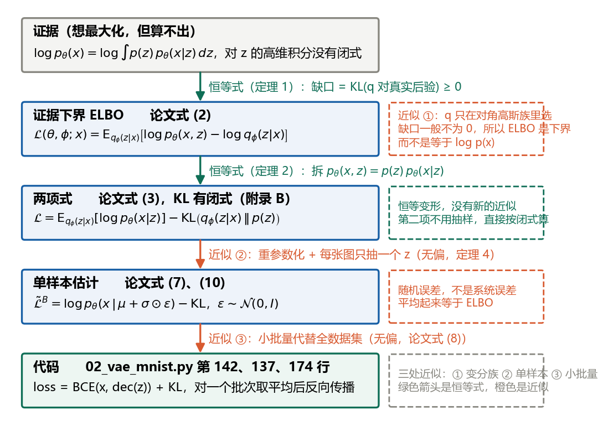
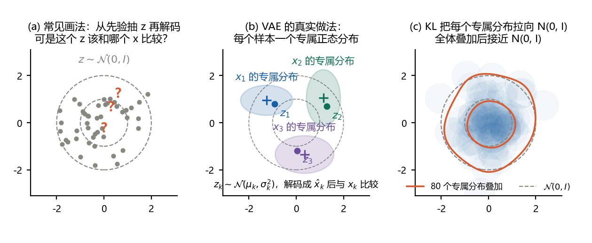
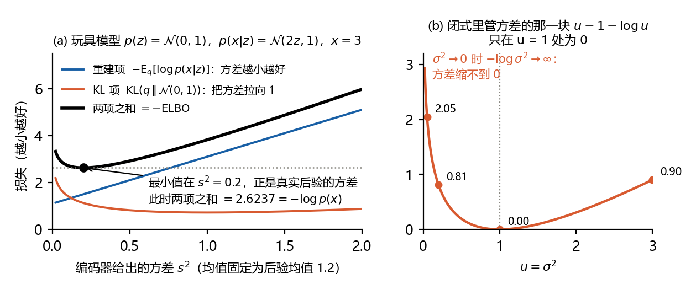

# 扩散模型推导笔记 R0：VAE 原论文推导精讲

本文是本系列的论文精读篇，对象是 Kingma & Welling (2014) 的《Auto-Encoding Variational Bayes》。它不按论文的章节顺序走，而是按苏剑林《变分自编码器》系列博客和李宏毅课程的思路，把 VAE 的全部推导压缩成 4 条定理、3 条引理、3 条命题。每条都按同一个格式写：先给正式陈述和紧凑证明，再用白话说这一步到底在做什么，最后给“对照”：对应论文的哪个公式、苏剑林哪篇哪一节、[L2](L2-vae-lectures.md) 哪一节、[D2–D3](D2-D3-elbo-and-vae-loss.md) 哪一章。逐步的代数细节不在这里重复，需要时按对照翻回去。

与其他各篇的关系：[L2](L2-vae-lectures.md) 按课程的顺序讲 VAE，[D2–D3](D2-D3-elbo-and-vae-loss.md) 把其中每一步推导展开，[I0](I0-vae-intuition.md) 不写定理、只讲直观的路线，并用 MNIST 上的实例核对；本文把同一套内容写成定义、定理与证明，并逐式对照原论文。DDPM 原论文的同类精读是 [R1](R1-ddpm-paper-walkthrough.md)，它的第 8 章把两篇逐项对照。

读法：第 0 章一页速览，先把六步链条和“三处近似”看一遍；第 1 章对齐三套记号，论文、苏剑林、李宏毅各用一套字母，不先对齐会一直读不顺；第 2 到 6 章是定义和定理，是正文；第 7 章把定理接到算法和代码；第 8 章回答初学者最常问的十个问题；第 9 章是总对照表；第 10、11 章是自测题与答案。记号以论文为准，log 一律指自然对数。文中的数字由 `code/r0_check.py` 核对；图 1、图 4、图 6 由 `code/make_figures_r0.py` 生成，图 2、图 3 取自 L2，图 5、图 7 取自 D2–D3。版本 1.0，2026-10-24。

引用说明：博客与课程的内容是笔记作者自己的概括，没有照录原文；论文的公式按原文的编号引用。

## 0 一页速览

### 0.1 六步链条

VAE 要做的事一句话：学一个生成模型 $`p_\theta(x)=\int p(z)\,p_\theta(x\mid z)\,dz`$，让训练数据的对数似然尽量大。积分算不出，于是改为最大化一个算得出的下界 ELBO；下界与真值的差，恰好是编码器与真实后验之间的 KL 散度。从目标到代码一共六步：

1. **目标**：最大化 $`\log p_\theta(x)`$，即极大似然。卡住的地方：对 $`z`$ 的积分没有闭式，真实后验也写不出（命题 0）。
2. **下界**：引入编码器 $`q_\phi(z\mid x)`$，得到恒等式 $`\log p_\theta(x)=\mathrm{ELBO}+\mathrm{KL}\big(q_\phi(z\mid x)\,\Vert\,p_\theta(z\mid x)\big)`$（定理 1）。KL 非负，所以 ELBO 是下界；最大化 ELBO 同时做两件事：抬高似然，让编码器逼近真实后验。
3. **两项式**：ELBO 等于重建项减去编码器与先验之间的 KL（定理 2）。两边都是高斯时 KL 有闭式（引理 2），只剩重建项需要采样。
4. **重参数化**：重建项是对 $`q_\phi`$ 的期望，参数 $`\phi`$ 藏在期望的下标里，梯度进不去。令 $`z=\mu_\phi(x)+\sigma_\phi(x)\odot\varepsilon`$，$`\varepsilon\sim\mathcal{N}(0,I)`$，随机性挪到外部噪声上，梯度就能穿过采样回到编码器（定理 4）。每张图只抽一个 $`z`$，是无偏估计。
5. **小批量**：用 $`M`$ 张图的平均代替全数据集，也是无偏估计。
6. **代码**：损失等于像素二元交叉熵之和加 KL 闭式，对一个批次取平均后反向传播，就是论文式 (10) 取负号。



### 0.2 哪些是恒等式，哪些是近似

初学者最容易把“下界”读成“近似”。下表把每一步的性质列清楚：

| 步骤 | 性质 | 误差来自哪里 | 本文位置 |
|---|---|---|---|
| 证据到 ELBO | 恒等式加一个不等号 | 缺口 $`=\mathrm{KL}(q_\phi\Vert p_\theta(z\mid x))`$。它由“$`q`$ 只在对角高斯族里选”决定，训练时靠调 $`\phi`$ 压小，一般不为 0。这是近似 ① | 定理 1 |
| ELBO 到两项式 | 恒等式 | 无 | 定理 2 |
| 期望到单样本 | 无偏估计 | 随机误差，平均为 0。这是近似 ② | 定理 4 |
| 全数据集到小批量 | 无偏估计 | 随机误差。这是近似 ③ | 7.1 节 |

### 0.3 三种讲法的起点

| 讲法 | 起点 | 顺序 | 最想让读者记住的一句话 |
|---|---|---|---|
| 论文（Kingma & Welling, 2014） | 后验难解 | 下界，朴素梯度估计方差大，重参数化，SGVB 估计器，高斯特例 | 这是一个通用的低方差梯度估计器，VAE 只是它的一个例子 |
| 苏剑林（一）（二）（三） | 分布变换；直接对联合分布做 KL | 每个样本一个专属正态，方差会缩成 0，KL 正则，重参数化；（二）联合 KL 一步到损失；（三）为什么只采一个点 | VAE 是加了噪声的自编码器，两项损失互相对抗；一切都是“分布加采样” |
| 李宏毅 2016 年 VAE 一讲 | 估计 $`P(x)`$：高斯混合到无穷多个高斯 | 结构直观，为什么加噪声，极大似然，下界，两项对上网络 | 要同时调编码器和解码器，下界才能把似然推高 |

本文的顺序是：李宏毅“问题到下界”的骨架，加上苏剑林（二）的联合 KL 作为总定理，再接论文的梯度估计部分。

## 1 三套记号与三条路线

### 1.1 记号对照

同一个东西在三处用了不同的字母。先对齐，后面才读得顺：

| 对象 | 本文（与论文相同） | 苏剑林（一）（二） | 李宏毅讲义 | 代码 `02_vae_mnist.py` |
|---|---|---|---|---|
| 数据分布 | $`p_{\mathrm{data}}(x)`$ | $`\tilde p(x)`$ | 训练样本 | 训练集 |
| 先验 | $`p(z)=\mathcal{N}(0,I)`$，论文写 $`p_\theta(z)`$ | $`q(z)`$ | $`P(z)`$ | 固定，不出现 |
| 解码器（生成模型） | $`p_\theta(x\mid z)`$ | $`q(x\mid z)`$，参数 $`\tilde\mu(z)`$ 或 $`\rho(z)`$ | $`P(x\mid z)`$，参数 $`\mu(z),\sigma(z)`$ | `decode`，输出 `logits` |
| 编码器（近似后验） | $`q_\phi(z\mid x)=\mathcal{N}\big(\mu_\phi(x),\mathrm{diag}\,\sigma_\phi^2(x)\big)`$ | $`p(z\mid x)`$，参数 $`\mu(x),\sigma^2(x)`$ | $`q(z\mid x)`$，参数 $`\mu'(x),\sigma'(x)`$ | `mu`，`logvar` |
| 真实后验 | $`p_\theta(z\mid x)`$ | $`q(z\mid x)`$，只在贝叶斯公式里出现一次 | $`P(z\mid x)`$ | 不出现 |
| 下界 | $`\mathcal{L}(\theta,\phi;x)`$，本文也写 ELBO | 损失 $`L`$ 是它的相反数再对数据平均 | $`L_b`$ | `-(rec + kl)` |
| 重参数化 | $`z=\mu+\sigma\odot\varepsilon`$ | $`Z=\mu+\varepsilon\times\sigma`$ | $`c_i=\exp(\sigma_i)\,e_i+m_i`$ | `mu + std * eps` |

三点说明：

- 苏剑林把“数据加编码器”这一侧记作 $`p`$，把“先验加解码器”这一侧记作 $`q`$，与论文正好相反。他的理由是：$`\tilde p(x)p(z\mid x)`$ 是“真实的联合分布”，$`q(z)q(x\mid z)`$ 是“模型”，KL 写成 KL(真实 ‖ 模型)。读他的文章时，看到 $`p(z\mid x)`$ 要在心里换成本文的 $`q_\phi(z\mid x)`$。
- 李宏毅讲义里的 $`\sigma_i`$ 在两个式子中约定不一致，一处相当于对数标准差，一处相当于对数方差，结论不受影响；细节见 [L2 第 2.1 节](L2-vae-lectures.md#21-从自编码器到-vae)的订正。本文的 $`\sigma`$ 一律是标准差，$`\sigma^2`$ 是方差，网络输出的是 $`\log\sigma^2`$。
- 论文写 $`p_\theta(z)`$，是因为先验原则上也可以带参数；VAE 的例子里先验是 $`\mathcal{N}(0,I)`$，没有参数，本文直接写 $`p(z)`$。

### 1.2 三条路线各走什么

**论文的路线**。从“后验难解”出发，写出证据分解（式 (1)、(2)）和两项式（式 (3)）；指出朴素的蒙特卡洛梯度估计方差太大；用重参数化（式 (4)、(5)）得到两个 SGVB 估计器（式 (6)、(7)）和小批量版本（式 (8)）；最后才拿高斯编码器、MLP 解码器做例子（式 (9)、(10)）。论文的重心是估计器，VAE 是例子。

**苏剑林的路线**。（一）从“生成模型都是把简单分布变成数据分布”出发，指出教程里“从先验抽 $`z`$ 再解码”的画法说不通，因为不知道抽出来的 $`z`$ 该和哪个 $`x`$ 比较；VAE 的真实做法是给每个样本一个专属的正态分布，均值和方差由网络算出；接着说明只有重建损失时方差会缩成 0，所以要加 KL 把每个专属分布拉向标准正态；然后是重参数化；最后总结 VAE 的本质是加了噪声的自编码器，两项损失互相对抗。（二）换成更正式的写法：直接最小化“数据加编码器”与“先验加解码器”两个联合分布的 KL，展开即得“重建加 KL”，并且说明交叉熵和均方误差各从哪种解码器来。（三）解释为什么每个样本只采一个 $`z`$ 就够，并引出 IWAE。

**李宏毅的路线**。先讲结构，编码器输出两组数、码里加噪声、损失多一项；再讲直观，加噪声让码空间连续，只有重建误差时方差会缩到 0；然后讲数学，从高斯混合到无穷多个高斯的混合，极大似然算不出，引入 $`q(z\mid x)`$ 得到下界，解释为什么要同时调两边，最后把下界拆成两项与网络对上。

## 2 模型与问题的正式陈述

### 2.1 定义 1：隐变量模型

**定义 1（隐变量模型）**。设 $`z\in\mathbb{R}^J`$ 是隐变量，$`x`$ 是观测，例如 784 维的图像。生成模型由先验 $`p(z)=\mathcal{N}(0,I)`$ 和解码器 $`p_\theta(x\mid z)`$ 组成，$`\theta`$ 是解码器网络的权重。联合分布、证据（边缘似然）和真实后验分别是：

```math
p_\theta(x,z)=p(z)\,p_\theta(x\mid z),\qquad p_\theta(x)=\int p(z)\,p_\theta(x\mid z)\,dz,\qquad p_\theta(z\mid x)=\frac{p_\theta(x,z)}{p_\theta(x)}.
```

解码器有两种常用形式：二值或灰度数据用逐像素独立的伯努利分布 $`p_\theta(x\mid z)=\prod_{i}\mathrm{Bern}\big(x_i;\rho_i(z)\big)`$，$`\rho(z)`$ 是网络输出过 sigmoid；实值数据用高斯分布 $`\mathcal{N}\big(x;\mu_\theta(z),\sigma_\theta^2(z)I\big)`$。

**白话**。生成一张图分两步：先从 $`\mathcal{N}(0,I)`$ 抽一个 $`z`$，再把 $`z`$ 送进解码器得到像素的分布，从中抽出 $`x`$。$`p_\theta(x)`$ 是模型给这张图打的分，训练就是让训练集里每张图的分都尽量高。

**李宏毅的引入**。高斯混合模型 $`P(x)=\sum_m P(m)P(x\mid m)`$ 是“先抽类别 $`m`$，再从第 $`m`$ 个高斯抽 $`x`$”。把整数 $`m`$ 换成连续向量 $`z`$，有限个高斯就变成无穷多个高斯的积分，这正是定义 1 的 $`p_\theta(x)`$。$`z`$ 虽然来自简单的 $`\mathcal{N}(0,I)`$，但把 $`z`$ 变成高斯参数的是神经网络，所以 $`p_\theta(x)`$ 可以任意复杂（图 2）。


**苏剑林的引入**。生成模型都在找一个把简单分布 $`Z`$ 变成数据分布 $`X`$ 的变换。困难在于只有样本、没有分布的表达式，没法直接算两个分布的距离。GAN 的办法是训练一个判别器充当距离；VAE 走了一条迂回的路，引入编码器，下面的定义 2 就是这条路的起点。

### 2.2 定义 2：变分分布，也就是编码器

**定义 2（变分分布，识别模型）**。取一族容易采样、密度算得出的分布 $`\{q_\phi(z\mid x)\}`$ 来代替算不出的真实后验 $`p_\theta(z\mid x)`$。VAE 取对角高斯：

```math
q_\phi(z\mid x)=\mathcal{N}\big(z;\,\mu_\phi(x),\,\mathrm{diag}\,\sigma_\phi^2(x)\big),
```

其中 $`\mu_\phi(x)`$ 和 $`\log\sigma_\phi^2(x)`$ 由同一个编码网络的两个输出头给出，$`\phi`$ 是编码器的权重。$`\phi`$ 对所有样本共享，这叫摊销推断（amortized inference）；经典的平均场变分推断是每个样本单独解一组变分参数，论文 2.1 节指出这里的 $`\phi`$ 不由闭式期望算出，而是与 $`\theta`$ 联合学习。


**白话（苏剑林（一）“VAE 初现”）**。关键一句：VAE 假设的是后验 $`p(z\mid x_k)`$ 服从正态分布，而不是先验。每个训练样本 $`x_k`$ 都有一个专属的正态分布 $`\mathcal{N}(\mu_k,\sigma_k^2)`$，均值和对数方差由网络算出；从这个专属分布抽出的 $`z_k`$ 解码成 $`\hat x_k`$ 后，才知道该和哪个 $`x_k`$ 比较（图 4(a)(b)）。教程里常画的“从 $`\mathcal{N}(0,I)`$ 抽 $`z`$ 再解码、最小化重构误差”之所以说不通，就是因为那样抽出的 $`z`$ 与哪个 $`x`$ 都对不上。拟合 $`\log\sigma_k^2`$ 而不是 $`\sigma_k^2`$，是因为对数方差可正可负，网络输出不需要加激活函数。



### 2.3 命题 0：极大似然卡在哪里

**命题 0（两个困难）**。对定义 1 的模型，(i) 证据 $`p_\theta(x)`$ 一般没有闭式：它是对 $`J`$ 维 $`z`$ 的积分，解码器非线性时积不出来；(ii) 真实后验 $`p_\theta(z\mid x)`$ 也没有闭式，因为它的分母正是 (i)。因此既不能直接对 $`\log p_\theta(x)`$ 做梯度上升，也不能用 EM 算法，因为 E 步需要后验。

**白话**。[D0–D1 第 5 章](D0-D1-gaussian-and-kl.md#5-d0a-线性高斯模型)里解码器是线性的，$`x=az+\sigma\varepsilon`$，积分能算，$`p(x)=\mathcal{N}(0,a^2+\sigma^2)`$；把 $`az`$ 换成神经网络 $`f_\theta(z)`$ 就不行了。用蒙特卡洛估计 $`p_\theta(x)`$ 再取对数也不行，因为 $`\log\mathbb{E}\neq\mathbb{E}\log`$，估计是有偏的。出路是找一个算得出、又永远不超过 $`\log p_\theta(x)`$ 的量，抬高它。

**对照**：论文 2.1 节的三个“难解”；苏剑林（二）“后验分布近似”的注释（后验按贝叶斯公式写出来，分母的积分做不了，所以用网络近似）；[L2 第 3.4 节](L2-vae-lectures.md#34-最大似然与下界)；[D2–D3 第 3.2 节](D2-D3-elbo-and-vae-loss.md#32-卡在哪里)。

## 3 定理 1：证据分解

### 3.1 引理 1 与定理 1

**引理 1（KL 散度非负）**。对任意两个密度 $`q`$、$`p`$，只要 $`q`$ 大于 0 处 $`p`$ 也大于 0，就有 $`\mathrm{KL}(q\,\Vert\,p)=\mathbb{E}_q[\log q-\log p]\ge0`$，等号当且仅当 $`q`$ 与 $`p`$ 相同。

**证明**。log 是凹函数，由 Jensen 不等式：

```math
-\mathrm{KL}(q\,\Vert\,p)=\mathbb{E}_q\Big[\log\frac{p}{q}\Big]\le\log\mathbb{E}_q\Big[\frac{p}{q}\Big]=\log\int p\,dz=0 .
```

等号要求 $`p/q`$ 为常数，而两边的积分都是 1，常数只能是 1。证毕。

**定理 1（证据分解）**。对任意满足引理 1 条件的 $`q_\phi(z\mid x)`$：

```math
\log p_\theta(x)=\underbrace{\mathbb{E}_{q_\phi(z\mid x)}\big[\log p_\theta(x,z)-\log q_\phi(z\mid x)\big]}_{\mathcal{L}(\theta,\phi;x)}+\underbrace{\mathrm{KL}\big(q_\phi(z\mid x)\,\Vert\,p_\theta(z\mid x)\big)}_{\ge 0}.
```

推论：(a) $`\log p_\theta(x)\ge\mathcal{L}(\theta,\phi;x)`$，所以 $`\mathcal{L}`$ 叫证据下界（ELBO）；(b) 等号当且仅当 $`q_\phi(z\mid x)=p_\theta(z\mid x)`$；(c) $`\mathcal{L}`$ 只含联合分布 $`p_\theta(x,z)=p(z)p_\theta(x\mid z)`$ 和 $`q_\phi`$，两者都算得出，难解的 $`p_\theta(x)`$ 和 $`p_\theta(z\mid x)`$ 都不出现。

**证明**。$`\log p_\theta(x)`$ 不含 $`z`$，所以 $`\log p_\theta(x)=\mathbb{E}_{q_\phi(z\mid x)}[\log p_\theta(x)]`$。代入 $`p_\theta(x)=p_\theta(x,z)/p_\theta(z\mid x)`$，再在对数里同乘同除 $`q_\phi(z\mid x)`$：

```math
\log p_\theta(x)=\mathbb{E}_{q_\phi}\Big[\log\frac{p_\theta(x,z)}{q_\phi(z\mid x)}+\log\frac{q_\phi(z\mid x)}{p_\theta(z\mid x)}\Big]=\mathcal{L}(\theta,\phi;x)+\mathrm{KL}\big(q_\phi(z\mid x)\,\Vert\,p_\theta(z\mid x)\big).
```

非负性由引理 1。证毕。

**另一条路**。直接用 Jensen：$`\log p_\theta(x)=\log\mathbb{E}_{q_\phi}\big[\frac{p_\theta(x,z)}{q_\phi(z\mid x)}\big]\ge\mathbb{E}_{q_\phi}\big[\log\frac{p_\theta(x,z)}{q_\phi(z\mid x)}\big]=\mathcal{L}`$。它只给出不等号，不给缺口的名字。[D2–D3 第 4 章](D2-D3-elbo-and-vae-loss.md#4-d2a-jensen-推法)和[第 5 章](D2-D3-elbo-and-vae-loss.md#5-d2b-分解推法)把这两条路各逐步推了一遍。

### 3.2 白话：下界为什么有用

- 定理 1 对任何 $`q`$ 都成立，所以 ELBO 是严格的下界，不是近似。“近似”只发生在一处：$`q`$ 只能在对角高斯族里选，真实后验一般不在这个族里，缺口压不到 0。
- [L2 第 3.5 节](L2-vae-lectures.md#35-为什么要引入-qzx)的论证，写成两句话。第一句：$`\log p_\theta(x)`$ 不含 $`\phi`$，所以固定 $`\theta`$、只调 $`\phi`$ 时，$`\mathcal{L}`$ 升多少 KL 就降多少；关于 $`\phi`$ 最大化 $`\mathcal{L}`$ 等价于最小化 $`\mathrm{KL}(q_\phi\,\Vert\,p_\theta(z\mid x))`$，即让编码器逼近真实后验，这就是变分推断。第二句：只调 $`\theta`$ 去抬 $`\mathcal{L}`$ 并不保证 $`\log p_\theta(x)`$ 上升，因为 $`\mathcal{L}`$ 的增加也可能只是缺口缩小；$`\theta`$、$`\phi`$ 一起调，缺口被持续压小，$`\log p_\theta(x)\ge\mathcal{L}`$ 才被一起推高。
- 训练结束后得到两样东西：解码器 $`p_\theta`$ 用来生成，编码器 $`q_\phi`$ 是后验的近似，用来做表示学习。

**数字**。玩具模型 $`p(z)=\mathcal{N}(0,1)`$、$`p(x\mid z)=\mathcal{N}(2z,1)`$，观测 $`x=3`$。此时 $`\log p(x)=-2.6237`$，真实后验是 $`\mathcal{N}(1.2,0.2)`$。换几个 $`q`$，每一行 ELBO 与缺口之和都等于 $`\log p(x)`$：

| 编码器 $`q`$ | ELBO | 缺口 $`\mathrm{KL}(q\Vert p(z\mid x))`$ | 和 |
|---|---|---|---|
| $`\mathcal{N}(0,1)`$，等于先验 | −7.4189 | 4.7953 | −2.6237 |
| $`\mathcal{N}(1.2,1)`$，均值对、方差太大 | −3.8189 | 1.1953 | −2.6237 |
| $`\mathcal{N}(1.2,0.05)`$，均值对、方差太小 | −2.9418 | 0.3181 | −2.6237 |
| $`\mathcal{N}(1.2,0.2)`$，等于真实后验 | −2.6237 | 0 | −2.6237 |


**对照**：论文式 (1)、(2)；苏剑林（一）“变分在哪里”（“变分”之名来自 KL 散度是泛函，承认 KL 非负之后变分法就不再出场）；[L2 第 3.4、3.5 节](L2-vae-lectures.md#34-最大似然与下界)；[D2–D3 第 4、5 章](D2-D3-elbo-and-vae-loss.md#4-d2a-jensen-推法)（规则 T9 到 T13）。

## 4 定理 2：两项式与高斯闭式

### 4.1 定理 2

**定理 2（ELBO 的两项式）**。

```math
\mathcal{L}(\theta,\phi;x)=\mathbb{E}_{q_\phi(z\mid x)}\big[\log p_\theta(x\mid z)\big]-\mathrm{KL}\big(q_\phi(z\mid x)\,\Vert\,p(z)\big).
```

**证明**。把 $`\log p_\theta(x,z)=\log p(z)+\log p_\theta(x\mid z)`$ 代入定理 1 中 $`\mathcal{L}`$ 的定义，按期望的线性拆开，剩下的 $`\mathbb{E}_{q_\phi}[\log p(z)-\log q_\phi(z\mid x)]`$ 正是 $`-\mathrm{KL}(q_\phi\,\Vert\,p(z))`$。证毕。

第一项叫重建项：从编码器抽一个 $`z`$，解码器还原出 $`x`$ 的对数概率。第二项叫正则项：编码器给出的分布离先验多远。注意这里 KL 的第二个分布是先验 $`p(z)`$，不是真实后验；真实后验只出现在定理 1 的缺口里，训练时从不计算。

### 4.2 引理 2：对角高斯的 KL 闭式

**引理 2**。设 $`q=\mathcal{N}(\mu,\mathrm{diag}\,\sigma^2)`$，$`p=\mathcal{N}(0,I)`$，维数为 $`J`$，则：

```math
\mathrm{KL}(q\,\Vert\,p)=\frac{1}{2}\sum_{j=1}^{J}\Big(\mu_j^2+\sigma_j^2-1-\log\sigma_j^2\Big).
```

**证明（算矩）**。各维独立时 KL 逐维相加，只需算一维。$`\mathbb{E}_q[\log q]=-\frac{1}{2}\log(2\pi\sigma^2)-\frac{1}{2}`$，因为 $`\mathbb{E}_q[(z-\mu)^2]=\sigma^2`$；$`\mathbb{E}_q[\log p]=-\frac{1}{2}\log(2\pi)-\frac{1}{2}(\mu^2+\sigma^2)`$，因为 $`\mathbb{E}_q[z^2]=\mu^2+\sigma^2`$。相减，$`\log 2\pi`$ 抵消，得 $`\frac{1}{2}(\mu^2+\sigma^2-1-\log\sigma^2)`$。证毕。

**白话（苏剑林的拆法）**。把它拆成两块：$`L_\mu=\frac{1}{2}\sum_j\mu_j^2`$ 是对均值的 L2 正则，把均值拉向 0；$`L_{\sigma^2}=\frac{1}{2}\sum_j(\sigma_j^2-1-\log\sigma_j^2)`$ 是函数 $`u-1-\log u`$ 在 $`u=\sigma_j^2`$ 处的值。这个函数只在 $`u=1`$ 处为 0，其余处处为正（图 6(b)），所以它把方差拉向 1；更要紧的是 $`u\to0`$ 时 $`-\log u\to\infty`$，方差缩不到 0。几个数：$`u`$ 取 0.05、0.2、1、3 时，函数值分别是 2.0457、0.8094、0、0.9014。李宏毅讲义写的 $`\exp(\sigma_i)-(1+\sigma_i)+m_i^2`$ 是同一个东西换了参数：把 $`\sigma_i`$ 当作对数方差时，它恰好是 KL 的两倍。

### 4.3 命题 1：两项的拉锯，噪声为什么训不没

**命题 1（固定均值时的拉锯）**。取一维的线性高斯解码器 $`p_\theta(x\mid z)=\mathcal{N}(az,\sigma_0^2)`$，先验 $`\mathcal{N}(0,1)`$，编码器 $`q=\mathcal{N}(m,s^2)`$。则：

```math
-\mathbb{E}_q\big[\log p_\theta(x\mid z)\big]=\frac{(x-am)^2+a^2s^2}{2\sigma_0^2}+\frac{1}{2}\log(2\pi\sigma_0^2),\qquad \mathrm{KL}\big(q\,\Vert\,p(z)\big)=\frac{1}{2}\big(m^2+s^2-1-\log s^2\big).
```

重建项关于 $`s^2`$ 单调递增，斜率是 $`a^2/(2\sigma_0^2)`$，只有 KL 项里的 $`-\frac{1}{2}\log s^2`$ 阻止 $`s^2\to0`$。两项之和的最小点是：

```math
s_\star^2=\frac{1}{1+a^2/\sigma_0^2},\qquad m_\star=\frac{a x/\sigma_0^2}{1+a^2/\sigma_0^2},
```

恰好是真实后验 $`p(z\mid x)`$ 的方差和均值。

**证明**。重建项用 $`\mathbb{E}_q[(x-az)^2]=(x-am)^2+a^2s^2`$，即偏差加方差。对 $`s^2`$ 求导：$`\frac{a^2}{2\sigma_0^2}+\frac{1}{2}-\frac{1}{2s^2}=0`$；对 $`m`$ 求导：$`-\frac{a(x-am)}{\sigma_0^2}+m=0`$。解出即得；与 [D0–D1 第 5.2 节](D0-D1-gaussian-and-kl.md#52-后验分布套路二)用配方法算出的后验一致。证毕。

**数字**。$`a=2`$，$`\sigma_0^2=1`$，$`x=3`$，均值固定为 1.2 时，重建项是 $`1.0989+2s^2`$，KL 是 $`\frac{1}{2}(1.44+s^2-1-\log s^2)`$：$`s^2=0.2`$ 处两项分别为 1.4989 和 1.1247，和为 2.6237，正是 $`-\log p(x)`$；$`s^2=0.05`$ 处为 1.1989 加 1.7429 等于 2.9418；$`s^2=1`$ 处为 3.0989 加 0.7200 等于 3.8189（图 6(a)）。



**白话**。

- 苏剑林（一）“分布标准化”的论点：重构时的噪声增加了还原的难度，模型会倾向于把方差压到 0，退化成普通自编码器；VAE 要求每个专属分布都向 $`\mathcal{N}(0,I)`$ 看齐，代价是重建变差一点，换来的是全体专属分布叠起来接近 $`\mathcal{N}(0,I)`$（图 4(c)），于是从先验抽出的 $`z`$ 解码器都“见过”。两项损失一个要“没有噪声”、一个要“有噪声”，他称之为 VAE 内部的对抗过程；与 GAN 不同，这里双方混在一起共同进化。输出方差的那个网络相当于在动态调节噪声强度：解码器还学得差时噪声小一点，学得好了噪声大一点。
- [L2 第 2.3、2.4 节](L2-vae-lectures.md#23-为什么要加噪声码空间的连续性)是同一件事的另一种说法：只有重建误差时 $`\sigma`$ 会缩到 0；加了噪声以后相邻样本的码重叠，解码器被迫对“附近的 $`z`$”也给出合理输出，码空间被填满（讲义里满月与弦月的例子）。
- 极端情形：训练结束时 $`q`$ 仍等于先验、$`z`$ 不携带 $`x`$ 的任何信息，叫后验坍缩，解码器很强时容易发生（第 8 章问 7）。

**对照**：论文式 (3)、附录 B；苏剑林（一）“分布标准化”“本质是什么”，（二）“后验分布近似”；[L2 第 2.1、2.3、2.4、3.6 节](L2-vae-lectures.md#36-下界拆成两项与网络对上)；[D2–D3 第 6 章](D2-D3-elbo-and-vae-loss.md#6-d2c-elbo-的两项形式)、[第 7.3 节](D2-D3-elbo-and-vae-loss.md#73-d3c-kl-的闭式)；[D0–D1 第 6 章](D0-D1-gaussian-and-kl.md#6-d1-两个对角高斯之间的-kl-散度)。

## 5 定理 3：联合分布的 KL，苏剑林（二）的观点

### 5.1 陈述与证明

记数据分布为 $`p_{\mathrm{data}}(x)`$；下面把它看成有密度的分布，训练集是从它抽出的样本。考虑两个联合分布：编码侧 $`q_\phi(x,z):=p_{\mathrm{data}}(x)\,q_\phi(z\mid x)`$，即“先有数据，再编码”；生成侧 $`p_\theta(x,z)=p(z)\,p_\theta(x\mid z)`$，即“先抽 $`z`$，再解码”。

**定理 3（联合 KL 的两种拆法）**。拆法 A：

```math
\mathrm{KL}\big(q_\phi(x,z)\,\Vert\,p_\theta(x,z)\big)=-\mathbb{E}_{p_{\mathrm{data}}(x)}\big[\mathcal{L}(\theta,\phi;x)\big]-H(p_{\mathrm{data}}).
```

拆法 B：

```math
\mathrm{KL}\big(q_\phi(x,z)\,\Vert\,p_\theta(x,z)\big)=\mathrm{KL}\big(p_{\mathrm{data}}(x)\,\Vert\,p_\theta(x)\big)+\mathbb{E}_{p_{\mathrm{data}}(x)}\Big[\mathrm{KL}\big(q_\phi(z\mid x)\,\Vert\,p_\theta(z\mid x)\big)\Big].
```

其中 $`H(p_{\mathrm{data}})=-\mathbb{E}_{p_{\mathrm{data}}}[\log p_{\mathrm{data}}(x)]`$ 是数据分布的熵，与 $`\theta`$、$`\phi`$ 无关。

**证明**。按定义，联合 KL 等于 $`\mathbb{E}_{q_\phi(x,z)}\big[\log p_{\mathrm{data}}(x)+\log q_\phi(z\mid x)-\log p_\theta(x,z)\big]`$。第一项只含 $`x`$，其期望是 $`-H(p_{\mathrm{data}})`$；后两项合起来是 $`-\mathbb{E}_{p_{\mathrm{data}}}\mathbb{E}_{q_\phi(z\mid x)}\big[\log p_\theta(x,z)-\log q_\phi(z\mid x)\big]=-\mathbb{E}_{p_{\mathrm{data}}}[\mathcal{L}]`$，这是拆法 A。拆法 B 改用 $`p_\theta(x,z)=p_\theta(x)\,p_\theta(z\mid x)`$ 拆分母：

```math
\log\frac{p_{\mathrm{data}}(x)\,q_\phi(z\mid x)}{p_\theta(x)\,p_\theta(z\mid x)}=\log\frac{p_{\mathrm{data}}(x)}{p_\theta(x)}+\log\frac{q_\phi(z\mid x)}{p_\theta(z\mid x)},
```

对 $`q_\phi(x,z)`$ 取期望：第一项只含 $`x`$，得 $`\mathrm{KL}(p_{\mathrm{data}}\,\Vert\,p_\theta(x))`$；第二项先对 $`z`$ 取期望，得到每个 $`x`$ 的 $`\mathrm{KL}(q_\phi\,\Vert\,p_\theta(z\mid x))`$，再对 $`x`$ 平均。证毕。两种拆法相减，正是定理 1 对数据取平均后的形式。

**数字**。`code/r0_check.py` 取数据分布 $`\mathcal{N}(0.5,4)`$、玩具模型 $`p(x\mid z)=\mathcal{N}(2z,1)`$、编码器 $`q(z\mid x)=\mathcal{N}(0.3x+0.1,\,0.3)`$，数据与模型不一致，编码器也不是真实后验。联合 KL 用二维数值积分算出是 0.1901，拆法 A、拆法 B 逐项算出的结果与它相差不到 $`10^{-6}`$。

### 5.2 白话：一条式子里的两件事

- 拆法 A 说：对全体训练数据最大化 ELBO 的平均，等价于最小化两个联合分布之间的 KL，熵那一项不含参数。这就是苏剑林（二）“直面联合分布”的出发点：不先分析后验，直接要求“数据加编码器”与“先验加解码器”这两个联合分布一致；把 $`p_\theta(x,z)=p(z)p_\theta(x\mid z)`$ 代进去，一步就得到“重建加 KL”的损失。他那一节的标题是“你的 VAE 已经送达”，几乎没有技巧性的变形。
- 拆法 B 说：这个 KL 等于“模型的边缘分布离数据多远”加“编码器离真实后验多远”。所以最小化它同时在做极大似然（第一项，等价于最大化 $`\mathbb{E}_{p_{\mathrm{data}}}[\log p_\theta(x)]`$）和变分推断（第二项）；两项都非负，总 KL 为 0 当且仅当 $`p_\theta(x)=p_{\mathrm{data}}(x)`$ 并且编码器等于真实后验。这把定理 1 的“两件事”写成了一行。
- 损失为什么可能是负数。代码里的损失是 $`-\mathcal{L}`$ 的平均，按拆法 A 等于联合 KL 加 $`H(p_{\mathrm{data}})`$。对连续数据，微分熵可以是负数，所以损失有可能小于 0，苏剑林（二）特意提醒了这一点，它不说明代码有错。MNIST 用伯努利解码器时，$`-\log p_\theta(x\mid z)`$ 是 784 个二元交叉熵之和，不会是负数。
- 两项不能分开优化。KL 项为 0 意味着每个 $`x`$ 的编码都是先验，$`z`$ 对 $`x`$ 毫无辨识度，重建必然差；重建极好则 $`q`$ 必然很集中，KL 不会小。只有整体 $`\mathcal{L}`$ 才是有意义的指标，它还可以用来比较训练进度，苏剑林指出这是 GAN 要到 WGAN 才具备的性质。
- 这也解释了为什么 VAE 的两项没有可调的权重：它们来自同一个 KL。论文第 4 节把“不需要额外的正则化超参数”列为优点；后来的 β-VAE 在 KL 前乘一个 β，是有意打破这一点。
- 换到边缘分布上看：两个联合分布的 $`x`$ 边缘分别是数据和模型的 $`p_\theta(x)`$，$`z`$ 边缘分别是聚合后验 $`q_\phi(z)`$ 和先验，压小联合 KL 同时把这两对拉近。直观的讲法见 [I0 第 5.5 节](I0-vae-intuition.md#55-两个混合放在一起看两个联合分布)，KL 项本身还能拆成互信息加聚合后验与先验的 KL，见 [I0 第 5.3 节](I0-vae-intuition.md#53-kl-项的两份工作)。

**对照**：苏剑林（二）“直面联合分布”“你的 VAE 已经送达”“不能搞分裂”；论文式 (1) 对数据集求和的版本；Kingma & Welling (2019) 第 2 章也给出了同一个恒等式；L2 和 D2–D3 没有这一节。

## 6 定理 4：重参数化与梯度估计

### 6.1 问题：φ 藏在期望的下标里

训练要对 $`\phi`$ 求 $`\mathcal{L}`$ 的梯度。KL 项是 $`\phi`$ 的显函数（引理 2），好办；重建项 $`\mathbb{E}_{q_\phi(z\mid x)}[f(z)]`$，$`f(z)=\log p_\theta(x\mid z)`$，$`\phi`$ 只出现在期望的下标里。直接求导得：

```math
\nabla_\phi\int q_\phi(z\mid x)\,f(z)\,dz=\int f(z)\,\nabla_\phi q_\phi(z\mid x)\,dz,
```

右边不是“$`q`$ 下某个量的期望”，不能靠从 $`q`$ 采样来估计。一个常见的错误与一个可行但差的办法：

- 先采样再对 $`f`$ 求 $`\phi`$ 的梯度：$`f`$ 里没有 $`\phi`$，梯度恒为 0，编码器学不到任何东西。根本原因是“采样”不是 $`\mu`$、$`\sigma`$ 的可微函数。
- 得分函数估计（REINFORCE）：用 $`\nabla_\phi q_\phi=q_\phi\nabla_\phi\log q_\phi`$ 把右边改写成 $`\mathbb{E}_{q_\phi}\big[f(z)\nabla_\phi\log q_\phi(z\mid x)\big]`$，可以采样、无偏，但方差大。论文 2.2 节末尾说的“朴素蒙特卡洛梯度估计器方差太大、不实用”就是它。

### 6.2 引理 3 与定理 4

**引理 3（重参数化换元）**。设 $`z=g_\phi(\varepsilon,x)`$，$`\varepsilon\sim p(\varepsilon)`$，$`p(\varepsilon)`$ 不含 $`\phi`$，且这样得到的 $`z`$ 的分布恰为 $`q_\phi(z\mid x)`$。则对任意 $`f`$：

```math
\mathbb{E}_{q_\phi(z\mid x)}\big[f(z)\big]=\mathbb{E}_{p(\varepsilon)}\big[f(g_\phi(\varepsilon,x))\big].
```

对角高斯取 $`g_\phi(\varepsilon,x)=\mu_\phi(x)+\sigma_\phi(x)\odot\varepsilon`$，$`\varepsilon\sim\mathcal{N}(0,I)`$。

**证明**。期望只依赖随机变量的分布，不依赖它是怎么产生的。$`\mu+\sigma\odot\varepsilon`$ 是高斯向量，均值 $`\mu`$，各维方差 $`\sigma_j^2`$，各维独立，所以它的分布就是 $`q_\phi(z\mid x)`$。证毕。论文 2.4 节用的是换元公式 $`q_\phi(z\mid x)\,dz=p(\varepsilon)\,d\varepsilon`$，是同一件事。

**定理 4（重参数化梯度估计无偏）**。在引理 3 的条件下，若 $`f`$ 关于 $`z`$ 可微，且求导可以与积分交换，则：

```math
\nabla_\phi\,\mathbb{E}_{q_\phi(z\mid x)}\big[f(z)\big]=\mathbb{E}_{p(\varepsilon)}\big[\nabla_\phi f\big(g_\phi(\varepsilon,x)\big)\big]\simeq\frac{1}{L}\sum_{l=1}^{L}\nabla_\phi f\big(g_\phi(\varepsilon^{(l)},x)\big),\qquad\varepsilon^{(l)}\sim p(\varepsilon),
```

右边的蒙特卡洛估计无偏，$`L=1`$ 也无偏。特别地，ELBO 的估计：

```math
\tilde{\mathcal{L}}^{B}(\theta,\phi;x)=-\mathrm{KL}\big(q_\phi(z\mid x)\,\Vert\,p(z)\big)+\frac{1}{L}\sum_{l=1}^{L}\log p_\theta\big(x\mid\mu_\phi(x)+\sigma_\phi(x)\odot\varepsilon^{(l)}\big)
```

满足 $`\mathbb{E}[\tilde{\mathcal{L}}^{B}]=\mathcal{L}`$，并且 $`\nabla_{\theta,\phi}\tilde{\mathcal{L}}^{B}`$ 是 $`\nabla_{\theta,\phi}\mathcal{L}`$ 的无偏估计。

**证明**。引理 3 把 $`\phi`$ 从期望的下标挪进了被积函数，而 $`p(\varepsilon)`$ 不含 $`\phi`$，于是梯度可以穿过期望号；样本平均的期望等于期望本身。KL 项按引理 2 直接求导。证毕。链式法则给出 $`\partial z/\partial\mu=1`$、$`\partial z/\partial\sigma=\varepsilon`$，梯度沿这两条路从 $`z`$ 回到 $`\mu`$、$`\sigma`$，再回到编码器的权重（图 7）。


### 6.3 白话

- 苏剑林（一）“重参数技巧”的说法：从 $`\mathcal{N}(\mu,\sigma^2)`$ 采样，等价于先从 $`\mathcal{N}(0,1)`$ 采一个 $`\varepsilon`$ 再算 $`\mu+\varepsilon\sigma`$；这样“采样”这个操作不参与梯度计算，而“采样的结果”参与。重参数化解决的是“可微”，不是“可采样”：从 $`\mathcal{N}(\mu,\sigma^2)`$ 抽样本来就容易。
- 方差有多大的差别。[D2–D3 第 7.1 节](D2-D3-elbo-and-vae-loss.md#71-d3a-为什么梯度不能直接放进期望)的例子：$`f(z)=z^2`$，$`q=\mathcal{N}(\mu,1)`$，$`\mu=1`$，真梯度是 2。重参数化的单样本估计标准差为 2，得分函数估计为 $`\sqrt{30}\approx5.48`$，差 2.7 倍；“先采样再求导”恒为 0，是错的。真实的 VAE 里 $`f`$ 是整个解码器，差距通常更大，这是论文采用重参数化的理由。
- 哪些分布能重参数化：需要一个对 $`\phi`$ 可微的变换 $`g`$。论文 2.4 节列了三类：逆累积分布函数、位置-尺度族、复合。离散隐变量没有可微的 $`g`$，后来的 Gumbel-Softmax 用连续松弛绕开。
- [L2 第 2.1 节](L2-vae-lectures.md#21-从自编码器到-vae)结构图里的 $`c_i=\exp(\sigma_i)\,e_i+m_i`$ 就是重参数化，课上没有点出这个名字。噪声加在哪里、与去噪自编码器和扩散模型有何不同，见 [I0 第 4 章](I0-vae-intuition.md#4-噪声加在哪里问题-2)。

**对照**：论文 2.3、2.4 节，式 (4) 到 (7)；苏剑林（一）“重参数技巧”，（三）“重参之神”；[L2 第 2.1 节](L2-vae-lectures.md#21-从自编码器到-vae)、[第 3.6 节](L2-vae-lectures.md#36-下界拆成两项与网络对上)；[D2–D3 第 7.1、7.2 节](D2-D3-elbo-and-vae-loss.md#72-d3b-重参数化)（规则 T14 到 T16、T18）。

## 7 从定理到算法与代码

### 7.1 AEVB 算法与式 (10)

把定理 2、引理 2、定理 4 合在一起，就是论文的算法 1（AEVB，小批量版）：

1. 初始化 $`\theta`$、$`\phi`$。
2. 从数据集随机取 $`M`$ 个样本 $`x^{(1)},\dots,x^{(M)}`$。
3. 对每个样本抽噪声 $`\varepsilon^{(i)}\sim\mathcal{N}(0,I)`$，算 $`z^{(i)}=\mu_\phi(x^{(i)})+\sigma_\phi(x^{(i)})\odot\varepsilon^{(i)}`$。
4. 算小批量估计 $`\tilde{\mathcal{L}}^{M}=\frac{N}{M}\sum_{i=1}^{M}\tilde{\mathcal{L}}^{B}(\theta,\phi;x^{(i)})`$（论文式 (8)），求梯度 $`\nabla_{\theta,\phi}\tilde{\mathcal{L}}^{M}`$。
5. 用 SGD、Adagrad 或 Adam 更新 $`\theta`$、$`\phi`$；回到第 2 步，直到收敛。

高斯编码器、$`\mathcal{N}(0,I)`$ 先验时，$`\tilde{\mathcal{L}}^{B}`$ 就是论文式 (10)：

```math
\tilde{\mathcal{L}}(\theta,\phi;x)=\frac{1}{2}\sum_{j=1}^{J}\Big(1+\log\sigma_j^2-\mu_j^2-\sigma_j^2\Big)+\frac{1}{L}\sum_{l=1}^{L}\log p_\theta\big(x\mid z^{(l)}\big),\qquad z^{(l)}=\mu+\sigma\odot\varepsilon^{(l)}.
```

第一项是 $`-\mathrm{KL}`$，即引理 2 取负号；第二项是重建项的蒙特卡洛估计。论文实验用 $`M=100`$、$`L=1`$。代码里通常对批次取平均而不是乘 $`N/M`$，只差一个常数因子，不影响最优点。

三处近似的正式表述：① 变分族，$`\mathcal{L}\le\log p_\theta(x)`$，缺口 $`\mathrm{KL}(q_\phi\,\Vert\,p_\theta(z\mid x))`$ 是系统性的，由族的选择和摊销决定；② 单样本，$`\mathbb{E}[\tilde{\mathcal{L}}^{B}]=\mathcal{L}`$（定理 4），误差是随机的；③ 小批量，$`\mathbb{E}[\tilde{\mathcal{L}}^{M}]=\sum_i\mathcal{L}(\theta,\phi;x^{(i)})`$，误差也是随机的。随机误差靠多步迭代平均掉，系统误差只能靠更灵活的 $`q`$ 缩小，例如后来的归一化流。在一个真实训练好的 VAE 上，近似 ① 有多大，见 [I0 第 3.3 节](I0-vae-intuition.md#33-和真实后验比一比)。

### 7.2 解码器的选择：交叉熵与均方误差从哪里来

苏剑林（二）“生成模型近似”一节强调，解码器 $`p_\theta(x\mid z)`$ 必须是一个归一化的分布，常用的只有两种：

- **伯努利解码器**（二值或灰度图像）：$`p_\theta(x\mid z)=\prod_{i=1}^{D}\rho_i(z)^{x_i}\big(1-\rho_i(z)\big)^{1-x_i}`$，$`\rho(z)`$ 是网络输出过 sigmoid。取负对数，就是逐像素二元交叉熵之和（下面第一式）。代码第 142 行用的是 logit 版的稳定写法。
- **高斯解码器**（实值数据）：$`p_\theta(x\mid z)=\mathcal{N}\big(x;\mu_\theta(z),\sigma_0^2I\big)`$，方差常固定为常数。取负对数得下面第二式，其中第二项是常数，所以最大化似然就是最小化均方误差。$`\sigma_0^2`$ 实际上在给重建项和 KL 项定相对权重：它越小，重建项越重。[L2 第 3.6 节](L2-vae-lectures.md#36-下界拆成两项与网络对上)说“实作中常不考虑解码器的方差，只要求输出的均值接近 $`x`$”，指的就是这种情形。

```math
-\log p_\theta(x\mid z)=\sum_{i=1}^{D}\Big[-x_i\log\rho_i(z)-(1-x_i)\log\big(1-\rho_i(z)\big)\Big]
```

```math
-\log p_\theta(x\mid z)=\frac{1}{2\sigma_0^2}\big\Vert x-\mu_\theta(z)\big\Vert^2+\frac{D}{2}\log(2\pi\sigma_0^2)
```

另外两点：

- **为什么网络输出 $`\log\sigma^2`$**：线性层的输出可正可负，取指数后天然为正，不用加约束；引理 2 的公式里本来就要用 $`\log\sigma_j^2`$。
- **灰度不是 0 或 1**：MNIST 像素在 0 到 1 之间，二元交叉熵仍可用，最小值在 $`\rho_i=x_i`$ 处，但严格说此时伯努利“似然”不再归一化，Loaiza-Ganem & Cunningham (2019) 讨论过修正办法。

### 7.3 式 (10) 与代码逐行对照

行号以 `code/02_vae_mnist.py` 为准：

| 公式 | 行号 | 代码 | 对应本文 |
|---|---|---|---|
| 编码器输出 $`\mu_\phi(x)`$、$`\log\sigma_\phi^2(x)`$ | 115 到 117 | `return self.mu(h), self.logvar(h)` | 定义 2 |
| 重参数化 $`z=\mu+\sigma\odot\varepsilon`$ | 120 到 124 | `std = torch.exp(0.5 * logvar)`，`eps = torch.randn_like(std)`，`mu + std * eps` | 引理 3 |
| KL 闭式 | 135 到 137 | `0.5 * (mu ** 2 + logvar.exp() - 1.0 - logvar).sum(dim=1)` | 引理 2 |
| 重建项 $`-\log p_\theta(x\mid z)`$ | 142 | `binary_cross_entropy_with_logits(logits, x, reduction="none").sum(dim=1)` | 7.2 节伯努利 |
| 负 ELBO | 174 | `loss = rec + kl` | 定理 2 取负、定理 4 单样本 |
| 更新 $`\theta`$、$`\phi`$ | 175 | `loss.backward(); opt.step()` | 算法 1 第 5 步 |

**实跑的数字**：[D2–D3 第 8 章](D2-D3-elbo-and-vae-loss.md#8-配套练习训练一个-vae对照公式找代码)在测试机的 GPU 上训练这个模型（10 个 epoch，隐变量 2 维，批大小 128），负 ELBO 从 181.42 降到 143.05，其中重建项 136.61、KL 项 6.44，单位是 nat。KL 项从第 1 个 epoch 的 4.09 升到 6.44，不是坏事：编码器的分布从先验“分化”出去，$`z`$ 开始携带 $`x`$ 的信息，这就是命题 1 的拉锯在真实数据上的样子。手写的 KL 闭式与 `torch.distributions` 的结果，每个 epoch 的最大差都在 $`10^{-6}`$ 以下。

### 7.4 一个点为什么够，以及 IWAE：苏剑林（三）

$`L=1`$ 的单样本估计噪声不小，为什么训得动？论文的经验回答是“$`M`$ 足够大（例如 100）时 $`L`$ 取 1 就够”，因为每一步的梯度已经是 $`M`$ 个样本的平均。苏剑林（三）给了一个直观解释：训练好的后验 $`q_\phi(z\mid x)`$ 方差很小，数据落在低维流形上，$`x`$ 与 $`z`$ 接近一一对应，多采几次结果差不多，一次就够；他承认这是对后验形态的一种“先验猜测”。他还给了一个反例：如果改从先验抽 $`k`$ 个 $`z`$ 去估计 $`\log\frac{1}{k}\sum_i p_\theta(x\mid z_i)`$，同一批样本会“争抢”有限的 $`z`$，训练失败。

**命题 2（IWAE 界，Burda et al., 2016）**。令 $`z_1,\dots,z_k\sim q_\phi(z\mid x)`$ 独立：

```math
\mathcal{L}_k=\mathbb{E}\Big[\log\frac{1}{k}\sum_{i=1}^{k}\frac{p_\theta(x,z_i)}{q_\phi(z_i\mid x)}\Big],
```

则 $`\mathcal{L}_1=\mathcal{L}\le\mathcal{L}_k\le\mathcal{L}_{k+1}\le\log p_\theta(x)`$；比值 $`p_\theta(x,z)/q_\phi(z\mid x)`$ 有界时，$`k\to\infty`$ 时 $`\mathcal{L}_k\to\log p_\theta(x)`$。证明见原文；上界由 Jensen 得到，因为 $`\mathbb{E}\big[\frac{p_\theta(x,z)}{q_\phi(z\mid x)}\big]=p_\theta(x)`$。苏剑林（三）“耿直的 IWAE”一节的评论是：它能提高生成质量，但会削弱编码器的质量。

**数字**。玩具模型里取 $`q`$ 为先验 $`\mathcal{N}(0,1)`$，这时 $`\mathcal{L}_1`$ 就是表中第一行的 ELBO，约 −7.42；$`k`$ 取 10、100、1000 时，$`\mathcal{L}_k`$ 约为 −2.81、−2.64、−2.626，逐渐逼近 $`\log p(x)=-2.6237`$。这些值是蒙特卡洛估计，标准误都不超过 0.005。

## 8 初学者十问

1. **“变分”在哪里？** 变分推断是在一族分布里找最接近真实后验的那个，优化的对象是函数（分布）而不是数，所以借用了变分法的名字。苏剑林（一）的说法：VAE 的下界直接由 KL 散度推出，承认 KL 非负之后变分法就不再出场。Bishop (2006) 第 10.1 节正是从定理 1 的分解讲起。
2. **ELBO 是近似还是下界？** 严格的下界（定理 1）。近似在两处：$`q`$ 的族不够灵活（缺口）和蒙特卡洛（随机误差），见 0.2 节。
3. **定理 2 里 KL 的第二个分布是谁？** 先验 $`p(z)`$。定理 1 的缺口里才是真实后验。前者有闭式、训练时每步都算，后者算不出、从不计算。
4. **为什么 $`q`$ 和 $`p(z)`$ 取正态，不取均匀分布？** 苏剑林（一）“正态分布？”：KL 在 $`q`$ 大于 0 而 $`p`$ 等于 0 的区域是无穷大。正态密度处处为正，不出这个问题；两个均匀分布只要支撑不一致，KL 就是无穷，要专门处理除零、加大重建权重，很笨拙。另两个理由：正态容易采样；两边都是正态时 KL 有闭式（引理 2）。
5. **为什么 VAE 生成的图偏模糊？** [L2 第 4.2 节](L2-vae-lectures.md#42-vae-的问题逐像素地像不等于真的像)：逐像素比较分不出“笔画末端多一点”和“空白处多一个黑点”，平方误差还偏爱几个位置的平均，也就是模糊的图。[D2–D3 第 8.2 节](D2-D3-elbo-and-vae-loss.md#82-四张图)：隐变量只有 2 维时，4 和 9 共用一片 $`z`$，解码器只能输出两者的平均。苏剑林（一）“终点站”也承认模糊是 VAE 的公认缺点，并认为它的价值在于概率图模型与深度学习结合的范例。
6. **条件 VAE 一句话？** 把条件 $`y`$ 一起送进编码器和解码器，下界变为 $`\log p(x\mid y)\ge\mathbb{E}_{q(z\mid x,y)}[\log p(x\mid z,y)]-\mathrm{KL}(q(z\mid x,y)\,\Vert\,p(z\mid y))`$。苏剑林（一）给了一个更简的版本：给每一类一个专属均值 $`\mu_Y`$，方差仍取 1，KL 项改为 $`\frac{1}{2}\sum_j\big[(\mu_j-\mu_{Y,j})^2+\sigma_j^2-\log\sigma_j^2-1\big]`$，生成时控制均值就能控制类别。[L2 第 4.1 节](L2-vae-lectures.md#41-条件-vae)的例子：固定 $`z`$ 换标签，笔迹风格不变、数字变。
7. **什么是后验坍缩？β-VAE 是什么？** 后验坍缩：KL 项把 $`q`$ 完全推成先验，$`z`$ 不含 $`x`$ 的信息，解码器很强时容易发生；对策有 KL 退火、free bits 等。β-VAE 在 KL 前乘 β：β 大于 1 时 $`q`$ 被更强地拉向先验，从先验采样更可靠、各维更解耦，但重建更糊；β 小于 1 相反。按 7.2 节，固定方差高斯解码器里的 $`\sigma_0^2`$ 起的是同样的作用。
8. **loss 为什么可能是负数？** 定理 3 拆法 A：损失等于联合 KL 加数据分布的熵，连续数据的微分熵可以是负数。换个说法，$`-\log p_\theta(x\mid z)`$ 对连续的 $`x`$ 是负的对数密度，而密度可以大于 1。
9. **每个样本只采一个 $`z`$ 为什么够？** 7.4 节：小批量已经在做平均；后验方差小，多采几次差别不大。需要更紧的界时用 IWAE。
10. **论文式 (4) 到 (8) 各在本文哪里？** 式 (4) 是引理 3 的 $`z=g_\phi(\varepsilon,x)`$；式 (5) 是引理 3 的换元加蒙特卡洛；式 (6) 是 $`\tilde{\mathcal{L}}^{A}`$，把 $`\log p_\theta(x,z)-\log q_\phi(z\mid x)`$ 整体当作定理 4 的 $`f`$；式 (7) 是 $`\tilde{\mathcal{L}}^{B}`$，即定理 4；式 (8) 是小批量，见 7.1 节。两个估计器的区别只在 KL 项用闭式还是用采样，论文说后者的方差更小。

## 9 总对照表

### 9.1 论文公式与本文的对应

| 论文 | 所在章节 | 内容 | 本文 |
|---|---|---|---|
| 式 (1) | 2.2 | $`\log p_\theta(x)=\mathrm{KL}+\mathcal{L}`$ | 定理 1 |
| 式 (2) | 2.2 | $`\mathcal{L}=\mathbb{E}_q[-\log q_\phi+\log p_\theta(x,z)]`$ | 定理 1 |
| 式 (3) | 2.2 | $`\mathcal{L}=-\mathrm{KL}(q_\phi\Vert p_\theta(z))+\mathbb{E}_q[\log p_\theta(x\mid z)]`$ | 定理 2 |
| 无编号式 | 2.2 末尾 | 朴素（得分函数）梯度估计 | 6.1 节 |
| 式 (4) | 2.3 | $`\tilde z=g_\phi(\varepsilon,x)`$ | 引理 3 |
| 式 (5) | 2.3 | 期望换到 $`p(\varepsilon)`$ 上并做蒙特卡洛 | 引理 3 |
| 式 (6) | 2.3 | 估计器 $`\tilde{\mathcal{L}}^{A}`$ | 定理 4、问 10 |
| 式 (7) | 2.3 | 估计器 $`\tilde{\mathcal{L}}^{B}`$ | 定理 4 |
| 式 (8) | 2.3 | 小批量估计 $`\tilde{\mathcal{L}}^{M}`$ | 7.1 节 |
| 算法 1 | 2.3 | AEVB | 7.1 节 |
| 三类可重参数化的分布 | 2.4 | 逆累积分布函数、位置-尺度族、复合 | 6.3 节 |
| 式 (9) | 3 | 对角高斯编码器 | 定义 2 |
| 式 (10) | 3 | VAE 的估计器 | 7.1 节 |
| 高斯 KL 闭式 | 附录 B | $`-D_{\mathrm{KL}}`$ 的闭式 | 引理 2 |
| 伯努利与高斯 MLP | 附录 C | 解码器的两种形式 | 7.2 节 |

### 9.2 本文与博客、课程、推导篇的对应

| 本文 | 苏剑林 | L2 | D2–D3 |
|---|---|---|---|
| 定义 1 隐变量模型 | （一）分布变换、经典回顾 | 3.1 到 3.3 节 | 3.1 节 |
| 定义 2 编码器 | （一）VAE 初现 | 2.1、3.4 节 | 3.1 节 |
| 命题 0 两个困难 | （二）后验分布近似的注释 | 3.4 节 | 3.2 节 |
| 定理 1 证据分解 | （一）变分在哪里 | 3.4、3.5 节 | 第 4、5 章 |
| 定理 2 两项式 | （二）你的 VAE 已经送达 | 3.6 节 | 第 6 章 |
| 引理 2 KL 闭式 | （一）分布标准化；（二）后验分布近似 | 2.1 节订正、2.4 节 | 7.3 节 |
| 命题 1 拉锯 | （一）分布标准化、本质是什么；（二）不能搞分裂 | 2.3、2.4 节，3.6 节补充 | 第 6 章“两项各在拉什么” |
| 定理 3 联合 KL | （二）直面联合分布 | 无 | 无 |
| 引理 3、定理 4 重参数化 | （一）重参数技巧；（三）重参之神 | 2.1 节，3.6 节补充 3 | 7.1、7.2 节 |
| 7.2 节解码器 | （二）生成模型近似 | 3.6 节 | 7.4 节 |
| 7.4 节 $`L=1`$ 与 IWAE | （三）采样之惑 | 无 | 无 |
| 问 4 正态与均匀 | （一）正态分布？；（二）KL 散度及变分 | 3.3 节补充 | 无 |
| 问 5 为什么模糊 | （一）终点站 | 4.2 节 | 8.2 节 |
| 问 6 条件 VAE | （一）条件 VAE | 4.1 节 | 无 |

## 10 自测题

1. 写出定理 1，并说明为什么“关于 $`\phi`$ 最大化 ELBO”等价于变分推断。
2. 定理 2 的 KL 与定理 1 的 KL 有什么不同？哪个算得出？
3. 固定均值只看方差：重建项和 KL 项分别把 $`\sigma^2`$ 往哪边拉？为什么 $`\sigma^2`$ 缩不到 0？用引理 2 的式子回答。
4. 用定理 3 解释：为什么不能只优化重建项，也不能只优化 KL 项？
5. 取 $`f(z)=z^2`$，$`z\sim\mathcal{N}(\mu,\sigma^2)`$。先采样再对 $`\mu`$ 求梯度得到什么？重参数化后的单样本梯度是什么？它的期望是多少？

## 11 自测答案

1. $`\log p_\theta(x)=\mathcal{L}+\mathrm{KL}(q_\phi(z\mid x)\,\Vert\,p_\theta(z\mid x))`$。左边不含 $`\phi`$，所以关于 $`\phi`$ 抬高 $`\mathcal{L}`$ 等于压低右边的 KL，也就是让 $`q_\phi`$ 逼近真实后验，这正是变分推断的定义（3.2 节）。
2. 定理 2 的 KL 是 $`q_\phi`$ 对先验 $`p(z)`$，两个对角高斯，有闭式；定理 1 的 KL 是 $`q_\phi`$ 对真实后验 $`p_\theta(z\mid x)`$，后验算不出，所以这个 KL 也算不出，它只用来说明缺口是什么。
3. 重建项随 $`\sigma^2`$ 单调变差（命题 1 里斜率为正），所以它把 $`\sigma^2`$ 往 0 拉；KL 项里的 $`\sigma^2-1-\log\sigma^2`$ 只在 $`\sigma^2=1`$ 处为 0，把它往 1 拉；$`\sigma^2\to0`$ 时 $`-\log\sigma^2\to\infty`$，所以和的最小点不可能在 0，噪声训不没。
4. 拆法 B 说联合 KL 等于“边缘分布的差距”加“编码器与后验的差距”，两项都非负，要同时为 0 才是最优；拆法 A 说这个 KL 就是负 ELBO 的平均加常数。只优化重建项会让 $`q`$ 的方差缩到 0、聚合分布偏离先验，从先验采样的 $`z`$ 解码器没见过；只优化 KL 项会让每个 $`x`$ 的编码都等于先验，$`z`$ 不含信息，重建失败。
5. 先采样再求导：样本 $`z`$ 里看不到 $`\mu`$，梯度为 0，错。重参数化 $`z=\mu+\sigma\varepsilon`$，单样本梯度 $`\frac{\partial}{\partial\mu}(\mu+\sigma\varepsilon)^2=2(\mu+\sigma\varepsilon)`$，期望为 $`2\mu`$，与真值 $`\frac{d}{d\mu}(\mu^2+\sigma^2)=2\mu`$ 一致。

## 参考文献

1. Kingma, D. P., & Welling, M. (2014). Auto-encoding variational Bayes. *International Conference on Learning Representations*. arXiv:1312.6114. 式 (1) 到 (10)、算法 1、附录 B、C。
2. Kingma, D. P., & Welling, M. (2019). An introduction to variational autoencoders. *Foundations and Trends in Machine Learning*, 12(4), 307–392. arXiv:1906.02691.
3. 苏剑林 (2018). 变分自编码器（一）：原来是这么一回事. 科学空间. <https://kexue.fm/archives/5253>
4. 苏剑林 (2018). 变分自编码器（二）：从贝叶斯观点出发. 科学空间. <https://kexue.fm/archives/5343>
5. 苏剑林 (2018). 变分自编码器（三）：这样做为什么能成？ 科学空间. <https://kexue.fm/archives/5383>
6. 李宏毅. 机器学习 2016 秋（课程页）. <https://speech.ee.ntu.edu.tw/~tlkagk/courses_ML16.html> 。2016/12/02 条目下的 VAE 一讲，听课笔记见 [L2](L2-vae-lectures.md)。
7. 李宏毅. 生成式AI导论 2024（课程页）. <https://speech.ee.ntu.edu.tw/~hylee/genai/2024-spring.php> 。第 18 讲的前半段。
8. Bishop, C. M. (2006). *Pattern Recognition and Machine Learning*. Springer. 第 10.1 节。
9. Burda, Y., Grosse, R., & Salakhutdinov, R. (2016). Importance weighted autoencoders. *International Conference on Learning Representations*. arXiv:1509.00519.
10. Williams, R. J. (1992). Simple statistical gradient-following algorithms for connectionist reinforcement learning. *Machine Learning*, 8(3–4), 229–256.
11. Mohamed, S., Rosca, M., Figurnov, M., & Mnih, A. (2020). Monte Carlo gradient estimation in machine learning. *Journal of Machine Learning Research*, 21(132), 1–62. arXiv:1906.10652.
12. Higgins, I., Matthey, L., Pal, A., Burgess, C., Glorot, X., Botvinick, M., Mohamed, S., & Lerchner, A. (2017). β-VAE: Learning basic visual concepts with a constrained variational framework. *International Conference on Learning Representations*.
13. Sohn, K., Lee, H., & Yan, X. (2015). Learning structured output representation using deep conditional generative models. *Advances in Neural Information Processing Systems 28*.
14. Loaiza-Ganem, G., & Cunningham, J. P. (2019). The continuous Bernoulli: Fixing a pervasive error in variational autoencoders. *Advances in Neural Information Processing Systems 32*. arXiv:1907.06845.
15. Rezende, D. J., Mohamed, S., & Wierstra, D. (2014). Stochastic backpropagation and approximate inference in deep generative models. *International Conference on Machine Learning*. arXiv:1401.4082.
