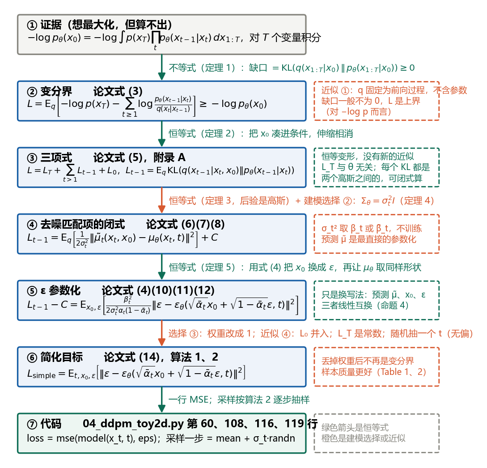
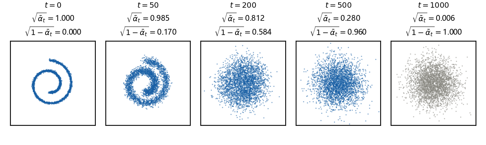
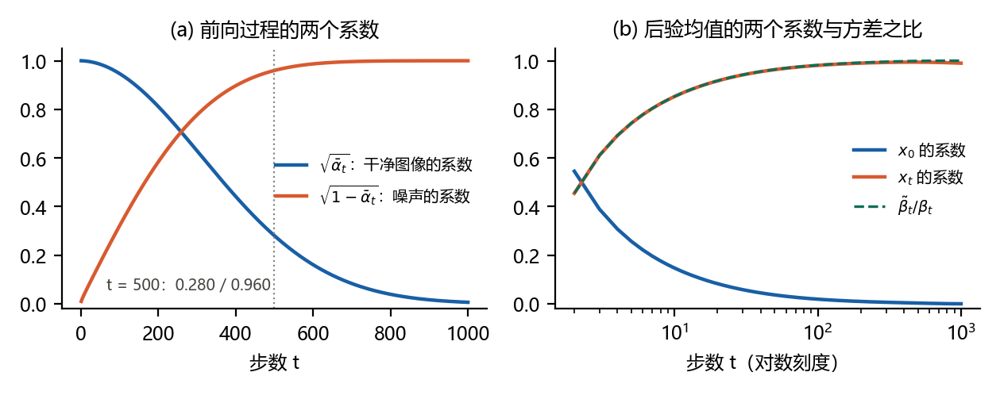
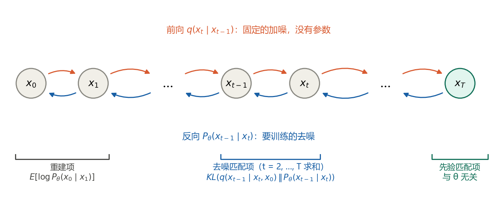
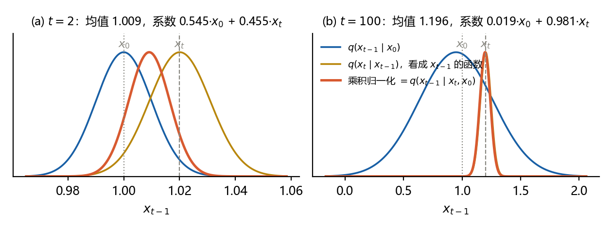
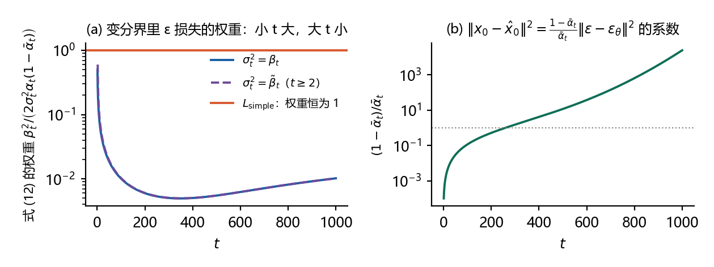
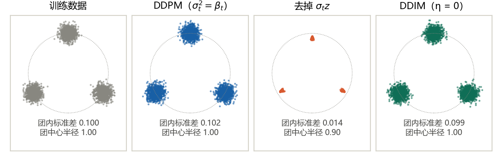

# 扩散模型推导笔记 R1：DDPM 原论文推导精讲

本文是本系列的论文精读篇，对象是 Ho, Jain & Abbeel (2020) 的《Denoising Diffusion Probabilistic Models》。它不按论文的章节顺序走，而是按苏剑林《生成扩散模型漫谈》（一）至（四）和李宏毅“Diffusion Model 原理剖析”四讲的思路，把 DDPM 的全部推导压缩成 2 条定义、5 条定理、2 条引理、8 条命题（命题 0 到 7）。每条都按同一个格式写：先给正式陈述和紧凑证明，再用白话说这一步到底在做什么，最后给“对照”：对应论文的哪个公式、苏剑林哪篇哪一节、[L1](L1-ddpm-lectures.md) 哪一节、本系列推导题的哪一题。逐步的代数细节不在这里重复，需要时按对照翻回去。

与其他各篇的关系：[L1](L1-ddpm-lectures.md) 按课程的顺序讲 DDPM 的两个算法和背后的下界，本文把同一套内容写成定义、定理与证明，并逐式对照原论文；[R0](R0-aevb-paper-walkthrough.md) 是 VAE 原论文的同类精读，本文的定理 1、2 和命题 3 与它的定理 1、3 只是换了变量名，第 8 章逐项对照；证明里用到的高斯规则与 KL 散度见 [D0–D1](D0-D1-gaussian-and-kl.md)，证据下界的推导见 [D2–D3](D2-D3-elbo-and-vae-loss.md)。对照里提到的推导题 D4 到 D8 是本系列的后续篇目。

读法：第 0 章一页速览，先把七步链条和“哪些是恒等式、哪些是近似或选择”看一遍；第 1 章对齐三套记号，论文、苏剑林、李宏毅各用一套字母，苏剑林的 α、β 还是论文的平方根，不先对齐会一直读不顺；第 2 到 6 章是定义和定理，是正文；第 7 章把论文其余部分一页读完；第 8 章把 DDPM 接回 R0；第 9 章接到代码；第 10 章回答初学者最常问的十个问题；第 11 章是总对照表；第 12、13 章是自测题与答案。记号以论文为准，log 一律指自然对数，向量的平方范数写作 $`\Vert\cdot\Vert^2`$。文中的数字由 `code/r1_check.py` 核对；图 1、2、5、6 由 `code/make_figures_r1.py` 生成，图 3、4、7 取自 L1。版本 1.0，2026-10-24。

引用说明：博客与课程的内容是笔记作者自己的概括，没有照录原文；论文的公式按原文的编号引用。

## 0 一页速览

### 0.1 七步链条

DDPM 要做的事一句话：固定一条“逐步加噪”的前向链，把数据 $`x_0`$ 在 $`T`$ 步内变成纯噪声 $`x_T`$；再学一条“逐步去噪”的反向链，从纯噪声走回数据。反向链的每一步都是一个高斯分布，均值由网络给出。训练目标是让反向链给训练数据的对数似然尽量大；似然算不出，于是最大化一个下界；下界拆开后，每一项都是两个高斯之间的 KL 散度，有闭式；再换一次变量，网络只需要预测加进去的噪声。从目标到代码一共七步：

1. **目标**：最大化 $`\log p_\theta(x_0)`$，即极大似然。卡住的地方：$`p_\theta(x_0)`$ 是对 $`x_1,\ldots,x_T`$ 共 $`T`$ 个变量的积分，没有闭式；真正的反向分布 $`q(x_{t-1}\mid x_t)`$ 也写不出（命题 0）。
2. **前向一步到位**：前向链每步只乘一个数、加一份高斯噪声，所以任意第 $`t`$ 步可以由 $`x_0`$ 一步算出：$`x_t=\sqrt{\bar\alpha_t}\,x_0+\sqrt{1-\bar\alpha_t}\,\epsilon`$（命题 1，论文式 (4)）。训练时只加一次噪声，就是这一条。
3. **下界**：把前向链当作“编码器”，得到 $`-\log p_\theta(x_0)\le L`$，缺口是一个 KL 散度（定理 1，论文式 (3)）。与 VAE 的区别只有一处：这里的编码器是固定的，没有参数。
4. **三项式**：$`L=L_T+\sum_{t\gt 1}L_{t-1}+L_0`$，中间每一项都是 $`\mathrm{KL}\big(q(x_{t-1}\mid x_t,x_0)\,\Vert\,p_\theta(x_{t-1}\mid x_t)\big)`$（定理 2，论文式 (5)）。关键一步是把 $`x_0`$ 凑进条件里。
5. **后验是高斯**：$`q(x_{t-1}\mid x_t,x_0)=\mathcal{N}(\tilde\mu_t,\tilde\beta_t I)`$，均值是 $`x_0`$ 与 $`x_t`$ 的加权和，方差只和 $`t`$ 有关（定理 3，论文式 (6)(7)）。于是三项式里的每个 KL 都是两个高斯之间的，可以闭式算。
6. **只需均值靠近**：反向链的方差固定为 $`\sigma_t^2`$ 后，$`L_{t-1}`$ 就是两个均值之差的平方除以 $`2\sigma_t^2`$（定理 4，论文式 (8)）；把 $`x_0`$ 用第 2 步换成噪声 $`\epsilon`$，均值差变成噪声差，$`L_{t-1}`$ 变成带权重的 $`\Vert\epsilon-\epsilon_\theta\Vert^2`$（定理 5，论文式 (10) 到 (12)）。
7. **简化目标与代码**：把权重改成 1，就是 $`L_{\mathrm{simple}}`$（命题 5，论文式 (14)）和算法 1；采样时按反向链逐步抽样，就是算法 2。代码里训练是一行均方误差，采样是“均值加 $`\sigma_t`$ 倍的新噪声”。



### 0.2 哪些是恒等式，哪些是近似或选择

初学者最容易把“下界”读成“近似”，又把“参数化”读成“假设”。下表把每一步的性质列清楚：

| 步骤 | 性质 | 误差或自由度来自哪里 | 本文位置 |
|---|---|---|---|
| 证据到 $`L`$ | 不等式 | 缺口 $`=\mathrm{KL}\big(q(x_{1:T}\mid x_0)\,\Vert\,p_\theta(x_{1:T}\mid x_0)\big)`$。前向过程 $`q`$ 是固定的，缺口只能靠调 θ 压小，一般不为 0。这是近似 ① | 定理 1 |
| $`L`$ 到三项式 | 恒等式 | 无 | 定理 2 |
| 后验 $`q(x_{t-1}\mid x_t,x_0)`$ | 恒等式 | 无，前向过程全是高斯，后验必是高斯 | 定理 3 |
| 反向链方差取 $`\sigma_t^2 I`$ | 建模选择 ② | 论文试了 $`\beta_t`$ 和 $`\tilde\beta_t`$ 两种，效果相近，都不训练 | 定理 4、命题 6 |
| 预测 $`\tilde\mu`$ 改成预测 $`\epsilon`$ | 只是换写法 | 无，三种参数化线性互换 | 定理 5、命题 4 |
| 权重改成 1 | 选择 ③ | $`L_{\mathrm{simple}}`$ 不再是下界，样本质量反而更好 | 命题 5 |
| $`L_0`$ 并入同一形式 | 近似 ④ | 离散解码器的积分用密度乘箱宽代替 | 命题 5、第 7 章 |
| $`L_T`$ 省略 | 无误差 | 前向方差固定，$`L_T`$ 与 θ 无关，而且本身几乎是 0 | 命题 2 |
| 随机抽一个 $`t`$ | 无偏估计 ⑤ | 随机误差，平均为 0 | 6.2 节 |

### 0.3 三种讲法的起点

| 讲法 | 起点 | 顺序 | 最想让读者记住的一句话 |
|---|---|---|---|
| 论文（Ho et al., 2020） | 变分界 | 前向过程、变分界、三项式（背景节）；固定方差；用后验分析 $`L_{t-1}`$；换元得噪声预测；指出它像去噪得分匹配；去掉权重得简化目标 | 噪声预测这种参数化，既让变分界变成去噪得分匹配的样子，又让采样像朗之万动力学 |
| 苏剑林（一）拆楼 + 建楼 | 不用变分，直接写单步回归 | 拆楼每步只加一点噪声；建楼学一步逆操作，用欧氏距离；把回归目标换成噪声；正态叠加换元降方差；递归生成；超参 | 拆楼容易建楼难，但只要记录拆的每一步，建楼就是一步步做逆操作 |
| 苏剑林（二）自回归式 VAE | 两个联合分布的 KL | 多步突破单步 VAE 的拟合能力；联合 KL 展开；逐项化简；得到同一个噪声回归目标；两种 σ 的由来 | DDPM 是编码器固定、层层递归、参数共享的自回归式 VAE |
| 苏剑林（三）贝叶斯 + 去噪 | 条件贝叶斯 | 不带 $`x_0`$ 的反向分布算不出，带 $`x_0`$ 全是高斯；用网络估 $`x_0`$ 代进去；预估—修正；两个特例给出 σ | 去噪的“D”就是用估出来的 $`x_0`$ 代替真的 $`x_0`$ |
| 苏剑林（四）DDIM | 训练只依赖边缘分布 | 待定系数法重设后验；σ 自由；σ 取 0 得确定性采样；跳步 | 同一个训练好的模型，采样方式可以换 |
| 李宏毅四讲 | 最大似然 | 逐行读两个算法；最大似然等于最小化 KL；VAE 的下界套到 DDPM；三项；均值靠近；换成预测噪声；采样为什么加噪（猜测） | 两个算法“暗藏玄机”，玄机全在下界的第三项里 |

本文的顺序是：李宏毅“最大似然到下界到三项”的骨架，加上苏剑林（三）的后验推导作为定理 3，再接论文的 ε 参数化与权重讨论；苏剑林（一）作为“不用变分也能到同一损失”的旁证放在 5.5 节；苏剑林（四）只在第 10 章作指引。

## 1 三套记号与三条路线

### 1.1 记号对照

同一个东西在三处用了不同的字母，而且苏剑林的 α、β 是论文里对应量的平方根。先对齐，后面才读得顺：

| 对象 | 本文（与论文相同） | 苏剑林（一）至（四） | 李宏毅讲义 | 代码 `04_ddpm_toy2d.py` |
|---|---|---|---|---|
| 单步噪声方差 | $`\beta_t`$，线性从 $`10^{-4}`$ 增到 $`0.02`$ | $`\beta_t^2`$ | $`\beta_t`$ | `betas` |
| 单步缩放 | $`\sqrt{\alpha_t}`$，$`\alpha_t=1-\beta_t`$ | $`\alpha_t`$，约束 $`\alpha_t^2+\beta_t^2=1`$ | $`\sqrt{1-\beta_t}`$ | `alphas.sqrt()` |
| 累积缩放 | $`\sqrt{\bar\alpha_t}`$，$`\bar\alpha_t=\prod_{s\le t}\alpha_s`$，约定 $`\bar\alpha_0=1`$ | $`\bar\alpha_t=\alpha_1\cdots\alpha_t`$ | 同论文 | `sqrt_ab` |
| 累积噪声标准差 | $`\sqrt{1-\bar\alpha_t}`$ | $`\bar\beta_t=\sqrt{1-\bar\alpha_t^2}`$ | 同论文 | `sqrt_1m_ab` |
| 前向（加噪）过程 | $`q(x_t\mid x_{t-1})`$，固定 | $`p(x_t\mid x_{t-1})`$ | $`q(x_t\mid x_{t-1})`$ | `q_sample` |
| 反向（生成）过程 | $`p_\theta(x_{t-1}\mid x_t)`$，均值 $`\mu_\theta(x_t,t)`$ | $`q(x_{t-1}\mid x_t)`$，均值 $`\mu(x_t)`$ | $`P_\theta(x_{t-1}\mid x_t)`$，均值 $`G(x_t)`$ | `p_sample` |
| 数据分布 | $`q(x_0)`$ | $`\tilde p(x_0)`$ | $`P_{\mathrm{data}}`$ | 瑞士卷 |
| 后验 | $`q(x_{t-1}\mid x_t,x_0)=\mathcal{N}(\tilde\mu_t,\tilde\beta_t I)`$ | $`p(x_{t-1}\mid x_t,x_0)`$，方差 $`\bar\beta_{t-1}^2\beta_t^2/\bar\beta_t^2`$ | 同论文 | `q_posterior` |
| 噪声网络 | $`\epsilon_\theta(x_t,t)`$ | （一）（二）的 $`\epsilon_\theta`$ 等于本文的 $`\epsilon_\theta`$ 乘以 $`\sqrt{\beta_t/(1-\bar\alpha_t)}`$；（三）（四）与本文相同 | $`\epsilon_\theta`$ | `model(xt, t)` |
| 反向链方差 | $`\sigma_t^2`$，取 $`\beta_t`$ 或 $`\tilde\beta_t`$ | $`\sigma_t^2`$，取 $`\beta_t^2`$ 或 $`\bar\beta_{t-1}^2\beta_t^2/\bar\beta_t^2`$ | $`\sigma_t^2`$ | `posterior_var` |

四点说明：

- 苏剑林把前向过程记作 p、生成过程记作 q，与论文正好相反。理由和他写 VAE 时一样：$`\tilde p(x_0)\,p(x_1\mid x_0)\cdots`$ 是“数据加编码器”这一侧，$`q(x_T)\,q(x_{T-1}\mid x_T)\cdots`$ 是“模型”这一侧，KL 写成 KL(真实 ‖ 模型)。读他的文章时，看到 $`p(x_t\mid x_{t-1})`$ 要在心里换成本文的 $`q(x_t\mid x_{t-1})`$。
- 苏剑林的 $`\alpha_t`$、$`\beta_t`$、$`\bar\alpha_t`$、$`\bar\beta_t`$ 都是“标准差级”的量：他写 $`x_t=\alpha_t x_{t-1}+\beta_t\varepsilon_t`$，论文写 $`x_t=\sqrt{\alpha_t}\,x_{t-1}+\sqrt{\beta_t}\,\epsilon_t`$。换算规则：苏的字母平方后等于论文的字母。他的约束 $`\alpha_t^2+\beta_t^2=1`$ 就是论文的 $`\alpha_t=1-\beta_t`$。
- 苏剑林（一）（二）里的 $`\epsilon_\theta`$ 比论文的多乘了一个因子。原因在 5.5 节：他先让网络回归单步噪声 $`\epsilon_t`$，再把多步噪声合并，合并后网络该回归的是 $`\sqrt{\beta_t/(1-\bar\alpha_t)}\,\epsilon`$。他在（一）里自己注明了换算；（三）起改用论文的定义。
- 李宏毅讲义把反向链的均值写成网络输出 $`G(x_t)`$，把 $`P_\theta(x_{t-1}\mid x_t)`$ 写成 $`\exp(-\Vert G(x_t)-x_{t-1}\Vert^2)`$ 的形式，省略了方差前的系数；结论不受影响。

### 1.2 三条路线各走什么

**论文的路线**。第 2 节先给三件事：反向链（式 (1)）、前向链（式 (2)）、变分界（式 (3)），再给前向一步到位（式 (4)）、三项式（式 (5)）和后验（式 (6)(7)），这些都是 Sohl-Dickstein et al. (2015) 已有的内容。第 3 节是论文自己的贡献，按三项式的三项分别讨论：$`L_T`$ 因为方差固定而成为常数（3.1 节）；$`L_{t-1}`$ 在固定反向方差后变成均值差的平方（式 (8)），再把 $`x_0`$ 换成噪声，得到噪声预测参数化（式 (10)(11)）和带权重的噪声损失（式 (12)），并指出这像多噪声水平的去噪得分匹配，采样像朗之万动力学（3.2 节）；$`L_0`$ 用离散解码器处理（式 (13)，3.3 节）；最后去掉权重得到简化目标（式 (14)，3.4 节）。第 4 节是实验和两个解释：渐进解码与率失真、与自回归模型的联系、插值。附录 A 是式 (5) 和式 (16) 的推导。论文的重心是“噪声预测参数化为什么好”，变分推断是背景。

**苏剑林的路线**。（一）从“拆楼容易建楼难”出发：每步加一点噪声是拆楼，学一步逆操作是建楼；建楼用欧氏距离回归即可，因为相邻两步非常接近；把回归目标从 $`x_{t-1}`$ 换成单步噪声，再用正态分布的叠加性合并多步噪声、降低方差，就得到与论文相同的损失；最后讨论递归生成与超参。全程不用变分推断。（二）换成更正式的写法：直接最小化“数据加前向链”与“先验加反向链”两个联合分布的 KL，逐项化简到同一个噪声回归目标，并把 DDPM 定位成编码器固定、递归式的 VAE。（三）从贝叶斯定理出发：不带 $`x_0`$ 的反向分布算不出，带 $`x_0`$ 的后验全是高斯，可以算；采样时用网络估出来的 $`x_0`$ 代替真的 $`x_0`$，这就是“去噪”；两种 σ 来自两个可以精确求解的特例。（四）指出训练目标只依赖 $`q(x_t\mid x_0)`$，后验可以用待定系数法重设，σ 是自由参数，取 0 就是 DDIM。

**李宏毅的路线**。先逐行读训练算法和采样算法，指出三处“玄机”：训练只加一次噪声、网络只预测噪声、采样去噪之后还要加噪声。再从头讲生成模型的共同目标：最大似然等价于最小化 KL；VAE 的似然算不出，改为最大化下界；DDPM 把 VAE 的隐变量 z 换成 $`x_{1:T}`$、把编码器换成固定的前向过程，下界的推导一模一样。然后把下界拆成三项，只有去噪匹配项需要训练；它要求网络的均值靠近后验均值；把 $`x_0`$ 换成噪声后，网络只需预测噪声。最后讨论采样为什么要加噪，老师自己标明这一段是猜测。

## 2 模型与问题的正式陈述

### 2.1 定义 1：前向过程

**定义 1（前向过程，扩散过程）**。设数据 $`x_0\in\mathbb{R}^D`$，像素值线性缩放到 $`[-1,1]`$。给定一串事先选定的小正数 $`\beta_1,\ldots,\beta_T`$（噪声调度），前向过程是固定的马尔可夫链

```math
q(x_{1:T}\mid x_0)=\prod_{t=1}^{T}q(x_t\mid x_{t-1}),\qquad q(x_t\mid x_{t-1})=\mathcal{N}\big(x_t;\,\sqrt{1-\beta_t}\,x_{t-1},\,\beta_t I\big),
```

等价地写成 $`x_t=\sqrt{\alpha_t}\,x_{t-1}+\sqrt{\beta_t}\,\epsilon_t`$，$`\epsilon_t\sim\mathcal{N}(0,I)`$，各步噪声相互独立，$`\alpha_t=1-\beta_t`$。它没有任何可训练参数。论文取 $`T=1000`$，$`\beta_t`$ 从 $`10^{-4}`$ 线性增加到 $`0.02`$。

**白话（苏剑林（一）“拆楼”）**。一栋楼一步建不起来，但拆楼容易：每一步只敲掉一点点，记录下每一步的样子。前向过程就是拆楼：每一步把上一步的图像缩小一点（乘 $`\sqrt{\alpha_t}`$），再加一点高斯噪声（标准差 $`\sqrt{\beta_t}`$）。$`T`$ 步之后只剩噪声。

**为什么要乘 $`\sqrt{1-\beta_t}`$**。若 $`x_{t-1}`$ 每个坐标的二阶矩是 1，则 $`\mathbb{E}\Vert x_t\Vert^2=\alpha_t\mathbb{E}\Vert x_{t-1}\Vert^2+\beta_t D=D`$，二阶矩不变。不缩放的话每步方差会累加，$`x_T`$ 的尺度随 $`T`$ 增长，网络的输入尺度就不一致；论文附录 C 第 2 点指出这是 DDPM 与 NCSN 的区别之一。苏剑林（一）的约束 $`\alpha_t^2+\beta_t^2=1`$ 说的是同一件事，只是他的字母是本文的平方根。

### 2.2 定义 2：反向过程与模型似然

**定义 2（反向过程，生成模型）**。反向过程是从标准正态分布出发、转移为高斯的马尔可夫链

```math
p_\theta(x_{0:T})=p(x_T)\prod_{t=1}^{T}p_\theta(x_{t-1}\mid x_t),\qquad p(x_T)=\mathcal{N}(x_T;0,I),\qquad p_\theta(x_{t-1}\mid x_t)=\mathcal{N}\big(x_{t-1};\,\mu_\theta(x_t,t),\,\Sigma_\theta(x_t,t)\big),
```

θ 是网络权重。$`x_1,\ldots,x_T`$ 是与数据同维的隐变量，模型给数据打的分是边缘似然 $`p_\theta(x_0)=\int p_\theta(x_{0:T})\,dx_{1:T}`$。生成一个样本就是沿这条链抽样：先抽 $`x_T`$，再依次抽 $`x_{T-1},\ldots,x_0`$。

**白话**。建楼：从一堆噪声出发，每一步由网络算出“上一步大概长什么样”的高斯分布，从中抽一个，走 $`T`$ 步。为什么每步可以用高斯：$`\beta_t`$ 很小时，前向一步只改动一点点，它的逆操作也只改动一点点，用高斯来描述足够（Sohl-Dickstein et al., 2015；论文第 2 节）。苏剑林（二）“多步突破”的说法是：VAE 用一步高斯从噪声到数据，拟合力有限；DDPM 把它拆成 $`T`$ 步，每步只拟合一个微小的变化，像用很多小线段去拟合一条曲线。

### 2.3 命题 0：极大似然卡在哪里

**命题 0（两个困难）**。(i) 边缘似然 $`p_\theta(x_0)`$ 一般没有闭式：它是对 $`T`$ 个 $`D`$ 维变量的积分，被积函数是 $`T`$ 个高斯密度的乘积，而每个高斯的均值 $`\mu_\theta(x_t,t)`$ 是网络，非线性，积不出来。(ii) 前向链真正的反向转移

```math
q(x_{t-1}\mid x_t)=\frac{q(x_t\mid x_{t-1})\,q(x_{t-1})}{q(x_t)},\qquad q(x_{t-1})=\int q(x_{t-1}\mid x_0)\,q(x_0)\,dx_0
```

也写不出，因为分子分母里的边缘分布都要对数据分布 $`q(x_0)`$ 积分，而数据分布只有样本、没有表达式。

**白话**。(i) 说的是“不能直接对 $`\log p_\theta(x_0)`$ 做梯度上升”，与 VAE 同一个困难，只是积分变量从一个 z 变成了 $`T`$ 个 x。(ii) 说的是“反向链没有现成的答案可抄”：如果 $`q(x_{t-1}\mid x_t)`$ 算得出，直接让 $`p_\theta`$ 去拟合它就完了。苏剑林（三）“请贝叶斯”一节的第一步正是把这个式子写出来，然后指出它算不了，于是改在条件 $`x_0`$ 下用贝叶斯，这就是定理 3。

### 2.4 命题 1：前向过程一步到位

**命题 1（一步到位，论文式 (4)）**。记 $`\bar\alpha_t=\prod_{s=1}^{t}\alpha_s`$，$`\bar\alpha_0=1`$。对任意 $`t`$，

```math
q(x_t\mid x_0)=\mathcal{N}\big(x_t;\,\sqrt{\bar\alpha_t}\,x_0,\,(1-\bar\alpha_t)I\big),\qquad x_t=\sqrt{\bar\alpha_t}\,x_0+\sqrt{1-\bar\alpha_t}\,\epsilon,\quad\epsilon\sim\mathcal{N}(0,I).
```

**证明（归纳）**。$`t=1`$ 时就是定义 1。设 $`x_{t-1}=\sqrt{\bar\alpha_{t-1}}\,x_0+\sqrt{1-\bar\alpha_{t-1}}\,\bar\epsilon`$，代入 $`x_t=\sqrt{\alpha_t}\,x_{t-1}+\sqrt{\beta_t}\,\epsilon_t`$：

```math
x_t=\sqrt{\alpha_t\bar\alpha_{t-1}}\,x_0+\sqrt{\alpha_t(1-\bar\alpha_{t-1})}\,\bar\epsilon+\sqrt{\beta_t}\,\epsilon_t .
```

$`\bar\epsilon`$ 与 $`\epsilon_t`$ 独立、零均值、各向同性，两者的和仍是零均值各向同性高斯，方差相加：$`\alpha_t(1-\bar\alpha_{t-1})+\beta_t=\alpha_t-\bar\alpha_t+1-\alpha_t=1-\bar\alpha_t`$。于是 $`x_t=\sqrt{\bar\alpha_t}\,x_0+\sqrt{1-\bar\alpha_t}\,\epsilon`$。证毕。证明里用到的恒等式

```math
1-\bar\alpha_t=\alpha_t(1-\bar\alpha_{t-1})+\beta_t
```

在定理 3 和定理 5 里还会各用一次。

**白话（[L1 第 1.2 节](L1-ddpm-lectures.md#12-想象中与实际上只加一次噪声)）**。想象中训练要“加很多次噪声”，算法 1 却只加一次。原因就是这条命题：多次加入的独立高斯噪声可以合并成一份，第 $`t`$ 步的带噪图像可以由 $`x_0`$ 一步算出，中间各步根本不必抽。$`\sqrt{\bar\alpha_t}`$ 是干净图像的成分，$`\sqrt{1-\bar\alpha_t}`$ 是噪声的成分，两者平方和恒为 1。

**数字**。两步例子 $`\beta_1=0.1`$、$`\beta_2=0.2`$：$`x_0`$ 的系数是 $`\sqrt{0.72}=0.8485`$，合并后噪声的标准差是 $`\sqrt{0.28}=0.5292`$；从 $`x_0=1`$ 出发模拟一百万次，$`x_2`$ 的均值 0.8492、标准差 0.5288。论文的线性调度下，$`\bar\alpha_t`$ 在 $`t=1`$、10、100、250、500、750、1000 时分别约为 0.9999、0.9981、0.8970、0.5241、0.0786、0.0034、$`4.0\times10^{-5}`$，首次降到 0.5 以下是 $`t=260`$；逐步加噪 1000 步的模拟（两万条链）在 $`t=500`$ 时均值 0.275、标准差 0.959，闭式为 0.280、0.960，$`t=1000`$ 时均值 0.015、标准差 1.005，闭式为 0.006、1.000，差别在两万条链的抽样误差之内。图 2 是瑞士卷二维数据在五个时刻的样子，图 3(a) 是两个系数随 $`t`$ 的变化。





### 2.5 命题 2：信号被摧毁

**命题 2（$`x_T`$ 几乎与 $`x_0`$ 无关）**。按命题 1，$`q(x_T\mid x_0)`$ 与先验 $`p(x_T)=\mathcal{N}(0,I)`$ 之间的 KL 散度有闭式（对角高斯 KL，[D0–D1 第 6 章](D0-D1-gaussian-and-kl.md#6-d1-两个对角高斯之间的-kl-散度)）：

```math
\mathrm{KL}\big(q(x_T\mid x_0)\,\Vert\,p(x_T)\big)=\frac{1}{2}\sum_{i=1}^{D}\Big(\bar\alpha_T x_{0,i}^2-\bar\alpha_T-\log(1-\bar\alpha_T)\Big).
```

论文的调度给出 $`\bar\alpha_T=4.0\times10^{-5}`$；像素值取到边界 $`x_{0,i}=1`$ 时每维 $`2.0\times10^{-5}`$ 纳特，即 $`2.9\times10^{-5}`$ 比特；$`\vert x_{0,i}\vert\le1`$ 时这是上限。论文第 4 节报告其数据上 $`L_T\approx10^{-5}`$ 比特每维。

**白话**。调度的设计目标是“信号被摧毁”：走到第 $`T`$ 步，不管从哪张图出发，得到的都几乎是标准正态噪声。所以采样时可以直接从 $`\mathcal{N}(0,I)`$ 出发，而三项式里的 $`L_T`$ 几乎是 0、又与 θ 无关，训练时可以不管。苏剑林（一）“该怎么拆”用他的记号给了一个估计：$`\log\bar\alpha_T=\sum_t\log\alpha_t\lt -0.005(T+1)`$，$`T=1000`$ 时约 $`-5.0`$，即他的 $`\bar\alpha_T`$（本文的 $`\sqrt{\bar\alpha_T}`$）小于 0.0067；本文调度下实际值 0.0064。附录 C 第 3 点说，前向过程真的摧毁信号，是 DDPM 与 NCSN 的又一区别。

**对照**：论文式 (1)(2)(4)，第 4 节首段，附录 B 调度的选法，附录 C；苏剑林（一）“该怎么拆”“超参设置”，（二）“多步突破”“超参设置”，（三）“模型绘景”；L1 第 1.1、1.2、3.1 节；推导题 D4（后续）。

## 3 定理 1、2：变分界与三项分解

### 3.1 引理 1 与定理 1

**引理 1（KL 散度非负）**。对任意两个密度 q、p，$`\mathrm{KL}(q\,\Vert\,p)=\mathbb{E}_q[\log q-\log p]\ge0`$，等号当且仅当两者相同。证明用 log 的凹性（Jensen 不等式），见 [R0 引理 1](R0-aevb-paper-walkthrough.md#31-引理-1-与定理-1) 或 [D2–D3 第 4 章](D2-D3-elbo-and-vae-loss.md#4-d2a-jensen-推法)。

**定理 1（变分界，论文式 (3)）**。对定义 1 的前向过程和定义 2 的模型，

```math
-\log p_\theta(x_0)=L-\mathrm{KL}\big(q(x_{1:T}\mid x_0)\,\Vert\,p_\theta(x_{1:T}\mid x_0)\big)\le L,\qquad L:=\mathbb{E}_{q(x_{1:T}\mid x_0)}\Big[-\log\frac{p_\theta(x_{0:T})}{q(x_{1:T}\mid x_0)}\Big],
```

并且按两条链的乘积结构展开，

```math
L=\mathbb{E}_q\Big[-\log p(x_T)-\sum_{t\ge1}\log\frac{p_\theta(x_{t-1}\mid x_t)}{q(x_t\mid x_{t-1})}\Big].
```

**证明**。写 $`p_\theta(x_{0:T})=p_\theta(x_0)\,p_\theta(x_{1:T}\mid x_0)`$，则

```math
-\log\frac{p_\theta(x_{0:T})}{q(x_{1:T}\mid x_0)}=-\log p_\theta(x_0)+\log\frac{q(x_{1:T}\mid x_0)}{p_\theta(x_{1:T}\mid x_0)} .
```

两边对 $`q(x_{1:T}\mid x_0)`$ 取期望：左边是 $`L`$，右边第一项与 $`x_{1:T}`$ 无关，第二项的期望正是 KL 散度。移项得第一式，由引理 1 得不等号。第二式只是把 $`p_\theta(x_{0:T})`$ 和 $`q(x_{1:T}\mid x_0)`$ 按定义 1、2 写成乘积，再把 log 拆成和。证毕。

推论：(a) $`L`$ 是 $`-\log p_\theta(x_0)`$ 的上界，等价地 $`-L`$ 是对数似然的下界，与 VAE 的 ELBO 同一回事；(b) 等号当且仅当 $`p_\theta(x_{1:T}\mid x_0)=q(x_{1:T}\mid x_0)`$，即模型的“反向链在给定 $`x_0`$ 时的分布”与前向链完全一致；(c) 前向过程 $`q`$ 没有参数，所以缺口只能靠 θ 压小，这是 0.2 节的近似 ①。

**白话（[L1 第 2.4 到 2.6 节](L1-ddpm-lectures.md#24-vae-的证据下界)）**。VAE 的推导只用一个技巧：在 $`\log p_\theta(x)`$ 里塞进一个任意分布 $`q(z\mid x)`$，乘上去再除掉，就得到“下界加 KL”。DDPM 把 z 换成 $`x_1,\ldots,x_T`$，把 $`q(z\mid x)`$ 换成前向过程 $`q(x_{1:T}\mid x_0)`$，一个字都不用改。区别在于 VAE 的 q 是要训练的编码器，DDPM 的 q 事先规定好、没有参数，所以 DDPM 是“编码器固定的层级 VAE”：

| | VAE | DDPM |
|---|---|---|
| 隐变量 | $`z`$，维数通常远小于数据 | $`x_1,\ldots,x_T`$，与数据同维 |
| $`q`$ | 编码器 $`q_\phi(z\mid x)`$，要训练 | 前向过程 $`q(x_{1:T}\mid x_0)`$，固定 |
| 生成 | 解码器 $`p_\theta(x\mid z)`$，一步 | $`T`$ 步去噪 $`p_\theta(x_{t-1}\mid x_t)`$ |
| 训练目标 | 最大化 ELBO，调 θ 和 φ | 最小化 $`L`$，只调 θ |
| 缺口 | $`\mathrm{KL}(q_\phi(z\mid x)\,\Vert\,p_\theta(z\mid x))`$ | $`\mathrm{KL}(q(x_{1:T}\mid x_0)\,\Vert\,p_\theta(x_{1:T}\mid x_0))`$ |

### 3.2 定理 2：三项式

**定理 2（三项分解，论文式 (5)）**。定理 1 的 $`L`$ 可以恒等地改写为

```math
L=\mathbb{E}_q\Big[\underbrace{\mathrm{KL}\big(q(x_T\mid x_0)\,\Vert\,p(x_T)\big)}_{L_T}+\sum_{t\gt 1}\underbrace{\mathrm{KL}\big(q(x_{t-1}\mid x_t,x_0)\,\Vert\,p_\theta(x_{t-1}\mid x_t)\big)}_{L_{t-1}}\underbrace{-\log p_\theta(x_0\mid x_1)}_{L_0}\Big].
```

**证明**（论文附录 A 式 (17) 到 (22)，分六步）。

1. 把定理 1 第二式里 $`t=1`$ 的一项单独写出：$`L=\mathbb{E}_q\big[-\log p(x_T)-\sum_{t\gt 1}\log\frac{p_\theta(x_{t-1}\mid x_t)}{q(x_t\mid x_{t-1})}-\log\frac{p_\theta(x_0\mid x_1)}{q(x_1\mid x_0)}\big]`$。
2. 对 $`t\gt 1`$ 把前向转移改写成“带 $`x_0`$ 的反向转移”。前向链是马尔可夫的，所以 $`q(x_t\mid x_{t-1})=q(x_t\mid x_{t-1},x_0)`$；在条件 $`x_0`$ 下用贝叶斯公式，

```math
q(x_t\mid x_{t-1})=\frac{q(x_{t-1}\mid x_t,x_0)\,q(x_t\mid x_0)}{q(x_{t-1}\mid x_0)} .
```

3. 代入第 1 步，分母里多出的比值 $`q(x_t\mid x_0)/q(x_{t-1}\mid x_0)`$ 单独拿出来：$`-\sum_{t\gt 1}\log\frac{p_\theta(x_{t-1}\mid x_t)}{q(x_t\mid x_{t-1})}=-\sum_{t\gt 1}\log\frac{p_\theta(x_{t-1}\mid x_t)}{q(x_{t-1}\mid x_t,x_0)}-\sum_{t\gt 1}\log\frac{q(x_{t-1}\mid x_0)}{q(x_t\mid x_0)}`$。
4. 第二个和是伸缩和：$`\sum_{t\gt 1}\big[\log q(x_{t-1}\mid x_0)-\log q(x_t\mid x_0)\big]=\log q(x_1\mid x_0)-\log q(x_T\mid x_0)`$。
5. 重组：$`-\log p(x_T)+\log q(x_T\mid x_0)`$ 合成 $`\log\frac{q(x_T\mid x_0)}{p(x_T)}`$；$`-\log q(x_1\mid x_0)`$ 与第 1 步末项里的 $`+\log q(x_1\mid x_0)`$ 抵消，只剩 $`-\log p_\theta(x_0\mid x_1)`$。
6. 取期望并认出 KL：$`\mathbb{E}_q\big[\log\frac{q(x_T\mid x_0)}{p(x_T)}\big]`$ 只依赖 $`x_T`$，等于 $`\mathrm{KL}(q(x_T\mid x_0)\,\Vert\,p(x_T))`$；对每个 $`t\gt 1`$，先对 $`x_{t-1}`$ 在给定 $`x_t,x_0`$ 下取期望，$`\mathbb{E}_{q(x_{t-1}\mid x_t,x_0)}\big[\log\frac{q(x_{t-1}\mid x_t,x_0)}{p_\theta(x_{t-1}\mid x_t)}\big]=\mathrm{KL}\big(q(x_{t-1}\mid x_t,x_0)\,\Vert\,p_\theta(x_{t-1}\mid x_t)\big)`$，再对 $`x_t`$ 取期望。证毕。

三项的名字（Luo, 2022）：$`L_T`$ 先验匹配项，$`L_{t-1}`$ 去噪匹配项，$`L_0`$ 重建项。$`L_T`$ 不含 θ，训练时可以忽略（命题 2）；要训练的是 $`L_{t-1}`$ 和 $`L_0`$。



### 3.3 白话：为什么要把 x₀ 凑进去

- 定理 1 的第二式把反向转移 $`p_\theta(x_{t-1}\mid x_t)`$ 和前向转移 $`q(x_t\mid x_{t-1})`$ 放在同一个分数里，方向相反，没法直接比。想训练反向转移，就得给它一个“同方向的标准答案”。
- 真正的标准答案 $`q(x_{t-1}\mid x_t)`$ 算不出（命题 0(ii)）。但多加一个条件 $`x_0`$ 之后，$`q(x_{t-1}\mid x_t,x_0)`$ 只由前向链的高斯组成，定理 3 会证明它本身也是高斯。训练时 $`x_0`$ 就是训练样本，是已知的，所以“凑 $`x_0`$”不花任何代价。
- 凑进去的好处有两个。一是每个 $`L_{t-1}`$ 都成了两个高斯之间的 KL，有闭式，不必用蒙特卡洛估计；论文把这叫 Rao-Blackwell 化：把一个随机估计换成它在某个条件下的期望，方差只会变小、不会变大。二是三项式告诉我们训练到底在训练什么：让网络的一步去噪分布，逼近“已知起点和终点时中间那一步”的分布。
- 论文式 (16) 是不凑 $`x_0`$ 的版本：$`L=\mathrm{KL}(q(x_T)\,\Vert\,p(x_T))+\mathbb{E}_q\sum_{t\ge1}\mathrm{KL}(q(x_{t-1}\mid x_t)\,\Vert\,p_\theta(x_{t-1}\mid x_t))+H(x_0)`$。推导完全一样，只是贝叶斯公式不加条件 $`x_0`$，伸缩和留下的是 $`\log q(x_T)-\log q(x_0)`$，于是多出数据熵 $`H(x_0)`$。它算不出，但说清了模型真正在学的东西：数据分布的前向链的真实反向转移。第 7 章再谈论文怎样用它解释“扩散模型像自回归模型”。

### 3.4 命题 3：苏剑林（二）的联合 KL

**命题 3（联合分布的 KL）**。记 $`q(x_{0:T})=q(x_0)\,q(x_{1:T}\mid x_0)`$ 为“数据加前向链”的联合分布，$`p_\theta(x_{0:T})`$ 为“先验加反向链”的联合分布，$`H(q(x_0))`$ 为数据分布的微分熵。则

```math
\mathrm{KL}\big(q(x_{0:T})\,\Vert\,p_\theta(x_{0:T})\big)=\mathbb{E}_{q(x_0)}[L]-H(q(x_0))=\mathrm{KL}\big(q(x_0)\,\Vert\,p_\theta(x_0)\big)+\mathbb{E}_{q(x_0)}\mathrm{KL}\big(q(x_{1:T}\mid x_0)\,\Vert\,p_\theta(x_{1:T}\mid x_0)\big).
```

**证明**。按定义展开，$`\mathrm{KL}(q(x_{0:T})\,\Vert\,p_\theta(x_{0:T}))=\mathbb{E}_{q(x_{0:T})}\big[\log q(x_0)+\log q(x_{1:T}\mid x_0)-\log p_\theta(x_{0:T})\big]`$。第一项的期望是 $`-H(q(x_0))`$，后两项合起来正是定理 1 里 $`L`$ 的被积函数，对 $`q(x_{1:T}\mid x_0)`$ 取期望得 $`L`$，再对 $`q(x_0)`$ 取期望。第二个等号把 $`p_\theta(x_{0:T})=p_\theta(x_0)p_\theta(x_{1:T}\mid x_0)`$ 拆开后同样逐项认出 KL；它也可以由定理 1 的第一式两边对 $`q(x_0)`$ 取期望再加 $`-H`$ 得到。证毕。

**白话**。苏剑林（二）“联合散度”一节把 DDPM 的训练目标直接定义为这个联合 KL（他的记号里 p、q 互换），然后在“分而治之”一节去掉与参数无关的项，逐项化简。命题 3 说明这与论文“最小化变分界”是同一件事：两者只差数据熵这个常数，最优的 θ 相同。第二个等号把目标拆成“模型边缘分布逼近数据分布”加“反向链逼近前向链”，正是 [R0 定理 3](R0-aevb-paper-walkthrough.md#5-定理-3联合分布的-kl苏剑林二的观点) 的 DDPM 版：压低联合 KL 既抬高似然，又压小定理 1 的缺口。

**数字**。一维线性高斯玩具可以把每一项都精确算出：数据 $`q(x_0)=\mathcal{N}(0.5,1.5^2)`$，$`T=3`$，$`\beta=(0.1,0.2,0.3)`$，反向链取 $`p_\theta(x_{t-1}\mid x_t)=\mathcal{N}(a_tx_t+b_t,\beta_t)`$，$`a=(0.95,0.90,0.85)`$，$`b=(0.05,0.10,0)`$（故意不精确的线性模型）。三项分别是 $`L_T=0.7286`$、$`L_1+L_2=1.0584`$、$`L_0=0.3286`$，$`\mathbb{E}[L]=2.1155`$，$`H=1.8244`$，$`\mathbb{E}[L]-H=0.2911`$；四维联合高斯的 KL 直接算也是 0.2911；拆成 $`\mathrm{KL}(q(x_0)\,\Vert\,p_\theta(x_0))=0.2640`$ 加缺口 0.0271，相加也相符。

**对照**：论文式 (3)(5)(16)，附录 A 式 (17) 到 (26)；苏剑林（二）“多步突破”“联合散度”“分而治之”；L1 第 2.2 到 2.6、3.2 节；推导题 D6（后续）；R0 定理 1、定理 3。

## 4 定理 3：前向过程的后验

### 4.1 陈述与证明

**定理 3（前向过程的后验，论文式 (6)(7)）**。对 $`t\ge1`$，

```math
q(x_{t-1}\mid x_t,x_0)=\mathcal{N}\big(x_{t-1};\,\tilde\mu_t(x_t,x_0),\,\tilde\beta_tI\big),\qquad \tilde\mu_t=\frac{\sqrt{\bar\alpha_{t-1}}\,\beta_t}{1-\bar\alpha_t}\,x_0+\frac{\sqrt{\alpha_t}\,(1-\bar\alpha_{t-1})}{1-\bar\alpha_t}\,x_t,\qquad \tilde\beta_t=\frac{1-\bar\alpha_{t-1}}{1-\bar\alpha_t}\,\beta_t,
```

且 $`\dfrac{1}{\tilde\beta_t}=\dfrac{\alpha_t}{\beta_t}+\dfrac{1}{1-\bar\alpha_{t-1}}`$。

**证明（配方法）**。在条件 $`x_0`$ 下用贝叶斯公式并利用马尔可夫性，

```math
q(x_{t-1}\mid x_t,x_0)=\frac{q(x_t\mid x_{t-1})\,q(x_{t-1}\mid x_0)}{q(x_t\mid x_0)}\ \propto\ q(x_t\mid x_{t-1})\,q(x_{t-1}\mid x_0),
```

分母与 $`x_{t-1}`$ 无关。右边两个因子都是高斯（定义 1 与命题 1），取对数、只保留含 $`x_{t-1}`$ 的项：

```math
\log q(x_{t-1}\mid x_t,x_0)=-\frac{\Vert x_t-\sqrt{\alpha_t}\,x_{t-1}\Vert^2}{2\beta_t}-\frac{\Vert x_{t-1}-\sqrt{\bar\alpha_{t-1}}\,x_0\Vert^2}{2(1-\bar\alpha_{t-1})}+C_0,
```

$`C_0`$ 与 $`x_{t-1}`$ 无关。这是 $`x_{t-1}`$ 的二次式，所以分布是高斯，只需读出二次项和一次项的系数（[D0–D1 的 T6 高斯识别模板](D0-D1-gaussian-and-kl.md#t6-配方法与高斯识别模板)：二次项系数 $`-\frac{A}{2}`$ 给方差 $`1/A`$，一次项系数 $`B`$ 给均值 $`B/A`$）。二次项：$`-\frac{1}{2}\big(\frac{\alpha_t}{\beta_t}+\frac{1}{1-\bar\alpha_{t-1}}\big)\Vert x_{t-1}\Vert^2`$，括号里通分，分子用命题 1 的恒等式 $`\alpha_t(1-\bar\alpha_{t-1})+\beta_t=1-\bar\alpha_t`$，得 $`A=\frac{1-\bar\alpha_t}{\beta_t(1-\bar\alpha_{t-1})}`$，方差 $`\tilde\beta_t=1/A`$。一次项：$`x_{t-1}^{\top}\big(\frac{\sqrt{\alpha_t}}{\beta_t}x_t+\frac{\sqrt{\bar\alpha_{t-1}}}{1-\bar\alpha_{t-1}}x_0\big)`$，均值 $`=\tilde\beta_t\big(\frac{\sqrt{\alpha_t}}{\beta_t}x_t+\frac{\sqrt{\bar\alpha_{t-1}}}{1-\bar\alpha_{t-1}}x_0\big)`$，把 $`\tilde\beta_t`$ 乘进去，正好是 $`\tilde\mu_t`$ 的两个系数。证毕。

**另一条路（联合高斯的条件公式）**。给定 $`x_0`$，$`x_{t-1}`$ 与 $`x_t`$ 是联合高斯：$`\mathrm{Var}(x_{t-1})=(1-\bar\alpha_{t-1})I`$，$`\mathrm{Cov}(x_{t-1},x_t)=\sqrt{\alpha_t}(1-\bar\alpha_{t-1})I`$，$`\mathrm{Var}(x_t)=(1-\bar\alpha_t)I`$。条件均值等于“均值加回归系数乘偏差”，回归系数 $`\mathrm{Cov}/\mathrm{Var}(x_t)`$ 正是 $`x_t`$ 的系数；条件方差 $`\mathrm{Var}(x_{t-1})-\mathrm{Cov}^2/\mathrm{Var}(x_t)=\tilde\beta_t`$（[D0–D1 第 5.3 节](D0-D1-gaussian-and-kl.md#53-另一种方法联合高斯的条件公式)）。脚本对所有 $`t`$ 核对了两条路给出的三个量，相对差在 $`10^{-12}`$ 量级。

### 4.2 白话与数字

**白话**。已知起点 $`x_0`$ 和第 $`t`$ 步的 $`x_t`$，问“第 $`t-1`$ 步在哪里”。两个因子各拉一边：$`q(x_{t-1}\mid x_0)`$ 说它应该在 $`\sqrt{\bar\alpha_{t-1}}x_0`$ 附近，范围很宽（方差 $`1-\bar\alpha_{t-1}`$）；$`q(x_t\mid x_{t-1})`$ 看成 $`x_{t-1}`$ 的函数，说它应该在 $`x_t/\sqrt{\alpha_t}`$ 附近，范围很窄（方差 $`\beta_t/\alpha_t`$）。两个高斯相乘，结果仍是高斯，均值是按精度（方差的倒数）加权的平均，精度相加。除了最初几步，$`\beta_t`$ 远小于 $`1-\bar\alpha_{t-1}`$，所以后验几乎完全由 $`x_t`$ 决定：每一步只往回走一点点（图 5）。



**数字**。$`x_0`$、$`x_t`$ 的系数和方差之比随 $`t`$ 的变化如下（图 3(b)）：

| $`t`$ | $`x_0`$ 的系数 | $`x_t`$ 的系数 | 两系数之和 | $`\tilde\beta_t/\beta_t`$ |
|---|---|---|---|---|
| 1 | 1.0000 | 0.0000 | 1.0000 | 0（$`\tilde\beta_1=0`$） |
| 2 | 0.5453 | 0.4547 | 1.0000 | 0.4547 |
| 10 | 0.1473 | 0.8527 | 1.0000 | 0.8528 |
| 100 | 0.0191 | 0.9809 | 1.0000 | 0.9819 |
| 500 | 0.0031 | 0.9941 | 0.9972 | 0.9991 |
| 1000 | 0.0001 | 0.9899 | 0.9901 | 1.0000 |

三点观察：(a) $`t=1`$ 时 $`\bar\alpha_0=1`$，后验退化为 $`x_0`$ 处的点质量，方差为 0，这是对的，因为 $`x_0`$ 已知；(b) 两个系数之和并不恒为 1，$`t`$ 大时略小于 1，因为后验均值还包含前向过程的缩放；(c) $`t`$ 大时 $`\tilde\beta_t\approx\beta_t`$。图 5 的两个例子：$`t=2`$、$`x_0=1`$、$`x_2=1.02`$ 时后验是 $`\mathcal{N}(1.0091,5.45\times10^{-5})`$；$`t=100`$、$`x_{100}=1.2`$ 时是 $`\mathcal{N}(1.1962,2.04\times10^{-3})`$；两例都把两个因子在网格上相乘、归一化后算均值和方差，与公式一致。固定 $`x_0=1`$、在 $`t=10`$ 模拟四十万组 $`(x_9,x_{10})`$，用 $`x_{10}`$ 回归 $`x_9`$：斜率 0.8531（公式 0.8527）、截距 0.1469（公式 0.1473）、残差方差 $`2.385\times10^{-4}`$（公式 $`2.382\times10^{-4}`$）。

### 4.3 苏剑林（三）的讲法

苏剑林（三）“请贝叶斯”一节走的就是 4.1 节的第一条路，只是记号不同：他写 $`p(x_{t-1}\mid x_t,x_0)=\dfrac{p(x_t\mid x_{t-1})\,p(x_{t-1}\mid x_0)}{p(x_t\mid x_0)}`$，结果的均值是 $`\dfrac{\alpha_t\bar\beta_{t-1}^2}{\bar\beta_t^2}x_t+\dfrac{\bar\alpha_{t-1}\beta_t^2}{\bar\beta_t^2}x_0`$，方差是 $`\dfrac{\bar\beta_{t-1}^2\beta_t^2}{\bar\beta_t^2}`$。按 1.1 节的换算（他的 $`\alpha_t`$ 是本文的 $`\sqrt{\alpha_t}`$，$`\bar\beta_{t-1}^2`$ 是 $`1-\bar\alpha_{t-1}`$，$`\beta_t^2`$ 是 $`\beta_t`$，$`\bar\beta_t^2`$ 是 $`1-\bar\alpha_t`$，$`\bar\alpha_{t-1}`$ 是 $`\sqrt{\bar\alpha_{t-1}}`$），逐项对应 $`\tilde\mu_t`$ 和 $`\tilde\beta_t`$。他的推导逻辑也是“指数部分是二次式，必为正态，比较系数即可”。他接着指出这个后验的问题：生成时没有 $`x_0`$。解决办法在 5.3 节的命题 4：用网络估出的 $`\hat x_0`$ 代替，这正是“去噪”二字的来历。

**对照**：论文式 (6)(7)；苏剑林（三）“请贝叶斯”；L1 第 3.3 节；推导题 D5（后续）；[D0–D1 第 5.2 节](D0-D1-gaussian-and-kl.md#52-后验分布套路二)、[5.3 节](D0-D1-gaussian-and-kl.md#53-另一种方法联合高斯的条件公式)。

## 5 定理 4、5：去噪匹配项与 ε 参数化

### 5.1 引理 2 与定理 4

**引理 2（高斯之间的 KL 只看均值差）**。设 $`q=\mathcal{N}(\mu_1,s^2I)`$，$`p=\mathcal{N}(\mu_2,\sigma^2I)`$，维数为 D，则

```math
\mathrm{KL}(q\,\Vert\,p)=\frac{\Vert\mu_1-\mu_2\Vert^2}{2\sigma^2}+\frac{D}{2}\Big(\log\frac{\sigma^2}{s^2}+\frac{s^2}{\sigma^2}-1\Big),
```

第二项与两个均值无关；两边方差相同（$`s=\sigma`$）时第二项为 0。

**证明**。各维独立时 KL 逐维相加，一维公式 $`\frac{1}{2}\big(\log\frac{\sigma^2}{s^2}+\frac{s^2+(\mu_1-\mu_2)^2}{\sigma^2}-1\big)`$ 见 [D0–D1 第 6.1 节](D0-D1-gaussian-and-kl.md#61-一维情形-a)，把均值差的平方单独拿出来即得。证毕。例：$`\mathrm{KL}(\mathcal{N}(0.3,0.25)\,\Vert\,\mathcal{N}(1.1,0.25))=0.8^2/(2\times0.25)=1.28`$。

**定理 4（去噪匹配项的闭式，论文式 (8)）**。取反向链的协方差为不训练的常数 $`\Sigma_\theta(x_t,t)=\sigma_t^2I`$，则对 $`t\gt 1`$，

```math
L_{t-1}=\mathbb{E}_q\Big[\frac{1}{2\sigma_t^2}\big\Vert\tilde\mu_t(x_t,x_0)-\mu_\theta(x_t,t)\big\Vert^2\Big]+C,\qquad C=\frac{D}{2}\Big(\log\frac{\sigma_t^2}{\tilde\beta_t}+\frac{\tilde\beta_t}{\sigma_t^2}-1\Big),
```

C 与 θ 无关。

**证明**。把定理 3 的后验 $`\mathcal{N}(\tilde\mu_t,\tilde\beta_tI)`$ 和模型 $`\mathcal{N}(\mu_\theta,\sigma_t^2I)`$ 代入引理 2，再对 $`q(x_t\mid x_0)`$ 取期望。证毕。

**白话（[L1 第 3.4 节](L1-ddpm-lectures.md#34-最小化-kl只需让均值靠近)）**。讲义画了两个圆：左边的圆是后验，均值、方差都已经定了；右边的圆是模型，方差也定了，只有圆心（网络输出的均值）可以挪。要让 KL 最小，就把右边的圆心挪到左边的圆心上。所以“训练反向链”归结为“让网络输出的均值靠近后验均值 $`\tilde\mu_t`$”。方差为什么不训练：论文 3.2 节说，实验上 $`\sigma_t^2=\beta_t`$ 与 $`\sigma_t^2=\tilde\beta_t`$ 结果相近，而学习方差（Table 2 的“learned diagonal Σ”）训练不稳定、样本更差；两种取值的来历见命题 6。

### 5.2 定理 5：ε 参数化

**定理 5（噪声预测参数化，论文式 (10) 到 (12)）**。把 $`x_t`$ 按命题 1 写成 $`x_t(x_0,\epsilon)=\sqrt{\bar\alpha_t}\,x_0+\sqrt{1-\bar\alpha_t}\,\epsilon`$。则

(i) 后验均值可以不显含 $`x_0`$ 地写成

```math
\tilde\mu_t\big(x_t,x_0\big)=\frac{1}{\sqrt{\alpha_t}}\Big(x_t-\frac{\beta_t}{\sqrt{1-\bar\alpha_t}}\,\epsilon\Big);
```

(ii) 若令网络输出 $`\epsilon_\theta(x_t,t)`$，并把反向链的均值取为同样的形状

```math
\mu_\theta(x_t,t)=\frac{1}{\sqrt{\alpha_t}}\Big(x_t-\frac{\beta_t}{\sqrt{1-\bar\alpha_t}}\,\epsilon_\theta(x_t,t)\Big),
```

(iii) 则定理 4 的去噪匹配项变成带权重的噪声预测误差：

```math
L_{t-1}-C=\mathbb{E}_{x_0,\epsilon}\Big[\frac{\beta_t^2}{2\sigma_t^2\,\alpha_t\,(1-\bar\alpha_t)}\big\Vert\epsilon-\epsilon_\theta\big(\sqrt{\bar\alpha_t}\,x_0+\sqrt{1-\bar\alpha_t}\,\epsilon,\ t\big)\big\Vert^2\Big].
```

**证明**。(i) 由命题 1 反解 $`x_0=\big(x_t-\sqrt{1-\bar\alpha_t}\,\epsilon\big)/\sqrt{\bar\alpha_t}`$，代入定理 3 的 $`\tilde\mu_t`$。$`x_0`$ 那一项变成

```math
\frac{\sqrt{\bar\alpha_{t-1}}\,\beta_t}{1-\bar\alpha_t}\cdot\frac{x_t-\sqrt{1-\bar\alpha_t}\,\epsilon}{\sqrt{\bar\alpha_t}}=\frac{\beta_t}{\sqrt{\alpha_t}(1-\bar\alpha_t)}\,x_t-\frac{\beta_t}{\sqrt{\alpha_t}\sqrt{1-\bar\alpha_t}}\,\epsilon,
```

其中用了 $`\sqrt{\bar\alpha_{t-1}}/\sqrt{\bar\alpha_t}=1/\sqrt{\alpha_t}`$。$`x_t`$ 那一项写成 $`\frac{\alpha_t(1-\bar\alpha_{t-1})}{\sqrt{\alpha_t}(1-\bar\alpha_t)}x_t`$。两个 $`x_t`$ 系数相加，分子是 $`\beta_t+\alpha_t(1-\bar\alpha_{t-1})=1-\bar\alpha_t`$（命题 1 的恒等式），与分母约掉，剩下 $`x_t/\sqrt{\alpha_t}`$。(ii) 是定义。(iii) 把 (i)(ii) 相减，$`x_t`$ 抵消，$`\tilde\mu_t-\mu_\theta=-\frac{\beta_t}{\sqrt{\alpha_t}\sqrt{1-\bar\alpha_t}}(\epsilon-\epsilon_\theta)`$，取平方范数除以 $`2\sigma_t^2`$，得权重 $`\frac{\beta_t^2}{2\sigma_t^2\alpha_t(1-\bar\alpha_t)}`$；对 $`q`$ 的期望改写成对 $`(x_0,\epsilon)`$ 的期望，因为 $`x_t`$ 是两者的函数。证毕。

**数字**。随机抽 1000 组 $`(t,x_0,\epsilon)`$，用定理 3 的 $`\tilde\mu_t`$（代入反解出的 $`x_0`$）和 (i) 式分别计算，最大差 $`2.6\times10^{-14}`$，是浮点误差。

### 5.3 命题 4：三种参数化是同一件事

**命题 4（三种参数化线性互换）**。给定 $`x_t`$ 和 $`t`$，下面三种网络输出一一对应，而且是线性关系：预测噪声 $`\epsilon_\theta`$；预测干净图像 $`\hat x_0=\big(x_t-\sqrt{1-\bar\alpha_t}\,\epsilon_\theta\big)/\sqrt{\bar\alpha_t}`$（论文式 (15)）；预测后验均值 $`\mu_\theta=\tilde\mu_t(x_t,\hat x_0)`$（论文式 (11) 的第一种写法）。三者的平方误差也只差一个只与 $`t`$ 有关的因子：

```math
\Vert\tilde\mu_t-\mu_\theta\Vert^2=\frac{\beta_t^2}{\alpha_t(1-\bar\alpha_t)}\Vert\epsilon-\epsilon_\theta\Vert^2,\qquad \Vert x_0-\hat x_0\Vert^2=\frac{1-\bar\alpha_t}{\bar\alpha_t}\Vert\epsilon-\epsilon_\theta\Vert^2 .
```

**证明**。第一式是定理 5 (iii) 的中间结果；第二式由 $`x_0=\big(x_t-\sqrt{1-\bar\alpha_t}\,\epsilon\big)/\sqrt{\bar\alpha_t}`$ 与 $`\hat x_0`$ 相减得到。证毕。

**白话**。网络到底该输出什么，只是“同一个量的三种写法”，但三种写法配上“不加权重的均方误差”时，等价于对各个 $`t`$ 加了不同的权重（图 6(b)）：预测 $`x_0`$ 的损失相当于 ε 损失乘以 $`(1-\bar\alpha_t)/\bar\alpha_t`$，这个因子在 $`t=10`$、100、500、1000 时约为 0.002、0.11、12、$`2.5\times10^{4}`$，$`t`$ 大时极大。论文 Table 2 的消融：预测 $`\tilde\mu`$ 只有配真正的变分界 $`L`$ 才行（FID 13.22），配不加权的均方误差训练不稳定；预测 ε 配 $`L`$ 时 FID 13.51，配 $`L_{\mathrm{simple}}`$ 时 3.17，是全文最好的结果；论文还提到早期实验里直接预测 $`x_0`$ 样本更差（3.2 节末段）。

**苏剑林（三）“去噪过程”与“预估修正”**。他的做法是：先训练一个网络 $`\bar\mu(x_t)`$ 去估计 $`x_0`$，损失 $`\Vert x_0-\bar\mu(x_t)\Vert^2`$；再把定理 3 的后验里的 $`x_0`$ 换成 $`\bar\mu(x_t)`$，得到 $`p(x_{t-1}\mid x_t)\approx q(x_{t-1}\mid x_t,x_0=\bar\mu(x_t))`$，这就是去噪（Denoising）二字的来历。把 $`\bar\mu`$ 写成 ε 形式 $`\bar\mu(x_t)=\big(x_t-\sqrt{1-\bar\alpha_t}\,\epsilon_\theta\big)/\sqrt{\bar\alpha_t}`$，就得到论文式 (11) 的均值和命题 4 的第二式。他给的解释叫“预估—修正”：$`\bar\mu(x_t)`$ 对 $`x_0`$ 的估计很粗（$`t`$ 大时尤其粗，命题 4 的因子说明误差被放大了多少倍），但我们只用它向前走一小步到 $`x_{t-1}`$，下一步再重新估计；像数值方法里先预估再修正，每一步的粗估不会累积成大错。

### 5.4 白话：为什么“只需预测噪声”

[L1 第 3.5 节](L1-ddpm-lectures.md#35-把干净图像换成噪声网络只需预测噪声)把它讲成三句话：

1. 目标均值 $`\tilde\mu_t`$ 里含有 $`x_0`$，而采样时 $`x_0`$ 正是要生成的东西，不能当作输入。
2. 训练时 $`x_t`$ 是由 $`x_0`$ 和 $`\epsilon`$ 合成的，所以 $`x_0`$ 可以用 $`x_t`$ 和 $`\epsilon`$ 表示；代入后 $`\tilde\mu_t`$ 里的 $`x_0`$ 消失了，只剩 $`x_t`$ 和 $`\epsilon`$（定理 5 (i)）。
3. $`x_t`$ 是网络的输入，已知；唯一的未知量是 $`\epsilon`$。所以网络只需预测 $`\epsilon`$，再按同一个式子组合出均值（定理 5 (ii)）。

于是采样算法第 4 行括号里的东西就是定理 5 (ii) 的 $`\mu_\theta`$，训练算法第 5 行就是定理 5 (iii) 去掉权重。

### 5.5 苏剑林（一）的旁证：不用变分也到同一个损失

苏剑林（一）“又如何建”“降低方差”两节从头到尾没有用变分下界，却得到了同一个损失。用本文记号复述，它说明定理 4、5 的结论不依赖“下界”这个视角：

1. **朴素回归**。建楼就是从 $`x_t`$ 预测 $`x_{t-1}`$，最朴素的损失是 $`\Vert x_{t-1}-\mu(x_t)\Vert^2`$。它与定理 4 其实是同一目标：对后验取期望，由“偏差加方差”的拆分（[D0–D1 的 T4](D0-D1-gaussian-and-kl.md#t4-偏差-方差分解)），$`\mathbb{E}_{q(x_{t-1}\mid x_t,x_0)}\Vert x_{t-1}-\mu\Vert^2=\Vert\tilde\mu_t-\mu\Vert^2+D\tilde\beta_t`$，多出的只是常数。
2. **把目标换成单步噪声**。由 $`x_t=\sqrt{\alpha_t}\,x_{t-1}+\sqrt{\beta_t}\,\epsilon_t`$ 反解 $`x_{t-1}=\big(x_t-\sqrt{\beta_t}\,\epsilon_t\big)/\sqrt{\alpha_t}`$；让网络也输出这个形状 $`\mu(x_t)=\big(x_t-\sqrt{\beta_t}\,\epsilon'_\theta(x_t,t)\big)/\sqrt{\alpha_t}`$，损失变成 $`\frac{\beta_t}{\alpha_t}\Vert\epsilon_t-\epsilon'_\theta(x_t,t)\Vert^2`$。这里 $`\epsilon_t`$ 是最后一步加的噪声，而 $`x_t=\sqrt{\bar\alpha_t}\,x_0+\sqrt{\alpha_t(1-\bar\alpha_{t-1})}\,\bar\epsilon_{t-1}+\sqrt{\beta_t}\,\epsilon_t`$ 里含两份独立噪声，训练时要同时抽 $`\bar\epsilon_{t-1}`$ 和 $`\epsilon_t`$，随机量太多，估计波动大。
3. **降低方差**。把两份噪声做一次正交旋转：令 $`\sqrt{1-\bar\alpha_t}\,\epsilon=\sqrt{\alpha_t(1-\bar\alpha_{t-1})}\,\bar\epsilon_{t-1}+\sqrt{\beta_t}\,\epsilon_t`$，$`\sqrt{1-\bar\alpha_t}\,\omega=\sqrt{\beta_t}\,\bar\epsilon_{t-1}-\sqrt{\alpha_t(1-\bar\alpha_{t-1})}\,\epsilon_t`$。两个新变量方差都是 $`1-\bar\alpha_t`$（用命题 1 的恒等式）、协方差为 0，所以 $`\epsilon`$、$`\omega`$ 是独立的标准正态，并且 $`x_t`$ 只含 $`\epsilon`$。反解 $`\epsilon_t=\big(\sqrt{\beta_t}\,\epsilon-\sqrt{\alpha_t(1-\bar\alpha_{t-1})}\,\omega\big)/\sqrt{1-\bar\alpha_t}`$，代入损失：它是 $`\omega`$ 的二次式，而 $`\omega`$ 与 $`(x_t,\epsilon)`$ 独立，可以先对 $`\omega`$ 取期望，得到 $`\big\Vert\sqrt{\beta_t/(1-\bar\alpha_t)}\,\epsilon-\epsilon'_\theta(x_t,t)\big\Vert^2`$ 加常数。网络该回归的从单步噪声变成了“合并噪声乘以 $`\sqrt{\beta_t/(1-\bar\alpha_t)}`$”。
4. **换个名字**。令 $`\epsilon_\theta:=\sqrt{(1-\bar\alpha_t)/\beta_t}\;\epsilon'_\theta`$，损失正比于 $`\Vert\epsilon-\epsilon_\theta(x_t,t)\Vert^2`$，而 $`\mu(x_t)=\big(x_t-\frac{\beta_t}{\sqrt{1-\bar\alpha_t}}\epsilon_\theta\big)/\sqrt{\alpha_t}`$，与定理 5 (ii) 一字不差。这也是 1.1 节那个因子的来历：苏剑林（一）（二）的 $`\epsilon_\theta`$ 是这里的 $`\epsilon'_\theta`$，比论文的 $`\epsilon_\theta`$ 多乘 $`\sqrt{\beta_t/(1-\bar\alpha_t)}`$，他在（一）末尾自己注明了换算。

苏剑林（二）“场景再现”一节用联合 KL 重做了同一件事，并把每项的权重 $`\beta_t^2/(\alpha_t\sigma_t^2\cdots)`$ 写了出来，与定理 5 (iii) 的权重一致（记号换算后）。

**对照**：论文式 (8) 到 (12)、(15)，3.2 节，Table 2；苏剑林（一）“又如何建”“降低方差”，（二）“场景再现”，（三）“去噪过程”“预估修正”；L1 第 3.4、3.5 节；推导题 D7（后续）。

## 6 简化目标与两个算法

### 6.1 命题 5：简化目标

**命题 5（$`L_{\mathrm{simple}}`$，论文式 (14)）**。定义

```math
L_{\mathrm{simple}}(\theta)=\mathbb{E}_{t,x_0,\epsilon}\Big[\big\Vert\epsilon-\epsilon_\theta\big(\sqrt{\bar\alpha_t}\,x_0+\sqrt{1-\bar\alpha_t}\,\epsilon,\ t\big)\big\Vert^2\Big],\qquad t\sim\mathrm{Uniform}\{1,\ldots,T\}.
```

它与变分界 $`L`$ 的关系是：(a) $`t\gt 1`$ 的项是定理 5 (iii) 把权重 $`\frac{\beta_t^2}{2\sigma_t^2\alpha_t(1-\bar\alpha_t)}`$ 换成 1；(b) $`t=1`$ 的项对应 $`L_0`$：把离散解码器（第 7 章式 (13)）的积分用“密度乘箱宽”近似，$`-\log p_\theta(x_0\mid x_1)\approx\frac{1}{2\sigma_1^2}\Vert x_0-\mu_\theta(x_1,1)\Vert^2+C_1`$（$`C_1`$ 与 θ 无关），而由定理 5 (ii) 在 $`t=1`$（此时 $`\bar\alpha_1=\alpha_1`$）有 $`\Vert x_0-\mu_\theta(x_1,1)\Vert^2=\frac{\beta_1}{\alpha_1}\Vert\epsilon-\epsilon_\theta(x_1,1)\Vert^2`$，再把权重换成 1；(c) $`L_T`$ 不出现，因为它与 θ 无关（命题 2）。

**证明**。(a)(c) 是定义和命题 2。(b)：$`x_1=\sqrt{\alpha_1}\,x_0+\sqrt{\beta_1}\,\epsilon`$，反解 $`x_0=\big(x_1-\sqrt{\beta_1}\,\epsilon\big)/\sqrt{\alpha_1}`$，与 $`\mu_\theta(x_1,1)=\big(x_1-\sqrt{\beta_1}\,\epsilon_\theta\big)/\sqrt{\alpha_1}`$ 相减即得。证毕。

**白话**。$`L_{\mathrm{simple}}`$ 不再是 $`-\log p_\theta(x_0)`$ 的上界，而是“加了权重的变分界”。图 6(a) 画出了被扔掉的权重：取 $`\sigma_t^2=\beta_t`$ 时，$`t=1`$、10、100、500、1000 处约为 0.50、0.074、0.010、0.0055、0.010，最小值 0.0050 在 $`t=349`$；取 $`\sigma_t^2=\tilde\beta_t`$ 时 $`t=2`$ 处 0.60，往后与前者几乎重合（$`t=1`$ 处无定义，因为 $`\tilde\beta_1=0`$，这正是 $`L_0`$ 需要单独的解码器的原因）。权重全部换成 1，相当于把 $`t`$ 小（噪声少、容易去噪）的项相对压低、把 $`t`$ 大（噪声多、难去噪）的项相对抬高，论文 3.4 节说这让网络把精力放在更难的去噪任务上。代价是似然略差：Table 1 里 $`L_{\mathrm{simple}}`$ 的测试 NLL $`\le3.75`$ 比特每维，用 $`L`$ 训练是 $`\le3.70`$；收益是样本质量大好：FID 3.17 对 13.51，IS 9.46 对 7.67。



### 6.2 算法 1、2 逐行读

**算法 1（训练）**，每一行用到的结果：

| 行 | 做什么 | 依据 |
|---|---|---|
| 2 | 取一张训练图像 $`x_0\sim q(x_0)`$ | 数据 |
| 3 | 均匀抽一个 $`t\in\{1,\ldots,T\}`$ | $`L_{\mathrm{simple}}`$ 是对 $`t`$ 的平均，抽一个是无偏估计 |
| 4 | 抽噪声 $`\epsilon\sim\mathcal{N}(0,I)`$ | 命题 1：一次加噪到位 |
| 5 | 对 $`\Vert\epsilon-\epsilon_\theta(\sqrt{\bar\alpha_t}x_0+\sqrt{1-\bar\alpha_t}\epsilon,t)\Vert^2`$ 做一步梯度下降 | 命题 5；括号里是 $`x_t`$ |

**为什么随机抽一个 $`t`$ 就够**。$`L_{\mathrm{simple}}=\frac{1}{T}\sum_{t=1}^{T}\ell_t`$，$`\ell_t`$ 是第 $`t`$ 项对 $`(x_0,\epsilon)`$ 的期望。均匀抽一个 $`t`$、再抽一组 $`(x_0,\epsilon)`$，得到的单项损失的期望正是 $`L_{\mathrm{simple}}`$（期望的线性性），它的梯度是 $`L_{\mathrm{simple}}`$ 梯度的无偏估计，一个批次内取平均只是降低方差。这与 [R0 定理 4](R0-aevb-paper-walkthrough.md#6-定理-4重参数化与梯度估计) 的“每张图只抽一个 z”是同一类论证。论文第 2 节末尾还说明，原始的 $`L`$ 也可以这样随机抽项优化，三项式的作用是把每项从蒙特卡洛估计换成闭式，降低方差（3.3 节）。

**算法 2（采样）**：

| 行 | 做什么 | 依据 |
|---|---|---|
| 1 | $`x_T\sim\mathcal{N}(0,I)`$ | 定义 2 的先验；命题 2 说前向链确实走到了这里 |
| 3 | $`t\gt 1`$ 时抽 $`z\sim\mathcal{N}(0,I)`$，$`t=1`$ 时 $`z=0`$ | 命题 7；最后一步不加噪，因为输出的是 $`\mu_\theta(x_1,1)`$（3.3 节末句） |
| 4 | $`x_{t-1}=\frac{1}{\sqrt{\alpha_t}}\big(x_t-\frac{1-\alpha_t}{\sqrt{1-\bar\alpha_t}}\epsilon_\theta(x_t,t)\big)+\sigma_tz`$ | 括号项是定理 5 (ii) 的 $`\mu_\theta`$，$`1-\alpha_t=\beta_t`$；$`\sigma_t`$ 按命题 6 取 |
| 6 | 返回 $`x_0`$ | |

### 6.3 命题 6：两种 σ_t² 从哪里来

**命题 6（两个可以精确求解的特例）**。(a) 若数据只有一个点 $`x_0=c`$，则前向链真正的反向转移 $`q(x_{t-1}\mid x_t)`$ 就是定理 3 的后验 $`q(x_{t-1}\mid x_t,c)`$，方差为 $`\tilde\beta_tI`$。(b) 若数据分布是 $`q(x_0)=\mathcal{N}(0,I)`$，则每一步 $`q(x_t)=\mathcal{N}(0,I)`$，并且

```math
q(x_{t-1}\mid x_t)=\mathcal{N}\big(\sqrt{\alpha_t}\,x_t,\ \beta_tI\big),
```

方差为 $`\beta_tI`$。

**证明**。(a) 数据是点质量时条件 $`x_0=c`$ 自动成立。(b) 归纳：$`x_{t-1}\sim\mathcal{N}(0,I)`$ 时 $`x_t=\sqrt{\alpha_t}\,x_{t-1}+\sqrt{\beta_t}\,\epsilon_t`$ 的方差是 $`\alpha_t+\beta_t=1`$，仍是标准正态；$`\mathrm{Cov}(x_{t-1},x_t)=\sqrt{\alpha_t}\,I`$。联合高斯的条件公式给出条件均值 $`\sqrt{\alpha_t}\,x_t`$、条件方差 $`(1-\alpha_t)I=\beta_tI`$。证毕。

**白话**。论文 3.2 节说两种取值“分别对 $`x_0\sim\mathcal{N}(0,I)`$ 和 $`x_0`$ 固定为一点时最优”，是反向过程熵的上界和下界两个极端（Sohl-Dickstein et al., 2015）。苏剑林（三）“遗留问题”一节用同样的两个特例回答“σ 该怎么取”。真实数据介于两个极端之间，而两种取值差别很小：$`\tilde\beta_t/\beta_t`$ 在 $`t=10`$ 时 0.85，$`t=100`$ 时 0.98，$`t=1000`$ 时 0.999999（4.2 节的表），所以实验结果相近。

**数字**。$`t=10`$、数据 $`x_0\sim\mathcal{N}(0,1)`$，模拟四十万组 $`(x_9,x_{10})`$，用 $`x_{10}`$ 回归 $`x_9`$：斜率 0.9998（$`\sqrt{\alpha_{10}}=0.9999`$），残差方差 $`2.789\times10^{-4}`$，与 $`\beta_{10}=2.793\times10^{-4}`$ 一致，而 $`\tilde\beta_{10}=2.382\times10^{-4}`$；把数据换成固定的一点，残差方差就是 $`\tilde\beta_{10}`$（4.2 节的回归）。

### 6.4 命题 7：采样为什么要加噪声

**命题 7（采样必须抽样）**。定义 2 的模型分布 $`p_\theta(x_0)=\int p(x_T)\prod_t p_\theta(x_{t-1}\mid x_t)\,dx_{1:T}`$ 由“沿链逐步抽样”定义。若每一步不抽样而取均值 $`x_{t-1}=\mu_\theta(x_t,t)`$，得到的是从 $`x_T`$ 到 $`x_0`$ 的一个确定性映射，它把 $`p(x_T)`$ 推成的分布一般不等于 $`p_\theta(x_0)`$。

**证明**。取均值相当于把每个转移核 $`\mathcal{N}(\mu_\theta,\sigma_t^2I)`$ 换成 $`\mu_\theta`$ 处的点质量，被积函数变了，积分一般也变。证毕。

**白话**。李宏毅第 4 讲对“去噪之后为什么还要加噪声”的说法，讲义上写明“以下只是猜测”：语言模型每步取最可能的字会生成平淡、重复的文本，语音合成推理时保留 dropout 效果更好，扩散模型是“N 次到位”的自回归，每一步大概也要保留随机性。从命题 7 看，答案其实是确定的：模型本来就是一条随机链，只有按链抽样，最后得到的 $`x_0`$ 才是模型分布的样本。一个可以精确计算的例子（[L1 第 4.5 节](L1-ddpm-lectures.md#45-一个可以自己验证的小实验)，图 7）：数据是二维平面上三团高斯，团内标准差 0.10，团中心在半径 1 的圆上，最优的噪声预测器有闭式，不用训练。从同一批 3000 个 $`x_T`$ 出发，DDPM（$`\sigma_t^2=\beta_t`$）得到的团内标准差约 0.10、中心距离约 1.00，与数据一致；去掉 $`\sigma_tz`$ 只取均值，每团缩成一个小点（标准差 0.014）并被拉向原点（距离 0.90）；DDIM 不加噪声却没有这个问题，因为它用的是另一种更新式（苏剑林（四），第 10 章第 ⑩ 问）。每一步的均值更新都把样本往密度高处拉，没有噪声把它们重新推散，迭代一千次后样本就挤到了一起。



**对照**：论文 3.2、3.4 节，算法 1、2，Table 1、2，第 4 节首段；苏剑林（一）“递归生成”“超参设置”，（二）“超参设置”，（三）“遗留问题”；L1 第 1.1 到 1.3、4.1 到 4.5 节；推导题 D7（后续）。

## 7 论文其余部分一页读完

**$`L_0`$ 与离散解码器（3.3 节，式 (13)）**。图像像素是 $`\{0,\ldots,255\}`$ 里的整数，缩放到 $`[-1,1]`$ 后相邻两级相差 $`2/255`$。论文把反向链的最后一步定义成“离散解码器”：第 $`i`$ 个像素取值 $`x_0^i`$ 的概率，是高斯 $`\mathcal{N}(x;\mu_\theta^i(x_1,1),\sigma_1^2)`$ 在区间 $`[x_0^i-1/255,\,x_0^i+1/255]`$ 上的积分，两端的区间延伸到无穷。这样变分界就是离散数据的无损码长，不必给数据加均匀噪声，也不必处理缩放的雅可比行列式。$`L_{\mathrm{simple}}`$ 的 $`t=1`$ 项把这个积分近似成密度乘箱宽（命题 5 (b)）。采样结束时直接输出 $`\mu_\theta(x_1,1)`$，不再加噪。

**渐进解码与率失真（4.3 节，式 (15)，算法 3、4，Table 4）**。三项式的每一项都可以读成“发送 $`x_t`$ 需要的比特数”，于是整条链是一个渐进式的有损压缩：收到 $`x_t`$ 的一方随时可以用式 (15) $`\hat x_0=\big(x_t-\sqrt{1-\bar\alpha_t}\,\epsilon_\theta(x_t)\big)/\sqrt{\bar\alpha_t}`$ 估计干净图像 $`x_0`$。Table 4 给出 CIFAR10 测试集上的率失真：反向过程走到底时码率 1.78 比特每维、失真（均方根误差，0 到 255 尺度）0.95；只走 100 步时码率 0.12、失真 12.0；走 500 步时码率 0.007、失真 38。大部分比特花在肉眼看不出的细节上。“渐进生成”是同一件事的另一面：采样过程中不断算 $`\hat x_0`$，先出现大尺度结构，细节最后出现；固定某个 $`x_t`$ 反复采样，$`t`$ 大时只有大尺度属性相同，$`t`$ 小时细节也相同。

**与自回归模型的联系（4.3 节末，式 (16)）**。3.3 节提过式 (16) 是不凑 $`x_0`$ 的分解。论文用它做一个思想实验：若“扩散”不是加高斯噪声而是逐个坐标遮住，$`T`$ 等于数据维数，那么式 (16) 训练的正是一个自回归模型。所以高斯扩散可以看作“按一种无法用重排坐标表示的广义顺序”做自回归；而且 $`T`$ 不必等于维数，可以更短（快）或更长（表达力强）。苏剑林（一）“递归生成”也比较了 DDPM 与 PixelRNN/PixelCNN：前者固定 $`T`$ 步，后者的步数等于像素数。

**插值（4.4 节）**。把两张图分别前向到 $`x_t`$ 和 $`x_t'`$，线性插值后用反向链解码。$`t`$ 越大，插值越粗、越多样，$`t=1000`$ 时就是全新样本。

**与得分匹配、朗之万动力学的联系（3.2 节、附录 C）**。定理 5 (iii) 的形式像“多个噪声水平上的去噪得分匹配”（Song & Ermon, 2019；Vincent, 2011）：最优的噪声预测器与 $`x_t`$ 处的得分（对数密度的梯度）只差一个因子 $`-1/\sqrt{1-\bar\alpha_t}`$（推导题 D9，后续）；算法 2 每步“减去按比例的预测噪声再加噪”像朗之万动力学。论文的主张是：噪声预测这种参数化让变分推断直接训练了一个朗之万式的采样器。附录 C 列出与 NCSN 的四点差异：U-Net 加自注意力并在每层注入 $`t`$；每步乘 $`\sqrt{1-\beta_t}`$ 保持尺度；前向过程真的把信号摧毁、$`\beta_t`$ 很小；采样器的系数由 $`\beta_t`$ 严格导出而不是手调。这条线继续往下是 SDE/ODE 的统一框架（推导题 D10、D11，后续），本文不展开。

**实验设定（第 4 节，附录 B）**。$`T=1000`$，$`\beta_t`$ 从 $`10^{-4}`$ 线性到 $`0.02`$，在常数、线性、二次三种调度里选，约束 $`L_T\approx0`$；网络是 PixelCNN++ 风格的 U-Net，组归一化，Transformer 正弦位置编码注入 $`t`$，$`16\times16`$ 分辨率上有自注意力；CIFAR10 模型 35.7 M 参数，Adam 学习率 $`2\times10^{-4}`$，批大小 128，dropout 0.1，随机水平翻转，EMA 0.9999；TPU v3-8 上训练 80 万步约 10.6 小时，采样 256 张约 17 秒。结果：CIFAR10 无条件 FID 3.17、IS 9.46；LSUN 256×256 与 ProgressiveGAN 相当。

## 8 从 VAE 到 DDPM

把 [R0](R0-aevb-paper-walkthrough.md) 的每一条与本文逐项对上，就能看出 DDPM 哪里是老朋友、哪里是新东西：

| 项目 | VAE（R0） | DDPM（本文） |
|---|---|---|
| 隐变量 | $`z`$，维数远小于数据 | $`x_1,\ldots,x_T`$，与数据同维，共 $`T`$ 层 |
| 编码器 | $`q_\phi(z\mid x)`$，要训练 | 前向过程 $`q(x_{1:T}\mid x_0)`$，固定，无参数 |
| 先验 | $`\mathcal{N}(0,I)`$ | $`\mathcal{N}(0,I)`$，前向链自动走到那里（命题 2） |
| 生成 | 一步 $`p_\theta(x\mid z)`$ | $`T`$ 步 $`p_\theta(x_{t-1}\mid x_t)`$，参数共享，$`t`$ 作输入 |
| 证据分解 | 定理 1：$`\log p=\mathrm{ELBO}+\mathrm{KL}`$ | 定理 1：$`-\log p=L-\mathrm{KL}`$ |
| 拆项 | 两项：重建项减 $`\mathrm{KL}(q_\phi\Vert p(z))`$ | 三项：$`L_0`$、$`\sum_t\mathrm{KL}(q(x_{t-1}\mid x_t,x_0)\Vert p_\theta)`$、$`L_T`$ |
| KL 的闭式 | 引理 2：对角高斯对 $`\mathcal{N}(0,I)`$ | 引理 2：两个同方差高斯 |
| 联合分布的 KL | 定理 3（苏剑林 VAE（二）） | 命题 3（苏剑林 漫谈（二）） |
| 重参数化 | $`z=\mu+\sigma\odot\varepsilon`$，为了让梯度穿过采样回到编码器 | $`x_t=\sqrt{\bar\alpha_t}x_0+\sqrt{1-\bar\alpha_t}\epsilon`$，只为把损失写成对 $`(x_0,\epsilon)`$ 的期望；不需要梯度穿过，因为 $`q`$ 没有参数 |
| 单样本估计 | 每张图抽一个 $`z`$ | 每张图抽一个 $`(t,\epsilon)`$ |
| 损失 | $`-\mathrm{ELBO}`$，仍是界 | $`L_{\mathrm{simple}}`$，权重换成 1，不再是界 |
| 两项的拉锯 | 重建项想把方差缩到 0，KL 项把它拉回来（R0 命题 1） | 没有拉锯：编码器固定，网络只做回归 |
| 代码 | `02_vae_mnist.py` | `04_ddpm_toy2d.py` |

[L1 第 2.6 节](L1-ddpm-lectures.md#26-ddpm-的证据下界)的说法是“DDPM 是编码器固定的层级 VAE”；Luo (2022) 称之为变分扩散模型。苏剑林（二）“相关工作”把 DDPM 与 NVAE（Vahdat & Kautz, 2020）相比：NVAE 是第一个生成清晰图像的 VAE，隐变量分很多层；DDPM 可以看作极度简化的 NVAE，层与层之间是马尔可夫的条件高斯，而且同一个网络在每一层反复使用。反过来说，读懂了 R0 的定理 1 到 3，本文的定理 1、2 和命题 3 就只是换了变量名；真正新的是定理 3 的后验、定理 5 的换元和命题 5 的“扔掉权重”。

## 9 与代码对应

`code/04_ddpm_toy2d.py` 在瑞士卷二维数据上实现了完整的 DDPM，每个常数和每一行都能对回本文：

| 内容 | 行号 | 本文 |
|---|---|---|
| $`\beta_t`$ 线性调度 `torch.linspace(1e-4, 0.02, T)` | 48 | 定义 1 |
| $`\alpha_t`$、$`\bar\alpha_t`$（`cumprod`）、$`\bar\alpha_{t-1}`$（$`\bar\alpha_0=1`$） | 49 到 51 | 命题 1 |
| $`\sqrt{\bar\alpha_t}`$、$`\sqrt{1-\bar\alpha_t}`$ | 52、53 | 命题 1 |
| $`\tilde\beta_t`$ 与 $`\tilde\mu_t`$ 的两个系数 | 55 到 57 | 定理 3 |
| `q_sample`：$`x_t=\sqrt{\bar\alpha_t}x_0+\sqrt{1-\bar\alpha_t}\epsilon`$ | 60 到 62 | 命题 1，算法 1 第 4 行 |
| `q_posterior`：后验均值与方差 | 65 到 69 | 定理 3 |
| `p_losses`：抽 $`t`$（105）、抽 $`\epsilon`$（106）、合成 $`x_t`$（107）、`F.mse_loss(model(xt, t), eps)`（108） | 102 到 108 | 命题 5，算法 1 |
| `p_sample`：均值 $`\big(x_t-\frac{\beta_t}{\sqrt{1-\bar\alpha_t}}\epsilon_\theta\big)/\sqrt{\alpha_t}`$（116）；$`t=1`$ 时不加噪（117、118）；加 $`\sqrt{\tilde\beta_t}\,z`$（119） | 112 到 119 | 定理 5 (ii)，命题 6 (a)，命题 7，算法 2 |
| `p_sample_loop`：从 $`x_T\sim\mathcal{N}(0,I)`$ 走到 $`x_0`$ | 123 到 131 | 算法 2 |

两点说明。(1) 这份代码的采样方差取的是 $`\sigma_t^2=\tilde\beta_t`$（第 119 行 `posterior_var`），即命题 6 (a) 的那一种；换成 `betas[i]` 就是另一种。(2) 它的 $`t`$ 用 0 到 $`T-1`$ 的下标表示本文的 $`1`$ 到 $`T`$。实测（测试机的 GPU）：训练 20000 步后 $`L_{\mathrm{simple}}`$ 约 0.23，用时 37 秒，采样 3000 个点各走 1000 步 0.5 秒；$`\bar\alpha_t`$ 在 $`t=260`$ 降到 0.5，$`\bar\alpha_T=4\times10^{-5}`$，与命题 1 的数字一致；只训练 6000 步时只学到外圈，20000 步才贴合。

本文引用的数字全部由 `code/r1_check.py` 核对：调度表、两步例子与 1000 步模拟、$`L_T`$、后验系数表与回归核对、图 5 两例、式 (7) 与式 (10) 的一致性、三种参数化的因子、式 (12) 的权重、命题 6 的回归、命题 3 的玩具数值，以及本章引用的行号；脚本里每条恒等式都有断言，最后一行应为“全部通过”。图 1、2、5、6 由 `code/make_figures_r1.py` 生成。

## 10 初学者十问

**① 前向过程为什么每步要乘 $`\sqrt{1-\beta_t}`$，直接加噪声不行吗？** 为了让每一步的尺度不变（2.1 节）：缩放后二阶矩不变，$`T`$ 步之后恰好是标准正态；不缩放的话方差一路累加，$`x_T`$ 的尺度随 $`T`$ 变大，先验就不能取 $`\mathcal{N}(0,I)`$，网络的输入尺度也不一致。

**② 为什么不直接学一步从 $`x_T`$ 到 $`x_0`$？** 一步高斯的拟合能力有限，VAE 就是一步高斯。苏剑林（二）“多步突破”的比喻是用很多小线段拟合曲线；论文第 2 节的依据是 $`\beta_t`$ 小时前向一步的逆操作也近似高斯（Sohl-Dickstein et al., 2015），每一步都简单，整体却能表达很复杂的分布。

**③ 训练时为什么只加一次噪声？** 命题 1：多次加入的独立高斯噪声可以合并成一份，第 $`t`$ 步的带噪图像由 $`x_0`$ 一步算出，中间各步不必抽（L1 第 1.2 节）。

**④ 为什么要把 $`x_0`$ 凑进后验？** 3.3 节：不带 $`x_0`$ 的真实反向转移要对数据分布积分，算不出；带 $`x_0`$ 之后全是高斯，有闭式（定理 3），每个 KL 都能精确算，不用蒙特卡洛，方差更小；训练时 $`x_0`$ 就是训练样本，凑进去不花代价。

**⑤ 预测 $`\tilde\mu`$、预测 $`x_0`$、预测 $`\epsilon`$ 有什么区别？** 命题 4：给定 $`x_t`$ 时三者线性互换，是同一个量的三种写法；区别在于配上不加权的均方误差后，相当于对不同 $`t`$ 加了不同权重，预测 $`x_0`$ 的损失在 $`t`$ 大时被放大几万倍。论文 Table 2 的消融显示预测 $`\epsilon`$ 加 $`L_{\mathrm{simple}}`$ 最好。

**⑥ 权重为什么可以丢？丢了还是下界吗？** 不是下界了（命题 5）。论文的理由是经验的：丢掉权重相当于相对抬高 $`t`$ 大、噪声多、难去噪的项，样本质量更好（FID 3.17 对 13.51），代价是似然略差（NLL 3.75 对 3.70），与 β-VAE 一类“加权下界”同一思路。

**⑦ 采样为什么要加噪？$`\sigma_t`$ 两种取法为什么都行？** 命题 7：模型是一条随机链，只有按链抽样才得到模型分布的样本；只取均值会让样本缩成几个点（图 7）。命题 6：$`\sigma_t^2=\tilde\beta_t`$ 在数据是单点时精确，$`\sigma_t^2=\beta_t`$ 在数据是标准正态时精确，两者在绝大多数 $`t`$ 上几乎相等（$`t=100`$ 时之比已是 0.98）。

**⑧ 为什么 $`T=1000`$、$`\beta_t`$ 线性？** 附录 B：$`T=1000`$ 沿用前人工作，没有扫参；调度在常数、线性、二次三种里选，约束是 $`L_T\approx0`$（命题 2），结果选了线性 $`10^{-4}`$ 到 $`0.02`$。苏剑林（一）“超参设置”的解释：$`\beta_t`$ 前小后大，是因为开始时图像接近真实、步子要小，后期接近噪声、步子可以大；$`T`$ 大才能让相邻两步足够接近，欧氏距离回归才不会糊。

**⑨ $`L_T`$ 和 $`L_0`$ 去哪了？** $`L_T`$ 不含 θ，而且几乎是 0（命题 2），训练时省略。$`L_0`$ 由离散解码器定义（第 7 章），$`L_{\mathrm{simple}}`$ 把它近似成 $`t=1`$ 的噪声预测项（命题 5 (b)）；算法 2 最后一步不加噪，与之配套。

**⑩ 与得分匹配、DDIM 是什么关系？** 得分匹配：定理 5 (iii) 的形式就是多个噪声水平上的去噪得分匹配，最优噪声预测器与得分只差因子 $`-1/\sqrt{1-\bar\alpha_t}`$，算法 2 像朗之万动力学（第 7 章；推导题 D9、D10，后续）。DDIM：苏剑林（四）指出训练目标只依赖 $`q(x_t\mid x_0)`$，所以后验可以用待定系数法重设而不改训练，$`\sigma_t`$ 成为自由参数：取 $`\tilde\beta_t`$ 回到 DDPM，取 0 得到确定性的 DDIM，还可以在子序列上跳步加速（推导题 D8，后续）。

## 11 总对照表

### 11.1 论文公式与本文的对应

| 论文 | 内容 | 本文 | 论文章节 |
|---|---|---|---|
| 式 (1) | 反向链 $`p_\theta(x_{0:T})`$ | 定义 2 | 第 2 节 |
| 式 (2) | 前向链 $`q(x_{1:T}\mid x_0)`$ | 定义 1 | 第 2 节 |
| 式 (3) | 变分界 $`L`$ | 定理 1 | 第 2 节 |
| 式 (4) | $`q(x_t\mid x_0)`$ | 命题 1 | 第 2 节 |
| 式 (5) | 三项式 | 定理 2 | 第 2 节，附录 A |
| 式 (6)(7) | 后验 $`\tilde\mu_t`$、$`\tilde\beta_t`$ | 定理 3 | 第 2 节 |
| 式 (8) | $`L_{t-1}`$ 的均值差形式 | 定理 4 | 3.2 节 |
| 式 (9)(10) | 把 $`x_0`$ 换成 $`\epsilon`$ | 定理 5 (i) | 3.2 节 |
| 式 (11) | $`\mu_\theta`$ 的参数化 | 定理 5 (ii)，命题 4 | 3.2 节 |
| 式 (12) | 带权重的 ε 损失 | 定理 5 (iii) | 3.2 节 |
| 式 (13) | 离散解码器 | 第 7 章 | 3.3 节 |
| 式 (14) | $`L_{\mathrm{simple}}`$ | 命题 5 | 3.4 节 |
| 式 (15) | $`\hat x_0`$ | 命题 4，第 7 章 | 4.3 节 |
| 式 (16) | 不凑 $`x_0`$ 的分解 | 3.3 节，第 7 章 | 4.3 节，附录 A |
| 式 (17) 到 (22) | 式 (5) 的推导 | 定理 2 的六步 | 附录 A |
| 式 (23) 到 (26) | 式 (16) 的推导 | 3.3 节 | 附录 A |
| 算法 1、2 | 训练与采样 | 6.2 节 | 第 3 节 |
| Table 1 | CIFAR10 结果 | 命题 5 | 4.1 节 |
| Table 2 | 参数化与目标的消融 | 命题 4、定理 4 | 4.2 节 |
| Table 4 | 率失真 | 第 7 章 | 附录 |
| 附录 B | 网络与超参 | 第 7 章，第 ⑧ 问 | 附录 B |
| 附录 C | 与 NCSN 的差异 | 定义 1、命题 2、第 7 章 | 附录 C |

### 11.2 本文与博客、L1、推导题、R0 的对应

| 本文 | 苏剑林《漫谈》 | L1 | 推导题（后续） | R0 |
|---|---|---|---|---|
| 定义 1 前向过程 | （一）该怎么拆；（三）模型绘景 | 1.1、3.1 节 | D4 | — |
| 定义 2 反向过程 | （二）多步突破 | 2.5 节 | — | 定义 1 |
| 命题 0 两个困难 | （三）请贝叶斯（开头） | 2.5 节 | — | 命题 0 |
| 命题 1 一步到位 | （一）该怎么拆 | 1.2、3.1 节 | D4 | — |
| 命题 2 信号被摧毁 | （一）该怎么拆、超参设置；（二）超参设置 | 3.2 节 | D4 | — |
| 定理 1 变分界 | — | 2.4、2.6 节 | D6 | 定理 1 |
| 定理 2 三项式 | （二）分而治之 | 3.2 节 | D6 | 定理 2 |
| 命题 3 联合 KL | （二）联合散度 | 2.2 节 | — | 定理 3 |
| 定理 3 后验 | （三）请贝叶斯 | 3.3 节 | D5 | — |
| 引理 2、定理 4 | （二）场景再现 | 3.4 节 | D7(a) | 引理 2 |
| 定理 5 ε 参数化 | （一）又如何建、降低方差；（二）场景再现；（三）去噪过程 | 3.5 节 | D7(b)(c) | 定理 4 |
| 命题 4 三种参数化 | （三）去噪过程、预估修正 | 3.5 节 | D7(b) | — |
| 命题 5 简化目标 | （一）又如何建；（二）场景再现 | 3.5 节 | D7(d) | 7.1 节 |
| 算法 1、2 | （一）递归生成 | 1.1 到 1.3 节 | D7(d)(e) | 7.1 节 |
| 命题 6 两种 σ | （三）遗留问题；（二）超参设置 | 1.3 节 | D7(e) | — |
| 命题 7 采样要抽样 | （一）递归生成 | 4.1 到 4.5 节 | — | — |
| 第 7 章 其余部分 | （二）综合评价 | — | D9 | — |
| 第 ⑩ 问 DDIM | （四）全篇 | 4.5 节 | D8 | — |

## 12 自测题

做完再看第 13 章的答案。

1. 写出前向一步的公式和“一步到位”的公式，并说明 $`\sqrt{1-\beta_t}`$ 的作用。
2. 变分界 $`L`$ 与 $`-\log p_\theta(x_0)`$ 之差是什么？为什么它只能靠 θ 压小？
3. 定理 2 的证明里，把 $`q(x_t\mid x_{t-1})`$ 改写成了什么？伸缩和留下哪两项？
4. 写出后验方差 $`\tilde\beta_t`$，并用“精度相加”解释它。$`t=1`$ 时它等于多少，为什么合理？
5. 把 $`x_0`$ 换成 $`\epsilon`$ 之后 $`\tilde\mu_t`$ 变成什么形状？由此 $`\mu_\theta`$ 应取什么形状？
6. 预测 $`x_0`$ 的平方误差与预测 $`\epsilon`$ 的平方误差相差什么因子？$`t=1000`$ 时约多大？
7. $`L_{\mathrm{simple}}`$ 与 $`L`$ 有哪三处不同？论文为什么说它“压低了 $`t`$ 小的项”？
8. 采样时每步取均值而不抽样会怎样？$`\sigma_t^2`$ 的两种取法各在什么数据上精确？

## 13 自测答案

1. 前向一步 $`x_t=\sqrt{1-\beta_t}\,x_{t-1}+\sqrt{\beta_t}\,\epsilon_t`$；一步到位 $`x_t=\sqrt{\bar\alpha_t}\,x_0+\sqrt{1-\bar\alpha_t}\,\epsilon`$，$`\bar\alpha_t=\prod_{s\le t}(1-\beta_s)`$。乘 $`\sqrt{1-\beta_t}`$ 使每步的二阶矩不变，$`T`$ 步后恰为标准正态，先验才能取 $`\mathcal{N}(0,I)`$。
2. 差是 $`\mathrm{KL}\big(q(x_{1:T}\mid x_0)\,\Vert\,p_\theta(x_{1:T}\mid x_0)\big)`$（定理 1）。前向过程 $`q`$ 固定、无参数，只有模型这一侧能动。
3. 利用马尔可夫性和条件 $`x_0`$ 下的贝叶斯公式：$`q(x_t\mid x_{t-1})=q(x_{t-1}\mid x_t,x_0)\,q(x_t\mid x_0)/q(x_{t-1}\mid x_0)`$。伸缩和留下 $`\log q(x_1\mid x_0)-\log q(x_T\mid x_0)`$，前者与 $`t=1`$ 项里的 $`\log q(x_1\mid x_0)`$ 抵消，后者与 $`-\log p(x_T)`$ 合成 $`L_T`$。
4. $`\tilde\beta_t=\frac{1-\bar\alpha_{t-1}}{1-\bar\alpha_t}\beta_t`$，等价于 $`1/\tilde\beta_t=\alpha_t/\beta_t+1/(1-\bar\alpha_{t-1})`$：后验的精度是“似然的精度”加“先验的精度”。$`t=1`$ 时 $`\bar\alpha_0=1`$，$`\tilde\beta_1=0`$，后验是 $`x_0`$ 处的点质量，因为 $`x_0`$ 已知，没有不确定性。
5. $`\tilde\mu_t=\frac{1}{\sqrt{\alpha_t}}\big(x_t-\frac{\beta_t}{\sqrt{1-\bar\alpha_t}}\epsilon\big)`$；把 $`\epsilon`$ 换成网络输出 $`\epsilon_\theta(x_t,t)`$ 就是 $`\mu_\theta`$（定理 5）。
6. 因子 $`(1-\bar\alpha_t)/\bar\alpha_t`$（命题 4）；$`t=1000`$ 时约 $`2.5\times10^{4}`$。
7. 三处：$`t\gt 1`$ 的项把权重 $`\beta_t^2/(2\sigma_t^2\alpha_t(1-\bar\alpha_t))`$ 换成 1；$`L_0`$ 的积分用密度乘箱宽近似后也写成权重为 1 的噪声预测项；$`L_T`$ 省略。原来的权重在 $`t`$ 小时大（$`t=1`$ 约 0.5）、$`t`$ 大时小（约 0.005 到 0.01），全部换成 1 相当于相对压低了 $`t`$ 小的项。
8. 样本不再来自模型分布，会向密度高处收缩：三团高斯例子里团内标准差从 0.10 缩到 0.014，并被拉向中心（命题 7，图 7）。$`\sigma_t^2=\tilde\beta_t`$ 在数据只有一个点时精确，$`\sigma_t^2=\beta_t`$ 在数据是 $`\mathcal{N}(0,I)`$ 时精确（命题 6）。

## 参考文献

1. Ho, J., Jain, A., & Abbeel, P. (2020). Denoising diffusion probabilistic models. *Advances in Neural Information Processing Systems 33*. arXiv:2006.11239.
2. Sohl-Dickstein, J., Weiss, E., Maheswaranathan, N., & Ganguli, S. (2015). Deep unsupervised learning using nonequilibrium thermodynamics. *ICML 2015*, pp. 2256–2265.
3. Song, Y., & Ermon, S. (2019). Generative modeling by estimating gradients of the data distribution. *Advances in Neural Information Processing Systems 32*, pp. 11895–11907.
4. Vincent, P. (2011). A connection between score matching and denoising autoencoders. *Neural Computation*, 23(7), 1661–1674.
5. Song, J., Meng, C., & Ermon, S. (2021). Denoising diffusion implicit models. *ICLR 2021*. arXiv:2010.02502.
6. Luo, C. (2022). Understanding diffusion models: A unified perspective. arXiv:2208.11970.
7. Kingma, D. P., & Welling, M. (2014). Auto-encoding variational Bayes. *ICLR 2014*. arXiv:1312.6114.
8. Vahdat, A., & Kautz, J. (2020). NVAE: A deep hierarchical variational autoencoder. *Advances in Neural Information Processing Systems 33*. arXiv:2007.03898.
9. 苏剑林 (2022a). 生成扩散模型漫谈（一）：DDPM = 拆楼 + 建楼. 科学空间. <https://kexue.fm/archives/9119>（2022 年 6 月）。
10. 苏剑林 (2022b). 生成扩散模型漫谈（二）：DDPM = 自回归式VAE. 科学空间. <https://kexue.fm/archives/9152>（2022 年 7 月）。
11. 苏剑林 (2022c). 生成扩散模型漫谈（三）：DDPM = 贝叶斯 + 去噪. 科学空间. <https://kexue.fm/archives/9164>（2022 年 7 月）。
12. 苏剑林 (2022d). 生成扩散模型漫谈（四）：DDIM = 高观点DDPM. 科学空间. <https://kexue.fm/archives/9181>（2022 年 7 月）。
13. 李宏毅. 机器学习 2023 春，课程页 <https://speech.ee.ntu.edu.tw/~hylee/ml/2023-spring.php>；【生成式AI】Diffusion Model 原理剖析 (1/4) 至 (4/4)：<https://youtu.be/ifCDXFdeaaM>、<https://youtu.be/73qwu77ZsTM>、<https://youtu.be/m6QchXTx6wA>、<https://youtu.be/67_M2qP5ssY>。
14. 本系列各篇：[D0–D1](D0-D1-gaussian-and-kl.md)、[D2–D3](D2-D3-elbo-and-vae-loss.md)、[L1](L1-ddpm-lectures.md)、[R0](R0-aevb-paper-walkthrough.md)。
